# The Space Unlock Tree

**How AI-produced mathematics, and then robots, propagate into space technology, 2026–2035: model and findings**

Model documentation for the paper · as of 7 October 2026 · companion to the interactive Space Unlock Tree

## Bottom line

- **The release matters to space for what it shows a machine can do.** That is research-grade mathematics on request, and machine-checked proofs at scale. The 372 result families barely touch spacecraft. In the hardware tiers (5–7), only 2 nodes rated Medium or better by 2035 cite a family (“Reflight cleared by data, not teardown”, family 372: manuscript-only, T1 and conditional; “Air-breathing electric propulsion flight test”, family 363, 364: manuscript-only, T1 and conditional), and only as supporting theory.
- **If the capability keeps compounding (the Exponential case, our central scenario), the cognitive half of space engineering changes fast.** By about 2028 these become routine, each rated High:
  - on-demand applied mathematics in space engineering;
  - guaranteed error bars for smooth-regime simulations;
  - verified flight code, 15–120x cheaper per line on the model's cost assumptions;
  - certified uncertainty margins;
  - trajectory design on demand.

  By 2035, 93% of the cognitive layers are unlocked in the Exponential case.
- **The physical half moves later, and less surely.** Hardware, missions and outcomes are unlocked in these shares of the physical layers:

  | Scenario | By 2031 | By 2035 |
  | --- | --- | --- |
  | Plateau | 14% | 37% |
  | Exponential | 33% | 58% |
  | Recursive | 42% | 69% |
  | Embodied (robots added) | 44% | 74% |

  The robots branch counts toward these shares. Leave it out, and Embodied and Recursive are level by 2031 (44% against 44%). By 2035, Embodied leads by only a few points (74% against 72%).

  New programs get about 20–30% shorter by 2031 and about a third shorter by 2035. Even with unlimited cognition and robots, a program gets no more than about 70–73% shorter by 2035, roughly 3.5x faster, far from 10x.
- **The first hardware effects land around 2029–30, where no regulator certifies the work.** Examples are proof-checked software on landers and constellations, hardware qualified mainly by analysis at commercial operators, model-based engine reuse life and AI-designed trajectories. Each is Medium by 2031 except trajectories (High).
- **By 2035 a second wave becomes likely, all in the Exponential case.** Most of it could first happen in 2030–31 but is only Low or Medium by 2031; two items first arrive after 2031.
  - *Launch and logistics:*
    - a routine orbital refueling economy (2030) and Starship internal cost under $100/kg (2031), both High by 2035;
    - a gigawatt of compute in orbit (2031, Medium by 2035);
    - 300 or more heavy launches a year (2033, Medium).
  - *The Moon:* a self-running lunar base (2031) and a tonne-a-year oxygen plant (2032), both Medium by 2035.
  - *Software and certification:* regulators accept AI-written proofs (2030, High by 2035); crewed-lander autonomy certified with AI proofs (2031, Medium by 2035).
- **Robots are how the acceleration reaches the physical world, and they arrive late.** The robot fleet grows fast but stays a small share of the work for years. In the Embodied case it reaches about 6 million robots in 2031 and 60 million in 2035, about 0.7% and 9% of global manufacturing labor.
  - Outside the robots branch, Embodied equals Recursive for every node through 2031.
  - By 2035, robots move 29 nodes. 21 are robotics milestones. The other 8 cover test, qualification and verification throughput, laser-terminal production, development cycles and lunar robot fleets.
  - Outside the robots branch, robots move no launch, landing, regulator or appropriations date and no science flight. They do not shorten physics-bound steps.
- **Space's own exponential is physical.** Falling launch cost from reusable heavy lift does not depend on AI mathematics, and it sets the dates for orbital compute, refueling, lunar cargo and Mars.
- **The bottleneck moves.** First it moves from proving to specifying, checking, data and institutions. By the mid-2030s it moves to physics and paperwork. The biggest single lever is a rule for what AI-made analysis is worth as evidence, expected about 2029 (Medium).

**How to read the dates.** Each node carries an earliest credible year and two likelihood ratings.

- Its **year** is the earliest credible year, not a forecast date.
- Its **bands** (High, Medium, Low or Speculative) are the analysts' estimates of the chance it happens by the end of 2031 and by the end of 2035.

So "2030 (Low / Medium)" means the node could happen as early as 2030. It has roughly a 10–30% chance by the end of 2031 and a 30–70% chance by the end of 2035.

A node counts as **unlocked** in a year once that year has arrived and its odds for that year are High or Medium. Odds are rated for every year from 2026 to 2035: each node records the first year they reach Low, Medium and High. In the robots branch, years follow the base robot path while odds also weigh the faster path, so a robot node can be Low before its listed year. Every table, node count and node date here is generated from the model graph. Figures quoted in the prose come from the graph's node and domain notes. Appendix A lists the figures a writer is likeliest to quote, with their status.

**How to use this document.** The argument is in this bottom line and sections 1–8.

- *Section 1:* what was modeled and how, with a glossary.
- *Section 2:* the premise and the scenarios.
- *Section 3:* the two clocks, the central finding.
- *Section 4:* robots and the Embodied scenario.
- *Sections 5–8:* findings, what the model means for whom, what does not change, and signposts.
- *Sections 9–13:* the reference material. These cover the trunk, all thirteen branches (each with a narrative, a main-chain diagram, the reviewers' disputes and a full node table), the waterfall by year, critical paths, and assumptions.

The interactive Space Unlock Tree shows the same graph with a four-way scenario switch and a year slider running to 2035.

## 1. What was modeled, and how

The model asks one question of space technology. If AI keeps getting better at research mathematics, and then gets robot hands, which problems become solvable, and what does each solution unlock further down the line? The answer is a skill tree of 482 nodes joined by 707 hard and 1040 soft dependencies, organized in 13 branches.

**Scope.** Space technology and development, including the physics and engineering disciplines that feed it, from October 2026 to the end of 2035. Likelihoods are judged for every year: each node records the first year its odds reach Low, Medium and High, and the end-2031 and end-2035 ratings are read off that series.

**The trigger.** OpenAI's [openai/math](https://github.com/openai/math) release of 6 October 2026, from an unreleased model.

- 722 manuscripts in 372 result families, dated 10 September to 6 October 2026.
- About 4,000 problems were posed. The 372 families are the results that survived the lab's aggregation and significance filter.
- In 127 families (counted from the repository's `formalization.yaml`), at least one manuscript's main result has an agent-written Lean proof. The repository marks these proofs unchecked. Auditors also found Lean documentation for more families than that, and the difference has not been reconciled.
- No outside expert audit had been reported by 7 October.

A Lean check covers only the formal statement, which can be narrower than the headline. The quasi-Riemann challenge, for example, targets the zeta function only, not every Dirichlet L-function. In this tree, families 104, 117, 143, 263, 347 and 365 have formal parts narrower than their headlines, and the rest of each headline is treated as manuscript-only.

**Nodes.** Each node is something that can be solved or achieved. Tiers run from the AI capability itself down to strategic outcomes:

| Tier | Layer | Clock |
| --- | --- | --- |
| 0 | AI capability and infrastructure | Cognitive |
| 1 | Frontier mathematics | Cognitive |
| 2 | Applied mathematics, numerics and verification methods | Cognitive |
| 3 | Physics models and theory | Cognitive |
| 4 | Engineering tools and methods | Cognitive |
| 5 | Validated technology (ground test or flight demonstration) | Physical |
| 6 | Operational systems and missions | Physical |
| 7 | Strategic and economic outcomes | Physical |

Every node carries, for each of the four scenarios, an **earliest credible year** and two **likelihood bands**.

- The earliest credible year is the first year the node is credibly achieved: a result proved, a tool in routine use, a first flight.
- The two bands are the chance it happens by the end of 2031 and by the end of 2035.

Each node also names its **binding gate** (the slowest thing between it and reality) and its **translation pathway**. It records the **trust tier** of any AI-math result it rests on, the causal chain behind its timing, the strongest case that its effect is small, and a signpost to watch. A node with an early year and a Low band could happen that early but probably will not by the year the band refers to. A node is rated Speculative for every year before its earliest year, except in the robots branch, where years follow the base robot path and odds also weigh the faster path. A node is never rated likelier by a year than any of its hard prerequisites. Node tiers are written "tier 0" to "tier 7" throughout, to keep them apart from trust tiers (T1–T5).

**Edges.** A hard edge means the dependent node cannot be achieved before its prerequisite. A soft edge means the prerequisite speeds the dependent up but is not required. No node is dated earlier than any of its hard prerequisites in any scenario.

**How it was built.** The work ran in seven stages, each done by independent AI research agents under the framework below.

1. *Research.* Thirteen researchers each took one domain:
   - flight software and certification;
   - astrodynamics, guidance and space traffic;
   - propulsion and combustion;
   - plasma, electric propulsion and space weather;
   - hypersonics and entry;
   - materials and electronics;
   - structures, thermal, power and orbital compute;
   - communications and security;
   - autonomy, robotics and in-situ resources;
   - space science;
   - the mathematics frontier;
   - the AI capability curve;
   - the physical clock.

   Each started from what its field actually spends mathematical effort on, not from the release's catalog, and searched current sources. Together they cited about 600 sources.
2. *Integration.* Duplicate nodes were merged and cross-domain dependencies added. Timings were calibrated against a lag ladder for the central scenario, measured from design-complete rather than program start, to first flight:
   - small satellite or derivative payload: 12–18 months;
   - new launch-vehicle subsystem: 2–3 years;
   - new engine: 4–6 years;
   - crewed system: 5 years or more;
   - space reactor: 4–6 years from a funded start.
3. *Challenge.* Each branch went to three independent reviewers:
   - a physics-and-engineering skeptic;
   - an advocate for the exponential premise;
   - an auditor who checked the framework's rules and the load-bearing facts against their sources.

   A resolver for each branch accepted about 720 changes, rejected about 130, and recorded the disputes (section 10). The auditors flagged 173 facts; about 40 were contradicted by their sources and corrected, including two that appear to have been fabricated.
4. *Completeness.* Two critics checked coverage against a map of space sectors and of downstream disciplines. They added 20 nodes covering Earth observation, positioning and timing, national-security tracking, space insurance, debris removal, power electronics, photonics and others.
5. *Clean-up and review.* Residual errors were swept from tables and notes, and high-likelihood hardware outcomes were re-audited. Three final reviewers then checked the document against the graph, the framework's rules and a reader's needs.
6. *Robots.* Six researchers studied robot capability, production ramps, the space physical clock, infrastructure, biology and the economics of an "industrial explosion". A skeptic and an advocate challenged the resulting Embodied scenario before a resolver settled it (section 4).
7. *Extension to 2035.* A new robots branch was built. Every other branch was then re-dated to 2035 and given Embodied values and new 2032–35 nodes. Each branch went through a skeptic and an advocate, and a resolver settled it. About 240 changes were accepted and about 90 rejected, and the disputes are recorded with each branch.

**Framework.** The model uses the AI Mathematics Frontier Analyst framework.

- *Trust tiers for AI-produced results:*
  - T1: a manuscript only.
  - T2: a manuscript plus a named outside expert's endorsement.
  - T3: a Lean proof of the main result in the lab's repository, unchecked by outsiders.
  - T4: a T3 result plus an independent Comparator run and an audit of the formal statement against the manuscript.
  - T5: established, meaning independently reconstructed, refereed or reused.

  Nothing in the October release is above T3. Implications that rest on a T1 or T2 result are labeled conditional and dropped one band.
- *Translation pathways:*
  - P1, capability transfer: teams pose their own hard math, within 0–2 years of public access.
  - P2, formal verification: 2–4 years to certified use.
  - P3, ceilings and counterexamples: months.
  - P4, practical algorithms: 1–5 years when the constants are practical, never when the speedup is galactic.
  - P5, model confidence: 1–3 years.
  - P6, new theory into tools: 4–10 years.
  - P7, physical or hardware outcomes: usually more than 5 years.
- *Likelihood bands:* High (roughly over 70%), Medium (30–70%), Low (10–30%) and Speculative (under 10%). They are judgments, not computed probabilities. The 2035 band is never below the 2031 band.

**Where this model departs from the framework's defaults.** The framework starts each implication at its pathway's default band (High for P1 and P3, Medium for P2, Medium or Low for P4 and P5, Low for P6, Speculative for P7) and adjusts only downward. This model departs from that on purpose, in four ways.

1. In the Exponential and Recursive cases, the premise itself lifts many cognitive-tier nodes above their pathway default.
2. A few hardware nodes are raised with stated reasons, such as commercial capsules that iterate in months.
3. Exogenous launch anchors take their bands from industry forecasts.
4. For frontier-mathematics nodes, the bands are the judged chances that the result is independently checked by each year.

Two framework rules are kept:

- anything that needs a regulator's or certifier's acceptance is capped at Medium by 2031. By 2035 it may be High only where acceptance runs through a named mechanism already in use, such as DO-333 credit through an already-qualified checker;
- implications that rest on T1 or T2 results drop one band.

A third rule would cap at Medium anything that depends on the internal model becoming public. It is not applied to the trunk node "Research-grade math for outside teams" (High in every scenario), because public release is how the scenarios are defined. Everything downstream of that node is conditional on the release happening.

**Terms used throughout.**

- *Lean* is a proof language in which a computer checks every step. *Mathlib* is its shared library.
- *Comparator* re-checks a Lean proof against its stated target theorem. A *statement audit* is an expert check that the formal statement says what the paper claims. *Hexagon* is a community repository for AI-generated mathematics, launched on 6 October 2026, and a likely venue for both.
- *Certified* or *guaranteed* error bars are proven bounds. *Honest* or *calibrated* error bars are estimates that state their uncertainty but carry no proof.
- A *galactic* algorithm is faster only at problem sizes too large to occur in practice.
- *Posing* is stating an engineering question precisely enough for a machine to prove an answer.
- *Forced* Navier–Stokes is the setting of OpenAI's September 2026 blowup claim. That setting uses a smooth external force, which two of the Clay prize's four official statements allow. The *unforced* problem remains open, and Clay still lists the prize as unclaimed.
- *Binding gates* name what holds a node back:
  - cognitive: the mathematics or design itself;
  - formalization: making it machine-checkable;
  - adoption: organizations choosing to use it;
  - launch-internal: launch on SpaceX's own manifest (Starlink, SpaceX's orbital compute, lunar-lander tankers and cargo, Mars), which sees SpaceX's internal cost;
  - launch-external: launch bought by anyone else (outside orbital-compute operators, small lunar and cislunar missions, science missions, other constellations), which waits for customer access and pays customer prices;
  - data, experiment, fabrication, qualification, regulatory or capital.

  **The rule.** We assign each node the gate whose removal would move its earliest year the most in the central scenario (Exponential). The runner-up gate is the one whose removal would move it the next most. Ties go to the gate later in the physical chain (cognitive, formalization, data, experiment, fabrication, qualification, regulatory, capital, launch, adoption). Each node from tier 5 up records both gates and a one-clause note giving the ranking. Launch splits in two because, in Mach33's Launch Keystone, an activity can become viable for a provider using spare capacity on its own rocket before it becomes viable for a customer buying a flight.
- *Exogenous* nodes, such as Starship reuse and launch cost, do not depend on AI mathematics. They are in the tree because AI-math nodes depend on them.
- *General-purpose robots* are humanoids and mobile manipulators run by AI models that can do many tasks. Specialized automation (welding cells, tile installers, lab workcells) is already counted in the Exponential and Recursive cases.
- *Robot-first firm* is a firm that redesigns its factory, test and integration lines around robots rather than adding robots to human lines.

## 2. The premise: an exponential in cognition

The premise this study was asked to test is that AI mathematics is at the start of an exponential curve. The evidence for the capability itself is strong. In about fifteen months, frontier systems went from competition problems to famous conjectures at volume:

| Date | Event | Level reached | Source |
| --- | --- | --- | --- |
| May 2025 | AlphaEvolve: 4x4 complex matrices in 48 multiplications; improved 20% of open problems tried; 0.7% of Google fleet compute recovered | Practical algorithm discovery | DeepMind blog, May 14, 2025 |
| Jul 2025 | Google DeepMind and OpenAI models reach IMO gold level | Competition | Analyst timeline |
| May 2026 | AlphaProof Nexus Lean proofs of 9 open Erdos problems; OpenAI disproves Erdos unit-distance conjecture | Open problems (Erdos tier) | Analyst timeline |
| Jul 31, 2026 | FrontierMath Open Problems: 9 of 50 solved (4 autonomously) | Open problems | Epoch AI |
| Aug 1, 2026 | OpenAI 'Astra': ten problems open a decade or more, ~$2,000 of tokens | Research problems | The Decoder; arXiv 2608.14673 audit |
| Aug-Sep 2026 | Anthropic: 67.2% of zeta zeros on critical line; FLT fully in Lean, Comparator-checked | Research results plus mega-formalization | Anthropic; Buzzard blog Sep 4 |
| Sep 3-4, 2026 | GPT-6 Astra public: FrontierMath Erdos 2 of 68 (first ever); ErdosBench 106 open problems | Public research math, easy end | Epoch benchmarks; The Decoder Sep 10 |
| Sep 8, 2026 | OpenAI forced Navier-Stokes blowup, Lean in ~17 h | Claimed to meet Clay statements (C)/(D) (T3); Clay still lists Navier-Stokes unsolved | OpenAI; Nature news |
| Oct 6, 2026 | openai/math: 722 manuscripts (dated Sep 10-Oct 6, 2026), 372 families incl. UGC | Famous conjectures at volume | github.com/openai/math |

Three features of that record matter for space.

- **The pace is set by more than one lab.** OpenAI, Google DeepMind and Anthropic all produced research-grade or formally verified results in 2026, and the gap between them appears to be months.
- **Price is not the gate.** A research-grade result costs roughly $200–2,000 in compute. The low end is OpenAI's token cost for ten published successes at API prices; counting failed attempts moves it toward the high end. A thousand hard problems a year costs about as much as one to ten engineers, before checking. Checking, not generating, sets the real price.
- **The applied frontier is closer than the famous one.** Most of the mathematics an engineering team needs is bespoke and easier than the catalog's problems. Examples are a stability proof for a control law, an error bound for an estimator, or a convergence proof for a solver. For that work, the October 2026 capability is already enough.

The model turns the premise into four scenarios. The first three differ in how fast the length of task an AI can complete grows; the fourth adds robots.

- **Plateau** (S1) is the framework's default view. Capability keeps improving, but slowly: the task horizon doubles every 12–18 months, and research-grade mathematics reaches outside teams only in 2028.
- **Exponential** (S2) is the central scenario and the premise under test. The task horizon doubles every 6–9 months, close to the long-run trend measured on software tasks. Research-grade mathematics reaches outside teams in 2027.
- **Recursive** (S3) adds AI that speeds up its own research from 2028. After that, cognitive work is close to free.
- **Embodied** (S4) is Recursive cognition plus general-purpose robots at scale, about 6 million in service by 2031 and 60 million by 2035, including robots that help build robots. Exponential and Recursive assume a slow robot path, about 1.4 million by 2031 and 4.6 million by 2035. Plateau runs about a year behind that, because its cognition lags. Section 4 sets out the Embodied case.

By 2035 the cognitive differences narrow. Plateau reaches roughly where Exponential stands in 2029–30, and cheap, abundant cognitive work arrives in every scenario except Plateau. The scenarios then differ mainly in what they have already built and in how many robots they have.

A rumor says the October release is one of three planned "dumps" of solved problems. As of 7 October 2026 it was unconfirmed, and OpenAI spoke only of "future releases". If true, it is moderate evidence for the upper Exponential or an earlier Recursive case. The real test is whether each release comes from a newer, stronger model. It says little about robots or space programs. Better mathematics is worth about 1.1–1.5x on the robotics timeline, and unlimited cognition moves the Recursive ceiling on program compression only from 51% to 53%.

The evidence does not show three things the exponential is often assumed to deliver.

1. **That the results are right.** Nothing in the release has been independently verified. The best results are T3: Lean proofs in OpenAI's own repository, unchecked by outsiders. A tech blog ran Comparator on three challenge targets on 6 October. One passed and two ran out of memory, and no statement was audited, so no result moved to T4.
2. **That outside teams can use the capability.** The model that produced the release is unreleased. The strongest public model, GPT-6 Astra, solved 2 of 68 FrontierMath Erdős problems in September 2026. Access is governed by lab release decisions and government pre-release review as well as by price. Export-controlled and classified engineering data, which covers much of space, adds its own gate.
3. **That applied problems behave like pure ones.** For the applied mathematics space engineering needs, raw capability is rarely the limit. Four things limit it, in order:
   1. *Access* to the model.
   2. *Posing*: stating the engineering question precisely enough to prove.
   3. *Formal trust.* Lean's library barely covers the equations of physics and numerical methods. Only 3 of the release's 16 families on partial differential equations were machine-checked, against 5 of 6 in logic.
   4. *Data*, wherever a physics model has to be tuned to measurements.

   Only 28 of the release's 372 families (7.5%) concern partial differential equations or dynamics. That reflects which problems the lab chose to pose and which survived its filter.

**Scenario parametrization for the cognitive clock** (task horizon = 50% success horizon on expert technical work; October 2026 assumed at about 40 hours; Embodied uses the Recursive cognitive clock)

| Parameter | S1 Plateau | S2 Exponential (base) | S3 Recursive |
| --- | --- | --- | --- |
| Horizon doubling time | 12-18 months | 6-9 months (METR long-run ~7) | 6-9 months to 2028, then ~3 months |
| Horizon end-2027 | ~76 h (~2 work-weeks) | ~150 h (~1 work-month) | ~150 h |
| Horizon end-2029 | ~230 h (~1.4 work-months) | ~1,300 h (~8 work-months) | ~37,000 h (metric loses meaning) |
| Horizon end-2031 | ~700 h (~4 work-months) | ~12,000 h (~6 work-years; range 2-26) | Unbounded on cognitive tasks; bound by compute and experiments |
| Lag internal to public | 12-18 months | 6-12 months | 6-12 months; then labs may hold back |
| Oct-2026 internal level public ("Research-grade math for outside teams") | 2028 | 2027 | 2027 |
| Research-grade applied math ("AI does research-grade applied math") | 2029 | 2027 | 2027 |
| Applied Lean libraries ("Lean libraries for the math engineers use") | 2030 | 2028 | 2028 |
| Verified numerics ("Verified floating-point and numerics toolchain") | 2029 | 2028 | 2028 |
| AI multiphysics design with guarantees | 2030 | 2028 | 2028 |
| AI-run closed-loop labs at scale | 2029 | 2028 | 2028 |
| AI builds validated physics theory | 2033 | 2029 | 2029 |
| Regulators accept AI-produced proofs | 2032 | 2030 | 2029 |
| Cost of an Oct-2026-grade result in 2028 | ~$20-70 (about 2-4x a year) | ~$1-10 (about 6-20x a year) | <$1 |
| Schedule compression by 2031, new space programs (Amdahl ceiling; expected realized value in brackets) | ~18% ceiling (~10-15% realized) | ~38% ceiling (~20-30% realized) | ~51% ceiling (~35-45% realized) |

## 3. Two clocks

Every node in the tree runs on one of two clocks.

- The **cognitive clock** governs mathematics, theory, design, software and verification.
- The **physical clock** governs experiments, test campaigns, fabrication, qualification, launch, regulation and budgets.

The exponential premise accelerates the first and touches the second much less. Robots are the one mechanism in the model that acts on the second directly, and section 4 treats them. This is the most important structural fact in the model.

The tree measures it directly.

- **The cognitive layers move a lot, and surely.** Going from Plateau to Exponential pulls tiers 0–4 forward by 1.2–2.5 years on average. Under Exponential, 68–100% of each cognitive tier is rated High or Medium by 2031, and 83–100% by 2035.
- **The physical layers move later, and less surely.** Tiers 5–7 move 1.2–1.7 years. Under Exponential, the shares of each physical tier rated High or Medium are:

  | Tier | By 2031 | By 2035 |
  | --- | --- | --- |
  | Validated technologies | 48% | 72% |
  | Operational systems | 28% | 54% |
  | Strategic outcomes | 24% | 52% |

- **Recursive and Embodied add less.** Going from Exponential to Recursive adds 0.1–0.8 years. Going on to Embodied adds 0.00–0.25 years across the tree, or 0.12–0.25 years on the physical tiers. By 2035, Embodied lifts the share of physical tiers rated High or Medium to 78%, 72% and 74%.

The physical layers move at all mainly because their cognitive prerequisites arrive sooner. Tests, factories and launches do not themselves get much faster before robots arrive.

**The two clocks, year by year.** The table shows the share of each half of the tree that is unlocked: its year has arrived and its odds for that year are High or Medium. Every node records the first year its odds reach Low, Medium and High in each scenario, so it carries a rating for every year from 2026 to 2035, not only at end-2031 and end-2035. The table covers 250 cognitive and 232 physical nodes, and it is the series behind the viewer's headline chart. A node that is Low by 2031 and Medium by 2035 crosses into Medium in the year its reviewers judged it passes 30%, so the curves rise through the early 2030s rather than in one step.

| Year | Plateau: cognitive | Plateau: physical | Exponential: cognitive | Exponential: physical | Recursive: cognitive | Recursive: physical | Embodied: cognitive | Embodied: physical |
| --- | --- | --- | --- | --- | --- | --- | --- | --- |
| 2026 | 1% | 0% | 1% | 0% | 1% | 0% | 1% | 0% |
| 2027 | 4% | 1% | 10% | 1% | 10% | 1% | 10% | 1% |
| 2028 | 10% | 3% | 28% | 3% | 31% | 3% | 31% | 3% |
| 2029 | 15% | 6% | 54% | 8% | 69% | 11% | 70% | 11% |
| 2030 | 33% | 8% | 75% | 21% | 86% | 27% | 87% | 28% |
| 2031 | 52% | 14% | 83% | 33% | 90% | 42% | 91% | 44% |
| 2032 | 57% | 20% | 86% | 39% | 91% | 47% | 92% | 50% |
| 2033 | 68% | 32% | 91% | 47% | 94% | 56% | 94% | 59% |
| 2034 | 76% | 36% | 93% | 57% | 95% | 66% | 95% | 70% |
| 2035 | 76% | 37% | 93% | 58% | 95% | 69% | 96% | 74% |

**Why 5–10 times faster thinking shortens programs by 38% at most by 2031.** Only about a third of a hardware program's critical path is cognitive work: requirements, design, analysis and software. The rest is fabrication, integration and test, qualification and launch. Under Exponential the cognitive slices run 5–10 times faster, but the physical ones compress only 1.0–1.2 times. Amdahl's law says a job cannot speed up by more than its unchanged parts allow, which caps schedule compression for a new program:

| Scenario | Ceiling by 2031 | Ceiling by 2035 |
| --- | --- | --- |
| Plateau | about 18% | not modeled |
| Exponential | about 38% | not modeled; about a third realized (judgment) |
| Recursive | about 51% | about 56% |
| Embodied, typical program | about 52% | about 58% |
| Embodied, robot-first firm | 56–60% | 66–67% |
| Unlimited cognition and robots | 67–70% | 70–73% |

The reviewers settled on 20–30% as the realistic Exponential gain by 2031, and on about a third by 2035 for programs finished by then (section 10, the engine branch). Some of the cognitive gain is already counted inside the physical multipliers, and organizations adopt new methods slowly.

**What can be proved runs ahead of what can be flown.**

- *2029.* Under Exponential, 122 of the 155 frontier-math, applied-math and physics-model nodes have reached their earliest year. Only 43 of the 170 validated technologies and operational systems have.
- *2031.* The counts are 149 and 106, and only 61 of the hardware nodes are rated High or Medium.
- *2035.* The counts are 154 of 155 and 157 of 170. Of the hardware nodes, 103 are rated High or Medium under Exponential, 120 under Recursive and 126 under Embodied. Most of the Embodied gain over Recursive is robot milestones themselves.

The exponential shows up first as a stock of solved problems waiting on hardware, data and approval, and the hardware catches up through the early 2030s.

**What binds at the outcome end.** Of the 168 operational systems and strategic outcomes in the tree, the binding gates are adoption (36), capital (34), regulatory (19), launch-internal (19), qualification (18), fabrication (13), data (12), launch-external (11) and experiment (6). Cognition binds none of them. It is the runner-up gate for 21 of them: removing the binding gate would leave thinking as the next thing holding the date. The runner-up gates are fabrication (22), adoption (20), qualification (20), capital (20), experiment (19), cognitive (15), regulatory (14), data (12), launch-external (10), launch-internal (10), formalization (6). That is how thinking can be about a third of a program's critical path and bind no outcome: a third of the path can run fast without ever being the slowest step.

**Space has its own exponential, and it is physical.** Launch cost is falling fast for reasons that owe nothing to AI mathematics: reuse, larger payloads and production learning. We pin the launch curve to Mach33 Launch Keystone v1.3: the internal cost path of its wave 44 base (23 Sep 2026) and the customer path of wave 38b (10 Sep 2026). All prices are 2026 dollars.

- *Internal cost, delivered to low orbit.* v1.3 takes SpaceX's own Starship cost from $4,915/kg on expended Flight 14 to $656/kg in 2027 and about $300/kg in 2028, then $13/kg in 2035. These are costs to SpaceX, not prices.
- *Customer prices.* v1.3 opens Starship spare capacity to customers in 2031 in its reference case (tested from 2029 to 2033). The spot price runs $6,200/kg in 2029, $5,634 in 2030, $820 in 2031 and $562 in 2033. The realized price, revenue per customer kilogram, has a median of $5,823/kg in 2030 and $945 in 2035.
- *Our dates.* We date each threshold about a year after Mach33's path, consistent with the slips seen between announced and actual schedules. Internal cost under $300/kg comes about 2029 in every scenario and under $100/kg about 2031 (2032 in Plateau), High by 2035 as long as rapid heat-shield reuse stays on track. Customers buying under $1,000/kg come about 2031 in the Exponential case, Medium from 2032. Three hundred or more heavy launches a year come about 2033 (Medium by 2035).
- *Sensitivity.* Wave 45 (v1.4, ratified 21 Oct 2026) moves the customer price hinge from 2031 to 2030 and raises the entry-year internal cost. We do not apply it; it would bring customer-priced nodes about a year earlier.

**Cheap launch reaches SpaceX first.** Mach33's thesis is that an activity can become viable for a provider using spare capacity on its own rocket before it becomes viable for a customer buying a flight. So we split the launch gate in two. *Launch-internal* nodes ride SpaceX's own manifest: Starlink, SpaceX's orbital compute, lunar-lander tankers and cargo, and Mars. *Launch-external* nodes are bought by someone else: outside compute operators, small lunar missions, science missions and other constellations. As of late June 2026, SpaceX partners and customers reported new Transporter and Bandwagon bookings beyond late 2028 or early 2029 closed, so the external outcomes that need new SpaceX capacity now wait on a customer-access node dated by v1.3's opening year. Of the 168 operational systems and strategic outcomes, 19 are bound by internal launch and 11 by external launch.

AI mathematics moves the launch curve by months, and robots move none of its dates in the model. Orbital compute, orbital refueling and rapid heat-shield reuse are where the two curves meet. There, AI adds confidence, months and a few percent of mass, while launch cadence sets the dates.

**How far each layer moves between scenarios** (mean years earlier; all nodes in the tree)

| Tier | Nodes | Mean Exponential year | Plateau → Exponential | Exponential → Recursive | Recursive → Embodied | High or Medium by 2031 (S1 / S2 / S3 / S4) | High or Medium by 2035 (S1 / S2 / S3 / S4) |
| --- | --- | --- | --- | --- | --- | --- | --- |
| 0 AI capability | 27 | 2027.7 | +1.2 | +0.1 | +0.04 | 89% / 100% / 100% / 100% | 96% / 100% / 100% / 100% |
| 1 Frontier math | 36 | 2028.36 | +1.5 | +0.3 | +0.00 | 44% / 75% / 81% / 81% | 72% / 83% / 89% / 89% |
| 2 Applied math | 75 | 2028.16 | +1.9 | +0.2 | +0.00 | 69% / 96% / 97% / 97% | 89% / 99% / 99% / 99% |
| 3 Physics models | 44 | 2029.66 | +2.5 | +0.6 | +0.02 | 16% / 68% / 89% / 89% | 55% / 91% / 93% / 93% |
| 4 Engineering tools | 68 | 2028.97 | +1.9 | +0.4 | +0.06 | 44% / 76% / 85% / 87% | 69% / 91% / 94% / 96% |
| 5 Validated tech | 64 | 2030.48 | +1.4 | +0.3 | +0.12 | 23% / 48% / 56% / 58% | 55% / 72% / 77% / 78% |
| 6 Systems & missions | 106 | 2031.92 | +1.2 | +0.5 | +0.25 | 11% / 28% / 40% / 42% | 32% / 54% / 67% / 72% |
| 7 Outcomes | 62 | 2032.13 | +1.7 | +0.8 | +0.13 | 10% / 24% / 32% / 32% | 26% / 52% / 66% / 74% |

**Why 5–10x faster thinking gives about 1.6x faster programs by 2031** (illustrative Amdahl bound; section 4 extends it to robots and 2035)

| Activity on critical path | Share (general) | S1 speedup | S2 speedup | S3 speedup | Binding gate |
| --- | --- | --- | --- | --- | --- |
| Requirements and trade studies | 10% | 2x | 5x | 20x | cognitive / adoption |
| Design and analysis | 15% | 2x | 10x | 50x | cognitive |
| Software development and verification | 10% | 2x | 5x | 20x | test hardware, qualification |
| Fabrication and procurement | 25% | 1.0x | 1.1x | 1.3x | fabrication, supply chain |
| Integration and test | 25% | 1.0x | 1.2x | 1.5x | experiment |
| Qualification and reviews | 10% | 1.0x | 1.2x | 1.5x | qualification, regulatory |
| Launch campaign | 5% | 1.0x | 1.0x | 1.0x | launch |
| Total schedule | 100% | ~18% shorter (1.2x) | ~38% shorter (1.6x) | ~51% shorter (2.0x) | physical clock dominates |

**Physical gates: typical duration today and plausible compression by 2031 without general-purpose robots**

| Gate | Typical duration (2026) | Evidence | S2 compression (calendar-time factor) | S3 compression (calendar-time factor) | What cannot compress |
| --- | --- | --- | --- | --- | --- |
| Clean-sheet orbital launcher (program start to first orbit) | 5-13 years | Falcon 9 ~2005-2010, Electron ~2013-2018 (general); New Glenn announced 2016 for 2020, flew Jan 2025; Neutron announced Mar 2021, NET Q4 2026 (Wikipedia) | 0.8-0.9x (saves ~0.5-1 year, programs started 2028+) | 0.7-0.8x (~1-1.5 years) | Engine hot-fire campaigns, pad construction, flight-test learning |
| New engine to flight; major engine version | 6-13 years new; ~3 years per major version | BE-4: 2011 start, first full-scale hot fire Oct 2017, qualified ~Apr 2023, first flight Jan 2024; Raptor: first firing Sep 2016, Raptor 2 flew Apr 2023, Raptor 3 flew May 2026 (Wikipedia; 33FG) | 0.8-0.9x | 0.7-0.8x | Turbopump and combustion failures found only in hot fire; test-stand losses (BE-4 explosions 2015 and 2023) |
| Integrated flight-test interval (new heavy vehicle) | 48-91 days (Starship 2025); 63-66 days (V3 2026); ~7 months across a version change | Wikipedia flight list; Mach33 | 0.6-0.8x (analysis share removed; reuse and more pads) | 0.5-0.7x | Vehicle build, pad turnaround, propellant logistics; one failure costs 1-12 months |
| Mishap investigation to return to flight | 5 days (cause clear) to 2-4 months; about a year if a pad is destroyed | Falcon 9 Feb 1 to Feb 6 2026 (the FAA's return-to-flight authorization, not the next launch; FAA via 33FG); New Glenn static-fire explosion May 28 2026 (Wikipedia) | Diagnosis 3-10x faster; total 0.5-0.8x for non-hardware causes | Same; hardware-fix share unchanged | Redesign, rebuild and retest; pad repair; FAA acceptance |
| Reuse learning (first landing to mature fleet life) | 15 months to first reflight; 3-5 years to 10+ flights per booster | Falcon 9 landing Dec 2015, reflight Mar 2017; cohort life 4.2 (2018), 8.0 (2019), 24 (2020); 2025 median booster on 14th flight, 38-day median turnaround (Mach33) | 0.8-0.9x (data-based clearance pulls the curve 6-12 months) | 0.7-0.8x | Wear revealed only by flight cycles; each life data point costs a flight |
| Satellite platform generation | 18-36 months commercial; 8-15 years government flagship (general) | Starlink v1.0 2019, v1.5 2021, v2 mini Feb 2023, V3 Jul-Sep 2026, gated by Starship (Wikipedia; 33FG) | 0.6-0.8x commercial; 0.85-0.9x flagship | 0.5-0.7x commercial; 0.8x flagship | Launcher availability, payload qualification, line retooling, parts lead times |
| Spacecraft environmental qualification campaign | 6-18 months (general) | GEVS, SMC-S-016, ECSS-E-ST-10-03 practice (general) | 0.8-0.9x (fewer re-tests; information-optimal design; analysis credit on derivatives from ~2030) | 0.7-0.8x | Thermal-vacuum soak and cycle time constants; workmanship screening; facility queues |
| Material or process qualification (new alloy or additive process) | 10-20+ years for materials; 1-3 years per additive machine and process (general) | Materials Genome Initiative: 20+ years discovery to market; NASA-STD-6030; NASA-FAA CM4QC strategy Mar 2026 (NTRS) | 0.7-0.8x | 0.5-0.7x | Real-time creep, fatigue, corrosion and radiation exposure; statistical replicates for allowables |
| Reliability demonstration by test | ~230 zero-failure trials for 0.99 reliability at 90% confidence (binomial, general) | n = ln(1-C)/ln(R) | Unchanged unless model-based priors are accepted (then 0.3-0.6x) | Same | Statistics: confidence needs trials or accepted priors |
| Human rating | ~6 years (Crew Dragon: CCtCap 2014 to certification 2020, general) | HLS not human-rated as of Apr 2026; Artemis III converted to a LEO test NET Jun 2027 (Wikipedia) | 0.9x | 0.8-0.9x | Crewed flight tests, independent review boards, risk posture |
| FAA launch or reentry license (Part 450) | 180-day statutory review after a complete application plus months of pre-application (general); modifications weeks to months | EO 14335 Aug 2025; FAA proposed rules Jul 30 and Oct 5 2026 (Federal Register) | 0.5-0.7x (reform plus AI-drafted analyses plus AI-assisted review) | 0.5x | Statutory clocks, interagency consultation, public comment |
| Environmental review (NEPA) for a new site or higher cadence | 1-2 years environmental assessment; 2-4 years EIS (general) | New Glenn cap 12 to 50 a year draft assessment Sep 2026 (FAA via 33FG); Starbase 5 to 25 a year in 2025 (general) | 0.7-0.8x (document preparation; categorical exclusions under EO 14335) | 0.7x | Comment periods, species consultation, litigation |
| Spectrum licensing (FCC and ITU) | FCC: years historically, months targeted; ITU milestones of 7+ years (general) | FCC Part 100 'Licensing Assembly Line' vote Jul 22 2026 (33FG) | 0.5x U.S.; 0.9x ITU | Same | International coordination and interference disputes |
| Heavy launch pad and propellant plant | 2-4 years per pad; 1-3 years per air-separation plant or pipeline (general) | Starpipe target Jan 2027; Florida 32.4-mile pipeline filing Oct 2026; Louisiana campus construction from 2027, first launches as soon as 2029 (Mach33; 33FG) | 0.9-1.0x | 0.8-0.9x | Concrete, steel, cryogenic plants, permits |
| Production ramp (engines, stages, satellites) | Years to reach rate | Raptor more than one a day by Nov 2022; Starlink v2 mini six a day by Mar 2023 (Wikipedia); New Glenn cadence production-limited (Mach33) | 0.9x | 0.7-0.8x (AI-run factories, robotics) | Tooling, capex, skilled labor, supplier capacity |
| Long-lead parts and supply chain | 12-24+ months for rad-hard parts; long forgings, castings, solid motors (general) | Capability domain; general | 0.9-1.0x | 0.8-0.9x | Fab capacity, single sources, export controls |
| Space nuclear system (funded start to launch) | 5+ years; no U.S. reactor launched since 1965 | DRACO 2021-2025, cancelled; SR-1 Freedom announced Mar 2026 for Dec 2028, $2.1B estimate, $10M recommended by the House Appropriations Committee within $50M for NEP (Wikipedia) | 0.9x | 0.8-0.9x | HALEU fuel, fabrication, criticality testing, NSPM-20 launch authorization (agency head after INSRB review for LEU fuel), appropriations |
| Government flagship program | 8-15 years with 2-7 year slips | Artemis II planned 2019-21, flew Apr 1 2026; Mars Sample Return $7B and 2033, then $11B and 2040, cancelled 2026; Gateway paused in its current form Mar 24-25 2026 (NASA via 33FG) | 0.9x | 0.85x | Appropriations, politics, requirements churn |
| Capital formation | SpaceX not binding ($100.8B cash Jun 2026); others raise $0.1-1B per phase | Reuters via 33FG; Mach33 | Development labor cost down 15-30% | Down 25-40% | Hardware, test articles, facilities, launch |
| Launch cost per kg (SpaceX internal) | ~$1,500/kg Falcon 9 Starlink; ~$4,915/kg Starship Flight 14 (expended) | Mach33 Keystone base: $656 (2027), ~$300 (2028), $13 (2035) | 0-0.5 year earlier | 0.5-1 year earlier | Flights needed to prove reuse; propellant $0.2-2.7M per flight; production learning |
| Launch price per kg (customers) | ~$5,300/kg Falcon dedicated median; ~$7,000/kg rideshare floor | Mach33 Unlock model: Starship entry ticket ~$3,975/kg (2027), fade midpoint 2033 | Set by competition; AI 0-1 year | Same | Market structure: SpaceX flew 83% of 2025 mass to orbit |

## 4. When the exponential gets hands: the Embodied scenario

The three original scenarios vary only the cognitive clock. **Embodied (S4)** adds the mechanism that could carry the acceleration into the physical world: Recursive cognition plus general-purpose robots at scale, including robots that help build robots, factories, labs, test stands and infrastructure. This section summarizes the reviewed analysis behind S4; the full version, with sources, is in `model/embodied/s4-embodied.md`. Its passages on the tree predate the 2035 extension round; where they differ, the tree's node values govern.

**The short answer.** Robots are how AI reaches the physical world, but they act on the 2030s more than on the 2020s.

- *Fast in rate, small in share.* The robot fleet grows fast, but its share of the work stays small for years. In the base path, general-purpose robots in service reach about 6 million in 2031 and about 60 million in 2035. That is 0.7% of global manufacturing labor in 2031 and about 9% in 2035.
- *Throughput more than latency.* Robots raise throughput far more than they shorten any single program. Physics time constants, reliability statistics, launch windows, trial endpoints and statutory reviews do not shrink.
- *The tree through 2031.* The robot review found no node outside the robots branch that robots move by a year or a band before 2032. The model therefore holds Embodied equal to Recursive there through 2031. Across the tree, 29 nodes gain from robots: 23 arrive earlier and 22 become more likely by 2035. 21 are robots-branch milestones, and 14 of those already differ before 2032. The other 8 are space nodes that gain only in 2032–35 dates or 2035 likelihoods.

**How fast robots arrive.** The starting point is small.

- *Shipments.* Humanoid shipments were about 13,300 in 2025 ([Omdia via TechNode](https://technode.com/2026/01/09/chinas-agibot-leads-global-humanoid-robot-shipments-in-2025-omdia-says/)). In the first half of 2026 they were about 19,000 ([Smart Analytics Global via TechNode](https://technode.com/2026/08/11/chinese-makers-accounted-for-more-than-97-of-global-humanoid-robot-shipments-in-h1-2026/)) to 25,000 ([IDC](https://roboticsandautomationnews.com/2026/10/02/idc-data-shows-agibot-led-global-humanoid-robot-shipments-in-h1-2026/105463/)). Over 97% were Chinese (Smart Analytics Global).
- *Paid work.* Most current uses are narrow and often need teleoperation ([IFR](https://www.zawya.com/en/press-release/asia-press-releases/global-sales-of-professional-service-robots-surge-24-1458551)). In January 2026 Musk said Optimus was "not in usage in our factories in a material way" ([Electrek](https://electrek.co/2026/01/28/musk-admits-no-optimus-robots-are-doing-useful-work-at-tesla-after-claiming-otherwise/)).
- *Output trend.* Output at the leading makers grew linearly through 2026.

| Robot path (weight within Embodied) | Fleet 2028 / 2031 / 2035 (millions) | Output doubling 2026–31 / 2031–35 | Fleet passes 1M / 10M |
| --- | --- | --- | --- |
| Slow (25%; also used for Exponential and Recursive, with Plateau about a year behind) | 0.24 / 1.4 / 4.6 | 18 / 32 months | 2031 (Plateau 2032) / after 2035 |
| Base (55%; the Embodied case) | 0.46 / 6.2 / 62 | 10 / 16 months | late 2029 / late 2032 |
| Fast (20%; the Embodied upside) | 0.91 / 14 / 158 | 9 / 15 months | early 2029 / mid-2031 |

Even the base path is historic. It needs a 10-month doubling held for five years. US military aircraft production under total mobilization doubled about every 12 months over 1940–44, and grew just 13% from 1943 to 1944. [Epoch AI](https://epoch.ai/blog/how-fast-could-robot-production-scale-up) calls 1.5–3 million humanoids a year by the end of 2030 "clearly achievable" if a demand shock hits at the end of 2027. Bank forecasts for 2030 (0.9–1.2 million worldwide; Morgan Stanley's 0.45 million covers China alone) sit between the slow and base paths.

**When robots become useful, by setting.**

| Setting | Useful at scale (base path) |
| --- | --- |
| Structured single-task factory and warehouse work | Now, in low thousands |
| Multi-task factory work; robot makers' own lines | About 2029 |
| General lab bench work | 2029–31 |
| Flight-hardware assembly, integration and test | 2030–31 at leading firms (2029 for handling and inspection); suppliers after 2031 |
| Construction trades | 2031–35 |
| Robots in the robot supply chain (the loop starts) | About 2032 |
| Infrastructure work off Earth | Pilots 2029–31; real work 2032–35 |

The premise that Recursive cognition turns dexterity into mainly a software problem by about 2028 is an assumption. Field reliability is physical. Showing 1,000 hours between interventions at 90% confidence takes about 2,300 failure-free hours per task. Putting robots on flight hardware is a process change that needs requalification under AS9100 and NADCAP, an estimated 6–24 months per process per supplier.

**What robots compress, and what they cannot.** A robot works around the clock and in parallel. It removes labor, shift and queue time and turns capacity limits into capital limits. It cannot shorten a step set by physics, statistics, orbital mechanics, biology or statute.

**How the model gives robots credit.** From 2032, a node gets an Embodied gain only if four conditions hold:

1. its binding gate, at the firm that will achieve it, is labor- or throughput-bound;
2. general-purpose robots are useful there before the node's year;
3. no hard prerequisite lands later;
4. the gain is not specialized automation already counted in Exponential or Recursive.

A typical gain is 0.5–1.5 years, sometimes one band. Nodes bound by institutions, physics, launch windows or appropriations get none. The branch disputes refer to these as conditions 1 to 4.

- *Where robots go, labor often is not the binding gate.* Rocket Lab's Rosie robot cut one composite step from 400+ hours to 12, while launch cadence rose about 3.5x over six years. SpaceX builds about 70 Starlink satellites a week and keeps Starship hulls ahead of flights, so launch binds.
- *Robots raise demand as well as supply.* Equipment lead times are queues, backlog divided by throughput, and Embodied raises demand at the same time. GE Vernova held 116 GW of gas-turbine backlog and slot reservations, 53 GW of it firm orders, against a production rate it expected to reach 20 GW a year in late 2026.

| Space gate | 2026 duration | Recursive 2031 | Embodied 2035, leading firm | What cannot compress |
| --- | --- | --- | --- | --- |
| Clean-sheet launcher or new engine | 5–13 years | 0.7–0.8x | 0.45–0.51x | Failures found only in hot fire and flight |
| Integrated flight-test interval | 48–91 days | 0.5–0.7x | 0.34–0.48x | Serial build-fly-learn; mishap closure |
| Environmental qualification | 6–18 months | 0.7–0.8x | 0.43–0.50x | Thermal-vacuum cycles and dwell times |
| Material or process qualification | 10–20+ years | 0.5–0.7x | 0.36–0.50x | 10,000–100,000-hour creep tests; lots from separate heats |
| Pad and propellant plant | 2–4 years | 0.8–0.9x | 0.50–0.57x | Transformer lead times; permits |
| Reliability demonstrated by test | ~229 trials for 0.99 at 90% | Unchanged | Components faster on parallel rigs; system trials unchanged | The trial count |
| Licensing and environmental review | 180 days to 2+ years | 0.5–0.7x | Same as Recursive | Statute, comment periods, litigation |
| Mars learning loop | 26-month windows | 1.0x | 1.0x | Orbital mechanics |

**Amdahl beyond space.** Section 3 gives the space-program ceilings. The same method, with physics time constants and institutions held at Recursive values, gives these for other domains.

| Program | Recursive 2031 | Embodied 2031 | Recursive 2035 | Embodied 2035 |
| --- | --- | --- | --- | --- |
| US grid-connected data center or power plant | 19% | 19–21% | 25% | 27–33% |
| Small-molecule drug program (16 years) | 30% | 33% (robots only) | 41% | 44% (48% with institutional change) |
| New material to flight qualification (15 years) | 32% | 37% | 43% | 48% (55% with model-based allowables) |

At a robot-first firm in 2035, labor falls to 16% of what remains on a space program's critical path. Physics is 44%, materials and capital 18%, and institutions 20% (shares rounded). Schedules end up set by physics and paperwork. Faster labs alone cannot make a drug program more than 34% shorter, because Phase I through review takes 10.5 of its 16 years. The larger cuts in the table come from AI shortening clinical operations and reviews, which is cognitive and institutional work.

**Robots building robots.** The loop is real, but it is not super-exponential before 2035.

- *By 2031 it adds only 1.0–1.2x.* Assembly labor is not what limits robot production; actuators, magnets, chips, capital and certification are.
- *It bites from about 2032.* That is when robots start working in reducer, screw and motor plants. Holding a 12-month doubling to 2035 would give about 104 million robots instead of 62 million.
- *Precedent.* FANUC has run lines where robots build robots since 2001. Its robot output grew from about 185 a month in 1983 to a capacity of 5,000–6,000 a month in 2016, a doubling about every seven years, because demand set the pace.

What caps the loop, roughly in the order each starts to bind:

1. precision actuators;
2. field reliability;
3. rare-earth magnets (the base path needs 26–118 thousand tonnes in 2035, depending on magnet mass per robot, against roughly 250–350 thousand tonnes of 2025 output);
4. capital ($50–100 billion a year in 2031 and $0.4–0.8 trillion in 2035);
5. compute and power, which robots share with AI data centers;
6. politics and safety rules.

Energy does not limit the robots themselves; the base fleet uses about 93 TWh a year in 2035. It does limit compute, chip fabs and any economy-wide doubling.

**Every domain moves at the pace of its slowest essential input.** Measured in physical output:

| Physical output | Earliest doubling in under two years | Likelihood | Weak link |
| --- | --- | --- | --- |
| General-purpose robots | Already; base path holds about 10 months to 2031 | High | Actuators, reliability |
| Lab experiments per year | Already, in robotic workcells | High | Characterization |
| Mass to orbit | 2027–28 | Medium | Pads, flight failures (launch-driven, not robots) |
| Satellites | 2027–29 | Medium | Launch |
| Lunar landed mass and robot-hours | 2028–30 | Medium | Landers, power |
| Manufacturing output in a leading economy | 2034–35 | Low by 2035 | Energy, equipment |
| Construction, grid electricity, drug approvals, magnet supply | After 2035 | Speculative | Permits, turbines, trials, mines |

What doubles fast is small or rides launch's own exponential. Large mature sectors do not double before 2035.

**What robots change in the tree.** Most of the 29 nodes that robots move are milestones in the robots branch itself. The Embodied case reaches each of the following earlier or more surely:

- one million robots in late 2029;
- robots on flight hardware at leading firms in 2030;
- around-the-clock integration and test in 2031;
- ten million robots in late 2032;
- robots across the aerospace supplier base in 2033.

Outside that branch, robots move only throughput-bound nodes, and the gains are 2033–35 dates or higher 2035 likelihoods:

- arc-jet test runs double;
- merchant laser terminals ship at 3,000 a year;
- qualification campaigns are 30% shorter at leading firms (High by 2035, against Medium in Recursive);
- the flight-software verification calendar halves;
- a new large engine flies four years after program start;
- a new reusable launcher reaches orbit three years after start;
- leading firms halve development cycles (2034, Medium);
- a hundred robots work on the Moon at once.

Robots move no launch date, no lunar or Mars landing date, no regulator or appropriations milestone and no science flight. The branch narratives in section 10 say which branches robots leave untouched, and why.

Every node where robots change the date or the 2035 likelihood

| Node | Tier | Recursive year | Embodied year | By 2035: Recursive | By 2035: Embodied |
| --- | --- | --- | --- | --- | --- |
| Robot AI models that work on sites they have never seen | 0 | 2029 | 2028 | High | High |
| Contact simulation good enough to train robot hands | 3 | 2030 | 2029 | High | High |
| Arc-jet test runs per year double | 4 | 2034 | 2033 | Low | Medium |
| An accepted route to requalify robot-made flight hardware | 4 | 2032 | 2029 | Medium | High |
| Independent suppliers ship 3,000 laser terminals a year | 5 | 2034 | 2033 | Low | Medium |
| Precision actuators for 1 million robots a year | 5 | 2033 | 2029 | High | High |
| Robot fleets run 1,000 hours between interventions | 5 | 2031 | 2030 | High | High |
| General-purpose robots do multi-task factory work at scale | 5 | 2031 | 2029 | High | High |
| Robots run integration and test around the clock | 6 | 2033 | 2031 | Medium | High |
| Robots do flight-hardware work across the supplier base | 6 | 2035 | 2033 | Low | Medium |
| Robots assemble flight hardware at leading space firms | 6 | 2032 | 2030 | Medium | High |
| General-purpose robots do construction trade work at scale | 6 | 2035 | 2032 | Low | High |
| Robot crews build a launch pad or propellant plant | 6 | >2035 | 2035 | Speculative | Low |
| One million general-purpose robots in service | 6 | 2031 | 2029 | High | High |
| Robots assemble large structures in orbit at scale | 6 | 2035 | 2033 | Low | Low |
| Robots do general lab bench work at scale | 6 | >2035 | 2030 | Low | High |
| Robots inspect and refurbish rockets between flights | 6 | 2031 | 2029 | Medium | High |
| Robots build lunar pads, berms and roads at outpost scale | 6 | 2035 | 2033 | Low | Medium |
| Robots work in the plants that make robot parts | 6 | 2035 | 2032 | Low | High |
| A hundred robots work on the Moon at once | 7 | 2032 | 2032 | Low | Medium |
| Leading firms halve development cycles | 7 | 2035 | 2034 | Low | Medium |
| A new reusable launcher from start to orbit in three years | 7 | 2031 | 2031 | Medium | High |
| A new large engine flies four years after program start | 7 | 2033 | 2033 | Low | Medium |
| Robots supply a quarter of aerospace production labor | 7 | >2035 | >2035 | Speculative | Low |
| Robots work in the plants that make heavy equipment | 7 | >2035 | 2035 | Speculative | Low |
| Ten million general-purpose robots in service | 7 | >2035 | 2032 | Low | High |
| Robots supply 10% of global manufacturing labor | 7 | >2035 | >2035 | Speculative | Low |
| Qualification campaigns 30% shorter at leading firms | 7 | 2033 | 2033 | Medium | High |
| Flight-software verification takes half the calendar time | 7 | 2035 | 2033 | Low | Medium |

## 5. Cross-cutting findings

**1. The capability matters; the catalog barely does.** Only 70 of the 482 nodes cite any openai/math family, and only 42 of the release's 372 families are cited by any node. Most of those nodes (48 of 70) sit in the frontier- and applied-mathematics tiers. There they serve as evidence of what the capability can do, as ceilings (P3) or as confidence results (P5). In the hardware tiers (5–7), only 2 nodes rated Medium or better by 2035 cite a family (“Reflight cleared by data, not teardown”, family 372: manuscript-only, T1 and conditional; “Air-breathing electric propulsion flight test”, family 363, 364: manuscript-only, T1 and conditional), and only as supporting theory. What reaches space hardware is the demonstrated ability: research-grade mathematics on request, and machine-checked proofs at scale. Eleven of the thirteen branch main chains start from that capability, and none rests on a catalog result. The orbital-compute chain starts from SpaceX hardware, and the robots chain starts from robot AI models and fleet growth, with AI mathematics only a second-order input.

**2. Verified software is the fastest bridge from AI mathematics to hardware.** On the model's cost assumptions, a fully verified line of flight code falls from about $300–600 to about $5–20 by about 2028 (High) under Exponential. A program built to the highest assurance level gets only about 2x cheaper, because integration and test stay physical. Constellations, landers and reusable launchers can fly proof-checked software from about 2029 (Medium). They need no regulator's sign-off for mission software, so they lead. Certification credit waits for regulators to accept AI-written proofs checked by an already-qualified tool: about 2030: Medium by 2031, where the regulatory cap holds, and High by 2035. Crewed-lander autonomy certified with AI proofs is Low by 2031 and Medium by 2035.

**3. The scarce resources become specification, checking and data.**

- *Specification.* There were nine software- or logic-related losses and near-losses among twelve notable cases from Ariane 501 to Athena. In every one, the missing piece was a wrong assumption or specification, not proof capacity. A proof of the wrong property gives false assurance at scale.
- *Checking.* It is slow too: a month after the Navier–Stokes claim, no outside statement audit had been reported.
- *Data.* Physics models that must be tuned to measurements wait on arc-jet hours, shock-tube time and flight data. For space weather, they wait on observations of the one Sun there is.

Across the tree, the most common binding gates are adoption (88 nodes), data (71) and experiment (52). Cognition binds 48, all but one of them in the capability and mathematics tiers (0–2).

**4. Institutions are the biggest lever on the physical clock.** The single most valuable relaxer is a rule for what AI-made analysis is worth as evidence.

- *A credibility standard or interim directive:* about 2029 (Medium).
- *Certification by analysis beyond what NASA standards already allow:* about 2030 (Low).
- *Commercial operators that carry their own risk move first.* They fly new-design hardware qualified mainly by analysis from about 2029 (Medium).

For comparison, NASA-sponsored studies put certification by analysis for aircraft at 2040–2050. Even so, qualification campaigns shorten only about 10–20% by 2031 in the central scenario (20–30% in Recursive), and about 17–29% by 2035 (28–37% in Recursive). The model does not expect even its 15% threshold before about 2031 (Low by 2031, Medium by 2035), because workmanship screening, endurance tests and test stands remain. Test standards that write in credit for AI analysis come about 2033, Low by 2035 in the central scenario. Campaigns 30% shorter at leading firms are High by 2035 only with robots.

**5. Adoption runs in a predictable order.**

1. Firms that own a frontier AI lab, a launch manifest and fleet data together.
2. Uncrewed commercial operators with no certifying regulator.
3. New entrants, for whom analysis stops being a moat and capital and launch access become the gate.
4. Agencies, national-security programs and crewed systems, because qualification and human rating bind.

**6. Whoever owns the data owns the models.**

- Rapid heat-shield reuse closes on the vehicle owner's flight data more than on new theory.
- Compute-satellite fleets streaming thermal telemetry will hold the best dataset on cooling in microgravity.
- Constellations already act as drag sensors and star-tracker networks for space traffic.
- A shared, AI-ready database of structural and thermal test results is among the 20 most depended-on nodes in the tree.

**7. Where the two exponentials meet, AI mathematics adds percent and months.** Orbital compute runs on launch, hardware and capital.

- AI-optimized radiator design saves about 2–9% of launched mass.
- Proven fault-tolerance layers may add about 5–20% useful compute per watt, which is an assumption.
- A validated boil-off model recovers up to about one tanker flight per lunar-lander refueling campaign.
- Lunar robots doing severalfold more work per operator by about 2029 (Medium) is the largest operational effect.
- By 2035 the launch curve carries a gigawatt of compute in orbit, a routine refueling economy and ten heavy lunar landings a year. These are Medium, High and Medium. AI mathematics still adds percent and months to each.

**8. Ceilings are a real deliverable, once checked.**

- *Hardness results* tell planners to stop searching for general solvers for tasking, ground-station siting and network partitioning. The Unique Games and k-median results (families 102 and 125) are T3. Sparsest-cut hardness (117) is T1 and conditional.
- *Uniqueness and nonuniqueness results* tell inspectors which measurements can and cannot identify damage. The elasticity uniqueness claim (372) and the recovery headline of family 365 are T1 and conditional. Only 365's conductivity nonuniqueness has a Lean proof (T3).
- *No-go results proved by humans* tighten bounds on exotic propulsion and redirect a small funding pool.

Ceilings act within months of being independently checked, because they change what people stop doing. On the geometric instances real constellations present, they often do not bind.

**9. In security, AI's sharpest early effect favors attackers.** Nothing in the release breaks deployed or post-quantum cryptography. But AI-assisted cryptanalysis and cheaper quantum resource estimates make crypto-agility urgent for satellites launched from 2027 that will operate into the 2040s. The hedge is a machine-checked update path, which AI also makes cheap.

**10. For space through 2035, the physical exponential is the larger story.** Reuse, cadence and cost per kilogram set the dates for refueling, orbital compute, lunar cargo and Mars. In the Exponential case, AI mathematics sets the date for 34 of the 76 technologies, systems and outcomes rated High or Medium by 2031, and for 60 of the 135 rated High or Medium by 2035. Physical gates alone set the rest. The split stays near half as the tree fills in. AI mathematics makes the cognitive work around launch nearly free, verification cheap and analysis abundant. Tests, factories, launch windows and approvals remain the pacing items.

**11. Robots are the bridge, and the bridge opens after 2031.** Robots are the one mechanism in the model that acts on the physical clock directly. In the Embodied case the fleet reaches about 6 million in 2031 and 60 million in 2035, 0.7% and 9% of global manufacturing labor. Robots raise throughput far more than they shorten any single program.

- *Through 2031.* Outside the robots branch, Embodied equals Recursive.
- *By 2035.* Robots lift 8 space nodes. These cover arc-jet, qualification and flight-software verification throughput, laser-terminal output, a four-year engine, a three-year launcher, halved development cycles and a hundred robots on the Moon.
- *Program schedules.* A robot-first firm's ceiling on program compression rises from about 56% to 66–67% by 2035, and a typical program gains a few points.

Section 4 gives the evidence, including why the robots-build-robots loop is not super-exponential before 2035 and why each domain moves at the pace of its slowest essential input.

## 6. What it means for whom

The findings land differently for each kind of reader. These are readings of the model, not recommendations.

- **Operators of constellations, landers and launchers.** The first gains are in software assurance, mission planning and analysis turnaround (2027–29). They need no regulator, so the operators who adopt early bank them. The binding resources become reviewed specifications and owned flight data. The model treats both as assets worth building now.
- **New entrants.** Analysis stops being a moat by about 2028: a small team can carry the analysis load of a large engineering organization. Capital, test facilities and launch access become the gates, and development cost falls by about 10–20%. For a hardware program, that is a meaningful saving but not a different business.
- **Agencies and regulators.** The biggest lever on the physical clock is theirs. They decide what AI-made analysis and AI-written proofs are worth as evidence. The central scenario puts a credibility rulebook at about 2029 and acceptance of AI-produced proofs at about 2030, both Medium by 2031. Proof acceptance reaches High by 2035; the rulebook stays Medium. Earlier action would move every certification-gated node in the tree. Agencies also own the one gate AI cannot touch: appropriations.
- **Insurers and financiers.** Better uncertainty models narrow error bars on some risks, such as collision, drag and heat-shield margins. They do not change the statistics of launch failure or the small number of flights behind them. The model rates a measurable effect on insurance capacity as Low by 2031 and Medium by 2035.
- **Investors.** Read the two clocks as a guide to where value moves fastest. Software, analysis and verification move fast. Firms that own data, launch and a frontier model together move fastest. Hardware cadence is still set by test, fabrication and launch. Claims of 10x faster space programs from AI mathematics are inconsistent with the model's Amdahl bound of 38% at most by 2031, and about 70–73% even with unlimited robots by 2035. Robots are a 2030s story for space. Before then, the supply chain for robots (actuators, magnets and robot makers' own lines) moves faster than robots' effect on space hardware.
- **Robot makers.** Aerospace is a small, demanding customer. It accepts robots on flight hardware only after process requalification, an estimated 6–24 months per process per supplier. The early payoff is in refurbishment, inspection and around-the-clock test lines at a few integrated firms, from about 2030–31.
- **Mathematicians and AI labs.** The applied frontier for space is posing, statement auditing and applied formal libraries more than capability. A lab that poses engineering problems at the scale it posed pure ones, and publishes checkable statements, would move more of this tree than another famous theorem.

## 7. What does not change

A credible forecast says where the effect is nil. These hold in every scenario, including Recursive and Embodied.

- **Physics.** The rocket equation, the entry energy a heat shield must dissipate, and the Stefan–Boltzmann limit on radiator area per watt do not move. Propellant chemistry caps specific impulse: the best vacuum engines reach about 380 s on methane–oxygen and about 465 s on hydrogen–oxygen, close to what the chemistry allows. Mathematics can only use existing materials and margins more fully.
- **The famous theorems.** Navier–Stokes either way, Euler blowup, Vlasov–Maxwell smoothness (family 362, T3) and the Boltzmann results (363 and 364, T1) change confidence in equations. They do not change codes, closures, engines, heat shields or orbits. What does spill into engineering is the machinery built to prove them: computer-assisted proofs and verified interval numerics.
- **Compute speed.** The release's matrix-multiplication (family 107) and Fourier-transform (130) results are galactic. They will not speed up onboard processing, simulation or AI training.
- **Deployed cryptography.** Nothing in the release weakens deployed or post-quantum schemes. The risk is the capability pointed at cryptanalysis, which makes crypto-agility the right hedge for satellites that will fly into the 2040s.
- **Statistics of reliability.** Demonstrating 0.99 reliability at 90% confidence by test alone takes about 230 trials without a failure, and that arithmetic is fixed. Customers and regulators could accept model-based evidence in place of some trials. But the base standards are revised on committee cycles of 8–10 years.
- **Calendars.** Only three Mars launch windows open before the end of 2031: late 2026, around the turn of 2028–29, and early 2031. Two more follow by the end of 2035, around April 2033 and mid-2035. Only windows from 2028–29 on can carry anything designed after this release. A 23,000-hour thruster life test is 2.6 years of firing. Creep tests, a year of on-orbit solar-cell exposure, beam time and statutory review clocks all run in real time.
- **Flagship dates.** LISA's launch stays at 2035 or later in every scenario, rated Low by the end of 2035 because flagship schedules slip. The Habitable Worlds Observatory stays in the 2040s. Budgets and politics set those dates, and neither AI nor robots speed them up.
- **Sensors and information.** About 1.2 million untracked debris fragments of 1–10 cm need sensors, not mathematics. Predicting a solar storm's magnetic orientation a day ahead needs observatories, such as a monitor well upstream of L1, that are not planned; it stays Low even by 2035.
- **Sectors where AI mathematics changes little by 2035.** Commercial space stations, space-based solar power, asteroid resources, space medicine and ground-segment operations software were reviewed and left without nodes. Their constraints are capital, launch cost, data or general-purpose AI, not mathematics.
- **Robots.** Robots cannot shorten physics, statistics, orbital mechanics, biology or statute. They raise throughput and turn labor limits into capital limits. Where they concentrate first, at integrated launch firms, labor is rarely the binding gate. Faster labs alone cannot make a drug program more than 34% shorter. Interconnection queues (a 61-month median from request to operation for US power plants built in 2025), turbine backlogs and permits hold infrastructure builds to about a third shorter by 2035, whatever the robots.

Limits recorded by each domain researcher

- *Astrodynamics, guidance and space traffic.* No catalog result changes an orbit, maneuver or trajectory: 146, 347, 343 and 143 concern the standard map, Hamiltonian fixed points, symplectic packing and planar polynomial fields; the release has no n-body, KAM-for-three-body or Arnold-diffusion-rate results.
- *Astrodynamics, guidance and space traffic.* Chaotic prediction horizons (Lyapunov times of days to weeks for NRHO-type orbits) are a property of the dynamics; proofs cannot extend ballistic predictability, so station-keeping and Monte Carlo remain.
- *Astrodynamics, guidance and space traffic.* Untracked debris: about 1.2 million 1-10 cm fragments cannot be screened against; detecting them needs sensors, not mathematics.
- *Autonomy, robotics and resources.* Mars launch windows (late 2026, which SpaceX is not using; late 2028/early 2029; early 2031; about April 2033; mid-2035) and transit times: orbital mechanics, not mathematics, limit Mars ISRU and outpost chains to at most two attempts by 2031 and four by 2035.
- *Autonomy, robotics and resources.* Starship-scale Mars propellant production before 2032: needs landed megawatt-class power, ice mining and a sub-scale demo first; Speculative in every scenario.
- *Autonomy, robotics and resources.* Deep-space radiation dose rate and the mass needed to shield against it: physics fixes these; the 600 mSv career limit is policy and unlikely to move by 2031.
- *AI capability curve.* Launch physics: the rocket equation, propellant energy density and structural mass fractions do not change; AI design optimization yields single-digit percent gains in launch performance.
- *AI capability curve.* Durations set by physics or time: thermal-vacuum and vibration campaigns, 10,000+ hour electric-thruster life tests, creep and oxidation tests, battery cycling, radiation beam tests.
- *AI capability curve.* Fabrication and supply-chain lead times (rad-hard parts often 12-24+ months, wafer runs, large forgings) and launch-manifest slots, even under S3.
- *Communications and security.* Deployed cryptography (AES, RSA, ECC, ML-KEM, ML-DSA) is unaffected by the catalog. 279 makes Shor's algorithm exact in theory but does not cut qubit or error-correction budgets, and 138 (Subset Sum in 2^0.49n worst case) is irrelevant to lattice parameters.
- *Communications and security.* The release's galactic speedups (FFT below n log n, matrix-multiplication exponent ≤ 9/4) give no onboard signal-processing or beamforming speedup; 120's almost-linear matching is irrelevant at constellation scale, where classical matching already runs in milliseconds.
- *Communications and security.* Link budgets and data rates do not change through 2031 because of any theorem. Optical rates are set by aperture, detector efficiency, pointing and weather; D2D rates by spectrum holdings, satellite aperture and power; deep-space optical by terminals already built (DSOC ended Sep 2025).
- *Mathematics frontier.* Unforced Navier-Stokes resolved either way: no CFD code, turbulence closure, engine or vehicle changes. Codes already regularize, and any singularity would sit below molecular scales.
- *Mathematics frontier.* Euler and ideal-MHD blowup proofs: no change to space-weather forecast skill, which is limited by solar boundary data (magnetograms) and coronal physics.
- *Mathematics frontier.* Billion-year solar-system stability theorems: no change to mission design, which uses numerical propagation over years with station-keeping margins.
- *Hypersonics and entry.* Entry energy budget: ~30 MJ/kg from LEO, ~72 MJ/kg at 12 km/s. Physics fixes how much energy must be dissipated, so TPS cannot be designed away, only right-sized.
- *Hypersonics and entry.* Ground-test capacity grows only on its own multi-year clock: new arc-jet capacity is funded (Kratos Project Helios, $68.3M awarded Oct 23 2025 under IBAS for a 20-25 MW arc jet and a 200 kW fiber laser), but no scenario builds arc jets or shock tubes fast. The Ames Arc Jet Complex is NASA's only reentry TPS ground facility, and DoD calls hypersonic test capacity a national bottleneck. AI can only use the hours better.
- *Hypersonics and entry.* Mars synodic windows: only two usable launch opportunities before end-2031 (late 2028 and early 2031; SpaceX is not using late 2026). Cognition does not add windows.
- *Materials and electronics.* Real-time physical clocks do not compress: 10,000-hour creep tests, a year of on-orbit PV exposure, ~5,500 LEO battery cycles a year, beam time at a handful of facilities. Under S2/S3 these become the critical path for every tier-5+ node.
- *Materials and electronics.* Thermodynamic and detailed-balance limits are untouched: no theorem raises the efficiency ceiling of III-V or perovskite cells (commercial III-V >29.5% AM0, record ~34% triple junction) or the thermochemical ceiling on chemical-propellant specific impulse; AI-designed propellants gain mainly in handling, toxicity and density (single-digit percent).
- *Materials and electronics.* Deployed DFT codes and materials workflows will not change because of 278, 275 or 263; ceiling theorems change method-development priorities, not practice.
- *Physical clock.* Launch cost per kilogram through 2031 follows reuse rate, payload and production learning; AI math moves it by 0-1 year at most.
- *Physical clock.* Propellant logistics and cost: about 389 cryogen truck deliveries per Starship flight on merchant supply, and air-separation plants, pipelines and power, all built on the physical clock (Mach33).
- *Physical clock.* Real-time endurance testing: creep (a 10,000-hour test is ~14 months), thermal-vacuum cycling, electric-thruster life tests of thousands of hours, and radiation dose tests at accelerator flux limits.
- *Plasma, electric propulsion and space weather.* Fusion-powered thrust in space by 2031: no, in any scenario. Net gain, D-He3 burn, He-3 supply, flight specific power and launch approval are physical, fuel and regulatory gates.
- *Plasma, electric propulsion and space weather.* Megawatt nuclear-electric cargo to Mars by 2031: no. Needs a flight reactor or MW arrays, space-reactor launch approval and multi-year thruster life tests.
- *Plasma, electric propulsion and space weather.* Thruster performance (Isp, efficiency, life) from any catalog theorem: none. 362 (Vlasov-Maxwell) and 363/364 (Boltzmann) are model-confidence results (P5), the analyst framework.
- *Propulsion and combustion.* Navier–Stokes regularity, forced or unforced: no change to CFD codes, turbulence closures, injector design or test plans. Effect is P5 confidence only, and real flows cavitate, shock or leave the continuum regime before any singularity matters.
- *Propulsion and combustion.* The galactic algorithm results in the release (matrix-multiplication exponent, sub-n log n FFT) do not make CFD, LES or chemistry solvers faster in practice.
- *Propulsion and combustion.* Thermochemical Isp ceilings: LOX/CH4 (~380 s vacuum) and LOX/LH2 (~460 s) are fixed by propellant thermochemistry (general). No mathematics raises them; only new propellants or nuclear heating do.
- *Space science.* Launch and flight dates: LISA (2035), HWO (2040s) and BHEX (after 2031) do not move in any scenario; capital, fabrication, qualification and launch bind.
- *Space science.* No warp drive, reactionless drive or traversable wormhole becomes possible; AI mathematics can only tighten no-go bounds (ceilings, P3).
- *Space science.* Strong cosmic censorship near Kerr (264) has no mission or engineering implication.
- *Structures, thermal, power and orbital compute.* Stefan-Boltzmann is not negotiable: radiator area per watt at a given temperature is fixed, and chip junction limits (~85-105 C) cap radiator temperature unless heat pumps spend power to lift it. No theorem changes the ~0.7-1.3 km2 of panel per GW at 765-1,400 W/m2 (from 33FG's Oct 2026 model holding HBM at 95 C up to Musk's stated ~1,400 W/m2).
- *Structures, thermal, power and orbital compute.* Launch cadence, heavy-lander availability, capital and chip supply set the dates for GW-scale orbital compute and lunar fission power in every scenario.
- *Structures, thermal, power and orbital compute.* Space nuclear power gates (fuel supply, nuclear launch approval, ground testing, budget) are untouched; radiation transport for shield design is outside the release entirely.
- *Flight software and certification.* Hardware and sensor-physics failures: Peregrine's helium valve (2024), Resilience's degraded rangefinder (2025) and Athena's altimeter interference and low-sun lighting (2025) are untouched by software proofs. That is roughly half of recent lunar-landing losses.
- *Flight software and certification.* Hardware/software integration testing, HIL time and environmental qualification (thermal vacuum, vibration, radiation) stay on the physical clock. DO-333 explicitly retains hardware/software integration tests.
- *Flight software and certification.* Multicore timing interference, worst-case execution time on new processors and radiation-induced upsets are measured, not proven. Isolation and timing proofs assume correct hardware.
- *General-purpose robotics.* Physics time constants: thermal-vacuum dwells and cycles, a spacecraft's thermal time constant, creep and corrosion exposure (10^4-10^5 h), concrete cure, curing and densification cycles, hot-fire and burn durations
- *General-purpose robotics.* Failure discovery that happens only in hot fire or flight, and the serial build-fly-learn loop that waits on each result
- *General-purpose robotics.* Statistics: confidence needs trials or accepted priors (~230 zero-failure trials for 0.99 at 90% confidence); robots make trials cheaper, not fewer.

## 8. Signposts

The model's dates hinge on a handful of shared prerequisites, so a few observable events would move whole branches at once. The first three can be checked within 12–24 months. The rest show whether the later, physical steps arrive on the central-scenario dates.

| Event | When the central scenario expects it | What it would change |
| --- | --- | --- |
| An independent Comparator run plus statement audit of openai/math results (Hexagon, Kevin Buzzard's group or another outside team) | Late 2026 to 2027 | Upgrades checked families from T3 to T4. A found error or statement gap downgrades the conditional nodes resting on that family and slows trust in AI results generally. |
| A model at the release's level becomes available to outside engineering teams, or an open-weight model reaches research grade | 2027 (open weights: 2028) | Switches on the capability channel for everyone. A slip to 2028 or later moves the central scenario toward Plateau for the 298 nodes downstream of it. |
| Lean's library gains real coverage of partial differential equations, Sobolev spaces and numerical analysis | 2027–28 | Lets applied results be formally checked, and so trusted, at the rate of discrete ones. Gates verified numerics, guaranteed error bars and verified guidance code. |
| A space operator publicly flies proof-checked guidance, collision-avoidance or update software | 2029 (a lander or constellation; Medium) | First evidence that the verification bridge reaches hardware. Earlier would beat every scenario in the model. |
| A certification body accepts AI-written proofs as evidence through an already-qualified checker (DO-333 plan acceptance, a NASA or ESA project) | About 2030 (Medium) | Opens certified and crewed software to the verification channel. Acceptance in 2028–29 is the main upside case in the tree. |
| A credibility standard, handbook or interim directive for AI-made engineering analysis (for example a NASA-STD-7009 revision) | About 2029 (Medium) | Unlocks analysis credit for qualification, the biggest institutional lever on the physical clock. |
| A commercial operator states that new-design hardware was qualified mainly by analysis | 2029 (Medium) | Confirms the commercial self-risk track runs ahead of government rules. |
| Starship ship reflights and annual heavy-launch cadence | Reflights 2027; 100 or more flights a year about 2030 | Sets the dates for refueling, orbital compute, lunar cargo and Mars in every scenario. It is the physical exponential, independent of AI mathematics. |
| Starship ship turnaround under a week; 300 heavy launches in a year | 2030–33 | Sets the dates for refueling, compute in orbit and lunar scale in every scenario. |
| An AI-produced result on lattice problems, isogenies or discrete logarithms, or a large cut in quantum code-breaking resource estimates | Any time | Moves cryptography from "watch" to urgent review for long-lived satellites. |
| The first spaceflight of an AI-designed alloy, heat-shield material or thruster | 2030–31 (Low to Medium by 2031, Medium to High by 2035) | Tests whether AI design shortens the materials and propulsion clocks or only the design phase. |
| Full-year 2026 and 2027 humanoid shipments, and whether quarterly output at the leading makers breaks from linear growth | Early 2027 and early 2028 | The slow, base and fast paths assume about 50,000, 60,000 and 80,000 shipments in 2026, so 2026 barely separates them. 2027 does: about 90,000 points to the slow path, 140,000 to the Embodied base path and 240,000 to the fast path. |
| A robot maker publishes fleet mean time between interventions, or Tesla reports Optimus units in productive use | 2027–28 | First evidence that robots are reliable enough for paid work at scale. The Embodied case needs 1,000 hours between interventions by about 2030. |
| Robots work in robot supply-chain plants (reducers, roller screws, motors, magnets) | About 2032 (Embodied) | Starts the robots-build-robots loop. Its absence by 2033 would hold the 2035 Embodied fleet nearer 30 million than 62 million. |
| Robots do paid flight-hardware work, and an accepted route to requalify robot-made flight hardware appears | 2029–30 (Embodied) | Opens aerospace to robots. Without it, Embodied changes nothing in the space tree before 2033. |
| China's rare-earth licensing decisions, and magnet mass per robot in new designs | From November 2026 | Sets how tightly magnets cap the robot fleet. The 2035 base fleet needs 26–118 thousand tonnes of magnets, depending on magnet mass per robot, against roughly 250–350 thousand tonnes of 2025 output. |

All domain signposts

| Domain | Event | What it would change |
| --- | --- | --- |
| Astrodynamics, guidance and space traffic | Public availability (API or product) of a research-grade math model from any lab, with pricing usable by aerospace teams. | Starts every P1 chain (SCP guarantees, transport proofs, global certificates, trajectory design on demand); its date is the main S1-versus-S2 discriminator. If later than mid-2028, shift S2 tier 2-4 years right by about one year. |
| Astrodynamics, guidance and space traffic | An AI agent places top-3 in a Global Trajectory Optimization Competition (GTOC) with minimal human input (2027-28). | Confirms trajectory design on demand and flown AI-designed trajectories (High). Failure due to the same implementation errors found in the GTOC 12 study would push those nodes a year later. |
| Astrodynamics, guidance and space traffic | First independent Comparator check of openai/math Lean families, including 347, 143, 104, 139 and 140. | Moves those families from T3 to T4; mainly tests the verification pipeline that astro verification chains rely on, since their direct astro effect is small. |
| Autonomy, robotics and resources | Any lab makes research-grade math capability publicly purchasable (API or product) by mid-2027. | Confirms the S2 timing for "Research-grade math for outside teams", pulling the synthesis, reliability-UQ and contact-mechanics nodes into 2027-2028; if access slips past 2028, shift those nodes toward S1. |
| Autonomy, robotics and resources | Independent Comparator runs on openai/math families 104 (RandomizedMeanPayoff.lean), 149 (MassAction.lean) and 124 (ThreeMachine.lean). | Moves those premises to T4 and removes the 'conditional' label from the planning-ceilings and bioregenerative nodes; also resolves whether 149 and 124 are T1 (per the overview) or T3 (per lean/docs). |
| Autonomy, robotics and resources | CADRE operates on the Moon after IM-3 (late 2026 or 2027) and reports leader election and task re-allocation results. | Establishes the multi-robot autonomy baseline that proof-carrying autonomy improves on; a failure for software reasons would raise the value of verified autonomy. |
| AI capability curve | Independent Comparator run plus statement audit published for a headline family (102 Unique Games or 362 Vlasov-Maxwell) by Hexagon, Buzzard's group or similar, Q4 2026 to Q1 2027. | Moves those results to T4 and validates the pipeline; a failed audit would downgrade every T3 premise in the tree and lengthen trust timelines. |
| AI capability curve | A public model (any lab) scores 20% or more on FrontierMath Erdos or the Open Problems benchmark by end-2027 (GPT-6 Astra: 3% in Sep 2026). | Confirms S2 public access in 2027; under 10% by end-2027 points to S1 and pushes every P1 node out by about a year. |
| AI capability curve | A successor task-horizon suite reports a frontier 50% horizon of 80 hours or more by end-2027, or under 40 hours. | Discriminates S2 (6-9 month doubling) from S1 (12-18 months); sets the dates for applied math, physics theory and design optimization. |
| Communications and security | First independent Comparator run and statement audit on any openai/math communications-relevant challenge (UniqueGamesTheorem.json, AmplitudeDamping.json, UniformSparsestCut.json, KMedianRecovery.json). | Moves the ceilings and the 276 capacity result from T3 to T4; confirms the P3 nodes for 2027 and lets planners cite the theorems without caveat. A failed audit would downgrade "Hardness limits for scheduling and network planning (unaudited)" and everything that relies on it. |
| Communications and security | A research-grade math model becomes available to outside engineering teams at a usable price (any lab). | Starts the P1 clock for "Near-optimal mesh routing with a proven gap", "Custom channel codes on request" and "Tasking and ground planning built on hardness limits". Before mid-2027 it confirms S2 timing; slipping past 2028 confirms S1. |
| Communications and security | An FCC filing, ITU-R WP4A contribution or bilateral coordination agreement that cites machine-checked or interval-certified interference bounds. | Confirms "Provable interference compliance for shared spectrum" and pulls the D2D coexistence and constellation-design nodes forward a year. Absence through 2028 under public model access would point to regulatory culture, not math, as the gate. |
| Mathematics frontier | First independent Comparator run plus statement audit on openai/math families (especially 102, 362) or on the Sep 8 forced Navier-Stokes proof, by Hexagon, Buzzard's group or another outside party | Moves premises from T3 to T4 and raises the bands of "Hardness limits for scheduling and network planning (unaudited)" and "Capacity limits of laser and quantum links (conditional)". A failure would push every frontier node about a year later and reprice the ~245 families the catalog lists without Lean (the repo's lean/docs may cover up to ~235 families in all; catalog reconciliation pending). |
| Mathematics frontier | A Lean- or interval-verified proof of smooth Euler blowup on R^3 (2028 under S2) | Confirms the S2 pace on the PDE frontier and unlocks "AI answer on unforced Navier–Stokes passes outside checks" and the MHD blowup question. If nothing appears by end-2028, shift toward S1. |
| Mathematics frontier | A lab claims unforced Navier-Stokes blowup or regularity (S2: about 2029; S3: about 2028) | The clearest test of the exponential premise in this domain. Its engineering effect stays nil, and the paper should say so in advance. |
| Hypersonics and entry | Outside teams can buy research-grade math capability (OpenAI or another lab) by mid-2027 | Confirms S2 timing for all P1 nodes (stability analysis, test design, margin UQ, inverse NDE). If public access slips past 2028, shift these nodes one year later and down one band, toward S1. |
| Hypersonics and entry | Expert review or a Comparator check of families 363/364 (Boltzmann) and 365 (inverse problems) within 12 months | Moves "Boltzmann foundations checked and scoped" to T2/T4 and settles whether the nonuniqueness is entropy-admissible. A refutation removes the kinetic catalog links but leaves the capability-driven nodes unchanged. |
| Hypersonics and entry | A NASA, ESA or commercial program adopts reliability-based TPS sizing (margin-policy revision, design-review citation, or a capsule operator disclosure) | Confirms the margins chain ("Probabilistic heat-shield sizing adopted in practice" to "Flown heat shield sized with reduced, model-based margins") and supports pulling the S2 flown date (2030) toward 2029. |
| Materials and electronics | Outside Comparator run or named-expert endorsement (or refutation) of families 278, 275 or 263, by mid-2027 | Moves "Claimed limits of the workhorse quantum-chemistry method" from T1 toward T2-T4; S1 band rises to High. A refutation of 278 removes the 'Kohn-Sham ceiling' argument from the learned-functional node. |
| Materials and electronics | Public access to a research-grade math model (OpenAI's internal model or equivalent from another lab) by mid-2027 | Confirms S2 timing for "Research-grade math for outside teams" and "AI does research-grade applied math"; if absent by end-2028, shift every tier 2-4 node in this tree 1-2 years later (toward S1). |
| Materials and electronics | A universal MLIP release with property-level calibrated uncertainty and published coverage tests, adopted in NASA or AFRL ICME workflows (2027) | Confirms "Atomistic AI models with trustworthy error bars" and pulls the alloy and TPS design nodes forward; failure keeps atomistic screening advisory only. |
| Physical clock | First Starship ship-catch attempt on Flight 15 (NET Oct 19 2026) and first reflight of a caught V3 booster and ship by mid-2027 | Confirms "Both Starship stages caught and reflown" and the Mach33 base cost path ($656/kg 2027, ~$300/kg 2028); a failed catch with no ship reflight before mid-2027 moves the tree to the bear path and pushes cadence and cost nodes a year later. |
| Physical clock | Starship flight count in 2027 (12 or more) and LC-39A's first Starship launch | Twelve or more would pull "Monthly flight testing of a fully reusable heavy launcher" forward to 2027 (the tree dates it 2028, treating 2027 as a coin flip) and support the 2029 pad milestone; fewer than eight flights pushes "100+ fully reusable heavy launches a year" to 2031 in every scenario. |
| Physical clock | About 1,000 Starlink V3 satellites in orbit by Q2 2027 (Musk to investors, Aug 2026) | Requires roughly 17-40 Starship flights by mid-2027; meeting it would pull "100+ fully reusable heavy launches a year" forward a year, missing it confirms the physical clock binds. |
| Plasma, electric propulsion and space weather | Outside Comparator run and statement audit of family 362 posted on Hexagon or by a kinetic-theory group (expected within 12 months). | Confirms T4 for "Relativistic plasma equations proved well-behaved (checked)". A definition mismatch would downgrade "Plasma simulations with certified error bars" and show that PDE autoformalization still has statement-alignment problems. |
| Plasma, electric propulsion and space weather | Public release (API or product) of a model with research-grade mathematical capability by mid-2027. | Puts all P1-driven nodes (kinetic solvers, data assimilation, density UQ, Landau theory) on the S2 track; no release by 2028 means S1 timing. |
| Plasma, electric propulsion and space weather | Full-device 3D PIC of a >=5 kW Hall thruster at real mass ratio matching discharge current within 10% with no tuned coefficients (IEPC 2027 or AIAA 2028). | Confirms "Full-thruster kinetic simulation becomes affordable" on the S2 track and pulls the anomalous-transport closure and design-before-build forward; failure keeps EP on calibrated models through 2031. |
| Propulsion and combustion | An independent Comparator run and statement audit of OpenAI's forced Navier–Stokes Lean proof, or of the Buckmaster–Alpöge Euler proofs (next 6-12 months). | Moves "Forced Navier–Stokes blowup independently checked" from T3 to T4 with nil engineering change and feeds "Clay rules on the forced Navier–Stokes breakdown claim". A gap would weaken the forced-flow precursor for "AI answer on unforced Navier–Stokes passes outside checks"; it gates nothing in LES or closure theory. |
| Propulsion and combustion | Public API access to a research-grade math model (OpenAI or another lab) by mid-2027. | Confirms S2 timing for every P1 node (certified stability models, automated V&V, gauging, life prediction). Slippage to 2028 or later puts tier-2 nodes on S1 dates. |
| Propulsion and combustion | The first Starship ship-to-ship propellant transfer flies and SpaceX or NASA discloses transferred mass, boil-off and chilldown losses. | Unlocks "Validated models of cryogenic propellant in microgravity" and fixes the realistic tanker count for "Full lunar-lander refueling campaign". Non-disclosure keeps public CFM models data-starved even under S2. |
| Space science | Named GR experts publicly endorse, or find gaps in, families 260 and 264 (by end-2027); Hintz or Szeftel Kerr-stability papers accepted | Moves "Black-hole foundations settled and checked" from T1 to T2 or higher; a scope gap in 260 would also remove its marginal extension of warp mass bounds. |
| Space science | First second-order self-force results for eccentric orbits or a spinning (Kerr) background, with AI credited (2027-28) | Confirms S2 timing for "LISA's hardest waveforms computed for spinning black holes" (2030) and "LISA analysis stack passes its accuracy tests" (2031, Low); no such result by 2029 means S1 timing. |
| Space science | Public release of a research-grade mathematics model and its documented use by gravitational-wave, exoplanet and heliophysics groups (2027) | Starts the P1 clock for all tier-2 nodes; a delay pushes S2 dates back roughly one-for-one. |
| Structures, thermal, power and orbital compute | A research-grade math model becomes publicly available and an aerospace firm reports using it (or an agentic FEA tool) on flight-program structural or thermal analysis, 2027. | Confirms "Research-grade math for outside teams" and "AI agents run and check structural and thermal analysis" on the S2 clock; absence by end-2027 shifts the tree toward S1 by ~1-2 years. |
| Structures, thermal, power and orbital compute | An independent Comparator run on family 365, or a refereed acceptance of 372 by inverse-problems specialists, by end-2027. | Raises "Firmer math under elasticity, crack and inspection models" to T4 and lets the SHM ceiling argument be stated without the 'conditional' label; an error found would remove the P3 ceiling. |
| Structures, thermal, power and orbital compute | SpaceX's first-generation Starmind/AI1 satellites launch (targeted Q4 2027) and publish thermal telemetry (heat rejected per m2 against Musk's stated ~1,400 W/m2, chip and HBM temperature, radiator areal density). | Anchors the orbital-compute chain; areal density below ~3 kg/m2 pulls "Ultralight radiators in serial production" and the 100 kW/t fleet forward; trouble with two-phase loops raises the value of "Predictive two-phase cooling physics in microgravity". |
| Flight software and certification | The first independent Comparator runs and statement audits of the openai/math Lean files (via Hexagon or Buzzard's group), including the rate of statement gaps. | It calibrates how far agent-written formal artifacts can be trusted without human proof review. A low statement-gap rate supports the checker-not-generator path; a high one shifts weight onto spec review and slows "Regulators accept AI-produced proofs". |
| Flight software and certification | Public release of a research-grade math and verification model (OpenAI or a rival) with agentic Lean, Dafny, SPARK or Frama-C workflows. | It turns on P1 and P2 for outside space teams and dates the S1-versus-S2 fork for "Agents that prove real flight code", "Machine-checked stability for guidance and control" and every node downstream. |
| Flight software and certification | A vendor or agency case study of AI-generated proofs over more than 10 KLOC of production embedded code (AdaCore, AbsInt, TrustInSoft, Galois, NASA, ESA), or Vero-class repository benchmarks above 90%. | It confirms "Agents that prove real flight code" and the "A research result costs less than an engineer-day" chain; failure to appear by end-2027 pushes S2 dates back about a year. |
| General-purpose robotics | Full-year 2026 and 2027 humanoid shipments, and whether quarterly output at the leading makers breaks from linear growth | Sets the robot path. The paths assume about 50,000 (slow), 60,000 (base) and 80,000 (fast) shipments in 2026; 2027 separates them (about 90,000, 140,000 and 240,000). |
| General-purpose robotics | A humanoid maker publishes fleet mean time between interventions; Tesla reports Optimus units in productive use | First evidence that robots are reliable enough for paid work at scale. The Embodied case needs about 1,000 hours between interventions by 2030. |
| General-purpose robotics | ISO 25785-1 reaches DIS/FDIS; first uncaged deployments; EU Machinery Regulation conformity assessments from Jan 2027 | Dates the humanoid safety standard and shows whether rules slow uncaged deployment. |

## 9. The trunk: what everything grows from

Everything in the tree grows from a short trunk of capability and infrastructure nodes. Their Exponential-case dates are the premise this study was asked to test. Almost every downstream date inherits them, so they are the assumptions to watch.

| Trunk node | Plateau | Exponential | Recursive | Embodied | By 2031 (S1 / S2 / S3 / S4) | By 2035 (S1 / S2 / S3 / S4) |
| --- | --- | --- | --- | --- | --- | --- |
| Research-grade math inside the labs | 2026 | 2026 | 2026 | 2026 | H / H / H / H | H / H / H / H |
| AI turns math into machine-checked proofs at scale | 2026 | 2026 | 2026 | 2026 | H / H / H / H | H / H / H / H |
| Research-grade math for outside teams | 2028 | 2027 | 2027 | 2027 | H / H / H / H | H / H / H / H |
| AI does research-grade applied math | 2029 | 2027 | 2027 | 2027 | M / H / H / H | H / H / H / H |
| AI results audited and trusted in days | 2029 | 2028 | 2028 | 2028 | M / H / H / H | H / H / H / H |
| On-demand applied math in space engineering | 2029 | 2028 | 2028 | 2028 | M / H / H / H | H / H / H / H |
| Lean libraries for the math engineers use | 2030 | 2028 | 2028 | 2028 | M / H / H / H | H / H / H / H |
| Verified floating-point and numerics toolchain | 2029 | 2028 | 2028 | 2028 | M / H / H / H | H / H / H / H |
| AI multiphysics design with guarantees | 2030 | 2028 | 2028 | 2028 | M / H / H / H | H / H / H / H |
| AI-run closed-loop labs at scale | 2029 | 2028 | 2028 | 2028 | M / H / H / H | H / H / H / H |
| AI builds validated physics theory | 2033 | 2029 | 2029 | 2029 | S / M / M / M | M / H / H / H |
| Regulators accept AI-produced proofs | 2032 | 2030 | 2029 | 2029 | S / M / M / M | M / H / H / H |

H = High, M = Medium, L = Low, S = Speculative.

The in-lab capability sits upstream of almost everything. Below it, three trunk nodes carry most of the tree.

- **Research-grade math for outside teams** has 298 nodes downstream of it.
- **AI does research-grade applied math** has 257 nodes downstream of it.
- **Machine-checked proofs at scale** feeds every verification chain.

If public access slips from 2027 to 2028, most of the tree slides about a year toward Plateau.

The trunk also carries the launch clock, which does not depend on AI mathematics. The years below are for the Exponential case, with likelihoods by 2031 / 2035.

- Both Starship stages caught and reflown: 2027 (High).
- Internal cost under $300/kg: about 2029 (High).
- 100 or more fully reusable heavy launches a year: about 2030 (High / High).
- Internal cost under $100/kg: about 2031 (Low / High).
- Customer prices under $1,000/kg: about 2031 (Low / High). The 2035 High rests on Mach33's reference spot-price path; its 2035 median across all customer classes is about $945/kg, close to the threshold.
- 300 or more heavy launches a year: about 2033 (Speculative / Medium).

These nodes are labeled exogenous. They are in the tree because refueling, orbital compute, lunar cargo and heat-shield reuse cannot happen without them. Robots move none of these dates in the model. Robotic refurbishment between flights helps, but pads, propellant and flight-test learning set the pace.

The nodes that the most other nodes depend on, directly or through chains:

| Node | Tier | Exponential year | Nodes downstream | Of which systems/outcomes |
| --- | --- | --- | --- | --- |
| Research-grade math inside the labs | 0 | 2026 | 361 | 96 |
| Research-grade math for outside teams | 0 | 2027 | 298 | 87 |
| AI does research-grade applied math | 0 | 2027 | 257 | 76 |
| AI turns math into machine-checked proofs at scale | 0 | 2026 | 135 | 49 |
| Independent checks of AI math | 0 | 2026 | 61 | 24 |
| Verified floating-point and numerics toolchain | 0 | 2028 | 36 | 14 |
| Agents that prove real flight code | 0 | 2027 | 34 | 15 |
| Both Starship stages caught and reflown | 5 | 2027 | 34 | 30 |
| Month-long autonomous research tasks | 0 | 2028 | 33 | 5 |
| AI-drafted formal specifications | 2 | 2027 | 31 | 17 |
| AI builds validated physics theory | 0 | 2029 | 31 | 5 |
| AI results audited and trusted in days | 2 | 2028 | 30 | 19 |
| Monthly flight testing of a fully reusable heavy launcher | 5 | 2028 | 25 | 23 |
| Ship-to-ship cryogenic transfer demonstrated | 5 | 2027 | 24 | 21 |
| Pads and propellant plants for hundreds of heavy flights | 6 | 2029 | 24 | 23 |

## 10. The tree, branch by branch

The tree has thirteen branches. Each traces one way the capability reaches space technology: from a cognitive unlock to a physical step, then to where things stand by 2031 and by 2035. The table is the whole waterfall at a glance. Entries give the Exponential-case earliest year and the likelihood by 2031 / 2035. In the first two columns one word means both likelihoods are the same; in the 'by 2031' and 'by 2035' columns a single word is the likelihood by that column's year. The Embodied column says what robots add.

| Branch | First cognitive unlock | First physical or operational step | Where it stands by 2031 | Where it gets by 2035 | What robots add (Embodied) |
| --- | --- | --- | --- | --- | --- |
| The engine: AI math and the launch clock | Research-grade math for outside teams, 2027 (High) | Spacecraft engineered mostly by AI flies, 2029 (Medium / High) | Development cycles 20–30% shorter, 2031 (Medium) | The same, High by 2035; Starship internal cost under $100/kg (High) | Leading firms halve development cycles, 2034 (Medium); a new launcher from start to orbit in three years becomes High by 2035, against Medium |
| Robots: the exponential gets hands | Robot AI models that work on sites they have never seen, 2030 (High) | Robots do multi-task factory work at scale, 2031 (Medium / High) | One million robots, 2031 (Medium / High) | Robots assemble flight hardware at leading firms, 2032 (Medium by 2035) | Most milestones arrive one to four years earlier than in Recursive: a million robots in 2029, flight hardware in 2030, ten million in late 2032 |
| The famous problems | Guaranteed error bars for smooth-regime simulations, 2028 (High) | None: this branch has no hardware step | An AI answer on unforced Navier–Stokes passes outside checks, 2029 (Medium / High), and changes no engine | Certified math on demand reaches the supplier base, 2032 (Medium by 2035) | Nothing |
| Software you can prove | Agents that prove real flight code, 2027 (High) | Lander flies proof-checked descent guidance, 2029 (Medium / High) | Regulators accept AI-produced proofs, 2030 (Medium) | The same, High; crewed lander autonomy certified with AI proofs, 2031 (Low / Medium) | Verification calendar halves at robot-first firms, 2033 (Medium) |
| Links, spectrum and codes | Near-optimal mesh routing with a proven gap, 2027 (High) | Mega-constellation mesh run with certified optimality, 2029 (Medium / High) | Fleets can swap encryption before the 2035 cutoff, 2030 (Low / Medium) | In-orbit post-quantum switch over proven update paths, 2032 (Medium by 2035) | Merchant laser terminals at 3,000 a year, a year earlier |
| Fewer tests, faster approvals | AI agents run and check structural and thermal analysis, 2027 (High) | Operators fly hardware qualified mainly by AI analysis, 2029 (Medium / High) | Qualification campaigns at least 15% shorter, 2031 (Low / Medium) | Test standards write in credit for AI analysis, 2033 (Low by 2035) | Campaigns 30% shorter at leading firms: High by 2035, against Medium in Recursive |
| Engines, fuels and alloys | Certified combustion-stability models, 2028 (High) | Model-based engine reuse life, 2029 (Medium / High) | Routine orbital refueling economy, 2030 (Medium) | The same, High; engines fly 50 missions without overhaul, 2033 (Medium) | A new large engine in four years at a robot-first firm (Medium) |
| Getting through the atmosphere | Heat-shield margins from on-demand uncertainty analysis, 2028 (High) | Heat shield sized with reduced, model-based margins, 2030 (Medium) | Rapidly reusable ship-scale heat shield, 2030 (Medium / High) | Routine reentry, 50+ commercial returns a year, 2031 (Low / Medium) | Arc-jet test runs double, a year earlier |
| Orbital compute and power | AI-optimized radiators and heat transport, 2028 (High) | 100-kW-class radiators fly on compute satellites, 2028 (High) | 1 GW of compute in orbit, 2031 (Low) | The same, Medium; 10 GW only after 2035 | Nothing: launch binds |
| Living and working off Earth | Mission planners that are correct by design, 2027 (High) | AI plans rover operations and machines check the plans, 2028 (High) | Moon Base Phase 2 infrastructure, 2031 (Low / Medium) | A self-running lunar base and a tonne-a-year oxygen plant (both Medium) | A hundred robots on the Moon at once: Medium by 2035, against Low |
| Seeing farther | AI mines the space-science archive at scale, 2027 (High) | More science per mission dollar, 2028 (Medium / High) | LISA analysis passes its accuracy tests, 2031 (Low / Medium) | LISA launches, 2035 (Low by end-2035) | Nothing: photons, budgets and launch dates bind |
| Crowded orbits and space weather | Trajectory design on demand, 2027 (High) | Missions fly AI-designed trajectories, 2029 (High) | Storm-proof low-orbit operations, 2030 (Medium / High) | Low Earth orbit safe at 100,000 satellites, 2032 (Low) | Nothing: no gate here is labor-bound |
| Plasma, nuclear and fusion propulsion | Full-thruster kinetic simulation affordable, 2028 (Medium / High) | AI-designed thruster flies and performs as predicted, 2031 (Low / High) | Design-before-build electric thrusters, 2030 (Low / Medium) | Nuclear thermal engine ground hot fire, 2033 (Low); fusion thrust after 2035 | Nothing |

Each branch section below has the same parts:

- the branch's thesis;
- a narrative of about 450 words covering 2026–2035 and all four scenarios;
- the main chain, as an indented tree and as a diagram. Each node shows its tier, Exponential-case year and likelihood by 2031 / 2035, with the Recursive and Embodied years where they differ. Cognitive nodes are blue and physical nodes orange;
- side lanes;
- the reviewers' disputes from the 2031 round and from the 2035 extension;
- a collapsible table of every node in the branch, with years and likelihoods for all four scenarios.

### The engine: AI math and the launch clock

*If research-grade AI math reaches outside teams in 2027 (central scenario), space engineers use it on demand by 2028. Tests, factories and launches run on physical time, so schedules shrink 20-30% by 2031 and about a third by 2035. In Embodied, leading firms halve cycles about 2034 (Medium by 2035).*

On-demand AI mathematics first lets space engineers pose their own hard problems, such as a stability proof for a control law or an error bound for a solver. We model two to eight weeks of specialist work as hours plus a check, for reduced models only. A result costs about $200 to $2,000 in tokens, so checking sets the price.

Research-grade math for outside teams arrives about 2027 in the Exponential case, our central scenario (High by 2031). AI results audited and trusted in days, and on-demand applied math in space engineering, follow about 2028 (High by 2031). A spacecraft engineered mostly by AI flies about 2029 (Medium by 2031, High by 2035), held by build and test. Development cycles 20 to 30% shorter arrive about 2031 (Medium by 2031, High by 2035), held by test hardware. Plateau adopts about 2029, pushing hardware outcomes to 2031 or later at Low or below. Recursive matches Exponential through 2028, then reaches shorter cycles about 2030.

By 2035 the Exponential case cuts schedules by about a third for finished programs (analyst judgment), and a launcher or large spacecraft engineered mostly by AI flies about 2033 (Low by 2035). Embodied equals Recursive on every node in this branch through 2031. Robots change nothing on the math nodes, which are cognitive, or on launch cadence, which pads, approvals and airspace bind. They matter only at robot-first firms with requalified processes, where assembly and test labor binds. There, leading firms halve development cycles about 2034 in the Embodied case (Medium by 2035), against 2035 and Low in Recursive, and a three-year launcher rises from Medium to High by 2035.

The openai/math catalog contributes evidence for the first step and little else. Its [722 manuscripts and 372 result families](https://github.com/openai/math/commits/main) came from 4,000 lab-chosen problems. Headline families 102 (Unique Games) and 362 (relativistic Vlasov-Maxwell) are T3, agent-written Lean no outsider has checked; the [first outside Comparator run](https://kingy.ai/blog/openai-math-proof-test-local-memory-limit/) passed one of three targets with no statement audit. Families 363, 364 and 372 are T1 and conditional. No later step rests on a catalog result.

The strongest case for a small effect is that analysis rarely sits on the critical path. Fabrication, procurement, integration and test fill about half the schedule (illustrative); radiation-hardened parts take 12 to 24 months. Amdahl's law caps the Exponential-case cut near 38% by 2031. The skeptic expected 15 to 25%, the advocate 45 to 50%; the analysts settled on 20 to 30%, judging that the advocate double-counted gains already inside the physical speedups. For 2035 the skeptic won on timing, because robot-first gains count only for programs run under 2035 conditions. Watch whether a public model reaches 20% on [FrontierMath Erdos](https://epoch.ai/benchmarks) by end-2027 (GPT-6 Astra: 3% in September 2026).

The trunk also carries the launch anchors, which run without AI mathematics. We pin them to Mach33 Launch Keystone v1.3: SpaceX's internal cost falls from $4,915/kg on expended Flight 14 to $656/kg in 2027 and about $300/kg in 2028 (wave 44 base, 23 Sep 2026), and customers get Starship spare capacity in 2031 in the reference case, at a spot price of $820/kg that year (wave 38b, 10 Sep 2026). We date each threshold about a year after that path: internal cost under $300/kg about 2029, under $100/kg about 2031, customers under $1,000/kg about 2031 (Medium from 2032). Cheap launch reaches SpaceX's own manifest first, so the tree splits the launch gate into internal and external, and a customer-access node (Medium from 2031, the v1.3 opening year) stands between outside customers and Starship capacity. Wave 45 (v1.4) would move the customer hinge to 2030; we record it as a sensitivity and do not apply it.

40 nodes. Rated High or Medium by 2031: Plateau 24, Exponential 33, Recursive 36, Embodied 36. By 2035: Plateau 33, Exponential 37, Recursive 39, Embodied 40. Main binding gate: fabrication.

**Main chain** (each node: tier · earliest year in the Exponential case · likelihood by 2031 / by 2035; Recursive and Embodied years shown where they differ)

- **Research-grade math inside the labs** (tier 0 · 2026 · High; gate: cognitive, then capital)
  - → **AI turns math into machine-checked proofs at scale** (tier 0 · 2026 · High; gate: formalization, then cognitive)
    - → **Independent checks of AI math** (tier 0 · 2026 · High; gate: adoption, then formalization)
      - → **AI results audited and trusted in days** (tier 2 · 2028 · High; gate: adoption, then formalization)
        - → **On-demand applied math in space engineering** (tier 4 · 2028 · High; gate: adoption, then regulatory)
          - → **Spacecraft engineered mostly by AI flies** (tier 6 · 2029 · Medium / High; gate: fabrication, then qualification)
          - → **New satellite generations every year** (tier 7 · 2030 · Medium; Recursive 2029; gate: fabrication, then qualification)
          - → **Development cycles 20-30% shorter, not 10x** (tier 7 · 2031 · Medium / High; Recursive 2030; gate: experiment, then fabrication)
            - → **Leading firms halve development cycles** (tier 7 · >2035 · Speculative; Recursive 2035; Embodied 2034; gate: experiment, then fabrication)
        - → **Development cycles 20-30% shorter, not 10x** (tier 7 · 2031 · Medium / High; Recursive 2030; gate: experiment, then fabrication) (see above)
    - → **AI results audited and trusted in days** (tier 2 · 2028 · High; gate: adoption, then formalization) (see above)
  - → **Research-grade math for outside teams** (tier 0 · 2027 · High; gate: regulatory, then capital)
    - → **AI does research-grade applied math** (tier 0 · 2027 · High; gate: cognitive, then data)
      - → **On-demand applied math in space engineering** (tier 4 · 2028 · High; gate: adoption, then regulatory) (see above)

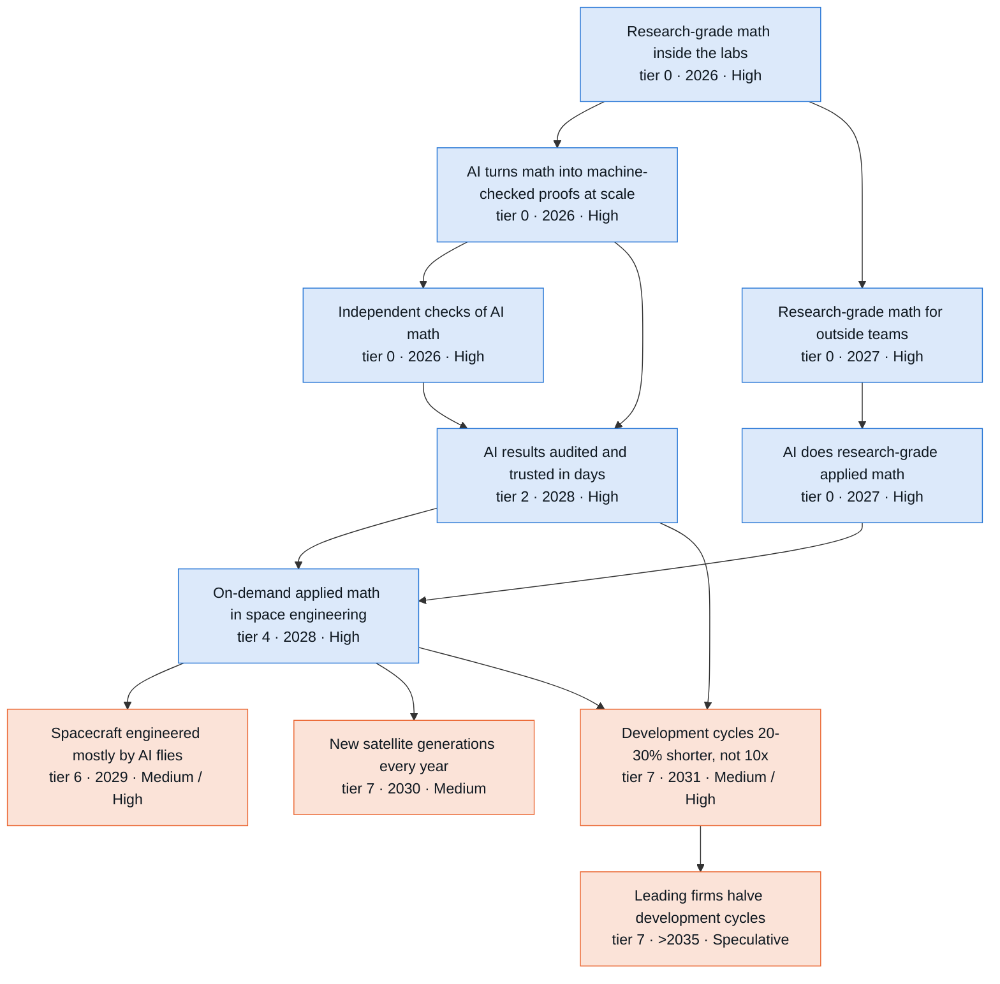

**Side lanes** (connected to the branch but off its main chain)

- Both Starship stages caught and reflown (tier 5 · 2027 · High) → Starship internal cost under $300 per kg (tier 7 · 2029 · High) → Customers buy orbit under $1,000 per kg (tier 7 · 2031 · Low / High)
- Both Starship stages caught and reflown (tier 5 · 2027 · High) → 100+ fully reusable heavy launches a year (tier 6 · 2030 · High) → Customers buy orbit under $1,000 per kg (tier 7 · 2031 · Low / High)
- Both Starship stages caught and reflown (tier 5 · 2027 · High) → 100+ fully reusable heavy launches a year (tier 6 · 2030 · High) → 300+ fully reusable heavy launches a year (tier 6 · 2033 · Speculative / Medium)
- Both Starship stages caught and reflown (tier 5 · 2027 · High) → Starship internal cost under $300 per kg (tier 7 · 2029 · High) → Starship internal cost under $100 per kg (tier 7 · 2031 · Low / High)
- On-demand applied math in space engineering (tier 4 · 2028 · High) → Spacecraft engineered mostly by AI flies (tier 6 · 2029 · Medium / High) → A launcher or large spacecraft engineered mostly by AI flies (tier 6 · 2033 · Speculative / Low)

Where the reviewers disagreed: 2031 challenge round (9 disputes)

Recorded during the 2031 challenge round. Later passes adjusted some dates and bands; the node table below has the final values.

- **How much shorter do new programs get in S2 ("Development cycles 20-30% shorter, not 10x").** *Skeptic:* The 38% is an Amdahl ceiling, not the expected result. Requirements negotiation, hardware-in-the-loop testing and review gates do not compress 5-10x, and long-lead parts run in parallel with design. Realized compression is 15-25% in S2, first visible in 2031. *Advocate:* The bound wrongly treats integration and test, procurement and reviews as wholly physical. Splitting out the analysis inside them gives 45-50% in S2 and 59-64% in S3. Uncrewed commercial programs need no certifier, so the Medium cap and the qualification gate are misapplied. S2 2029, S3 High. *Resolution:* The 38% is presented as a ceiling, and the realized S2 range is set at 20-30%, between the two views. The advocate's split mostly double-counts: the table's 1.1-1.2x physical multipliers already credit about 10 of the 60 'physical' points as compressing cognitive work. Accepted from the advocate: the binding gate becomes experiment, and design optimization becomes an accelerator. Accepted from the skeptic: S2 2031 and S3 2030, because only programs started after the 2028 adoption count. The advocate's S2 2029 and S3 High are rejected.
- **When space engineering routinely adopts on-demand math ("On-demand applied math in space engineering", S2).** *Skeptic:* S3 2027 runs ahead of S2 inside the shared pre-2028 window, so it should be 2028. Classified access is not a gate. *Advocate:* Move S2 to 2027. SpaceX owns a frontier lab and needs neither public release nor ITAR accreditation. NASA's 22% staff loss pulls toward AI substitution. *Resolution:* S2 stays 2028 and S3 moves to 2028. The node requires routine use of checked answers in design reviews. That needs the Oct-2026 capability level in outside hands (mid-to-late 2027 in S2) plus trust tooling (2028), and the S2 premise starts the 5-10x cognitive multiplier in 2028. The first-mover point is kept as text in its rationale. Because of this, the advocate's dependent proposals (AI-native spacecraft in 2028, program compression in 2029) are also rejected.
- **Month-long task horizons and applied Lean libraries in S2 ("Month-long autonomous research tasks", "Lean libraries for the math engineers use").** *Skeptic:* Both should move to S3 2028. S3 equals S2 until 2028, and the binding gate for the libraries is Mathlib review. *Advocate:* Horizon S2 2027, because METR measured about 4-month doubling in 2024-25. Libraries S2 2027, because the node accepts companion libraries and three groups built Sobolev theory in Lean in 2026. *Resolution:* S2 stays 2028 on both. A 4-month doubling is outside S2's 6-9 month parametrization, and applied Lean libraries in 2028 is the study's stated S2 premise. S3 moves to 2028 on both. The advocate's library evidence is recorded as a 2027 signpost. The advocate's S1 horizon fix (2029, High) is accepted, since the auditor reached the same result.
- **Annual satellite generations ("New satellite generations every year").** *Skeptic:* S2 2030, S3 2029, S3 band Medium. Showing an annual cadence needs two generations designed after adoption, and the link from AI math is weak. *Advocate:* S2 band High. Orbital-compute satellites with modular chip inserts can follow Nvidia's annual architecture cadence, and Bayesian test campaigns are not required. *Resolution:* The skeptic's and auditor's timing and band changes are accepted. The advocate's S2 High is rejected: chip cadence is not driven by AI math, and it depends on orbital-compute economics that are unproven ("1 GW of compute operating in orbit" is only Medium). The advocate's edge change is accepted (optimal test campaigns become a soft edge), and the chip-cadence path is recorded as an upside in its rationale.
- **Development cost cut ("AI cuts new space hardware development cost by about 10-20%").** *Skeptic:* The 15-30% headline does not follow from its own arithmetic; it is a labor-cost figure presented as total cost. Realized cut about 10-20%; S3 2029; binding gate adoption. *Advocate:* S2 band should be High. A 5-10x speedup on half of labor gives 16-27%, and standing-army costs fall with shorter schedules. *Resolution:* Retitled to about 10-20% with the full derivation (16-27% gross, minus scope growth). The standing-army channel and the advocate's soft edges are added. The S2 band stays Medium: by 2031 the evidence is mostly program estimates, and scope growth is the node's own strongest case.
- **Customer price under $1,000/kg ("Customers buy orbit under $1,000 per kg").** *Skeptic:* Competition is not a logical prerequisite. The S2 band should be Low, because Mach33's price-fade midpoint is 2033 (range 2030-36). The $900/kg Voyager figure divides by capacity, not delivered mass. *Advocate:* Competition is one route, not a gate: SpaceX's own capacity-release decision drives price. Keep the bands. *Resolution:* Both lenses agree the edge becomes soft. The S2 band moves to Low: with the 2033 midpoint, crossing by 2031 is roughly 20-30%, and S2's earliest year is 2031. The advocate's capacity-release mechanism and the counterpoint (SpaceX's own compute demand can delay the release) are added to its rationale.
- **A new reusable launcher in three years ("A new reusable launcher from start to orbit in three years").** *Skeptic:* Restrict the node to FAA-licensed programs and lower S3 Low -> Speculative. Clean-sheet multipliers still leave 3.5-10 years. *Advocate:* The node is not US-specific, so FAA licensing and AI test stands cannot be hard gates. Zhuque-3 shows a derivative-engine path. S2 should be Low by 2031. *Resolution:* Global scope and soft edges accepted from the advocate. Years and bands are unchanged: the Zhuque-3 derivative precedent (about 4 years, no AI help) times the physclock multipliers gives about 3.2-3.6 years in S2 (Speculative) and 2.8-3.2 years in S3 (Low).
- **New nodes coupling launch cost and AI (advocate's three proposals).** *Skeptic:* No new nodes are needed. Environmental caps and NSSL lane rules belong in the rationales of existing nodes. *Advocate:* Add three nodes: cheap launch buys margin instead of tests; flown fleets replace ground reliability tests; AI compute becomes Starship's second anchor customer. *Resolution:* Only the compute-demand node is added, renamed "AI compute becomes Starship's second anchor customer". Its years were moved one year later, its S3 band capped at Medium, and it is labelled as an AI-capability demand effect, not AI math. Margin-for-tests is rejected: analysis-only verification with higher factors of safety is an existing NASA-STD-5001 option independent of AI math, and it overlaps "Qualification by analysis replaces some structural tests". Fleet reliability is rejected: satellites do not demonstrate reliability through ~230 ground trials today, so there is nothing to replace, and its AI channel duplicates "Anomaly diagnosis 3-10x faster".
- **Reader hook and branch thesis.** *Skeptic:* Say 'at most about a third faster', and qualify $200 per result: failed attempts and checking are excluded, so cheapness may be overstated 10-100x. *Advocate:* Say 'about 45-50% once the analysis inside test and build is counted', and 'a third to a half faster' for commercial programs. *Resolution:* The thesis now says schedules get about a quarter to a third shorter (Amdahl ceiling about 38%, a 1.6x speedup; the auditor's correction of 'faster'), not 10x. The hook gives $200-2,000 per result and says checking sets the price. The advocate's 45-50% is rejected as double-counting.

Where the reviewers disagreed: 2035 and Embodied extension round (14 disputes)

- **300+ heavy launches a year ("300+ fully reusable heavy launches a year").** *Skeptic:* This breaks the regulatory cap. Approved Starship caps total about 145 a year, all from completed reviews, and nothing is filed for twice that. EO 14335 speeds reviews but sets no caps. The binding gate is approvals and airspace, so labeling it fabrication would wrongly invite S4 robot credit. Bands should drop to Medium in S2-S4 and Low in S1. *Advocate:* Mach33's reference tonnage passes 300 Starship flights a year around 2029-30. The Louisiana campus plans ten pads with first launches as soon as 2029. Going from 100 to 300 a year at 1.44x a year is slower than Falcon 9's ramp. So the years should be 2033/2032/2032/2032 and High in every scenario. AI moves the launch clock only by months, so the S1 two-year lag is too wide. *Resolution:* Skeptic accepted. The binding gate becomes regulatory and the 2035 band becomes L/M/M/M under the extension rules' named-mechanism rule. S2-S4 should rise to High once a launch-site review covering 300+ a year is filed. Years are kept. Mach33's reference has about 35,400 t, or 240-320 flights, in 2029 against 145 approved caps, so it ignores caps and cannot date the node. The only Louisiana filing is a reported construction permit (Sep 29 2026, unconfirmed). S1 lags because of weaker compute demand, while AI moves the clock by months.
- **Starship internal cost under $100/kg: year and heat-shield gate.** *Skeptic:* The node's own why says $100/kg needs ships flying about 10 times and that this depends on the heat shield. That is a hard gate written as a soft edge. High by 2035 must not exceed the heat shield's band. SpaceX does not report cost per kg. *Advocate:* The draft's arithmetic ($100M stack, 18 flights, $4M operations, 112 t) gives about $85/kg. Mach33's base reaches 18 flights per stack in 2030, and with a 0.85 learning rate the stack costs about $90-100M. Mach33 therefore crosses $100/kg in 2030, and the model's one-year lag gives 2031, not 2032. *Resolution:* Both accepted. Years become 2032/2031/2031/2031, and the heat shield becomes a hard prerequisite; it lands 2031/2030/2029, so no year is pushed later. the 2031 band is L/L/M/M: S2 stays Low because the heat shield is only Medium by 2031 and the chain has no slack. the 2035 band stays High in all four only while the entry branch keeps the heat shield High.
- **What 'halving development cycles' measures ("Leading firms halve development cycles").** *Skeptic:* As written, a satellite generation going from 24 to 12 months satisfies it, which duplicates "New satellite generations every year" and would reach the node in S3 2029-31. The realized ranges apply to programs run under that year's conditions. A program finished in 2033 ran on 2031-32 robots, at a realized 40-50%. The fix is to narrow the scope to vehicles and large spacecraft, with S3 2035 and S4 2034. *Advocate:* The node needs one fast program at one leading firm. Satellite generations at 0.32-0.44x for leading S4 firms in 2035 already halve. The S2 ceiling of 42-52% passes 50%. So: S2 2035 Low, S3 2033 Medium, S4 2032 High, with a soft edge from "New satellite generations every year". *Resolution:* Skeptic accepted. The advocate's case confirms the overlap, since it rests on satellite generations. Narrowing gives the node a distinct meaning: program-level halving where the space-program Amdahl applies. With S4 at 2034 against S3 at 2035, and Medium against Low, S4 credit comes from robot-first integration and test on requalified processes.
- **Start-to-orbit in three years: derivative or clean-sheet base ("A new reusable launcher from start to orbit in three years").** *Skeptic:* Applying clean-sheet multipliers to a 4-year derivative base counts the derivative shortcut twice. On the 5-13 year clean-sheet base, S3 gets 3.2 years at best, so S3 should be Low and S4 Medium. A 2033 orbit in S2 implies a 2030 start at 0.8-0.9x, which takes 3.2-3.6 years. About half of new launchers fail on their first flight. *Advocate:* The node needs one program worldwide, and China alone has more than ten commercial firms with methalox engine families. The draft's own S3 range of 2.5-2.9 years sits wholly under 3, so S3 should be High and S2 Medium. *Resolution:* Split decision. The S2 year moves from 2033 to 2035 and the timing is corrected: a program must start by 2032 and runs under 2032-35 conditions, giving 3.0-3.5 years in S2 and 2.6-3.0 in S3. The clean-sheet base is rejected because the node counts derivatives and a proportional multiplier on a shorter base does not count the shortcut twice. The advocate's raises are rejected because maiden-flight failures and pad access keep S3 at Medium. S4 keeps one band step to High: a robot-first program at 0.50-0.58x needs 2.0-2.3 years.
- **Scope of the AI-native large system.** *Skeptic:* A Starlink-class satellite at about 2 t satisfies both this node and "Spacecraft engineered mostly by AI flies". The title promises a launcher, where hot fire and flight bind. The fix is to narrow to stages, vehicles and non-constellation spacecraft over 5 t, use the qualification gate, and set >2035/2033/2032/2032 with bands S/L/M/M by 2035. *Advocate:* SpaceX builds about 70 satellites a week, owns SpaceXAI and needs no certifier, so S2 should be High like the smallsat node. The node should also get robot soft edges. *Resolution:* Skeptic accepted. The advocate's S2 High rested on a SpaceX satellite generation, which the narrowed scope excludes. The robot soft edges are kept as mechanism with no S4 credit, because hot fire, flight tests and disclosure bind.
- **Data-cleared reflight by 2035 ("Reflight cleared by data, not teardown").** *Skeptic:* Keep Medium on the node's own merits. A life database grows one flight at a time, Falcon 9 took 8 years to reach a 9-day turnaround with inspection, customers and insurers accept slowly, and robot inspection supplies data, not flight history. *Advocate:* The draft held Medium only because the heat shield was Medium, and the entry draft now makes it High. "Probabilistic engine life prediction for reuse" is High in all four scenarios, and Mach33 has about 20-day stack cycles from 2030. So High in all four. *Resolution:* S2-S4 rise to High, on condition that the entry branch keeps the heat shield High by 2035. The node covers SpaceX's own flights, so customer and insurer acceptance belongs to "Crew and defense payloads fly on data-cleared reused rockets", which stays Medium. After 2030 the fleet record grows by hundreds of flights a year. S1 stays Medium because its life models lag. S4 equals S3.
- **Customer price under $1,000/kg by 2035.** *Skeptic:* (Not raised.) The draft capped every scenario at Medium because Mach33's median 2035 customer revenue is $945/kg. *Advocate:* $945 is an average over all customer classes, including contract prices and government premiums (21% of 2040 revenue on 2% of tonnes). The node is the dedicated or spot price. Mach33's reference spot is $820/kg in 2031 and $562 in 2033, and the opening year is varied 2029-33. The advocate also proposed raising S2 by 2031 to Medium. *Resolution:* Accepted for 2035: S2-S4 become High and S1 stays Medium. Rejected for 2031: a crossing by then needs Starship open to customers by 2031, the opening assumption runs to 2033, and Mach33's earlier fade midpoint is 2033. The node still rests on one commercial forecaster's model.
- **Crew and NSSL payloads on data-cleared reused rockets by 2035.** *Skeptic:* (Not raised.) *Advocate:* Raise S2-S4 to High. The certification draft's High for the credibility standard (NASA-STD-7009 revision, CM4QC) supplies a named mechanism. Falcon precedents (Crew-2, GPS III SV05) show acceptance about four years after first reflight. *Resolution:* Rejected. The named mechanisms cover model credibility in general, not reflight clearance resting on data for crew or NSSL Lane 2. The node is stricter than the Falcon precedent. The certification final has since set the credibility standard to Medium by 2035, so the advocate's precondition failed. Medium stays as the certifier cap.
- **Whether S2 turns recursive by 2035 ("AI speeds up its own development 3x").** *Skeptic:* The node is the hinge between S2 and S3. High in S2 by 2035 would make S2 recursive inside the horizon, which contradicts S2's 6-9 month doubling. S1 maps to S2's 2029-30 level by 2035, and S2's year is 2030, so S1 should be 2035. *Advocate:* (Not raised.) *Resolution:* Accepted. S2 is Medium by 2035, S1 moves to 2035, and S1's 2031 band becomes Speculative to match. This keeps the scenario definitions coherent: S3 is the recursive case.
- **Validated AI physics theory in the base case by 2035 ("AI builds validated physics theory").** *Skeptic:* The S1 2032 hold protected nothing, because all 19 hard dependents sit at S1 2033-2035 in the full graph. S1 reaches the S2 2029 cognitive level about 2033, so S1 should be 2033. *Advocate:* S2 has six years past its 2029 date, closed-loop labs from 2028 and cheap cognition by 2033-35. That is two or three blind-validation cycles, so S2 should be High. *Resolution:* Both accepted. S1 moves to 2033, which causes no autofix in the full graph, and S2 becomes High by 2035. The node needs one domain where AI-derived theory beats the human state of the art on held-out data, and the base case already dates physics theory to 2029.
- **Annual satellite generations in the base case ("New satellite generations every year").** *Skeptic:* S2 gates in 2035 (1.2-1.4x) are no better than S3 gates in 2031, where an annual cadence was held at Medium. The draft leaned on chip-swap compute buses, which the F2 audit classed as upside. *Advocate:* (Used the node's High as support for broadening "Leading firms halve development cycles".) *Resolution:* Skeptic accepted: S2 is Medium by 2035 and S3 and S4 are High. This keeps a spread between the base case and the recursive case.
- **Where S4 launch and cost credit should live (proposed 1,000-flight and one-third-cost nodes).** *Skeptic:* The S4 pad credit belongs to "Robot crews build a launch pad or propellant plant". Cadence nodes are bound by approvals, airspace and environmental caps, which robots do not compress. *Advocate:* s4-embodied lists pads and propellant plants for S4 credit (0.50-0.57x at a leading site by 2035), but the trunk carries it nowhere. The advocate proposed a 1,000-flight node with S4 2034 Medium and a node for AI and robots cutting development cost by a third (S4 2033 Medium), and noted that two robot soft edges point at nodes reached years before the robots exist. *Resolution:* Both new nodes are rejected. The 1,000-flight node is bound by approvals and airspace, so it fails S4 condition 1, and its fabrication label repeats the "300+ fully reusable heavy launches a year" error. The pad credit stays with "Robot crews build a launch pad or propellant plant". For the one-third cost cut, netting robot capital puts it above S3's realized range and at the top of S4 robot-first estimates. Development cost is rarely disclosed, and the node would double-count the robot labor channel already in "Leading firms halve development cycles"; the channel is recorded in "AI cuts new space hardware development cost by about 10-20%"'s note instead. The two dead robot soft edges are removed and flagged to the robots branch.
- **Base-case 20-30% schedule cut in S1 ("Development cycles 20-30% shorter, not 10x").** *Skeptic:* S1's realized cut is 10-15% under 2031 conditions, and its ceiling under 2032-34 conditions is about 28-32%. S1 reaches S2's 2028 adoption-level cognition only around 2033-34, so a 20% cut with an attributable analysis first becomes credible in 2035. *Advocate:* (Not raised.) *Resolution:* Accepted. S1 moves to 2035, Low by 2035 and Speculative by 2031.
- **Trunk thesis.** *Skeptic:* 'Robot-first firms reach 50-58% by 2035' describes programs run entirely under 2035 conditions. Programs finished by 2035 ran on 2032-34 robots. The thesis should say robot-first firms approach half on programs started after 2032. *Advocate:* The thesis should also carry the launch clock: under $100/kg internal by 2031, 300+ heavy flights a year by 2032, and robots raising throughput more than they cut latency. *Resolution:* The skeptic's timing fix is accepted, and '30-40% by 2035' becomes 'about a third by 2035' for programs finished by then. The launch clause is rejected to keep the thesis on the AI-math chain and near other branches' length (55 words). The launch side chains carry that story, and "300+ fully reusable heavy launches a year" is now Medium, not a dated 2032 event.

All nodes in this branch

Years and likelihoods are listed for Plateau / Exponential / Recursive / Embodied. H = High, M = Medium, L = Low, S = Speculative.

| Node | Tier | Year | By 2031 | By 2035 | Binding gate | Pathway |
| --- | --- | --- | --- | --- | --- | --- |
| AI turns math into machine-checked proofs at scale | 0 | 2026 / 2026 / 2026 / 2026 | H / H / H / H | H / H / H / H | formalization | P2 |
| Research-grade math inside the labs | 0 | 2026 / 2026 / 2026 / 2026 | H / H / H / H | H / H / H / H | cognitive | P1 |
| Independent checks of AI math | 0 | 2026 / 2026 / 2026 / 2026 | H / H / H / H | H / H / H / H | adoption | P2 |
| AI does research-grade applied math | 0 | 2029 / 2027 / 2027 / 2027 | M / H / H / H | H / H / H / H | cognitive | P1 |
| Research-grade math for outside teams | 0 | 2028 / 2027 / 2027 / 2027 | H / H / H / H | H / H / H / H | regulatory | P1 |
| A research result costs less than an engineer-day | 0 | 2028 / 2027 / 2027 / 2027 | H / H / H / H | H / H / H / H | capital | P1 |
| Published error rate for openai/math results | 0 | 2027 / 2027 / 2027 / 2027 | H / H / H / H | H / H / H / H | adoption | P2/P3 (verification of the premise base, not certified use) |
| Frontier math on export-controlled and classified networks | 0 | 2029 / 2028 / 2028 / 2028 | M / H / H / H | H / H / H / H | adoption | P1 |
| AI-run closed-loop labs at scale | 0 | 2029 / 2028 / 2028 / 2028 | M / H / H / H | H / H / H / H | capital | P1->P7 |
| AI multiphysics design with guarantees | 0 | 2030 / 2028 / 2028 / 2028 | M / H / H / H | H / H / H / H | data | P1->P6 |
| Month-long autonomous research tasks | 0 | 2029 / 2028 / 2028 / 2028 | H / H / H / H | H / H / H / H | cognitive | P1 |
| Open-weight model at research-math level | 0 | 2029 / 2028 / 2028 / 2028 | M / H / H / H | H / H / H / H | cognitive | P1 |
| Lean libraries for the math engineers use | 0 | 2030 / 2028 / 2028 / 2028 | M / H / H / H | H / H / H / H | formalization | P2 |
| Verified floating-point and numerics toolchain | 0 | 2029 / 2028 / 2028 / 2028 | M / H / H / H | H / H / H / H | formalization | P2 |
| AI builds validated physics theory | 0 | 2033 / 2029 / 2029 / 2029 | S / M / M / M | M / H / H / H | data | P6 |
| AI speeds up its own development 3x | 0 | 2035 / 2030 / 2028 / 2028 | S / M / H / H | L / M / H / H | capital | P1 |
| AI-discovered algorithms in space codes | 2 | 2028 / 2027 / 2027 / 2027 | H / H / H / H | H / H / H / H | adoption | P1 (public AlphaEvolve-style search on teams' own evaluators; catalog families 102, 117 and 125 act via P3) |
| AI results audited and trusted in days | 2 | 2029 / 2028 / 2028 / 2028 | M / H / H / H | H / H / H / H | adoption | P2 |
| AI emulators of space physics codes with stated error bounds | 2 | 2029 / 2028 / 2028 / 2028 | M / H / H / H | H / H / H / H | data | P4 |
| On-demand applied math in space engineering | 4 | 2029 / 2028 / 2028 / 2028 | M / H / H / H | H / H / H / H | adoption | P1 |
| Both Starship stages caught and reflown | 5 | 2027 / 2027 / 2027 / 2027 | H / H / H / H | H / H / H / H | experiment | P7 (exogenous) |
| Monthly flight testing of a fully reusable heavy launcher | 5 | 2028 / 2028 / 2028 / 2028 | H / H / H / H | H / H / H / H | fabrication | P7 (exogenous) |
| Reflight cleared by data, not teardown | 5 | 2031 / 2030 / 2029 / 2029 | L / M / M / M | M / H / H / H | data | P1->P6 |
| Pads and propellant plants for hundreds of heavy flights | 6 | 2029 / 2029 / 2029 / 2029 | H / H / H / H | H / H / H / H | fabrication | P7 (exogenous) |
| Spacecraft engineered mostly by AI flies | 6 | 2031 / 2029 / 2029 / 2029 | L / M / H / H | M / H / H / H | fabrication | P1->P7 |
| 100+ fully reusable heavy launches a year | 6 | 2030 / 2030 / 2029 / 2029 | M / H / H / H | H / H / H / H | fabrication | P7 (exogenous) |
| A second reusable heavy-lift fleet at scale | 6 | 2030 / 2030 / 2029 / 2029 | M / M / M / M | H / H / H / H | fabrication | P7 (exogenous) |
| Outside customers can book launch again after the rideshare closure | 6 | 2030 / 2030 / 2029 / 2029 | L / M / M / M | H / H / H / H | adoption | P7 (exogenous; AI math enters only through competitors' engineering) |
| Crew and defense payloads fly on data-cleared reused rockets | 6 | 2033 / 2031 / 2030 / 2030 | S / L / M / M | L / M / M / M | qualification | P2->P7 |
| 300+ fully reusable heavy launches a year | 6 | 2034 / 2033 / 2032 / 2032 | S / S / S / S | L / M / M / M | regulatory | P7 (exogenous) |
| A launcher or large spacecraft engineered mostly by AI flies | 6 | >2035 / 2033 / 2032 / 2032 | S / S / S / S | S / L / M / M | qualification | P1->P7 |
| Starship internal cost under $300 per kg | 7 | 2029 / 2029 / 2029 / 2029 | H / H / H / H | H / H / H / H | launch-internal | P7 (exogenous) |
| AI cuts new space hardware development cost by about 10-20% | 7 | 2031 / 2029 / 2029 / 2029 | L / M / H / H | M / H / H / H | adoption | P1 |
| New satellite generations every year | 7 | 2031 / 2030 / 2029 / 2029 | L / M / M / M | M / M / H / H | fabrication | P1->P7 |
| AI compute becomes Starship's second anchor customer | 7 | 2031 / 2030 / 2029 / 2029 | L / M / M / M | M / H / H / H | capital | P7 (exogenous) |
| Development cycles 20-30% shorter, not 10x | 7 | 2035 / 2031 / 2030 / 2030 | S / M / M / M | L / H / H / H | experiment | P1->P7 |
| Customers buy orbit under $1,000 per kg | 7 | 2032 / 2031 / 2030 / 2030 | S / L / M / M | M / H / H / H | adoption | P7 (exogenous price; AI enters only through competitors' engineering) |
| Starship internal cost under $100 per kg | 7 | 2032 / 2031 / 2031 / 2031 | S / L / M / M | H / H / H / H | launch-internal | P7 (exogenous) |
| A new reusable launcher from start to orbit in three years | 7 | >2035 / 2035 / 2031 / 2031 | S / S / L / L | S / L / M / H | qualification | P1->P7 |
| Leading firms halve development cycles | 7 | >2035 / >2035 / 2035 / 2034 | S / S / S / S | S / S / L / M | experiment | P1->P7 |

### Robots: the exponential gets hands

*Embodied premise: Recursive-grade AI makes dexterity mostly software about 2028. The fleet passes 1 million in late 2029 and 10 million in late 2032. Robots build flight hardware at leading firms about 2030 (Medium by 2031), suppliers about 2033. Elsewhere Embodied changes little before 2032: physics, launch and paperwork bind.*

On-demand AI mathematics is a second-order input for robots. *Proven safety envelopes for robots working beside people* come about 2029 in the Exponential (base) case (Medium by 2031, High by 2035), since code inspection cannot certify learned controllers. *Contact simulation good enough to train robot hands* follows about 2031 (Medium by 2031, High by 2035). We judge it worth about 1.1-1.5x on robot timelines. Robot skill comes from frontier AI. In September 2026 [Figure's Helix 2.5](https://www.figure.ai/news/helix-2-5-zero-shot-30-home-generalization) completed 56% of full tasks in 30 unseen homes, against 9% for the same policy trained from scratch.

Exponential uses the slow robot path. *Robot AI models that work on sites they have never seen* arrive about 2030 (High by 2031). Multi-task factory work, 1,000 hours between interventions and a million robots land about 2031 (Medium by 2031). No maker publishes intervention rates, [Agility](https://www.sec.gov/Archives/edgar/data/0002074973/000121390026100159/ea0305579-425_churchill.htm) included. Robot assembly of flight hardware waits on requalification (an estimated 6-24 months per process) until about 2032 (Low by 2031). Embodied runs two years earlier, with a million robots in late 2029 (High by 2031). Plateau lags a year or two. Elsewhere in the tree, Embodied moves nothing before 2032.

Exponential reaches around-the-clock robot integration and test about 2033 (Medium by 2035) and 4.6 million robots by 2035. Embodied passes ten million robots in late 2032 (High by 2035) and reaches about 62 million by 2035 on its base path. Robots then make robot parts and do construction trades about 2032 (High by 2035) and reach aerospace suppliers about 2033 (Medium by 2035). Outpost-scale lunar pads and roads follow about 2033 (Medium by 2035), two years ahead of Recursive, given 10 cargo landings a year. A robot-built launch pad comes about 2035 (Low by 2035), too late to move launch dates.

The openai/math catalog contributes little; no robot node rests on a catalog family. Safety envelopes use neural-network verification limits (family 102, T3) and control guarantees (families 104 and 139, T3; part of 104 is T1 and conditional). None supplies the friction data contact models need.

The strongest case for a small effect is that launch binds where automation already works. In 2019 Rocket Lab's Rosie robot cut one Electron's composite work from over 400 hours to 12, yet launches rose only 3.5x by 2025. The skeptic won on hardware. Fleet size does not shorten 12-30 month hardware generations, so 1,000-hour fleets and contact simulation slipped a year in Embodied, and a quarter of aerospace labor slipped past 2035. The advocate won a 2029 requalification route and two new nodes, and lost its fast-path dates because the base path defines Embodied. Watch 2027 humanoid shipments; about 90,000, 140,000 or 240,000 would point to the slow, base or fast path.

23 nodes. Rated High or Medium by 2031: Plateau 2, Exponential 7, Recursive 7, Embodied 12. By 2035: Plateau 8, Exponential 12, Recursive 12, Embodied 18. Main binding gate: data (field reliability hours) through 2030; qualification (robot-made flight hardware) for space work.

**Main chain** (each node: tier · earliest year in the Exponential case · likelihood by 2031 / by 2035; Recursive and Embodied years shown where they differ)

- **Robot AI models that work on sites they have never seen** (tier 0 · 2030 · High; Recursive 2029; Embodied 2028; gate: data, then cognitive)
  - → **Robot fleets run 1,000 hours between interventions** (tier 5 · 2031 · Medium / High; Embodied 2030; gate: data, then fabrication)
    - → **Robots run integration and test around the clock** (tier 6 · 2033 · Low / Medium; Embodied 2031; gate: qualification, then data)
  - → **General-purpose robots do multi-task factory work at scale** (tier 5 · 2031 · Medium / High; Embodied 2029; gate: adoption, then fabrication)
    - → **Robots assemble flight hardware at leading space firms** (tier 6 · 2032 · Low / Medium; Embodied 2030; gate: qualification, then data)
      - → **Robots run integration and test around the clock** (tier 6 · 2033 · Low / Medium; Embodied 2031; gate: qualification, then data) (see above)
      - → **Robots supply a quarter of aerospace production labor** (tier 7 · >2035 · Speculative; gate: adoption, then qualification)
- **An accepted route to requalify robot-made flight hardware** (tier 4 · 2032 · Low / Medium; Embodied 2029; gate: qualification, then adoption)
  - → **Robots assemble flight hardware at leading space firms** (tier 6 · 2032 · Low / Medium; Embodied 2030; gate: qualification, then data) (see above)
- **One million general-purpose robots in service** (tier 6 · 2031 · Medium / High; Embodied 2029; gate: fabrication, then adoption)
  - → **Ten million general-purpose robots in service** (tier 7 · >2035 · Speculative / Low; Embodied 2032; gate: capital, then fabrication)
    - → **Robots supply a quarter of aerospace production labor** (tier 7 · >2035 · Speculative; gate: adoption, then qualification) (see above)

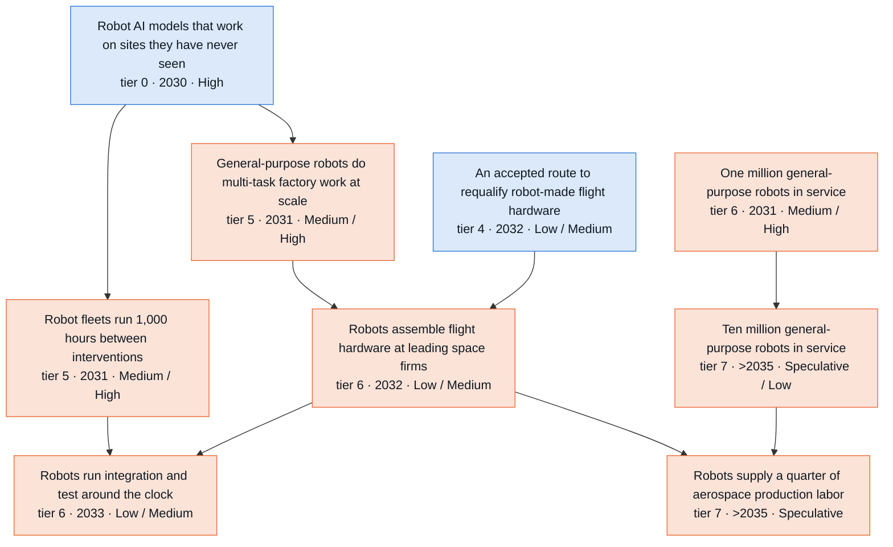

**Side lanes** (connected to the branch but off its main chain)

- Contact simulation good enough to train robot hands (tier 3 · 2031 · Medium / High)
- Proven safety envelopes for robots working beside people (tier 2 · 2029 · Medium / High) → Humanoid safety standard ISO 25785-1 published (tier 0 · 2028 · High)
- Precision actuators for 1 million robots a year (tier 5 · 2033 · Low / High)
- Robots do general lab bench work at scale (tier 6 · >2035 · Speculative / Low)
- Robots inspect and refurbish rockets between flights (tier 6 · 2031 · Low / Medium)
- Robots do flight-hardware work across the supplier base (tier 6 · 2035 · Speculative / Low)
- Robots work in the plants that make robot parts (tier 6 · 2035 · Speculative / Low) → Robots work in the plants that make heavy equipment (tier 7 · >2035 · Speculative)
- Robots supply 10% of global manufacturing labor (tier 7 · >2035 · Speculative)
- General-purpose robots do construction trade work at scale (tier 6 · 2035 · Speculative / Low) → Robot crews build a launch pad or propellant plant (tier 6 · >2035 · Speculative)
- Robots build lunar pads, berms and roads at outpost scale (tier 6 · >2035 · Speculative)
- Robots assemble large structures in orbit at scale (tier 6 · >2035 · Speculative)

Where the reviewers disagreed: 2035 and Embodied extension round (10 disputes)

- **Outpost-scale lunar construction: S4 timing, band and threshold ("Robots build lunar pads, berms and roads at outpost scale").** *Skeptic:* S4 gets two years plus a band step on a launch-bound node, against the extension rules' credit of 0.5-1.5 years. The labor share is 0%, its 0.4-0.6x credit holds only with 10+ cargo landings a year, and hardware lands frozen. Move S4 to 2034 Low. Also, 1,000 m2 is smaller than one heavy-lander pad, so make the first robot-built pad a hard prerequisite and raise the threshold. *Advocate:* Moon-mars dates real robot construction from 2032 and gives S4 High to the robot-built pad and to lunar oxygen. The work content is small, so landed mass and power bind, and those are High by 2035. Move S4 to 2032 High and S3 to 2034 Medium. *Resolution:* Threshold raised to two heavy-lander pads plus berms and roads (about 10,000 m2), and the hard edge from "First robot-built landing pad or blast berm on the Moon" added (skeptic). Years and bands kept at S4 2033 Medium and S3 2035 Low. On Earth-labor terms the skeptic's condition-1 objection holds, but on the Moon robots are the product: capability per landed kilogram is the throughput, and the S4 analysis gives 0.4-0.6x of S3's calendar if cargo reaches 10+ landings a year. The advocate's arithmetic, recomputed for the new threshold, shows power sets the pace. Grading takes about 150 days for 20 robots. Sintering two 50 m pads takes about 280 MWh: 4 months at 100 kW, or 1.5-2 years on 40 kW of daytime solar. That rules out 2032 High.
- **Robots at a quarter of aerospace production labor ("Robots supply a quarter of aerospace production labor").** *Skeptic:* The base path gives 24.92% in 2035 on supply alone (fleet x 0.5% allocation x 1.6 FTE per robot). Suppliers start only after 2031, at 6-24 months per process each, and most of the ~2M workforce builds commercial aircraft under FAA and EASA approvals. Move S4 to >2035 Low. *Advocate:* A year is the first credible year. The fast path crosses 25% about 2033, so S4 should be 2033 and keep Medium. Add a supplier-tier node as a hard prerequisite. *Resolution:* Skeptic on year and band: S4 >2035, Low. The supply-only figure is an upper bound, because requalification also slows how many robots aerospace takes up. The fast path (20% of S4's weight) carries the Low band. The advocate's supplier-tier node was added as a hard prerequisite: S4 2033, Medium by 2035. It makes the extension rules' rule that suppliers come after 2031 visible.
- **First credible year or base-path year for robot count and share nodes ("Ten million general-purpose robots in service", "Robots supply 10% of global manufacturing labor", construction trades).** *Skeptic:* Not raised directly. The skeptic's general position is that S4 is already generous in 2029-33. *Advocate:* The model says a year is the first credible year and the band carries the expectation. The fast path is 20% of S4, so "Ten million general-purpose robots in service" should be 2031 and "Robots supply 10% of global manufacturing labor" 2034 Medium (about 0.39 chance by 2035). Construction trades should be 2031, since the base path puts 0.25M robots in construction that year. *Resolution:* Rejected. the extension rules defines S4 by the base path and treats the fast path as upside, so years follow the base path and the bands carry the fast path ("Ten million general-purpose robots in service" stays 2032, Low by 2031). For "Robots supply 10% of global manufacturing labor", the fast path already is the upper tail. Adding a 35% within-base chance double-counts it, and about 30% is the fair estimate, so >2035 Low stays. The 2031 construction robots are mostly earthwork and handling, and trade work by 100,000 robots needs about a year after it becomes useful, so 2032 stays.
- **Order of the aerospace gates: requalification route, tolerance work and the 24/7 line.** *Skeptic:* Tolerance work (2030) shares a year with its hard prerequisite, the requalification route (2030). Move it to 2031 and the 24/7 line to 2032. The 24/7 description counts S3's 1.5x as a robot gain; the robots' own increment is about 1.17x in 2031. *Advocate:* The route's earliest date is 2029-30, and the extension rules dates inspection and handling to 2029. One robot on one task in 2028 can complete a 6-12 month requalification in 2029, so date the route 2029. *Resolution:* Route to 2029 (advocate). That clears the shared year without delaying tolerance work, which stays at 2030, the early end of the extension rules' 2030-31. The 24/7 line stays at 2031, leaving a year for the rest of the line to be requalified in parallel. The skeptic's description fix was accepted: at least 1.15x over the same firm's crewed line. The skeptic's proposed hard edge from factory usefulness to the route was rejected. Requalifying one process at one site does not need 100,000 robots in multi-task work, so the link stays soft.
- **Robotic assembly in orbit ("Robots assemble large structures in orbit at scale").** *Skeptic:* Robots built for Earth do not work in orbit unchanged: vacuum lubrication, thermal cycling, radiation-tolerant compute. S3 already has the certified skills and the 2030 demo. Repeated operation needs design about 2031, qualification, a first flight in 2033 and a repeat in 2034. Move S4 to 2034. *Advocate:* Neighbors give S4 a step: the flight demo is High and the km-scale monolith is S4 2033. Orbital compute and MRV show demand. Move S4 to 2032 Medium. *Resolution:* Kept at S4 2033 and S3 2035, both Low. The chain now states that one assembler doing several contracted jobs counts as repeated. It also shows a design built alongside the demo and 6-18 months of mechanism qualification, so 2033 survives the skeptic's own timeline. Medium was rejected: deployables, Starship's 9 m fairing, SpaceX's many-satellite approach and OSAM-1's cost keep demand uncertain. The 2-year S4 lead stands because the S4 analysis credits robotic assembly in space by 2035.
- **Soft edges that point back in time.** *Skeptic:* 17 of 36 edges run from a robot node dated after its target. They cannot move the target, they invite later S4 credit claims, and they should be removed and retargeted forward. *Advocate:* 31 of 36 point backward or to the same year (64 of 101 after integration). Remove five no-op edges and add forward edges to the 2032-35 payoffs. Apply the robots file first, or 47 robot edges from other branches are dropped silently. *Resolution:* 19 draft edges were removed where the target gets no S4 credit. Same-year edges were kept where the S4 analysis names a within-year gain. A soft edge may carry band credit for 2035 as well as year credit, so a backward edge stays legitimate only when the target's S4 band rises for a reason the robot node supplies. Forward edges to other branches' new nodes went into an edit file, applied last, and the robots file goes first. Two proposed edges were rejected for weak mechanism or backward timing: in-space assembly -> beyond-dawn-dusk compute and earth pads -> 10 GW compute.
- **Robot-built Earth launch pads and propellant plants ("Robot crews build a launch pad or propellant plant").** *Skeptic:* 'About half the 2026 calendar' is the S4 analysis's 2035 leading-firm value (0.50-0.57x); 2033 interpolates to about 0.63-0.71x. Construction-trade robots arrive in 2032, so a robot-built pad finishes 2034-35. Move to 2035 Low. *Advocate:* Not contested. The advocate agreed that earth pads should not move earlier. *Resolution:* Accepted: S4 2035, Low. Calendar time now runs from groundbreaking, with long-lead equipment and permits before it. The node arrives too late to move any launch node, which fits the extension rules' cap of about 1.4x on launch campaigns.
- **Does a larger fleet speed reliability and contact transfer? ("Robot fleets run 1,000 hours between interventions", "Contact simulation good enough to train robot hands", foundation models).** *Skeptic:* Twice the field data is worth 2-4 months when data grows 10-100x a year. 2,300 failure-free hours is trivial for any fleet. Wear-out fixes wait on 12-30 month hardware generations, which fleet size does not shorten. Move MTBI to 2030 and contact simulation to 2029, both Medium by 2031. Rewrite the foundation-model cause as the S4 premise. *Advocate:* Not contested. *Resolution:* Accepted in full. The S4 lead on these nodes is now about a year and rests on the scenario premise, not on fleet hours. The foundation-model node keeps its years (S4 2028 is the premise).
- **Thresholds at the base of the ramp: factory usefulness, actuators, lab bench.** *Skeptic:* 100,000 robots at 80% of human output in 2029 sits above the S4 analysis's own 0.85 productivity for robot-first firms in 2031, and maker targets miss by about 10x. Actuator High by 2031 rests on reducers alone: no roller-screw capacity is sourced, and magnets do not bind at 1M a year. The slow path gives about 46,000 lab robots in 2035, below the node's own 50,000. *Advocate:* Not contested. *Resolution:* Accepted. The factory bar is now 50% of human output per hour, the 1.5-worker payback case, and stays dated 2029. Actuators were renamed, dropped to Medium by 2031 in S4, and gained a roller-screw signpost; magnets moved to the 2035 note, where they bind (26-118 kt). Lab bench S2/S3 moved to >2035 Low. The skeptic's proposal to move the safety standard to 2029 was rejected, since years are first credible years. Its slip evidence and a DIS-ballot signpost were added instead.
- **New nodes for the 2032-35 rungs (supplier tier, capital-goods loop) and the pad-turnaround lever.** *Skeptic:* Not reviewed. The skeptic's labor-quarter finding names supplier adoption as the binding step. *Advocate:* Add a supplier-tier node (S4 2033 Medium) and a capital-goods loop node (S4 2034 Low). Together they show where the 'robots speed every physical domain' thesis meets transformer and equipment queues. Extend launch refurbishment to pad turnaround, the main S4 lever at about one flight a day. *Resolution:* Both nodes added. The capital-goods loop is dated S4 2035, Low, because the S4 analysis places that rung in the mid-2030s. The pad-turnaround mechanism went into the refurbishment node's why and 2035 note, with forward edges to 300+ flights a year and to internal cost under $100/kg. The node's threshold stays on vehicles, because outdoor pad work arrives with construction-trade robots after 2031.

All nodes in this branch

Years and likelihoods are listed for Plateau / Exponential / Recursive / Embodied. H = High, M = Medium, L = Low, S = Speculative.

| Node | Tier | Year | By 2031 | By 2035 | Binding gate | Pathway |
| --- | --- | --- | --- | --- | --- | --- |
| Humanoid safety standard ISO 25785-1 published | 0 | 2028 / 2028 / 2028 / 2028 | H / H / H / H | H / H / H / H | regulatory | P7 (exogenous) |
| Robot AI models that work on sites they have never seen | 0 | 2031 / 2030 / 2029 / 2028 | M / H / H / H | H / H / H / H | data | P7 (exogenous) |
| Proven safety envelopes for robots working beside people | 2 | 2030 / 2029 / 2028 / 2028 | L / M / M / M | M / H / H / H | adoption | P2 |
| Contact simulation good enough to train robot hands | 3 | 2033 / 2031 / 2030 / 2029 | L / M / M / M | M / H / H / H | data | P1->P6 |
| An accepted route to requalify robot-made flight hardware | 4 | 2034 / 2032 / 2032 / 2029 | S / L / L / M | L / M / M / H | qualification | P7 (exogenous) |
| Robot fleets run 1,000 hours between interventions | 5 | 2032 / 2031 / 2031 / 2030 | L / M / M / M | M / H / H / H | data | P7 (exogenous) |
| General-purpose robots do multi-task factory work at scale | 5 | 2032 / 2031 / 2031 / 2029 | L / M / M / H | M / H / H / H | adoption | P7 (exogenous) |
| Precision actuators for 1 million robots a year | 5 | 2034 / 2033 / 2033 / 2029 | S / L / L / M | M / H / H / H | fabrication | P7 (exogenous) |
| One million general-purpose robots in service | 6 | 2032 / 2031 / 2031 / 2029 | L / M / M / H | H / H / H / H | fabrication | P7 (exogenous) |
| Robots inspect and refurbish rockets between flights | 6 | 2033 / 2031 / 2031 / 2029 | S / L / L / M | L / M / M / H | adoption | P7 (exogenous) |
| Robots assemble flight hardware at leading space firms | 6 | 2034 / 2032 / 2032 / 2030 | S / L / L / M | L / M / M / H | qualification | P7 (exogenous) |
| Robots run integration and test around the clock | 6 | 2035 / 2033 / 2033 / 2031 | S / L / L / L | L / M / M / H | qualification | P7 (exogenous) |
| Robots work in the plants that make robot parts | 6 | >2035 / 2035 / 2035 / 2032 | S / S / S / L | S / L / L / H | fabrication | P7 (exogenous) |
| General-purpose robots do construction trade work at scale | 6 | >2035 / 2035 / 2035 / 2032 | S / S / S / L | S / L / L / H | adoption | P7 (exogenous) |
| Robots do flight-hardware work across the supplier base | 6 | >2035 / 2035 / 2035 / 2033 | S / S / S / S | S / L / L / M | qualification | P7 (exogenous) |
| Robots do general lab bench work at scale | 6 | >2035 / >2035 / >2035 / 2030 | S / S / S / M | S / L / L / H | adoption | P7 (exogenous) |
| Robot crews build a launch pad or propellant plant | 6 | >2035 / >2035 / >2035 / 2035 | S / S / S / S | S / S / S / L | capital | P7 (exogenous) |
| Robots build lunar pads, berms and roads at outpost scale | 6 | >2035 / >2035 / 2035 / 2033 | S / S / S / S | S / S / L / M | launch-internal | P7 (exogenous) |
| Robots assemble large structures in orbit at scale | 6 | >2035 / >2035 / 2035 / 2033 | S / S / S / S | S / S / L / L | launch-external | P7 (exogenous) |
| Ten million general-purpose robots in service | 7 | >2035 / >2035 / >2035 / 2032 | S / S / S / L | S / L / L / H | capital | P7 (exogenous) |
| Robots supply 10% of global manufacturing labor | 7 | >2035 / >2035 / >2035 / >2035 | S / S / S / S | S / S / S / L | capital | P7 (exogenous) |
| Robots supply a quarter of aerospace production labor | 7 | >2035 / >2035 / >2035 / >2035 | S / S / S / S | S / S / S / L | adoption | P7 (exogenous) |
| Robots work in the plants that make heavy equipment | 7 | >2035 / >2035 / >2035 / 2035 | S / S / S / S | S / S / S / L | fabrication | P7 (exogenous) |

### The famous problems

*If AI settles famous fluid problems, almost no engine, heat shield or orbit changes. Engineers get proof tools and on-demand error bars from about 2028 (central scenario). Math stops limiting leading programs about 2029, suppliers about 2032. Certifiers audit AI analysis instead of redoing it about 2033. Embodied adds nothing.*

On-demand AI mathematics first serves work that waits on scarce experts, such as a stability certificate for a controller, guaranteed error bars on a thermal simulation or a certified bound on a 1-in-10,000 collision probability. These problems are mostly easier than the catalog's, so stating them is the hard step. An agent workflow formalized a plasma result in 10 days for about $200, and two of its three failure modes were statement errors ([Ilin, 2026](https://arxiv.org/abs/2603.15929)).

The chain has no hardware step. In the Exponential case, our central scenario, optimal control with proven guarantees, certified rare-event probabilities and guaranteed error bars for smooth-regime simulations arrive about 2028, High by 2031. Math expertise stops limiting space programs about 2029, Medium by 2031 and High by 2035; Plateau delays that to about 2033. By analyst judgment it saves 8-14% of engineering hours, or 2-7% of program cost. An AI answer on unforced Navier–Stokes passes outside checks about 2029, Medium by 2031 and High by 2035.

In the Exponential case certified math reaches the supplier base about 2032 (Medium by 2035), and a certifier audits AI analysis instead of redoing it about 2033, first for an uncrewed vehicle (Low by 2035). Clay recognizes an AI answer to unforced Navier–Stokes about 2033 (Low by 2035) on an institutional clock. A second Millennium problem settled by AI is the clearest test of Recursive against Exponential, Medium against Low by 2035 (analyst judgment). Embodied equals Recursive on every node, because robots do no mathematics and each node waits on cognition, adoption or institutions. The one link runs outward, from reachability math to proven safety envelopes for robots working beside people.

The [openai/math](https://github.com/openai/math) catalog contributes little. Of its 372 families, 16 concern partial differential equations and 12 dynamics. Families 104 (T3; T1 for stochastic games, conditional) and 139 (T3) touch control; 139, 140, 360 (T3) and 374 (T1, conditional) set rare-event ceilings; 179 and 076 (T3) address two radar-code questions and change no waveform. The forced [Navier–Stokes claim](https://openai.com/index/navier-stokes-solution/) (T3) sits outside the catalog. Nodes resting on T1 families stay Medium through 2035.

Settling Navier–Stokes would change no CFD code, since codes already regularize. Model-form and input uncertainty usually outweigh discretization error, and 0.99 reliability at 90% confidence still needs about 230 failure-free tests without a validated model. Reviewers kept one soft link, from Euler proof machinery to error bars, and refused High by 2031 for the program outcome. For 2035 the skeptic moved Clay recognition a year later, the advocate won High for proven turbulence laws in the Recursive case, and three proposed robot links were dropped. The signpost is a release with 20 or more applied-mathematics families, which would move applied nodes up a year.

31 nodes. Rated High or Medium by 2031: Plateau 15, Exponential 24, Recursive 25, Embodied 25. By 2035: Plateau 23, Exponential 27, Recursive 30, Embodied 30. Main binding gate: cognitive.

**Main chain** (each node: tier · earliest year in the Exponential case · likelihood by 2031 / by 2035; Recursive and Embodied years shown where they differ)

- **Research-grade math inside the labs** (tier 0 · 2026 · High; gate: cognitive, then capital)
  - → **Engineering math posed as precise problems** (tier 0 · 2028 · High; gate: adoption, then cognitive)
    - → **Math expertise stops limiting space programs** (tier 7 · 2029 · Medium / High; Recursive 2028; gate: adoption, then cognitive)
      - → **Certified math on demand reaches the supplier base** (tier 7 · 2032 · Speculative / Medium; Recursive 2031; gate: adoption, then regulatory)
      - → **A certifier audits AI analysis instead of redoing it** (tier 7 · 2033 · Speculative / Low; Recursive 2032; gate: regulatory, then qualification)
  - → **Euler fluid equations proven to blow up in open space** (tier 1 · 2028 · High; gate: formalization, then cognitive)
  - → **AI answer on unforced Navier–Stokes passes outside checks** (tier 1 · 2029 · Medium / High; Recursive 2028; gate: cognitive, then formalization)
    - → **Clay recognizes an AI answer to unforced Navier–Stokes** (tier 1 · 2033 · Speculative / Low; Recursive 2032; gate: adoption, then cognitive)
- **Independent checks of AI math** (tier 0 · 2026 · High; gate: adoption, then formalization)
  - → **Classic radar-code problems settled (checked)** (tier 1 · 2027 · High; gate: formalization, then adoption)
  - → **Forced Navier–Stokes blowup independently checked** (tier 1 · 2027 · High; gate: formalization, then adoption)
    - → **Clay rules on the forced Navier–Stokes breakdown claim** (tier 1 · 2029 · Low / Medium; gate: adoption, then cognitive)
  - → **Euler fluid equations proven to blow up in open space** (tier 1 · 2028 · High; gate: formalization, then cognitive) (see above)
  - → **AI answer on unforced Navier–Stokes passes outside checks** (tier 1 · 2029 · Medium / High; Recursive 2028; gate: cognitive, then formalization) (see above)
- **Optimal control with proven guarantees** (tier 2 · 2028 · High; gate: cognitive, then adoption)
  - → **Math expertise stops limiting space programs** (tier 7 · 2029 · Medium / High; Recursive 2028; gate: adoption, then cognitive) (see above)
- **Certified rare-event probabilities** (tier 2 · 2028 · High; gate: adoption, then data)
  - → **Math expertise stops limiting space programs** (tier 7 · 2029 · Medium / High; Recursive 2028; gate: adoption, then cognitive) (see above)
- **Guaranteed error bars for smooth-regime simulations** (tier 2 · 2028 · High; gate: adoption, then cognitive)
  - → **Math expertise stops limiting space programs** (tier 7 · 2029 · Medium / High; Recursive 2028; gate: adoption, then cognitive) (see above)

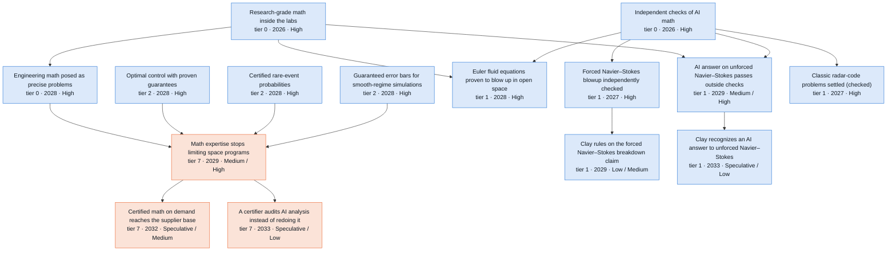

Where the reviewers disagreed: 2031 challenge round (12 disputes)

Recorded during the 2031 challenge round. Later passes adjusted some dates and bands; the node table below has the final values.

- **When unforced Navier-Stokes is settled.** *Skeptic:* Keep S2 2029/Medium. The euler and forced-check edges are not prerequisites, but the timing holds. *Advocate:* The node's own '1-2 doublings' at 6-9 months closes the gap mid-2027 to early 2028, so S2 should be 2028 and S1 2030 (not >2031). S3 should be High given ~3-month doublings after 2028. *Resolution:* Partly accepted. S1 >2031 -> 2030, because the node's own arithmetic at 12-18 months per doubling gives capability in late 2027 to late 2029. S3 band -> High, because either answer counts and the argument rests on recursive AI, which belongs in S3. S2 stays 2029/Medium: discovery 2027-28 plus about a year of checking, which matches Euler now at S2 2028.
- **"Math expertise stops limiting space programs": certification cap versus no regulator gate.** *Skeptic:* The flight-program signpost is certification evidence. Add "Regulators accept AI-produced proofs", move S2 to 2030 and S3 to 2029, and cap S3 at Medium. Alternatively, rescope the signpost to non-certification analysis. 'Program savings' confuses hours with cost. *Advocate:* Human sign-off is not a regulator gate, so no cap applies. S2 should be High because all hard prerequisites are High. 'Halves' is an S1 number; S2 is 5-10x. *Resolution:* Took the skeptic's alternative: the signpost is now design iteration and trade studies under the program's own sign-off, and certification use stays with "Regulators accept AI-produced proofs" (added as a soft link). Years and bands kept (Low/Medium/High). The advocate's S2 High was rejected: the node is a sweeping organizational claim over seven correlated prerequisites, two of them adoption-gated. Both sides were right that the arithmetic was wrong, and it was rewritten: ~8-14% of engineering hours in S2, ~2-7% of program cost, ~13 of the 38 Amdahl points.
- **Discovery versus acceptance for D0 problems (Euler R^3, kinetic regularity, Boltzmann check, nonuniqueness map).** *Skeptic:* These are dated when the proof is found, not accepted. Chen-Hou was still being clarified 4 years on, and PDE formalization is 3/16. Move S2 to 2028, and S3 too, since S3 equals S2 before 2028. *Advocate:* D0 nodes are about right at S2 2027. Kinetic S1 should be 2028 to match the other D0 nodes. *Resolution:* Skeptic accepted for S2 (2028) on all four. S3 split by binding step. Where acceptance runs through formal infrastructure that the graph already dates S3 2027 (Euler, kinetic, Boltzmann check), S3 stays 2027 as the optimistic end. Where it runs through human citation or adoption (nonuniqueness map), S3 = S2 = 2028. Kinetic S1 stays 2029, between the skeptic's 2030 and the advocate's 2028.
- **Band of "Boltzmann foundations checked and scoped".** *Skeptic:* Keep Medium and move it later. Expert bandwidth binds. *Advocate:* The node is the check, and a refutation counts too, so the T1 drop belongs on downstream implications. Raise S2/S3 to High. *Resolution:* Medium kept, so the band means the same as on the sibling confirmation nodes (results checked and confirmed, which carries the T1 drop). The advocate's point is now stated in why: a check either way by 2031 is High in S2/S3, and a refutation would also unlock the kinetic-solver scoping.
- **"How much sensor data is enough" band.** *Skeptic:* Re-ground Medium in known stability theory: logarithmic stability is optimal (Mandache), and Lipschitz constants grow exponentially with the number of unknowns (Rondi). Drop the off-topic families. *Advocate:* The premise is the capability, not the T1 families. Lipschitz stability holds for finitely parametrized damage, so raise to Medium/High/High. The consumers are hard-wired at 2028/High. *Resolution:* Both agreed the T1 drop was the wrong reason, so the premise label and the Lipschitz text were adopted. Bands stay Low/Medium/Medium on the skeptic's grounds: exponential constants make sensor counts impractical outside coarse damage models, and the signpost is flight use (P6). The advocate's claim about hard-wired consumers was wrong: those edges are soft.
- **"Guaranteed error bars for smooth-regime simulations" timing and band.** *Skeptic:* Adoption-gated, with a P6 part and a NASA-STD-7009 signpost. Move S2 to 2029 and Medium. *Advocate:* Both prerequisites are S3 2027, so S3 should be 2027. Add certified surrogates as a new node. *Resolution:* Took the auditor's middle path. The signpost is now method-level and 7009 credit is downstream, so High rates method availability and S2 stays 2028/High. S3 stays 2028 under the rule that P1 nodes land a year after public applied math. Surrogates folded into the why instead of a duplicate node.
- **Applied spine dated the year of public access (posing, HJB, rare-event).** *Skeptic:* P1 lag is 0-2 years and the signposts are adoption or publication events, so 2028 in S2 and S3. The rare-event math is also partly open in high dimension. *Advocate:* HJB and rare-event are right at S2 2027. Rare-event's binding gate is adoption, not data. *Resolution:* Skeptic's years accepted. The advocate's own gate change (adoption) supports the lag. Bands stay High.
- **"Turbulence laws proven".** *Skeptic:* No change proposed. *Advocate:* The 2-4 doubling arithmetic gives S2 2029 and S3 2028, and S3 should be High. *Resolution:* Rejected. Unlike unforced NS, this node needs one specific answer (the zeroth law and scaling hold for natural forcing), which may be false or unprovable in the posed form, and posing remains. Years and bands kept.
- **Forced-NS independent check date.** *Skeptic:* Silent on timing. Moved 376 off the node. *Advocate:* S2/S3 2026: kernel replay done, Comparator is cheap, and the credit dispute motivates audits. *Resolution:* Rejected. A month after the claim there is still no outside Comparator run or statement audit. Two of three Kingy Comparator targets hit memory caps. Hexagon has no deposits, and the node's own signpost expects 6-12 months.
- **Are the famous problems dead ends, or do they spill into engineering?** *Skeptic:* No new nodes needed. Effects are P5 confidence or P3 ceilings only. *Advocate:* The proof machinery (computer-assisted proofs, verified interval numerics, well-posedness checks) reaches engineering. Add three nodes: wellposedness-on-demand, certified-reference-solutions, certified-surrogates. *Resolution:* The mechanism is accepted for computer-assisted proofs: soft edge Euler -> certified PDE error, text, and a thesis sentence. All three nodes rejected. Wellposedness-on-demand duplicates "On-demand applied math in space engineering", "Math expertise stops limiting space programs" and existing instance nodes. Reference-solutions has a weak mechanism (ODE similarity solutions are already near machine precision, and multi-D shocked computer-assisted proofs are not credible by 2031). Surrogates duplicates "Guaranteed error bars for smooth-regime simulations" plus "AI emulators of space physics codes with stated error bounds".
- **"Chaos theorems in the release (weak link to orbits)" band.** *Skeptic:* Drop to Medium in every scenario (T1 drop, as on the siblings). *Advocate:* Keep High by scoping the band to the Lean families 347 and 143. *Resolution:* Medium. The auditor's check, confirmed in lean/docs/143.md, shows 143 is formalized only for quintic Lienard systems, so the advocate's scoping does not hold.
- **"Quantum-chemistry shortcuts with certified error bars".** *Skeptic:* Rescope to statistical error bars against a reference ('provable' is unreachable). Keep bands. Make posing soft. *Advocate:* Statistical certification needs applied math, not new physics theory. Make "AI builds validated physics theory" soft, move S2 2029 -> 2028 and S1 -> 2030, and S3 High. *Resolution:* Both rescope proposals adopted, and the advocate's edges and years accepted. Once rescoped, the hard edge to "AI builds validated physics theory" was what pinned the node to 2029. S3 High on abundant compute; S2 stays Medium for the adoption signpost and the solid-state reference-data gate.

Where the reviewers disagreed: 2035 and Embodied extension round (8 disputes)

- **When certifiers stop re-running AI analysis ("A certifier audits AI analysis instead of redoing it").** *Skeptic:* The hard gate is wrong: "Regulators accept AI-produced proofs" covers software plans, while analysis evidence runs through NASA-STD-7009 and verified numerics. The draft assumed a 3-year certification lag, but human rating takes about 6 years (Crew Dragon 2014-2020). For a crewed case, the right years are 2033/2034 at Low. Rescope to uncrewed certification instead. *Advocate:* Auditing a sample is a smaller step than replacing a test with analysis, yet the draft dates it after sibling nodes that do that ("Analysis replaces some environmental qualification tests" S2 2031; "Qualification by analysis replaces some structural tests" S2 2030). Both prerequisites reach High by 2035 through named mechanisms. Pull it a year earlier (S2 2032, S3 2031) and raise S2 to Medium by 2035. *Resolution:* Scope follows the skeptic. Uncrewed certification comes first (NASA Launch Services, Space Force mission assurance) and a crewed delta certification second. Verified numerics becomes the hard gate and tool qualification becomes soft. Years stay S2 2033 and S3 2032, with bands S/L/M/M. The advocate's pull was rejected on mechanism: certifiers will likely re-run in full the first analyses that earn test credit, so the audit step follows those credits by one delta certification. The advocate's soft edge from the analysis-credit precedent was added.
- **How fast certified math reaches tier-2 and tier-3 suppliers ("Certified math on demand reaches the supplier base").** *Skeptic:* S3 High by 2035 is generous. Many suppliers build to print, no contract data requirement is in motion, and CMMC and AS9100 tool validation add friction. Customers cannot take certification credit for the analysis, so cost is not the binding constraint. Lower S3 to Medium. *Advocate:* Suppliers already run commercial FE and CFD codes, so certified bounds reach them as tool updates without in-house experts. One prime or agency data requirement meets the signpost. Raise S2 to High and S1 to Low, and add soft edges from "Finite-element solvers with machine-checked error bounds" and "Automated checks that engine flow simulations are right". *Resolution:* The commercial-solver channel and its two soft edges were accepted. Bands stay S/M/H/H. S3 High holds because the node needs no certifier acceptance, so the regulatory cap does not apply, and S3 has had about four years of near-free cognition and certified tools. S2 stays Medium because three years after 2032 is short for many small firms and no data requirement is in motion. S1 stays Speculative because it lands after 2035.
- **Turbulence laws: truth risk against the white-in-time 4/5-law route ("Turbulence laws proven").** *Skeptic:* This is the draft's position; the skeptic did not challenge it. The zeroth law for natural forcing may be false or unprovable in the posed form, and the statements still have to be posed. So bands stay Medium in S2-S4 even by 2035. *Advocate:* With white-in-time forcing the noise fixes the energy input. Bedrossian et al. (arXiv 1803.09695) prove the averaged 4/5 law assuming only kinetic energy o(1/nu), so the open content is one estimate with little truth risk. S3 has years of near-free cognition, so S3 and S4 should be High by 2035. *Resolution:* Accepted after checking the arXiv abstract. The signpost was restated around this route, and S3 and S4 rise to High by 2035. S3 is already High on unforced Navier-Stokes by 2031. S2 stays Medium because base-case cognition reaches the S3-2031 level only in 2033-35, and the estimate may need tools close to regularity theory. The draft's truth-risk reason covers deterministic forcing only.
- **Inverse stability by 2035 and a robot link ("How much sensor data is enough").** *Skeptic:* Optimal logarithmic stability (Mandache 2001) and Lipschitz constants that grow exponentially with the number of unknowns (Rondi 2006) are properties of the problems. The signpost also needs flight use (P6). Cognition therefore cannot lift S3 to High. The robot edge points from an assembly node dated after this one, and automated NDE already exists, so rule 4 applies. *Advocate:* Keep S3 High. Swap the robot edge for "Robots inspect and refurbish rockets between flights": robot-carried scanning makes the dense measurement sets that logarithmic stability demands affordable. *Resolution:* Skeptic accepted: Medium in all four scenarios by 2035, and the robot edge was dropped without a replacement. "Robots inspect and refurbish rockets between flights" is also dated after this node in every scenario. The inspection chain already runs "Math for finding hidden heat-shield damage" -> "Robots inspect and refurbish rockets between flights", and dense scanning eases the need for this math more than it speeds it.
- **The math-to-robots channel ("Optimal control with proven guarantees", "How hard neural networks are to verify").** *Skeptic:* The draft edge into "General-purpose robots do multi-task factory work at scale" points at the wrong node. Factory usefulness is bound by data, hands, MTBI and ISO 25785-1. Deterministic HJB certificates reach only about 6 states, so the channel is reduced-order safety envelopes. Replace the edge with one to "Proven safety envelopes for robots working beside people". *Advocate:* Add hjb -> "Proven safety envelopes for robots working beside people" and nn-verification -> "Proven safety envelopes for robots working beside people", and keep the factory edge. The S4 analysis rates math at 1.1-1.5x on robotics, mainly through safety certificates. *Resolution:* Both envelope edges were added and the factory edge was dropped, since the envelope path reaches factories through "Humanoid safety standard ISO 25785-1 published". The thesis now names this as the branch's one S4 role. The branch does not speed robots' dates in this file, and robots speed nothing in this branch.
- **Clay recognition of an unforced Navier-Stokes answer ("Clay recognizes an AI answer to unforced Navier–Stokes").** *Skeptic:* The draft's three-year chain gives Clay's own board and committee zero time. The only precedent ran about 7 years (Perelman 2002-03 to 2010). If Clay accepts the forced result under (C)/(D), the prize is closed and a ruling on the unforced case becomes discretionary. *Advocate:* This is the draft's position; the advocate did not challenge it. Either answer counts, and a zero-force result avoids the force-decay questions, so Medium by 2035 in S2-S4 with earliest years 2031-33. *Resolution:* Skeptic accepted. Years are now 2034/2033/2032/2032 and the 2031 band is Speculative throughout. the 2035 band is S/L/M/M. Pre-emption by "Clay rules on the forced Navier–Stokes breakdown claim" is written into the why.
- **Long-shot math under recursion ("P vs NP resolved" and the new "AI settles a Millennium problem other than Navier–Stokes").** *Skeptic:* P vs NP cannot be Low (10-30%) by 2035 while its earliest credible year is after 2035, and the barriers may not yield to scaling. *Advocate:* The branch lacks the clearest public S2-against-S3 test for 2032-35: a Millennium-tier result outside fluids. Fortune reported OpenAI progress short of solutions on three other Millennium problems. *Resolution:* P vs NP is Speculative in all scenarios. A new members-only node, "AI settles a Millennium problem other than Navier–Stokes", was added, covering RH, Yang-Mills, Hodge or BSD settled with outside checks. Its years are >2035/2033/2030/2030 and the 2035 band is S/L/M/M. It is capped at Medium because the premise is T1 at best, and its engineering effect is nil. The proposed soft edge from unforced Navier-Stokes was dropped, because fluid methods do not carry to these problems.
- **Radiation transport and kinetic regularity band raises ("Radiation transport with error bounds", "Boltzmann and Landau equations proven well-behaved").** *Skeptic:* The draft's transport raises (S2 to High, S1 to Medium) rest on new pulls from lunar shielding and orbital-compute electronics. Nuclear cross sections, radiobiology and device beam tests bind those pulls, and transport math does not. Kinetic: the draft cites partial-truth risk to cap S1 while raising S2. That risk is a property of the mathematics, so the reasoning is inconsistent. *Advocate:* Did not contest these. The advocate grouped transport with the data-gated nodes already High in S3, where robots have no room to add credit. *Resolution:* Transport reverted to L/M/H/H by 2035. Kinetic keeps S2 High, since S3 is already High by 2031 and so already judges the partial-truth risk below 30%. Its note now explains S1 Medium by the cognition lag alone. "Quantum-chemistry shortcuts with certified error bars" keeps its S2 raise because its reference data come from computation.

All nodes in this branch

Years and likelihoods are listed for Plateau / Exponential / Recursive / Embodied. H = High, M = Medium, L = Low, S = Speculative.

| Node | Tier | Year | By 2031 | By 2035 | Binding gate | Pathway |
| --- | --- | --- | --- | --- | --- | --- |
| Engineering math posed as precise problems | 0 | 2029 / 2028 / 2028 / 2028 | M / H / H / H | H / H / H / H | adoption | P1 |
| Chaos theorems in the release (weak link to orbits) | 1 | 2027 / 2027 / 2027 / 2027 | M / M / M / M | M / M / M / M | formalization | P5 (science only) |
| How hard neural networks are to verify | 1 | 2028 / 2027 / 2027 / 2027 | H / H / H / H | H / H / H / H | cognitive | P3 |
| Claimed limits of the workhorse quantum-chemistry method | 1 | 2028 / 2027 / 2027 / 2027 | M / M / M / M | M / M / M / M | formalization | P3 |
| Forced Navier–Stokes blowup independently checked | 1 | 2027 / 2027 / 2027 / 2027 | H / H / H / H | H / H / H / H | formalization | P3+P5 |
| Firmer math under elasticity, crack and inspection models | 1 | 2028 / 2027 / 2027 / 2027 | L / M / M / M | M / M / M / M | formalization | P5 (+P3 for the 365 nonuniqueness half) |
| Hot spots conjecture (planar case) confirmed | 1 | 2028 / 2027 / 2027 / 2027 | L / M / M / M | M / M / M / M | formalization | P5 |
| Faster solvers for building correct-by-design controllers | 1 | 2027 / 2027 / 2027 / 2027 | M / M / M / M | M / M / M / M | formalization | P4 (theory only; practical effect nil) |
| Classic radar-code problems settled (checked) | 1 | 2027 / 2027 / 2027 / 2027 | H / H / H / H | H / H / H / H | formalization | P3 (nil to small) |
| Euler fluid equations proven to blow up in open space | 1 | 2029 / 2028 / 2028 / 2028 | M / H / H / H | H / H / H / H | formalization | P5 |
| Boltzmann and Landau equations proven well-behaved | 1 | 2029 / 2028 / 2028 / 2028 | M / M / H / H | M / H / H / H | formalization | P5 |
| Where fluid and kinetic models are not unique | 1 | 2029 / 2028 / 2028 / 2028 | M / H / H / H | H / H / H / H | cognitive | P3->P5 |
| Boltzmann foundations checked and scoped | 1 | 2029 / 2028 / 2028 / 2028 | M / M / M / M | M / M / M / M | formalization | P3->P5 |
| Which plasma fluid models make mathematical sense | 1 | 2029 / 2028 / 2028 / 2028 | M / H / H / H | H / H / H / H | cognitive | P3->P5 |
| AI answer on unforced Navier–Stokes passes outside checks | 1 | 2030 / 2029 / 2028 / 2028 | L / M / H / H | M / H / H / H | cognitive | P5 |
| Skolem and Positivity problems for linear loops settled | 1 | 2033 / 2029 / 2028 / 2028 | S / L / M / M | L / M / M / M | cognitive | P3 |
| Clay rules on the forced Navier–Stokes breakdown claim | 1 | 2029 / 2029 / 2029 / 2029 | L / L / L / L | M / M / M / M | adoption | P5 (science only) |
| Turbulence laws proven | 1 | 2034 / 2030 / 2029 / 2029 | S / M / M / M | L / M / H / H | cognitive | P5->P6 |
| Clay recognizes an AI answer to unforced Navier–Stokes | 1 | 2034 / 2033 / 2032 / 2032 | S / S / S / S | S / L / M / M | adoption | P5 (science only) |
| AI settles a Millennium problem other than Navier–Stokes | 1 | >2035 / 2033 / 2030 / 2030 | S / S / L / L | S / L / M / M | cognitive | P5 (science only) |
| P vs NP resolved | 1 | >2035 / >2035 / >2035 / >2035 | S / S / S / S | S / S / S / S | cognitive | P3 |
| Optimal control with proven guarantees | 2 | 2030 / 2028 / 2028 / 2028 | M / H / H / H | H / H / H / H | cognitive | P1->P2 |
| Certified rare-event probabilities | 2 | 2030 / 2028 / 2028 / 2028 | M / H / H / H | H / H / H / H | adoption | P1->P5 |
| Proven best designs for hard optimization problems | 2 | 2030 / 2028 / 2028 / 2028 | L / M / H / H | M / H / H / H | cognitive | P4 |
| Guaranteed error bars for smooth-regime simulations | 2 | 2030 / 2028 / 2028 / 2028 | M / H / H / H | H / H / H / H | adoption | P1->P6 |
| How much sensor data is enough | 2 | 2030 / 2028 / 2028 / 2028 | L / M / M / M | M / M / M / M | data | P1->P6 |
| Radiation transport with error bounds | 2 | 2030 / 2028 / 2028 / 2028 | L / M / H / H | L / M / H / H | data | P1->P6 |
| Quantum-chemistry shortcuts with certified error bars | 3 | 2030 / 2028 / 2028 / 2028 | L / M / H / H | M / H / H / H | data | P3->P6 |
| Math expertise stops limiting space programs | 7 | 2033 / 2029 / 2028 / 2028 | S / M / H / H | M / H / H / H | adoption | P1 |
| Certified math on demand reaches the supplier base | 7 | >2035 / 2032 / 2031 / 2031 | S / S / L / L | S / M / H / H | adoption | P1 |
| A certifier audits AI analysis instead of redoing it | 7 | >2035 / 2033 / 2032 / 2032 | S / S / S / S | S / L / M / M | regulatory | P1->P2 |

### Software you can prove

*Verified flight code gets 15-120x cheaper per line by 2028-29 and flies on landers and constellations about 2029 (central scenario). By 2035 certifiers accept AI-written proofs (High). Crewed credit stays Medium and a proof-checked Mars landing Low. In Embodied, robot-run tests halve verification time about 2033, two years early.*

On-demand AI mathematics first changes who can afford proof. Agents can write contracts, invariants and proofs of flight code for checkers such as GNATprove, check fault logic exhaustively and bound round-off error in guidance code. [seL4's design, implementation and proof took about 25 person-years](https://trustworthy.systems/projects/OLD/l4.verified/numbers) for 8,700 lines. The best tested agent fully solves [27 of 43 repository-scale verification tasks](https://arxiv.org/abs/2608.13522).

In the Exponential case, our central scenario, proof agents, AI-drafted specifications and fault-logic checks are usable about 2027 (High by 2031). By our cost model, an analyst judgment, a verified line falls from about $300-600 to $5-20 about 2028 (High by 2031). Plateau reaches $50-150. A lander flying proof-checked descent guidance and proof-checked constellation updates follow about 2029 (Medium by 2031, High by 2035), held by adoption and software freezes. Regulators accept AI-produced proofs about 2030 (Medium by 2031, the regulatory cap). Certified crewed lander autonomy stays Low by 2031.

From 2032 most changes are band steps. Regulator acceptance reaches High by 2035 through DO-333 credit and qualified checkers already in use. Crewed, engine and entry-guidance credit stop at Medium by 2035, the regulatory cap. Fewer missions lost to software logic becomes measurable about 2032 in the Exponential case (Medium by 2035). A proof-checked Mars landing needs a landing, proofs and disclosure together (Low by 2035). Robots change nothing on 35 of 36 nodes, because cognition, adoption, regulators and launch windows bind, and most nodes land before robots reach aerospace. The exception is halving the verification calendar. With cheap proofs, rigs and vehicle tests set about 80% of it (analyst assumption). Robot-run testing at robot-first firms gets there about 2033 in the Embodied case (Medium by 2035), against 2035 in the Recursive case (Low by 2035).

The openai/math catalog contributes almost nothing. The evidence is agent-written Lean for the main results of 162 papers, unchecked by outsiders (T3). One side node cites family 140 (T3), a sample-count ceiling for onboard estimators.

The strongest case for a small effect is that proof capacity rarely failed. Of 12 notable losses and near-losses from Ariane 501 to Athena, 9 involved software or logic, each from a wrong assumption, spec or process step. About half of recent lunar-landing losses were hardware or sensor faults, such as [Peregrine's valve](https://spacepolicyonline.com/?p=73769). A top-criticality program gets only about 2x cheaper, because integration testing stays physical. The skeptic won most disputes. The advocate lost its 2028 constellation date, because specs need review and operators disclose little, and High for the calendar and loss-rate outcomes. It won earlier Mars and loss-rate years and the qualified-checker certification route. Watch for a case study of AI proofs on 10,000-plus lines of production embedded code. Without one by end-2027, Exponential dates slip about a year.

36 nodes. Rated High or Medium by 2031: Plateau 14, Exponential 26, Recursive 28, Embodied 28. By 2035: Plateau 25, Exponential 31, Recursive 34, Embodied 35. Main binding gate: adoption.

**Main chain** (each node: tier · earliest year in the Exponential case · likelihood by 2031 / by 2035; Recursive and Embodied years shown where they differ)

- **Agents that prove real flight code** (tier 0 · 2027 · High; gate: formalization, then cognitive)
  - → **Guidance code with proven floating-point math** (tier 2 · 2028 · High; gate: formalization, then adoption)
    - → **Lander flies proof-checked descent guidance and fault logic** (tier 5 · 2029 · Medium / High; gate: adoption, then qualification)
      - → **A Mars lander flies proof-checked landing and fault logic** (tier 5 · 2031 · Speculative / Low; gate: launch-internal, then adoption)
      - → **Crewed lander autonomy certified with AI proofs** (tier 6 · 2031 · Low / Medium; Recursive 2030; gate: regulatory, then qualification)
      - → **Fewer missions lost to software logic (hard to see by 2031)** (tier 7 · 2032 · Speculative / Medium; Recursive 2031; gate: launch-external, then data)
  - → **Verified flight code 15-120x cheaper per line** (tier 7 · 2028 · High; gate: adoption, then cognitive)
  - → **Proof-checked software updates across constellations** (tier 6 · 2029 · Medium / High; gate: adoption, then cognitive)
    - → **Fewer missions lost to software logic (hard to see by 2031)** (tier 7 · 2032 · Speculative / Medium; Recursive 2031; gate: launch-external, then data) (see above)
  - → **Regulators accept AI-produced proofs** (tier 0 · 2030 · Medium / High; Recursive 2029; gate: regulatory, then adoption)
    - → **Crewed lander autonomy certified with AI proofs** (tier 6 · 2031 · Low / Medium; Recursive 2030; gate: regulatory, then qualification) (see above)
- **AI-drafted formal specifications** (tier 2 · 2027 · High; gate: adoption, then cognitive)
  - → **Exhaustive checks of fault logic and configuration** (tier 4 · 2027 · High; gate: data, then formalization)
    - → **Verified flight code 15-120x cheaper per line** (tier 7 · 2028 · High; gate: adoption, then cognitive) (see above)
    - → **Lander flies proof-checked descent guidance and fault logic** (tier 5 · 2029 · Medium / High; gate: adoption, then qualification) (see above)
    - → **Proof-checked software updates across constellations** (tier 6 · 2029 · Medium / High; gate: adoption, then cognitive) (see above)
    - → **Crewed lander autonomy certified with AI proofs** (tier 6 · 2031 · Low / Medium; Recursive 2030; gate: regulatory, then qualification) (see above)
  - → **Verified flight code 15-120x cheaper per line** (tier 7 · 2028 · High; gate: adoption, then cognitive) (see above)
  - → **Validated limits on sensor and terrain behavior** (tier 3 · 2029 · Medium / High; Recursive 2028; gate: experiment, then data)
    - → **Fewer missions lost to software logic (hard to see by 2031)** (tier 7 · 2032 · Speculative / Medium; Recursive 2031; gate: launch-external, then data) (see above)
  - → **Proof-checked software updates across constellations** (tier 6 · 2029 · Medium / High; gate: adoption, then cognitive) (see above)
- **Flight-software verification takes half the calendar time** (tier 7 · >2035 · Speculative; Recursive 2035; Embodied 2033; gate: qualification, then capital)

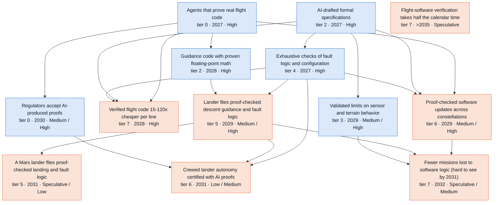

Where the reviewers disagreed: 2031 challenge round (10 disputes)

Recorded during the 2031 challenge round. Later passes adjusted some dates and bands; the node table below has the final values.

- **When does certification credit for AI-written proofs arrive, and should the checker route be its own node?** *Skeptic:* Define "Regulators accept AI-produced proofs" as plan acceptance (PSAC/SOI-1) and say completed certification follows 2-4 years later (S2 about 2032+). Dependents dated 0-1 years after 2030 wrongly read it as completed credit. Keep the years. *Advocate:* Split out verif-checker-route-credit at S2 2029 (S3 2028). Under DO-330 the AI generator needs no qualification when an already-qualified checker (GNATprove, Frama-C, Astree) verifies its output, and the domain's own table dates DO-333 credit 2028. Re-point the regulated dependents to it. Only Lean-kernel qualification stays at 2030. *Resolution:* Mechanism adopted, split and earlier date rejected. The node's description already was the checker route (A1 merged verif-checker-not-generator into it), and S2 2030 is the study's base-case premise for first credit. The node now means plan acceptance via the existing-checker route, with Lean-kernel qualification as a later step dependents do not need. The advocate's 2028-29 case is kept as an upside signpost. Dependents that need a specific program to accept the evidence lag it: engine software 2031 Low, EDL S2 Low, HLS unchanged. Part 450 and new-entrant nodes are decoupled from it.
- **Constellation proof-gated updates vs proof-backed GNC operations (the duplicate with inconsistent timing).** *Skeptic:* The constellation node is a strictly stronger instance of the general ops node, yet it was earlier (S2 2028) and higher (High). Move it to 2031/2029/2029 Low/Medium/High; S3 2027 has no basis because S3 equals S2 until 2028. *Advocate:* Keep constellation at 2028 High and instead raise the ops node to S1 2030 / S2 2028 Medium/High: uncrewed fleets need no qualification, and SpaceX owns a frontier lab (xAI, Feb 2026) and runs more than 355,000 avoidance maneuvers a year. *Resolution:* Skeptic and auditor prevail. Constellation moves to 2031/2029/2029 Low/Medium/High; ops stays 2031/2029/2029 Low/Medium/High (S3 2028 -> 2029); soft edge constellation -> ops. Reasons: the A3 lag ladder puts flown proof-carrying software at S2 2029, every invariant needs a reviewed spec (the bandwidth this branch says binds), and operators disclose little. The SpaceX-xAI integration is added to why, but it supports S3 High, not S2 High.
- **Assurance cost collapse: timing, band and the program-level multiplier.** *Skeptic:* The per-line fall is 15-120x, not 30-100x. The domain table dates $5-20/line 'by 2029', so S2 should be 2029. The 2.4x program figure uses x0.7 on requirements, which contradicts the thesis that specs become the bottleneck; with x1.0 it is about 2.1x. It belongs in "Verified autonomy becomes cheap" at S2 2031. *Advocate:* Uncrewed programs need no credit, so the program-level saving applies there now: keep 2.4x scoped to flight-software programs and raise S2 to High. Jul 2026 SPARK agents already show 20-40x lower supervision cost. *Resolution:* The per-line node keeps S2 2028 and goes to High: the auditor agreed, the 2029 table value is a 'by' date, and the 2026 SPARK evidence was checked. S3 moves to 2028. The arithmetic is corrected to 15-120x. The program claim moved to "Verified autonomy becomes cheap" as about 2x (1.8-2.4x, both multipliers shown). That node keeps 2031/2030 against the advocate's 2029/2028, because its chain runs through proof-backed ops (2029) to a published comparison (2030-31).
- **Lander flight: S2 likelihood and the terrestrial-testbed path.** *Skeptic:* S3 2028 -> 2029 and S3 High -> Medium. A tier-5 P2->P7 six-way conjunction does not justify High. Optimizer certificates are not needed for closed-form guidance. A VTVL testbed has no launch gate and would trivially satisfy the node, so move it to the signpost. *Advocate:* Raise S2 to High. The in-scope testbed path has no launch slot or freeze and could fly in 2028; 30+ lunar missions in 2024-2030 give many chances, incentives are strong, and re-verification falls to days. *Resolution:* Testbed moved to the signpost as a precursor, solver proofs made conditional, two hard edges made soft, gate changed to adoption, S3 2029. Bands stay Low/Medium/High: with the conjunction relaxed, Medium in the base case and High in the recursive case keep a meaningful spread. The advocate's cadence argument holds mainly once cognitive work is near-free, so it belongs in S3.
- **FAA Part 450 flight-termination credit.** *Skeptic:* Lower S2 to Low. Applicants gain no license time from proofs, AFSS already passes RCC-319 testing, FAA AST is not the DO-330 office, and the node had zero lag after general credit. Drop the RCC-319 revision signpost (next revision about 2030-31). *Advocate:* Part 450 is performance-based and outside DO-330; 450.35 requires an accepted means of compliance for 450.145(b) but not for 450.141. Remove the hard edge to "Regulators accept AI-produced proofs", add one from code-proof agents, and move to S2 2029 / S3 2028 (EO 14335 and the Oct 2026 means-of-compliance proposals). *Resolution:* Both partly adopted. The advocate's regulatory mechanism was verified against 14 CFR 450.35, so the edge to "Regulators accept AI-produced proofs" is soft and code-proof agents became a hard prerequisite. But the flight safety system still needs an FAA-accepted means of compliance, and the incentive is weak, so years stay >2031/2030/2029 and S2 drops to Low (skeptic + auditor). S3 stays Medium.
- **Onboard verified stack: what binds.** *Skeptic:* Kernel proofs are sunk (seL4 is open source and flew in 2017; the cFS port took over a year of OS-services work). Qualification and multicore timing bind, so S2 should be Medium and S3 2029. Add a new verif-multicore-timing-evidence node as a hard prerequisite. *Advocate:* Pull S2 to 2028. Parsers and update authentication can be uploaded to existing buses, the first flight of any component counts, and the tier-6 constellation node already includes command authentication at 2028. *Resolution:* Skeptic and auditor on timing and bands: Low/Medium/High, S3 2029. The constellation consistency argument fell away once that node moved to 2029. The advocate's scope point was adopted: any one component counts. The multicore node was not added: it is not necessary for the node as scoped, A1 already left timing and HIL evidence to the flight nodes, and its flight-qualification evidence could not be checked (403). The gate is written into the description instead.
- **RPO assured autonomy timing.** *Skeptic:* Prerequisites land in S2 2028 and missions take 2-4 years from contract to launch, so 2029 has no slack. Use S2 2030, S1 >2031, S1 Speculative, and write the full chain. *Advocate:* In S3, the refuel campaign (10-20 dockings per landing, S3 2028 High) and 100+ heavy flights supply demonstrations. Starship software changes between flights with no 12-18-month freeze, so S3 2028 High. *Resolution:* Years and bands kept at 2031/2029/2029 Low/Medium/Medium, with the full chain written (grounding rule). The Starship per-flight software route makes 2029 a feasible earliest year in S2, but S3 equals S2 through 2028, and the node's own strongest case (proofs may stay internal; hardware dominates docking risk) does not move with cognition. The advocate's soft edge from "Full lunar-lander refueling campaign" was added.
- **Uncrewed launch software and onboard AI agents (advocate's new nodes).** *Skeptic:* Adoption-gated nodes should not fly in the year their tools appear. Most launch failures are hardware, and onboard isolation depends on measured multicore timing. (The skeptic did not review these nodes directly; this view follows the skeptic's general lag argument.) *Advocate:* "Reusable launchers re-prove flight software every flight" (2030/2028/2028 Low/Medium/High) and "Onboard AI agents fly under proof-checked command guards" (2031/2029/2028 Low/Medium/High) are missing nodes that each need two or three exponential curves together. A separate checker-route credit node is also missing. *Resolution:* Both operational nodes added, as they are distinct from existing nodes and mechanistically sound, but tempered. Launch software is 2031/2029/2029 Low/Medium/Medium (lag ladder; disclosure binds; Falcon 9 makes Starship cadence a soft, not hard, edge). Guardrails is 2031/2029/2029 Low/Medium/High, with the onboard stack soft, because guards can run on the existing flight computer. The checker-route node was rejected as a duplicate of the A1-merged content.
- **Regulated dependents and the A4 conjunctive rule (engine software, HLS).** *Skeptic:* Engine software: S2 2031 / S3 2030, S2 Low, S3 Medium. Only crewed programs can accept the evidence, and the Raptor sensor-trip motive is commentary. *Advocate:* Re-point engine software, EDL and HLS to the checker-route node, keeping years. For HLS, raise S3 to Medium: about three years and several block upgrades remain, and the HLS provider owns a frontier lab. *Resolution:* Engine software set to Speculative/Low/Low at >2031/2031/2030. The auditor's A4 logic applies in S3 too (a dependent of a Medium regulatory node with a further human-rating step sits below Medium), matching HLS. HLS stays Speculative/Low/Low, as A4 resolved. Re-pointing was moot once the checker-route node was rejected.
- **Small timing calls: code-proof agents S1, closed-loop guarantees S2, environment models S3.** *Skeptic:* Code-proof agents S1 2028 -> 2029 (public models reach the Oct-2026 level only in 2028; Vero 27/43). Closed-loop guarantees: years unchanged, because the numerics edge holds them at 2028. Environment models: no change. *Advocate:* The Jul 2026 SPARK result (49,280 obligations, 20-40x) supports keeping code agents at 2027 High. Closed-loop guarantees S2 2028 -> 2027 via KeYmaera X/SOS. Environment models S3 High via AI-run test stands. *Resolution:* Code agents S1 stays 2028 (the advocate's evidence, which I checked, undercuts the slip); the fdir edge was still made soft. Closed-loop S2 2027 accepted: the hard edges holding it at 2028 were made soft by two lenses, and the bypass route is documented. Environment models S3 stays Medium: lunar truth data and adoption of a shared dataset by two teams do not speed up with cognition. The soft edges from test stands and labs were added.

Where the reviewers disagreed: 2035 and Embodied extension round (7 disputes)

- **Calendar node: when robots halve flight-software verification time, and by how much S4 leads.** *Skeptic:* The draft contradicted its own sketch: S3 reaches only about 0.55 of the 2026 calendar by 2035, and S2 only 0.6-0.7. The S4 2032 date lands one year after robot-run integration and test begins (S4 2031, Low), with no room for requalification and a release cycle. HIL rig time and real-time soak runs do not shorten with robots. The skeptic proposed S3 2035 Low, S4 2034 Low and S2 >2035. *Advocate:* The research puts robot-first ground I&T at 0.36-0.48 of today by 2035, giving 0.32-0.41 overall (0.39-0.50 after a haircut) against the 0.5 bar. The advocate proposed keeping S4 at 2032, raising it to High, and widening reporting to customers and agency reviews. *Resolution:* Both reviewers mixed edges: the skeptic read S3 at its optimistic edge and S4 at its center, and the advocate kept S3 2033 even though its own arithmetic gives S3 0.51 in 2035. Read consistently at the optimistic edge, S3 reaches half only in 2035 and S4 crosses in 2032. Adding one release cycle and a report gives S4 2033. With half the test slice robot-bound and half real-time HIL at about 1.6x, S4's central case is 0.44-0.50 by 2035, so S4 is Medium. It is not High, because reporting is uncertain and only part of the slice is robot-bound. Final: S2 >2035, S3 2035 Low, S4 2033 Medium. That is a credit of about two years, larger than the extension rules' typical 0.5-1.5 years, because ground test is about 80% of the remaining calendar. Reporting was widened to a customer or agency review.
- **Proof-checked Mars landing: joint probability and the S2 year.** *Skeptic:* The node is a joint event: a landing in the 2031 or 2033 window (Medium by 2035 in the entry branch), proof-checked logic and public disclosure. The likeliest carrier (Starship) may never say what it proved, and no funded non-Starship lander targets 2031 or 2033. That makes it Low by 2035 and Speculative by 2031. *Advocate:* The draft's 12-18-month freeze applies to new government programs. The likeliest lander comes from a reusable operator that, in S2, re-proves its software every flight from 2029. So S2 can reach 2031, the same as S3. *Resolution:* Both arguments hold, and they act on different fields. The advocate's argument sets the year: S2 moves to 2031, matching the B-round reasoning for RPO transfer software. The skeptic's argument sets the bands: Speculative by 2031 and Low by 2035 in S2-S4, with S1 Speculative. S2 now equals S3, which is appropriate because windows and disclosure bind, not cognition.
- **Fewer missions lost to software logic: statistical power against earliest year.** *Skeptic:* Six clean verified landings reject a 0.4 baseline only if the residual software-loss rate is near zero. At a halved rate (0.2), power is 0.26 at n=6 and about 0.41 at n=20. S2 should move to 2034 and Low. *Advocate:* S2 can reach six verified landings by 2032 at the upper case. By 2035 S3-S4 have dozens of landings, and 15 landings with one loss gives p about 0.005, so S3-S4 should be High. Non-AI learning helps the measured share fall. *Resolution:* earliest year is the optimistic case, so S2 moves to 2032, one year after S3. Power belongs in the band. With the residual near 0.1, S2's 10-12 landings give 74%+ power; near 0.2, 38-41%. The mix is about even odds, so S2 stays Medium. In S3-S4, dozens of landings give high power if the rate falls at all, but risk homeostasis can hold it flat, so they stay Medium. The S2 jump from Speculative to Medium is kept because the landing count accumulates sharply between 2031 and 2035.
- **Disclosure as a binding gate after 2031 (RPO, launch per-flight re-proof).** *Skeptic:* The launch node's own text says disclosure is why it is Medium and not High. The lead operator's habits do not change with time, so S2-S4 should stay Medium by 2035. *Advocate:* For RPO, S2 and S3 share the same flights, and an operator's own safety review is enough for uncrewed servicing. The draft's reason for holding S2 at Medium applies equally to S3, so S2 should be High. *Resolution:* Both were accepted, because the nodes differ. RPO goes to S2 High: many operators fly servicing, refueling and debris missions, no regulator cap applies, and the flight gate is shared across scenarios. Launch per-flight re-proof goes to S2-S4 Medium: the node requires a public statement from a handful of launch operators, and adoption times disclosure comes to about 0.6.
- **Reverse channel: does verified autonomy speed robot requalification in S4?** *Skeptic:* There was no direct skeptic finding. The skeptic did flag that soft edges must not point from later nodes to earlier ones or duplicate chains. Two of the draft's robo edges did point backward and one duplicated a chain. *Advocate:* Requalification (6-24 months per process per supplier) is the gate on S4 in aerospace. Proven guards and finite-sample guarantees are the natural evidence for it. The advocate proposed soft edges from runtime assurance and statistical guarantees into "An accepted route to requalify robot-made flight hardware", a guardrail edge into Mars robot site prep, and a new node, 'Robot processes requalify on proofs and statistics' (S4 2032, Medium by 2035). *Resolution:* One edge was accepted: "Proven safety wrappers for unverifiable autonomy" -> "An accepted route to requalify robot-made flight hardware". A learned robot's model updates could otherwise count as process changes, and a proven guard on force, path and sequence limits keeps the process inside its qualified window. The new node was rejected. Today's range already reaches 6 months, so the 'under 6 months' threshold does not isolate this branch's effect, and part-quality tests (coupons, first articles) dominate requalification. The statistics edge was rejected because probability-of-detection is already a statistical demonstration under MIL-HDBK-1823A. The guardrail edge was rejected because it duplicates "Proof-checked autonomy software for lunar robots" and needs an unapplied draft. The three weak robo edges were dropped.
- **Dating institution- and fab-gated 2032-35 nodes (standards route, timing isolation) and two-step band jumps.** *Skeptic:* Every node newly dated S2 2033 jumped from Speculative to Medium. A node whose gate is a standards cycle, a qualification campaign or a launch window rarely clears 30% within two years. The standards route codifies practice only after several programs, which is about 2034 in S2. Timing isolation fused qualification and first flight into one year. *Advocate:* No direct challenge on these two nodes. The advocate's general position was that cheap cognition by 2033-35 should lift S2 toward S3. *Resolution:* The skeptic's years and S2 bands were accepted: standards route S2 2034 and S3-S4 2033, timing isolation the same, both S2 Low, and S1 Speculative. The standards route left the spine because it may never be marked achieved. The rule was applied to S2 only. The remaining S3-S4 two-step jumps on new nodes stay, because a node that cannot exist before 2032 is Speculative by 2031 by construction. Its 2035 band is judged on its own merits: several standards bodies revise inside the window, and S3's near-free RTL proofs reach any new processor design.
- **S1 dating after legacy >2031 resolution.** *Skeptic:* Nodes resolved to S1 2033-34 kept the 2031 band Low, which is inconsistent. "Verified autonomy becomes cheap" S1 should be 2035, because the extension rules puts S1 cognition at S2's 2029-30 level only in 2035. *Advocate:* Lander S1 should be High by 2035, because its prerequisites land by 2030 and several landers fly each year. *Resolution:* the 2031 band S1 goes to Speculative where the S1 year is 2033-34. Nodes at 2032 keep Low, which the extension rules allows. "Verified autonomy becomes cheap" stays at S1 2034: the graph's own S1 chain (cost collapse 2030, proof-backed ops 2031, plus a 2-3-year lag) gives 2033-34, and the note no longer claims cognition parity. Lander S1 stays Medium: Low to High would be a two-step jump, and S1 adoption trails.

All nodes in this branch

Years and likelihoods are listed for Plateau / Exponential / Recursive / Embodied. H = High, M = Medium, L = Low, S = Speculative.

| Node | Tier | Year | By 2031 | By 2035 | Binding gate | Pathway |
| --- | --- | --- | --- | --- | --- | --- |
| Formal astrodynamics library | 0 | 2029 / 2027 / 2027 / 2027 | M / H / H / H | H / H / H / H | formalization | P2 |
| Agents that prove real flight code | 0 | 2028 / 2027 / 2027 / 2027 | H / H / H / H | H / H / H / H | formalization | P1->P2 |
| Regulators accept AI-produced proofs | 0 | 2032 / 2030 / 2029 / 2029 | S / M / M / M | M / H / H / H | regulatory | P2 |
| Landing-guidance solvers with proven convergence | 2 | 2029 / 2027 / 2027 / 2027 | M / H / H / H | H / H / H / H | cognitive | P1->P5 |
| AI-drafted formal specifications | 2 | 2028 / 2027 / 2027 / 2027 | H / H / H / H | H / H / H / H | adoption | P1->P2 |
| Machine-checked stability for guidance and control | 2 | 2030 / 2027 / 2027 / 2027 | M / H / H / H | H / H / H / H | formalization | P1->P2 |
| Verified docking and capture logic | 2 | 2030 / 2028 / 2028 / 2028 | M / H / H / H | H / H / H / H | cognitive | P1->P2 |
| Certified onboard trajectory optimizers | 2 | 2030 / 2028 / 2028 / 2028 | M / H / H / H | H / H / H / H | formalization | P1->P2 |
| Guidance code with proven floating-point math | 2 | 2029 / 2028 / 2028 / 2028 | M / H / H / H | H / H / H / H | formalization | P2 |
| Error-rate guarantees for onboard machine learning | 2 | 2030 / 2028 / 2028 / 2028 | M / H / H / H | H / H / H / H | data | P1 (P3 side link from 140) |
| Adaptive control of flexible spacecraft, proven stable | 2 | 2030 / 2028 / 2028 / 2028 | L / M / H / H | M / H / H / H | cognitive | P1->P5 |
| Verifying neural-network perception at flight scale | 2 | 2035 / 2030 / 2029 / 2029 | S / L / L / L | L / M / M / M | cognitive | P1->P6 |
| Validated limits on sensor and terrain behavior | 3 | 2030 / 2029 / 2028 / 2028 | L / M / M / M | M / H / H / H | experiment | P1->P5 |
| AI red-teaming of flight assumptions | 4 | 2028 / 2027 / 2027 / 2027 | H / H / H / H | H / H / H / H | data | P1->P3 |
| Exhaustive checks of fault logic and configuration | 4 | 2028 / 2027 / 2027 / 2027 | H / H / H / H | H / H / H / H | data | P1->P2 |
| Toolchain that ships guidance code with its proofs | 4 | 2030 / 2028 / 2028 / 2028 | M / H / H / H | H / H / H / H | adoption | P2 |
| Proven safety wrappers for unverifiable autonomy | 4 | 2030 / 2028 / 2028 / 2028 | M / H / H / H | H / H / H / H | qualification | P2 |
| Formally verified engine control software | 4 | 2033 / 2031 / 2030 / 2030 | S / L / L / L | L / M / M / M | regulatory | P2 |
| Proven-correct guidance for entry and landing | 4 | 2033 / 2031 / 2030 / 2030 | S / L / M / M | L / M / M / M | qualification | P2 |
| Formally verified onboard software stack | 5 | 2030 / 2029 / 2029 / 2029 | L / M / H / H | M / H / H / H | qualification | P2 |
| Lander flies proof-checked descent guidance and fault logic | 5 | 2030 / 2029 / 2029 / 2029 | L / M / H / H | M / H / H / H | adoption | P2->P7 |
| Proof-checked autonomous docking, servicing and refueling | 5 | 2031 / 2029 / 2029 / 2029 | L / M / M / M | M / H / H / H | launch-external | P2->P7 |
| A Mars lander flies proof-checked landing and fault logic | 5 | 2033 / 2031 / 2031 / 2031 | S / S / S / S | S / L / L / L | launch-internal | P2->P7 |
| Multicore space chip flies with proven worst-case timing | 5 | >2035 / 2034 / 2033 / 2033 | S / S / S / S | S / L / M / M | qualification | P2->P7 |
| Proof-checked software updates across constellations | 6 | 2031 / 2029 / 2029 / 2029 | L / M / H / H | M / H / H / H | adoption | P2 |
| Proof-backed guidance software in operational spacecraft | 6 | 2031 / 2029 / 2029 / 2029 | L / M / H / H | M / H / H / H | adoption | P2 |
| Reusable launchers re-prove flight software every flight | 6 | 2031 / 2029 / 2029 / 2029 | L / M / M / M | M / M / M / M | adoption | P2 |
| Onboard AI agents fly under proof-checked command guards | 6 | 2031 / 2029 / 2029 / 2029 | L / M / H / H | M / H / H / H | adoption | P2 |
| Proof-backed autonomous flight termination under FAA rules | 6 | 2033 / 2030 / 2029 / 2029 | S / L / M / M | L / L / M / M | regulatory | P2 |
| Crewed lander autonomy certified with AI proofs | 6 | 2033 / 2031 / 2030 / 2030 | S / L / L / L | L / M / M / M | regulatory | P2 |
| Verified flight code 15-120x cheaper per line | 7 | 2030 / 2028 / 2028 / 2028 | M / H / H / H | H / H / H / H | adoption | P2 |
| Assurance stops being a moat for primes | 7 | 2032 / 2030 / 2029 / 2029 | S / M / M / M | M / H / H / H | adoption | P1->P2 |
| Verified autonomy becomes cheap | 7 | 2034 / 2031 / 2030 / 2030 | S / M / M / M | L / H / H / H | adoption | P2 |
| Fewer missions lost to software logic (hard to see by 2031) | 7 | >2035 / 2032 / 2031 / 2031 | S / S / L / L | S / M / M / M | launch-external | P7 |
| Flight-software standards write in credit for AI proofs | 7 | >2035 / 2034 / 2033 / 2033 | S / S / S / S | S / L / M / M | regulatory | P2 |
| Flight-software verification takes half the calendar time | 7 | >2035 / >2035 / 2035 / 2033 | S / S / S / S | S / S / L / M | qualification | P2 |

### Links, spectrum and codes

*Certified routing and interference bounds put meshes and phone-to-satellite service on proven plans by 2029-30 (central scenario). Then the 2031 defense post-quantum deadline, WRC-31, standards and launches set the pace, so the base and Recursive cases end close together by 2035. Robots (Embodied) gain one year, on laser-terminal supply.*

On-demand AI mathematics first answers questions that need rare specialists. Pairing laser terminals and routing traffic across 10,000-plus satellites is NP-hard at every snapshot ([arXiv 2601.21914](https://arxiv.org/abs/2601.21914)), so teams can ask how near optimal a plan provably is. The FCC's 2026 rules judge sharing against simulated criteria such as 3% throughput loss ([FCC 26-26](https://research.33fg.com/news/fcc-replaces-26-year-old-epfd-framework-with-performance-based-ngso-rules)), so operators can request certified interference bounds. Agents can also prove routing and encryption code correct.

In the Exponential case, our central scenario, near-optimal mesh routing with a proven gap arrives about 2027, and verified routing software and certified interference bounds about 2028, all High by 2031. A mesh run with certified optimality and phone-to-satellite service scheduled around interference follow about 2029 (Medium by 2031, High by 2035). Software adding 10% sellable capacity per satellite at fixed spectrum comes about 2030 (Low by 2031, Medium by 2035); it counts capacity an operator can sell, not traffic, since satellites do not run near full. Upgradeable encryption with proven update paths arrives about 2028 (High by 2031), and fleets able to swap encryption before the 2035 cutoff about 2030 (Low by 2031, Medium by 2035). Plateau lags one to three years. Recursive lifts mesh and phone service to High by 2031.

The Department of War's end-2031 post-quantum deadline brings the first disclosed in-orbit switch over proven update paths to about 2032 in the Exponential case (Medium by 2035). A shell designed with certified tools enters service about 2032 (High by 2035), and AI-designed codes ship in a satellite link standard about 2033 (Medium by 2035). Mandates, committees, launches and proof work set these dates, so Recursive ends close to Exponential and robots change nothing, except for merchant laser terminals. Those are hand-aligned and tested, so requalified robots bring output of 3,000 a year, an analyst threshold, to about 2033 in the Embodied case (Medium by 2035) against 2035 in the Exponential case.

Direct to cell is the largest connectivity story, and it runs on its own clock. We follow the naming of Mach33's Connectivity Keystone ([evidence base, Oct 2026](https://research.33fg.com/analysis/state-of-connectivity-where-starlink-sits-in-the-world-s-network)): V1 D2C flies today on about 650 V2 Mini satellites, V2 D2C is the filed next generation and V3 D2C follows on Starship. *V2 D2C in commercial use* comes about 2028 in every scenario (Medium from 2029), *V3 D2C in service* about 2030 (Medium from 2031) and *Starlink Mobile serving 100 million phones a month*, against 22 million in August 2026, about 2029 (Medium from 2030, High from 2033). Handsets, operators, spectrum and Starship cadence set these dates; AI math enters only through scheduling phones around interference. The keystone model is not yet released, so these dates follow public windows and will be replaced by its own (TODO(source)).

The openai/math catalog contributes little beyond ceilings. The claimed Unique Games proof (family 102, T3, Lean proof unaudited), a k-median threshold (125, T3) and sparsest-cut results (117, T3 for the integrality gap, conditional for hardness) steer planners away from general solvers from about 2027 (High by 2031), though real constellation geometry escapes them. Families 120, 273 and 279 are conditional and change no hardware or deployed cryptography.

The strongest case for a small effect is that SpaceX and peers already optimize well. The model judges the remaining gain at 5-20% of capacity, beside a 10x per-satellite step from V3 hardware ([33FG](https://research.33fg.com/analysis/fcc-epfd-ruling-implications-how-it-raises-the-roof-for-v3)), and post-quantum migration is mandated anyway. The skeptic capped fleet encryption swaps at Medium, since no mandate asks for machine-checked update paths, and kept provable international sharing Low by 2035. The advocate won on encryption design, the 2031 deadline and the one robot credit. Watch for an FCC filing citing machine-checked interference bounds by 2028.

43 nodes. Rated High or Medium by 2031: Plateau 17, Exponential 27, Recursive 30, Embodied 30. By 2035: Plateau 27, Exponential 34, Recursive 35, Embodied 36. Main binding gate: adoption.

**Main chain** (each node: tier · earliest year in the Exponential case · likelihood by 2031 / by 2035; Recursive and Embodied years shown where they differ)

- **AI turns math into machine-checked proofs at scale** (tier 0 · 2026 · High; gate: formalization, then cognitive)
  - → **Proven-correct post-quantum crypto for space processors** (tier 2 · 2028 · High; gate: qualification, then formalization)
    - → **Upgradeable satellite encryption with proven update paths** (tier 4 · 2028 · High; gate: adoption, then formalization)
      - → **Satellite fleets can swap encryption before the 2035 cutoff** (tier 6 · 2030 · Low / Medium; Recursive 2029; gate: regulatory, then adoption)
      - → **Satellites in service switch to post-quantum encryption** (tier 7 · 2032 · Speculative / Medium; gate: regulatory, then adoption)
  - → **Formally verified constellation routing software** (tier 2 · 2028 · High; gate: formalization, then adoption)
    - → **Mega-constellation mesh run with certified optimality** (tier 6 · 2029 · Medium / High; gate: adoption, then formalization)
      - → **Software adds 10%+ capacity per satellite at fixed spectrum** (tier 7 · 2030 · Low / Medium; gate: adoption, then cognitive)
- **Near-optimal mesh routing with a proven gap** (tier 2 · 2027 · High; gate: cognitive, then data)
  - → **Mega-constellation mesh run with certified optimality** (tier 6 · 2029 · Medium / High; gate: adoption, then formalization) (see above)
- **Provable interference compliance for shared spectrum** (tier 2 · 2028 · High; gate: adoption, then cognitive)
  - → **Phone-to-satellite service scheduled around interference** (tier 6 · 2029 · Medium / High; Recursive 2028; gate: adoption, then regulatory)
    - → **Software adds 10%+ capacity per satellite at fixed spectrum** (tier 7 · 2030 · Low / Medium; gate: adoption, then cognitive) (see above)
- **Second-generation direct-to-cell service (V2 D2C) in commercial use** (tier 6 · 2028 · High; gate: adoption, then regulatory)
  - → **Starlink Mobile serves 100 million phones a month** (tier 7 · 2029 · Medium / High; gate: adoption, then regulatory)

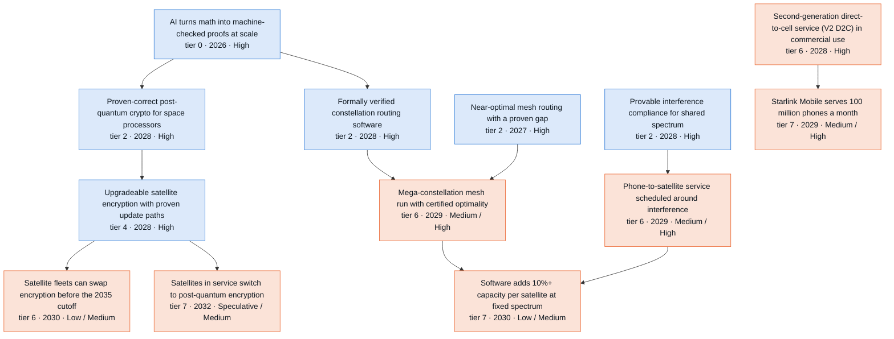

**Side lanes** (connected to the branch but off its main chain)

- Hardness limits for scheduling and network planning (unaudited) (tier 1 · 2027 · High)
- International shift to provable spectrum sharing (tier 7 · 2031 · Low)
- AI agents audit cryptography at research grade (tier 0 · 2027 · High) → AI cracks post-quantum or space-link crypto (watch item) (tier 1 · 2029 · Low)

Where the reviewers disagreed: 2031 challenge round (12 disputes)

Recorded during the 2031 challenge round. Later passes adjusted some dates and bands; the node table below has the final values.

- **When certified interference bounds first appear in a filing ("Provable interference compliance for shared spectrum").** *Skeptic:* S3 2027 -> 2028, because S3 equals S2 through 2027. Preparing a filing or coordination agreement with a new method takes months, so 2027 is not credible in any scenario. *Advocate:* S2 2028 -> 2027, and make "Verified floating-point and numerics toolchain" soft because interval tools (Arb, INTLAB, VNODE-LP) already exist. 2027 has forcing events: GSO operators may try to bring back aggregate limits through reconsideration, the D.C. Circuit or the WRC-27 cycle. The leading filer owns a frontier lab, and Part 100 self-certification needs no regulator to accept the method. *Resolution:* Soft edge accepted, since the interval-arithmetic tools exist. S2 stays 2028 and S3 becomes 2028. The primary source shows FCC 26-26 puts private coordination first and declined aggregate limits, which weakens the 2027 forcing event. Public applied math arrives in 2027 and a filing takes months to prepare. Bands stay High.
- **D2D coexistence scheduling timing and band.** *Skeptic:* Make network-optimization a soft edge. Bands Low/Medium/Medium, S1 2031, S3 2029. The node is dated the same year as its bounds, the harmonics problem is set by filters, and the incentive to protect science bands is weak. *Advocate:* S2 2029 -> 2028, bands unchanged (High). This is a software change on satellites the operator already flies. One vertically integrated actor owns the D2C satellites, the AWS-4/H-block spectrum and a frontier lab. SkyShare already works on Starlink geometry, and WRC-27 agenda item 1.13 sharpens the incentive. *Resolution:* Soft edge, S1 2031 Low and S2 Medium accepted; the auditor also pushed S2 down. S3 stays High and 2028 as the optimistic, vertically integrated path, now that 'achieved' no longer needs an FCC order and so carries no regulator cap. The advocate's S2 2028 is rejected because it assumed bounds in 2027. Agenda item 1.13 added to status and signpost.
- **Constellation design optimizer bands.** *Skeptic:* S3 High -> Medium. 'Proven compliance' is an FCC or ITU determination, so the regulator cap applies, and filers must use prescribed methods (ITU-R S.1503). *Advocate:* S2 Medium -> High. All three prerequisites are High by 2028, Part 100 makes compliance data machine-readable, demand is extreme (50,000+ planned satellites, the 1M orbital-data-center filing), and the bar includes a tool vendor shipping a product. *Resolution:* Neither change. 'Achieved' is now defined as use in a filing's technical annex without regulator acceptance, so no cap applies and S3 stays High. S2 stays Medium: three High prerequisites in conjunction, a P6 default of Low and strong in-house incumbent tools do not support more than 70%.
- **Crypto-agile architecture and the PQ flight demo: is AI's share thin or the cap misapplied?** *Skeptic:* Cryptanalysis is motive, so make it a soft edge. 'Only hedge' is wrong because AES-256 telecommand is already quantum-safe. Verified ML-KEM for AArch64 already exists, so the AI-dependent part is thin. Demo S3 -> 2029. *Advocate:* The Medium cap is misapplied because the achievement needs no certifier. Commercial PQ satellites fly, CNSA 2.0 applies from Jan 2027, and Tamarin/ProVerif and mlkem-native exist. Raise architecture S2/S3 to High, and the demo to High as well. *Resolution:* Architecture: the cap was misapplied. With achieved defined as one operator flying or contracting a design with machine-checked rekey and update proofs, S2/S3 go to High, consistent with other uncapped P2 tier-4 nodes in S2. All of the skeptic's structural fixes are kept. Demo: stays Medium. Lifting the inherited cap does not make a specific funded and disclosed mission more likely than not, and none is announced. Demo S3 2029 accepted. The advocate's 'AI-assisted AWS proofs' claim is unsupported and was not used.
- **PQ fleet migration timing and band.** *Skeptic:* Later and lower: >2031/2031/2030, Speculative/Low/Medium. 'Most new satellites' implies the roughly 3-year median contract lag. 'Machine-checked update paths' is really the procurement-norm content, which mandates do not drive. *Advocate:* Earlier: S2 2029, S3 2028. By count, new satellites are dominated by proliferated LEO (Starlink, Starshield, SDA), which turns over in 12-24 months and updates over the air. CNSA 2.0 makes new NSS acquisitions post-quantum from Jan 2027. *Resolution:* Split. The count-weighting argument is accepted for the lag, so S2 2030 and S3 2029 stay. The skeptic is accepted on the band: the machine-checked part needs buyers or the dominant operators to choose it, so S2 drops to Low and S1 to >2031/Speculative. The why was rewritten to remove the 'S3 does not beat S2' contradiction.
- **Machine-checked crypto procurement norm.** *Skeptic:* S2 Medium -> Low. It needs two institutional steps in sequence (tool qualification, then a solicitation) at SDA's roughly 2-year solicitation cadence. The signpost should count 'require' only, not evaluation credit. *Advocate:* Make "Regulators accept AI-produced proofs" a soft edge, because the trusted base is the proof kernel and not the AI generator. Move to S2 2029 / S3 2028. *Resolution:* Soft edge accepted on the advocate's trusted-base argument. Earlier years rejected: the flight demo has to come first (S2 2029, S3 2029) and politics compresses 1.0x, so S3 moves to 2030. S2 drops to Low on the skeptic's argument (an institutional step after the demo, with one or two solicitation windows left), and the signpost now counts 'require' only.
- **Software's share of constellation capacity.** *Skeptic:* S2 Low, S3 2030. Make design-optimizer and code-design soft edges, since their effects do not reach 2026-2031 capacity. Define the share additively; under log attribution the threshold is about 29%. *Advocate:* Redefine as at least 10% over the same hardware with 2026-era software, and raise S3 to High. Cheap mass moves the binding constraint in dense cells to spectral reuse under the 3%/0.1% test, so certified interference math becomes a capacity input. *Resolution:* Adopted the fixed-hardware definition, which the auditor also proposed, and the skeptic's S2 Low, S3 2030 and soft edges. The advocate's two-curve mechanism went into the why and the branch hook. S3 High rejected, because attribution to AI and disclosure do not compress under S3.
- **Verified PQC for space processors.** *Skeptic:* Part of the result already exists without AI (mlkem-native AArch64). Narrow the node to LEON, RISC-V and FPGA targets plus masking, and move S2/S3 to 2028 because flight adoption is held by qualification. *Advocate:* S1 2027 and High: a verified AArch64 ML-KEM already flies-capable on Zynq-class smallsats, so all that remains is a flight program using it. *Resolution:* Skeptic's view adopted, with S1 also moved to 2029 to keep S1 behind S2. The advocate's path is real, but it is not attributable to the AI-math channel. The advocate's claim that the proofs were AI-assisted is contradicted by the AWS post and the README.
- **Whether network optimization needs public research-grade models (hard edge).** *Skeptic:* Keep "Research-grade math for outside teams" as the binding prerequisite; only the ceilings edge should become soft. *Advocate:* Make it soft and move S1 to 2027. GPT-6 Astra and AlphaEvolve are already public, and the main operator owns a frontier lab. *Resolution:* Kept as a hard edge, and S1 stays 2028. S1 is the plateau scenario, and the node's own why ties it to public research-grade models. The advocate's internal-lab path is the S2/S3 story, which is already dated 2027.
- **When certified meshes run in production (branch thesis).** *Skeptic:* Mesh operations move to S2/S3 2029 at Medium, because a live network of more than 10,000 satellites needs emulation, validation and staged rollout. The thesis should say 2029-30. *Advocate:* 2027-28 at a vertically integrated operator (SpaceXAI), 2029-30 elsewhere. *Resolution:* The thesis says 2029-30 in the base case (Medium) and names the year-earlier vertically integrated path as the optimistic case. Mesh operations is S2/S3 2029, S2 Medium, S3 High.
- **Code-design adoption speed.** *Skeptic:* The gate is adoption and standards cycles bind, so move to 2029/2028/2028. 2026 evidence improves minimum-distance tables, not dB. *Advocate:* Proprietary air interfaces and laser ISLs can adopt by firmware. Add a soft edge into CRQC. *Resolution:* Years moved per the skeptic. The firmware path went into the text with the caveat that fixed-function decoder ASICs need a hardware cycle. The soft edge to CRQC was rejected: classical link codes are not the qLDPC route, which now lives in "AI lowers the quantum cost of breaking today's encryption".
- **CRQC before 2031: S2 band (auditor vs skeptic and advocate).** *Skeptic:* Keep Speculative. Vendor roadmaps reach the needed scale around 2033 and expert odds are low; S3 Low sits at its upper edge. *Advocate:* Keep the bands, but revisit S2 Speculative -> Low if logical-qubit milestones land in 2027. Error-correction overhead is the second exponential. *Resolution:* The auditor's S2 Low was rejected 2-to-1. The fabrication gate is unchanged even though resource estimates fell 10-100x. The advocate's revisit trigger is in the signpost, and the new resource-cuts node carries AI's route into this outcome.

Where the reviewers disagreed: 2035 and Embodied extension round (6 disputes)

- **Post-quantum fleet migration: can S2/S3 reach High by 2035?** *Skeptic:* CNSA 2.0 requires post-quantum algorithms. It does not require machine-checked update paths, and the node is defined by those paths. The procurement norm that would demand them is capped at Medium, so S3 High has no named mechanism. *Advocate:* By 2033-35 proofs are cheap in S2 as well as S3. CNSA 2.0 and the Department of War's use-by-2031 deadline are both named and in force, so S2 should rise to High along with S3. *Resolution:* Medium in S2-S4. The Department of War strategy is real (verified) and strengthens the post-quantum part, but neither mandate covers machine-checked paths. Cheap proofs do not create buyer demand or disclosure. The regulatory cap allows High only with a named mechanism for the node's own condition.
- **Timing and spread of the in-orbit post-quantum cutover (end of the spine).** *Skeptic:* S3 should not beat S2: both have the same hard-prerequisite years, and the gates are contracts, launches and disclosure. The target population is thin, because CNSA 2.0 makes national-security satellites post-quantum from launch and AES telecommand is already quantum-safe. Set S2 = S3 = 2033 and Low. *Advocate:* The Department of War's 2030-31 gates pull the first disclosed switch to 2031-32: S2 2032, S3 2031, and Medium by 2035, because proofs are near-free. *Resolution:* S2 = S3 = S4 = 2032 and S1 2033, with Medium in S2-S4 by 2035. The institutional overlay rule decides S3 = S2. The verified Dec 2031 use deadline creates a real population of in-orbit switches: satellites bought before 2027 that serve past 2031. That answers the thin-population point. Disclosure keeps the band below High.
- **Code-breaking quantum computer by 2035.** *Skeptic:* Fabrication binds, IBM's Blue Jay date has no slip allowance, Blue Jay's 1e9 operations fall short of RSA budgets, and the under-100,000 estimate is an unverified preprint. Lower S3 to Low, as the quantum chemistry node is. *Advocate:* The 2026 estimates of 10,000-26,000 atoms, AI-cut resource estimates and arrays of about 6,100 atoms put S2 at Medium from 2032. *Resolution:* Kept S2 Low and S3 Medium. The cited sister node is drafted at Medium in S2-S4 by 2035, so the skeptic's consistency argument cuts the other way. The advocate's case rests on a preprint and on atom counts without logical gates. Signposts now state what would move each band.
- **Does elapsed time justify a higher 2035 band on institution- or physics-bound nodes?** *Skeptic:* The draft treated the Medium cap as the value for the ITU sharing regime and raised the QKD backbone, the receiver theory and demo, and the optical ground network on time alone. The real gates are the WRC calendar, accreditation, physics and anchor capital, and none of them is named as moving. *Advocate:* S2 catches up with S3 by 2033-35 because cognition is cheap. Foundry runs accumulate, so the receiver demo should be Medium in S2 too. *Resolution:* Mostly the skeptic. The sharing regime and QKD backbone are Low, the receiver theory and optical ground network Medium, and the receiver demo Low in S2-S4, each with a conditional signpost. Cheap cognition closes S2/S3 gaps only where cognition was the gap: the certified shell S2 rose to High, and the mesh S2 stays High.
- **Where S4 gets credit in the networks branch.** *Skeptic:* Six of the seven robot soft edges point from accelerators that arrive after their targets, or at gates robots cannot move: procurement, launch, mission or capital. These edges imply causal paths that the notes then deny. *Advocate:* Supply of merchant laser terminals is labor-bound (hand alignment, bonding, test), and supplier ramps have failed. All four S4 conditions hold after 2031, so S4 earns one year and a band step. The thesis claim that no gate here is labor-bound is wrong. *Resolution:* Both accepted. Robot edges are cut to one with no credit. The new node "Independent suppliers ship 3,000 laser terminals a year" carries the branch's only S4 credit: 2033 against S3 2034, and Medium against Low. The demand risk and the specialized automation already counted in S3 are written into its strongest case. The proposed robot-assembled phone-to-satellite antenna was rejected: it is Speculative everywhere, folded arrays on Starship compete with it, and its gates lie in other branches.
- **New 2035-horizon nodes whose binding gate lies outside the model.** *Skeptic:* The joint-detection ground station needs a deep-space laser mission that is not modeled; set S2 >2035 or remove it. Aviation approval of low-orbit navigation is a decade-scale standards path where S3 gains nothing. Satellite-to-phone codes miss the Release 21 coding choice. *Advocate:* NASA's Mars Telecommunications Network, awarded to Blue Origin in Sep 2026 and expected at Mars around 2030, is a candidate deep-space laser target. The bands should say what changes if it carries a terminal. *Resolution:* All three nodes kept and made more conservative. The ground station keeps its years but is Speculative everywhere, with an MTN calibration note. Aviation approval is 2035 and Speculative in S2-S4. The code node moves to 2033 and widens to any published satellite link standard, including CCSDS.

All nodes in this branch

Years and likelihoods are listed for Plateau / Exponential / Recursive / Embodied. H = High, M = Medium, L = Low, S = Speculative.

| Node | Tier | Year | By 2031 | By 2035 | Binding gate | Pathway |
| --- | --- | --- | --- | --- | --- | --- |
| AI agents audit cryptography at research grade | 0 | 2028 / 2027 / 2027 / 2027 | M / H / H / H | H / H / H / H | adoption | P1->P3 |
| Optimal expander graphs for networks and codes (conditional) | 1 | 2028 / 2027 / 2027 / 2027 | S / L / L / L | L / L / L / L | formalization | P6 |
| Hardness limits for scheduling and network planning (unaudited) | 1 | 2027 / 2027 / 2027 / 2027 | H / H / H / H | H / H / H / H | formalization | P3 |
| Capacity limits of laser and quantum links (conditional) | 1 | 2028 / 2027 / 2027 / 2027 | L / M / M / M | M / M / M / M | formalization | P5 |
| AI cracks post-quantum or space-link crypto (watch item) | 1 | 2033 / 2029 / 2028 / 2028 | S / L / L / L | S / L / L / L | cognitive | P3 |
| Near-optimal mesh routing with a proven gap | 2 | 2028 / 2027 / 2027 / 2027 | M / H / H / H | H / H / H / H | cognitive | P1->P4 |
| Custom channel codes on request | 2 | 2029 / 2028 / 2028 / 2028 | M / H / H / H | H / H / H / H | adoption | P1->P4 |
| Proven-correct post-quantum crypto for space processors | 2 | 2029 / 2028 / 2028 / 2028 | M / H / H / H | H / H / H / H | qualification | P2 |
| Provable interference compliance for shared spectrum | 2 | 2030 / 2028 / 2028 / 2028 | M / H / H / H | H / H / H / H | adoption | P1->P2 |
| Machine-checked security proofs for satellite quantum keys | 2 | 2029 / 2028 / 2028 / 2028 | M / H / H / H | H / H / H / H | formalization | P1->P2 |
| Formally verified constellation routing software | 2 | 2029 / 2028 / 2028 / 2028 | M / H / H / H | H / H / H / H | formalization | P2 |
| AI lowers the quantum cost of breaking today's encryption | 2 | 2029 / 2028 / 2028 / 2028 | M / H / H / H | H / H / H / H | cognitive | P1->P4 |
| Proven error and spoofing bounds for satellite navigation | 2 | 2030 / 2028 / 2028 / 2028 | M / H / H / H | H / H / H / H | data | P1->P5 |
| Certified availability for optical ground networks | 3 | 2030 / 2029 / 2029 / 2029 | M / H / H / H | H / H / H / H | data | P1->P5 |
| Receivers that beat photon counting | 3 | 2032 / 2029 / 2028 / 2028 | S / M / M / M | M / M / M / M | experiment | P6 |
| Tasking and ground planning built on hardness limits | 4 | 2029 / 2028 / 2028 / 2028 | M / H / H / H | H / H / H / H | adoption | P3->P1 |
| Upgradeable satellite encryption with proven update paths | 4 | 2029 / 2028 / 2028 / 2028 | M / H / H / H | H / H / H / H | adoption | P2 |
| Satellite antenna beams with proven emission limits | 4 | 2030 / 2028 / 2028 / 2028 | L / M / H / H | M / H / H / H | adoption | P1->P4 |
| Constellation design with proven compliance | 4 | 2031 / 2029 / 2028 / 2028 | L / M / H / H | M / H / H / H | adoption | P1->P6 |
| AI-designed photonics with proven performance bounds | 4 | 2031 / 2029 / 2029 / 2029 | L / M / M / M | M / H / H / H | fabrication | P1->P4 |
| Multi-node satellite quantum-key demonstrations | 5 | 2028 / 2028 / 2028 / 2028 | H / H / H / H | H / H / H / H | launch-external | P7 (exogenous) |
| Flight demo of verified post-quantum command links | 5 | 2030 / 2029 / 2029 / 2029 | M / M / M / M | M / H / H / H | launch-external | P2 |
| Ground demo: optical receiver beats photon counting | 5 | 2034 / 2031 / 2030 / 2030 | S / L / L / L | S / L / L / L | experiment | P6 |
| AI-designed codes ship in a satellite link standard | 5 | 2035 / 2033 / 2033 / 2033 | S / S / S / S | S / M / M / M | adoption | P1->P4->P6 |
| Independent suppliers ship 3,000 laser terminals a year | 5 | >2035 / 2035 / 2034 / 2033 | S / S / S / S | S / L / L / M | fabrication | P1->P4 (plus robots in S4) |
| Second-generation direct-to-cell service (V2 D2C) in commercial use | 6 | 2028 / 2028 / 2028 / 2028 | H / H / H / H | H / H / H / H | adoption | P7 (exogenous; AI math enters only through coexistence scheduling and link design) |
| Mega-constellation mesh run with certified optimality | 6 | 2030 / 2029 / 2029 / 2029 | L / M / H / H | M / H / H / H | adoption | P1->P4 + P2 |
| Phone-to-satellite service scheduled around interference | 6 | 2031 / 2029 / 2028 / 2028 | L / M / H / H | M / H / H / H | adoption | P1->P4 |
| Weather-robust optical ground network service | 6 | 2031 / 2030 / 2030 / 2030 | L / M / M / M | M / M / M / M | capital | P1->P6 |
| Satellite fleets can swap encryption before the 2035 cutoff | 6 | 2033 / 2030 / 2029 / 2029 | S / L / M / M | L / M / M / M | regulatory | P2 |
| Low-orbit navigation service with published error bounds | 6 | 2031 / 2030 / 2029 / 2029 | L / M / M / M | M / H / H / H | launch-external | P1->P7 (service deployment; the integrity layer is the AI-math share) |
| Third-generation direct-to-cell satellites (V3 D2C) in service | 6 | 2030 / 2030 / 2029 / 2029 | L / M / M / M | H / H / H / H | launch-internal | P7 (exogenous; AI math enters only through coexistence scheduling and link design) |
| Certified quantum-key service from space | 6 | 2032 / 2031 / 2031 / 2031 | S / L / L / L | L / L / L / L | capital | P2->P7 |
| Real-time spectrum sharing among rival constellations | 6 | 2034 / 2031 / 2030 / 2030 | S / L / L / L | L / M / M / M | adoption | P1->P2 |
| Constellation designed with certified tools enters service | 6 | 2034 / 2032 / 2031 / 2031 | S / S / L / L | L / H / H / H | launch-external | P1->P6->P7 |
| Deep-space laser ground station gets more bits per photon | 6 | >2035 / 2034 / 2033 / 2033 | S / S / S / S | S / S / S / S | capital | P6->P7 |
| Starlink Mobile serves 100 million phones a month | 7 | 2029 / 2029 / 2029 / 2029 | M / M / M / M | H / H / H / H | adoption | P7 (exogenous; AI math enters only through coexistence scheduling and link design) |
| Software adds 10%+ capacity per satellite at fixed spectrum | 7 | 2033 / 2030 / 2030 / 2030 | S / L / M / M | L / M / M / M | adoption | P1->P4 |
| Machine-checked crypto becomes a procurement norm | 7 | 2033 / 2030 / 2030 / 2030 | S / L / M / M | L / M / M / M | regulatory | P2 |
| International shift to provable spectrum sharing | 7 | 2031 / 2031 / 2031 / 2031 | L / L / L / L | L / L / L / L | regulatory | P2 |
| Satellites in service switch to post-quantum encryption | 7 | 2033 / 2032 / 2032 / 2032 | S / S / S / S | L / M / M / M | regulatory | P2->P7 |
| Code-breaking quantum computer exists | 7 | 2034 / 2033 / 2031 / 2031 | S / S / L / L | L / L / M / M | fabrication | P7 |
| Aviation approves low-orbit navigation with proven integrity | 7 | >2035 / 2035 / 2035 / 2035 | S / S / S / S | S / S / S / S | regulatory | P1->P5->P7 |

### Fewer tests, faster approvals

*Operators fly hardware qualified mainly by AI analysis about 2029 (central scenario, High by 2035). Government credit follows in 2030-31. Test standards and new government designs follow about 2033, still Low. Qualification 15% shorter stays capped at Medium by 2035. Embodied lifts 30% shorter campaigns at leading firms to High.*

In the Exponential case, our central scenario, research-grade mathematics reaches outside teams about 2027 (High by 2031). Teams can ask for structural margins with certified uncertainty bounds in place of stacked safety factors of about 1.25–1.4, the most informative tests, and the smallest flaw a sensor layout can detect. Finite-element agents exist as [research prototypes](https://doi.org/10.48550/arxiv.2606.07850).

AI agents run and check structural and thermal analysis about 2027, and cycles get 2–5x faster about 2029 (both High by 2031). Risk-owning operators fly new hardware qualified mainly by AI analysis about 2029 (Medium by 2031, High by 2035). A rulebook for trusting AI-made analysis comes about 2029 (Medium, regulator-capped through 2035). Analysis replaces some structural tests about 2030 and some environmental tests about 2031, and qualification campaigns at least 15% shorter follow that year (all Low by 2031, Medium by 2035). On the government track, Plateau lags two to three years and Recursive leads by one. Bands are analyst judgments.

Test standards write in credit for AI analysis about 2033, and new government designs fly qualified mostly by analysis the same year (both Low by 2035, Medium in Recursive). Structures 5–15% lighter follow about 2033 (Low by 2035). Crewed structure certified with fewer strength tests is the limit, about 2034 in Recursive, Low by 2035. Only qualification campaigns 30% shorter at leading firms separate Embodied from Recursive. Both land about 2033, High by 2035 in Embodied and Medium in Recursive. Robots take setup, instrumentation and teardown, about 45% of campaign time (analyst estimate); thermal-vacuum plateaus and cycles stay fixed. Requalifying each robot process takes 6–24 months per supplier, so the year holds. Elsewhere robots change nothing; the gate is a signature, a standard or data.

The openai/math catalog contributes almost nothing here. Family 139, a sampling result with agent-written Lean no outsider has checked (T3), is background theory for margins and test design. Families 372 and 365 touch damage sensing as conditional T1 claims; 365's formal part (T3) sets no practical ceiling. Family 124, a conditional T1 scheduling result, will not schedule launch ranges.

The strongest case for a small effect is that much of this exists without AI. NASA-STD-5001B lets metallic structures skip strength tests at larger safety factors, operators skip tests they judge unnecessary, and only tests find workmanship errors. A [NASA uncertainty-quantification paper](https://ntrs.nasa.gov/citations/20230016541) puts widespread certification by analysis for aircraft in 2040–2050. The skeptic cut 30–50% shorter qualification by 2029 to 10–20% by 2031, held regulator steps at Medium through 2035 and kept Embodied's year equal to Recursive. The advocate won the commercial track, earlier years for most 2032–35 steps and Embodied's band step. Watch for a NASA directive, [NASA-STD-7009](https://standards.nasa.gov/standard/NASA/NASA-STD-7009) revision or ECSS handbook naming AI-generated analysis; silence through 2028 points to Plateau.

40 nodes. Rated High or Medium by 2031: Plateau 13, Exponential 26, Recursive 33, Embodied 33. By 2035: Plateau 22, Exponential 34, Recursive 39, Embodied 39. Main binding gate: regulatory (government track); adoption (commercial track).

**Main chain** (each node: tier · earliest year in the Exponential case · likelihood by 2031 / by 2035; Recursive and Embodied years shown where they differ)

- **Research-grade math for outside teams** (tier 0 · 2027 · High; gate: regulatory, then capital)
  - → **AI agents run and check structural and thermal analysis** (tier 4 · 2027 · High; gate: adoption, then cognitive)
    - → **Operators fly new hardware qualified mainly by AI analysis** (tier 5 · 2029 · Medium / High; gate: adoption, then fabrication)
      - → **New government designs fly qualified mostly by analysis** (tier 6 · 2033 · Speculative / Low; Recursive 2032; gate: regulatory, then capital)
      - → **Qualification campaigns 30% shorter at leading firms** (tier 7 · 2035 · Speculative / Low; Recursive 2033; gate: qualification, then adoption)
    - → **Structures and thermal analysis cycles 2-5x faster** (tier 7 · 2029 · High; Recursive 2028; gate: adoption, then cognitive)
      - → **5-15% lighter structures on new vehicles and spacecraft** (tier 7 · 2033 · Speculative / Low; Recursive 2031; gate: qualification, then adoption)
    - → **Qualification by analysis replaces some structural tests** (tier 4 · 2030 · Low / Medium; Recursive 2029; gate: regulatory, then data)
      - → **Analysis replaces some environmental qualification tests** (tier 4 · 2031 · Low / Medium; Recursive 2030; gate: qualification, then regulatory)
        - → **Qualification campaigns at least 15% shorter** (tier 7 · 2031 · Low / Medium; Recursive 2030; gate: qualification, then regulatory)
        - → **Test standards write in credit for AI analysis** (tier 5 · 2033 · Speculative / Low; Recursive 2032; gate: regulatory, then adoption)
        - → **New government designs fly qualified mostly by analysis** (tier 6 · 2033 · Speculative / Low; Recursive 2032; gate: regulatory, then capital) (see above)
  - → **Regulators review with AI tools** (tier 0 · 2028 · Medium; gate: adoption, then data)
    - → **Launch licensing in weeks** (tier 6 · 2028 · Medium; gate: regulatory, then adoption)
- **Structural margins with certified uncertainty bounds** (tier 2 · 2028 · High; gate: data, then cognitive)
  - → **Qualification by analysis replaces some structural tests** (tier 4 · 2030 · Low / Medium; Recursive 2029; gate: regulatory, then data) (see above)
- **Tests chosen for information, not habit** (tier 2 · 2028 · High; gate: adoption, then experiment)
  - → **Operators fly new hardware qualified mainly by AI analysis** (tier 5 · 2029 · Medium / High; gate: adoption, then fabrication) (see above)
  - → **Qualification campaigns at least 15% shorter** (tier 7 · 2031 · Low / Medium; Recursive 2030; gate: qualification, then regulatory) (see above)
- **A rulebook for trusting AI-made analysis** (tier 2 · 2029 · Medium; Recursive 2028; gate: regulatory, then formalization)
  - → **Qualification by analysis replaces some structural tests** (tier 4 · 2030 · Low / Medium; Recursive 2029; gate: regulatory, then data) (see above)
  - → **Analysis replaces some environmental qualification tests** (tier 4 · 2031 · Low / Medium; Recursive 2030; gate: qualification, then regulatory) (see above)

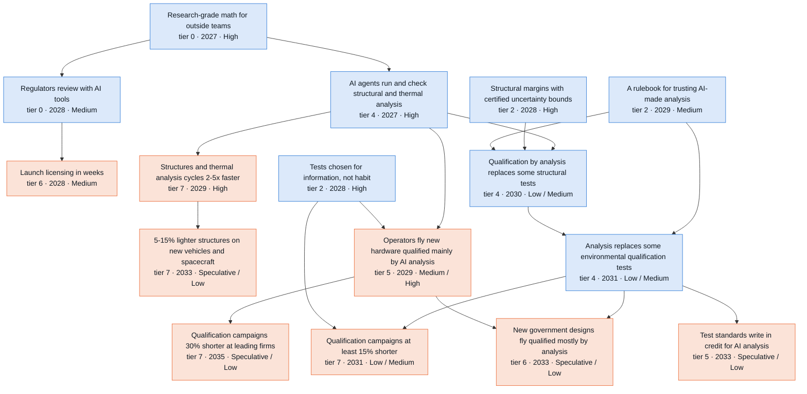

**Side lanes** (connected to the branch but off its main chain)

- Test stands that run themselves (tier 4 · 2029 · Medium / High)
- Crewed vehicle structure certified with fewer strength tests (tier 6 · 2035 · Speculative)

Where the reviewers disagreed: 2031 challenge round (10 disputes)

Recorded during the 2031 challenge round. Later passes adjusted some dates and bands; the node table below has the final values.

- **When the credibility rulebook for AI-made analysis arrives ("A rulebook for trusting AI-made analysis").** *Skeptic:* The named standards revise every 8-10 years (NASA-STD-7009 in 2008, 2016 and 2024). The next base revision falls around 2030-32, so S2 should be 2030, S3 2029 and S1 >2031. A rule counting AI-checked derivations should not come before the 2030 S2 premise for regulator credit of AI proofs. *Advocate:* FDA wrote a risk-based AI-credibility framework (draft, Jan 2025) without machine-checked numerics, and NASA-STD-7009B is already risk-based. A NASA interim directive needs only checked evidence, available in S2 by 2027. So S2 2028, with verified numerics as a soft input. *Resolution:* Kept S2 2029, S3 2028 and S1 2031. The skeptic's revision-cycle facts went into the why, but the node is met by the faster handbook or interim-directive route, which the skeptic also names. A rulebook also normally comes before project-level credit, so 2029 does not conflict with 2030 proof credit. Took the advocate's soft edge for verified numerics and the FDA precedent. Rejected S2 2028: FDA's draft is guidance for drug submissions, its device guidance took about five years after ASME V&V 40, and agencies adopt last.
- **How much shorter qualification gets, and when ("Qualification campaigns at least 15% shorter").** *Skeptic:* 30-50% contradicts the branch's own physical-gate table (0.8-0.9x in S2, 0.7-0.8x in S3) and the 1.2x Amdahl figure. Data on programs started in 2028 or later cannot report before about 2031. Retitle to 10-30%, S2 2031 Low, S3 2030. *Advocate:* Fewer tests and faster tests multiply to 0.36-0.64x of test-phase time. Commercial operators can skip qualification units, and the S3 qualification multiplier reaches 1.7x. Keep 30-50%, S2 2029, S3 2028 High, and make the analysis-credit and printed-part edges soft. *Resolution:* Retitled to 15-30% with a 15% threshold. S2 2031 Low, S3 2030 Medium. The advocate's multiplication applies to test-phase time only and still exceeds the experiment multiplier of 1.1-1.3x. The hard edge to analysis credit stays, because the signpost (GAO and ESA data) measures government programs. The commercial route became a soft accelerator through the new commercial node. Both lenses agreed the printed-part edge should be soft.
- **Certification by analysis for primary structure ("Qualification by analysis replaces some structural tests").** *Skeptic:* The node's examples are already allowed by NASA-STD-5001B, so re-scope to credit beyond those allowances. Follow the slipped rulebook to S2 2031 / S3 2030, S2 Low. Make verified FE solvers soft and add test data as a hard prerequisite. *Advocate:* Verified FE solvers are not required (agreed). With the rulebook in 2028, first credit on derivatives lands in S2 2029 / S3 2028, Medium. Operator self-acceptance belongs on a separate commercial node. *Resolution:* Re-scoped, after checking the 5001B text. Kept S2 2030 / S3 2029 because the rulebook stays at 2029. S2 band Low, because the re-scoped step is strictly harder than today's allowances and leaves one or two years of window. FE solvers made soft (both lenses). Test-data commons added as a hard edge, because 5001B's no-test criteria rely on similarity and correlation. Operator self-acceptance moved to the new commercial node.
- **A commercial self-risk track (new node "Operators fly new hardware qualified mainly by AI analysis").** *Skeptic:* No new node was proposed. The branch already says commercial operators skip tests where they own the risk, so the gain is mainly on government programs, and the gate is physical and institutional. *Advocate:* Most mass to orbit belongs to operators no qualification authority oversees: Part 450 covers public safety only, and SpaceX's own cargo is about 6x the external market. Add a commercial node at S2 2029, High, plus fleet-statistical qualification and envelope licensing. *Resolution:* Added the commercial node, re-scoped beyond today's protoflight practice, which the advocate's wording described. S2 Medium rather than High: tests catch workmanship errors, a fleet-wide defect is costly, and the step must be stated publicly to count. S3 High. S3 2029, because S3 equals S2 through 2028. Rejected fleet-statistical qualification: the launch-cost half is independent of AI, the fleet-statistics half is not scarce at the one operator that has such a fleet, and it sat in the same year as its prerequisite. Rejected envelope licensing as a near-duplicate of "Launch licensing in weeks", since Part 450 already allows one license for multiple launches.
- **Monthly build-fly-fix loops (physclock-test-loop-monthly).** *Skeptic:* It duplicates its own prerequisite (12+ flights in 2027 is a ~30-day mean interval) and contradicts it. The physical table gives 38-53 day intervals in S2. Merge it into "Monthly flight testing of a fully reusable heavy launcher", or set S3 to 2028 Medium. *Advocate:* It is internally inconsistent in the other direction. Since its prerequisite is High in 2027, six intervals of 30 days or less by 2031 must be High in S2. *Resolution:* Removed the node, which the skeptic proposed and the auditor offered as an alternative. Both lenses showed it carries no information its prerequisite lacks. The "Monthly flight testing of a fully reusable heavy launcher" owner is asked to add mishap analysis as an accelerator and to review its 2027 High against the physical-gate table.
- **Structural mass gains ("5-15% lighter structures on new vehicles and spacecraft", "First flight structure sized with AI-certified margins").** *Skeptic:* An industry-wide 5-15% trend cannot appear in the same year as the first flown article (S2 2031), so the mass step moves to >2031. The gains fall on different parts of dry mass. Analysis-based knockdowns already flew on SLS, so the flown-structure S3 band should drop to Low. *Advocate:* Commercial spacecraft need neither SP-8007 nor a regulator. Remove the standards gate, move the flown structure to S2 2030 Medium, and the mass step to S2/S3 Medium with S3 2030. An AI-native spacecraft at S2 2029 High makes a Low mass step inconsistent. *Resolution:* Edge changes taken from the advocate and auditor: the flown structure now needs imperfection theory and certified margins, not a standards revision. Years and bands for the flown structure unchanged: the lag ladder puts primary structure at 2031+, and attribution needs a public statement. Mass step S2 >2031 (skeptic). The AI-native spacecraft node is a process outcome whose own strongest case says the performance gains are small, so there is no inconsistency. It and design optimization became soft accelerators.
- **Launch environments ("Tighter launch vibration and acoustic environments").** *Skeptic:* Maximum predicted environments are already statistical (P95/50). Empirical data suffice for high-cadence vehicles, forcing uncertainty dominates, and providers lack the incentive to tighten published environments. Make mid-frequency vibroacoustics soft and set S2 Low. *Advocate:* SpaceX is both launch provider and customer for about 73.5% of mass to orbit and has every incentive. Starship flight data calibrate the models. S2 2029, S3 2028. *Resolution:* S2 Low, years unchanged. The advocate's own example undercuts the AI attribution: with abundant Starship data, empirical envelopes need no predictive models, and SpaceX rarely publishes its environments. The vertically integrated route was added to the description and signpost, and mid-frequency vibroacoustics made soft.
- **Regulators adopting AI review tools ("Regulators review with AI tools").** *Skeptic:* No finding on this node. The skeptic applied the same regulator-behavior cap to range and airspace scheduling. *Advocate:* The Medium cap is misapplied, because this is internal tool use, not acceptance of AI evidence. FDA deployed Elsa agency-wide in June 2025. S2 2027, S2/S3 High. *Resolution:* Kept Medium and set S3 to 2028, as the auditor proposed (S3 equals S2 through 2028). The node's event includes 2-5x reviewer throughput and published review times, which is regulator behavior under the A3 cap. FDA Elsa was added to the status as evidence that adoption can be fast.
- **Test design and autonomous test stands ("Tests chosen for information, not habit", "Test stands that run themselves").** *Skeptic:* Design of experiments has been mandated in DoD test and evaluation since 2010 and used at NASA Langley since the late 1990s, and qualification matrices did not shrink. Narrow the node to development tests (10-30%). 20-40% calendar compression from autonomous stands exceeds the 1.1-1.3x experiment multiplier, so stands drop to S2 Medium. *Advocate:* The first adopter, SpaceXAI, does not wait for industry-wide adoption, so optimal test campaigns move to S2 2027 and the "On-demand applied math in space engineering" edge becomes soft. The advocate treated autonomous stands as a High input. *Resolution:* Narrowed optimal test campaigns to development tests and kept S2 2028 High. 'Typical matrices shrink' is an industry outcome, so engineering adoption stays a hard prerequisite. Stands moved to S2 Medium (S3 High) with 10-25% calendar compression.
- **Certified UQ margins and SHM detection limits (skeptic vs auditor).** *Skeptic:* Both nodes should drop to S2 Medium. Model-form error is still open, data is the gate, and the scorecard default for P6 is Low. Probabilistic criteria have been allowed case by case for years with little uptake. *Advocate:* The auditor, not the advocate, took the other side: re-scope the signposts to method output (not regulator acceptance) and relabel the pathway P1, which keeps High grounded. *Resolution:* Took the auditor's signpost and pathway re-scopes and kept S2 High for both. Took the skeptic's data gate for UQ margins, the limit of its mass claim to strength-critical members, and its trust-tier wording fixes for 372 and 365. Once the signposts measure capability rather than acceptance, the lack of uptake argues about acceptance, which "Qualification by analysis replaces some structural tests" and "Sensor-based inspection credit for reusable stages" model.

Where the reviewers disagreed: 2035 and Embodied extension round (13 disputes)

- **Regulator nodes raised to High by 2035 (licensing in weeks, regulator AI capacity, credibility rulebook).** *Skeptic:* None of the named mechanisms is in motion for these events. EO 14335 can be reversed, the FAA proposals are not final, and FCC Part 100 covers satellites. The FDA tool belongs to another agency. CM4QC covers aviation metals, and no NASA-STD-7009 revision is open. New licenses under 90 days sit at the fast end of the gate table's 81-113 days, and 2-5x reviewer throughput exceeds the 1.6-2.2x regulatory clock gain. *Advocate:* No direct challenge. The advocate leaned on the rulebook being High by 2035 to support raising downstream nodes. *Resolution:* All three nodes go back to Medium in S2-S4. the extension rules allows High only through a named mechanism already in motion for the specific event, and none covers these thresholds. Every hard successor ("Qualification by analysis replaces some structural tests", "Analysis replaces some environmental qualification tests", "Models cut the test flights needed to prove reliability", "Certify each printed part from its build data", "A certifier audits AI analysis instead of redoing it", "Thruster life proven with shorter wear tests", "Crew and defense payloads fly on data-cleared reused rockets") is Medium or lower, so nothing downstream breaks.
- **Where robots show up in certification: 30% shorter qualification campaigns at leading firms.** *Skeptic:* The draft gave S4 both a year (2033 against 2034) and a band, built on a chain of earliest dates. That ignores the 6-24 month requalification dip and a missing cleanroom gate (contamination, outgassing, ESD). The skeptic proposed S4 at 2034 equal to S3, with the band step only, and S2 at Speculative. *Advocate:* The bands contradict the gate table. Typical S3 2035 runs 28-37% shorter, typical S4 33-42% and leading S4 firms 50-57%. The hard edge from the government-measured 15% node is wrong for commercial firms that set their own tests. The advocate proposed S2 2035, S3 2033, S4 2032, S3 Medium and S4 High, with hard edges from operator analysis-first qualification and AI-run stands. *Resolution:* Merged. The years follow the program clock: programs start in 2031 or later and must report, so S3 and S4 are both 2033 and S2 is 2035. S4 gets no year credit because requalification and cleanroom qualification absorb the first robot programs. The bands follow the gate table: S2 Low, S3 Medium, S4 High. A 30% cut sits below even typical S4 programs, and disclosure is the residual risk in S3. The 15% node becomes a soft accelerator. Operator analysis-first qualification becomes the one hard prerequisite, because robot labor gains alone give about 25% (45% labor share at 2.3x). The AI-run stands hard edge and S4 2032 were rejected. This band step is the branch's only S4 credit.
- **Typical qualification 15% shorter: does government credit still gate it by 2035?** *Skeptic:* No change beyond S1 going to Speculative, because its year is after 2035. *Advocate:* By 2035 the threshold is below the whole gate-table range in S2-S4 (17-29%, 28-37%, 33-42%). Operators that carry their own risk deliver the cut without government credit. The advocate proposed making the hard edge soft and raising S2-S4 to High, or, as a fallback, raising government analysis credit to High. *Resolution:* Rejected. The earlier review kept the hard edge because the signpost (GAO and ESA schedule data) measures government programs, and that still holds in 2035. Government credit stays Medium with no named mechanism, so the node stays Medium. The commercial route is modeled where it belongs, in the leading-firm 30% node. That node can be more likely than the 15% node because its population is not gated by government credit.
- **Crewed structure certified with fewer strength tests.** *Skeptic:* Two years from a crewed CDR to certification is too short for human-rated primary structure. The node chains two Medium regulator steps before the most conservative certifier. The skeptic proposed moving S3/S4 to after 2035 at Speculative and adding soft edges from the uncrewed audit node and the crewed probabilistic heat shield. *Advocate:* NASA-STD-5001B already lets a Technical Authority approve no-test or probabilistic criteria case by case (FSR 15-17), so a codified standard is not required. 2032-35 brings several crewed structure certifications. The advocate proposed S2 2035, S3/S4 2034, S2 Low, and making the standards edge soft. *Resolution:* Mixed. The standards edge becomes soft, because 5001B case-by-case approval is a real route. The event is read at approval of the certification plan, as the signpost already says, so the skeptic's build-to-certification lag does not apply. Years move to S2 2035 and S3/S4 2034. Bands stay cautious: S3/S4 Low and S2 Speculative. Both lenses' soft edges from "A certifier audits AI analysis instead of redoing it" and "Crewed heat shield sized by probabilistic margins flies" are added. This node still marks the limit of the branch.
- **When test standards codify AI analysis credit.** *Skeptic:* One or two derivative credits are not a body of cases. ECSS-E-ST-10-03 takes about 19 months from draft to publication, so drafting would start the year the first precedent lands. GEVS is next due before the precedents. The skeptic proposed slipping S2 to 2034 and S3 to 2033, and adding SMC-S-016. *Advocate:* Any of four standards counts. Their revision calendars fall in the window, and the parallel software-standards node is S2 Medium. The advocate proposed raising S2 to Medium. *Resolution:* Years and bands kept: S2 2033 Low, S3/S4 2032 Medium. Earliest year marks the first credible year, and an ECSS-E-ST-10-03 revision due about 2032 fits S3 at the optimistic end, so the slip was not needed. S2 stays Low because the scheduled base revisions fall before or at the start of its 2030-31 precedents. SMC-S-016 and a scope note on the credibility rulebook were added.
- **Government missions flying new designs qualified mainly by analysis.** *Skeptic:* The node relies on vendors that already qualify this way, so operator analysis-first qualification should be a hard edge. Flight dates follow appropriations-bound tranche calendars that are equal across S2-S4. *Advocate:* The years use the long end of the build lag. The lag ladder gives 12-18 months for smallsat and derivative builds, so the advocate proposed S2 2033 and S3/S4 2032, with S2 Medium. *Resolution:* Both structural points were taken. The hard edge from operator analysis-first qualification and the calendar sentence come from the skeptic. Years at the short end of the lag (S2 2033, S3/S4 2032) come from the advocate. S2 stays Low, because it chains on a Medium derivative credit with about two years of window. S3/S4 stay at the Medium cap.
- **Should a flight record certify heavy launchers? (advocate's new node).** *Skeptic:* Not raised. The skeptic's general position is that reliability statistics and certifier acceptance do not compress. *Advocate:* Cadence is the branch's largest missing unlock. At 100-300 heavy flights a year, a vehicle family logs the ~229 zero-failure flights for 0.99 at 90% in about two years. AI models of what each design change affects would let the record carry across versions. The advocate proposed a new tier-6 node: S2 2033 and S3 2032, Medium by 2035. *Resolution:* Rejected as a node, folded in as notes and edges. Certifying on flight history with engineering review of changes is already NASA LSP and NSSL practice, so the AI-attributable step is small and hard to observe. The cadence itself is exogenous and already modeled ("100+ fully reusable heavy launches a year", "300+ fully reusable heavy launches a year"). The pooling idea is read as a use of model priors in "Models cut the test flights needed to prove reliability". Its note now says high cadence makes priors matter most for new versions, low-cadence vehicles and components. Soft edges from cadence into the priors and reusable-life nodes were added. The proposed edge into launch environments was rejected, because abundant flight data substitute for that node's predictive models.
- **Does EO 14335 move model-based reliability priors to High?** *Skeptic:* Not addressed for this node. The skeptic's general reading is that named mechanisms must cover the specific event. *Advocate:* EO 14335 Sec. 3(b)(iii) directs review of whether to expand the conditions that demonstrate reliability for a reentry vehicle, and NSSL already certified Vulcan after two flights. The advocate proposed raising S3/S4 to High. *Resolution:* The quoted text was checked on whitehouse.gov and added to the status. The node stays Medium. The clause asks whether to expand public-safety reliability conditions for reentry under Part 450 and commits no mission-assurance certifier to model priors. Its hard prerequisite, the credibility rulebook, is Medium.
- **Robot-tended reliability rigs (advocate's new S4 node).** *Skeptic:* Not raised. *Advocate:* Statistics fix the trial count and labor sets the trial rate. Robots that re-stow deployables and latches could run 229 trials in weeks. The S4 gate table marks component trials at 0.3-0.5x with parallel rigs. *Resolution:* Rejected as a node. Many mechanism trials are destructive (pyrotechnic separation) or must run in thermal vacuum, where dwell binds, and valve cycling is already automated. Firms rarely seek 0.99 at 90% by brute-force test, and the AI-math attribution is nil. The parallel-rig gain is noted in the 30% node's why, where it counts when it shortens a campaign.
- **Five-year materials insertion and S4 credit.** *Skeptic:* The description still says 'fly by 2031', so the two checkpoints grade different events. Three five-year programs are commercial outliers, not an industry pattern, and creep tests and separate heats do not compress. The skeptic proposed re-scoping and keeping S3/S4 Medium only on the re-scoped event. *Advocate:* The node counts tail programs. Fast pre-AI programs took about six years, and lab robots from 2030 do specimen work. The advocate proposed S4 High and S2 Medium, citing "First AI-agent-designed alloy flies in a rocket engine" at High. *Resolution:* Re-scoped as the skeptic proposed: three programs started 2027 or later that each fly within five years, most likely commercial in-house materials. Bands kept: S2 Low, S3/S4 Medium. S4 fails condition 1, because creep hours and separate heats bind fast programs and the S4 table gains only about 5 points over S3 (48% vs 43%). S2's gates move only 1.2-1.4x by 2035.
- **Damage-tolerance physics: S4 band step and the lab-robot edge.** *Skeptic:* Bench robots do reagent prep and plate loading, while this node is bound by scarce cryogenic fatigue rigs and subcomponent tests. The skeptic proposed removing the "Robots do general lab bench work at scale" soft edge. *Advocate:* the extension rules freezes only the year and the 2031 band, so 2035 bands can take S4 credit. With physics theory High by 2035, rig throughput is the residue, and robot-tended frames raise it. The advocate proposed S4 High. *Resolution:* The advocate's rule reading is correct: the 2035 band steps are allowed for nodes dated before 2032. This node still fails condition 1. Its residual 2035 gate is material variability and fatigue hours, and coupon-test speedups are already counted through the "AI-run closed-loop labs at scale" prerequisite. S4 stays equal to S3 at Medium, and the edge is removed.
- **Lighter structures: disclosure and the launch-environment edge.** *Skeptic:* The flown-structure event needs a public statement of AI-derived knockdowns. Elsewhere the branch holds disclosure-bound nodes at Medium, so S3/S4 should go from High to Medium. *Advocate:* The mass step lists tighter launch environments as one of four contributors that apply to different parts of dry mass, so that edge should be soft. Masses become visible in debris filings and SpaceX's public reporting. The advocate proposed S2 Medium and S3/S4 High. *Resolution:* Both partly. The flown structure goes to Medium in S3/S4, for consistency with the earlier review and the branch's other disclosure-bound nodes. The launch-environment edge becomes soft, as the node's own description supports. The mass step stays S2 Low and S3/S4 Medium, bounded by its Medium flown-structure prerequisite and by attribution.
- **Bands before the first credible year.** *Skeptic:* Earliest year marks the first credible year, so a node first credible in 2033 cannot be 10-30% likely by 2031. The graph already uses Speculative in most such cases (103 against 54 at 2033). *Advocate:* Not contested. *Resolution:* Applied across the branch. Nine values move to Speculative, including one base-case value: "5-15% lighter structures on new vehicles and spacecraft" S2 the 2031 band, which is flagged for the integrator.

All nodes in this branch

Years and likelihoods are listed for Plateau / Exponential / Recursive / Embodied. H = High, M = Medium, L = Low, S = Speculative.

| Node | Tier | Year | By 2031 | By 2035 | Binding gate | Pathway |
| --- | --- | --- | --- | --- | --- | --- |
| Regulators review with AI tools | 0 | 2029 / 2028 / 2028 / 2028 | M / M / M / M | M / M / M / M | adoption | P1 |
| AI-ready structural and thermal test data | 0 | 2029 / 2028 / 2028 / 2028 | M / H / H / H | H / H / H / H | adoption | P1 (enabler) |
| Launch range and airspace scheduled by optimizer | 2 | 2028 / 2028 / 2028 / 2028 | M / M / M / M | M / M / M / M | adoption | P1 |
| Tests chosen for information, not habit | 2 | 2029 / 2028 / 2028 / 2028 | M / H / H / H | H / H / H / H | adoption | P1 |
| Structural margins with certified uncertainty bounds | 2 | 2030 / 2028 / 2028 / 2028 | M / H / H / H | H / H / H / H | data | P1 (method availability; acceptance as a substitute for factors is P6, modeled in struct-cert-by-analysis) |
| Damage detection with proven detection limits | 2 | 2030 / 2028 / 2028 / 2028 | M / H / H / H | M / H / H / H | data | P1 (catalog: P5 via 372, conditional) |
| Worst-case imperfection theory for thin shells | 2 | 2030 / 2028 / 2028 / 2028 | M / H / H / H | H / H / H / H | cognitive | P1->P6 |
| Material strength limits from far fewer test samples | 2 | 2031 / 2029 / 2028 / 2028 | L / M / M / M | L / M / M / M | regulatory | P1->P6 |
| Certified bridges from microstructure to part properties | 2 | 2034 / 2029 / 2028 / 2028 | S / M / M / M | L / H / H / H | cognitive | P6 |
| A rulebook for trusting AI-made analysis | 2 | 2031 / 2029 / 2028 / 2028 | L / M / M / M | M / M / M / M | regulatory | P2 |
| Closing the mid-frequency vibration gap | 2 | 2032 / 2029 / 2028 / 2028 | S / M / M / M | M / M / H / H | data | P1->P6 |
| Finite-element solvers with machine-checked error bounds | 2 | 2032 / 2029 / 2028 / 2028 | S / M / M / M | M / H / H / H | formalization | P2 |
| Predictive physics of 3D-printed metal parts | 3 | 2030 / 2029 / 2028 / 2028 | L / M / M / M | M / M / H / H | data | P1->P6 |
| Predictive damage and fatigue models for reusable structures | 3 | 2034 / 2030 / 2029 / 2029 | S / M / M / M | L / M / M / M | experiment | P6 |
| AI agents run and check structural and thermal analysis | 4 | 2028 / 2027 / 2027 / 2027 | H / H / H / H | H / H / H / H | adoption | P1 |
| License analyses drafted and checked by AI | 4 | 2029 / 2027 / 2027 / 2027 | M / H / H / H | H / H / H / H | adoption | P1->P2 |
| Anomaly diagnosis 3-10x faster | 4 | 2029 / 2027 / 2027 / 2027 | M / H / H / H | H / H / H / H | experiment | P1 |
| Test stands that run themselves | 4 | 2030 / 2029 / 2028 / 2028 | M / M / H / H | M / H / H / H | capital | P1 |
| Lighter buckling design rules for tanks and interstages | 4 | 2031 / 2029 / 2029 / 2029 | L / M / M / M | M / M / M / M | regulatory | P1->P6 |
| Insurance-grade models of launch and in-orbit risk | 4 | 2031 / 2029 / 2028 / 2028 | L / M / M / M | M / H / H / H | data | P1->P5 |
| Satellites screened by statistics, not unit tests | 4 | 2030 / 2029 / 2028 / 2028 | L / M / H / H | M / H / H / H | data | P1 |
| Certify each printed part from its build data | 4 | 2031 / 2030 / 2029 / 2029 | L / M / M / M | L / M / M / M | regulatory | P1->P6 |
| Qualification by analysis replaces some structural tests | 4 | 2033 / 2030 / 2029 / 2029 | S / L / M / M | L / M / M / M | regulatory | P2+P6 |
| Tighter launch vibration and acoustic environments | 4 | 2033 / 2030 / 2029 / 2029 | S / L / M / M | L / M / M / M | regulatory | P1->P6 |
| Models cut the test flights needed to prove reliability | 4 | 2033 / 2030 / 2029 / 2029 | S / L / M / M | L / M / M / M | qualification | P2->P6 |
| Analysis replaces some environmental qualification tests | 4 | 2034 / 2031 / 2030 / 2030 | S / L / M / M | L / M / M / M | qualification | P2->P6 |
| Operators fly new hardware qualified mainly by AI analysis | 5 | 2030 / 2029 / 2029 / 2029 | L / M / H / H | M / H / H / H | adoption | P1 (process outcome; flight step written out as a chain) |
| Sensor-based inspection credit for reusable stages | 5 | 2032 / 2030 / 2030 / 2030 | S / M / M / M | M / M / M / M | qualification | P1->P6 |
| First flight structure sized with AI-certified margins | 5 | 2033 / 2031 / 2031 / 2031 | S / L / M / M | L / M / M / M | qualification | P6->P7 |
| Test standards write in credit for AI analysis | 5 | >2035 / 2033 / 2032 / 2032 | S / S / S / S | S / L / M / M | regulatory | P2->P6 |
| Launch licensing in weeks | 6 | 2029 / 2028 / 2028 / 2028 | M / M / M / M | M / M / M / M | regulatory | P1 (with policy reform) |
| Sensors and models track wear on reusable stages | 6 | 2033 / 2031 / 2031 / 2031 | S / L / M / M | L / M / M / M | experiment | P6->P7 |
| New government designs fly qualified mostly by analysis | 6 | >2035 / 2033 / 2032 / 2032 | S / S / S / S | S / L / M / M | regulatory | P2->P7 |
| Crewed vehicle structure certified with fewer strength tests | 6 | >2035 / 2035 / 2034 / 2034 | S / S / S / S | S / S / L / L | regulatory | P2->P7 |
| Structures and thermal analysis cycles 2-5x faster | 7 | 2030 / 2029 / 2028 / 2028 | M / H / H / H | H / H / H / H | adoption | P1 |
| Qualification campaigns at least 15% shorter | 7 | >2035 / 2031 / 2030 / 2030 | S / L / M / M | S / M / M / M | qualification | P2->P6 |
| New space materials reach flight in five years or less | 7 | >2035 / 2031 / 2031 / 2031 | S / L / L / L | S / L / M / M | qualification | P1->P6->P7 |
| Model-priced insurance for new rockets and constellations | 7 | 2034 / 2031 / 2030 / 2030 | S / L / L / L | L / M / M / M | capital | P1->P5 (pricing practice; market capacity is not AI-math-driven) |
| 5-15% lighter structures on new vehicles and spacecraft | 7 | >2035 / 2033 / 2031 / 2031 | S / S / L / L | S / L / M / M | qualification | P6->P7 |
| Qualification campaigns 30% shorter at leading firms | 7 | >2035 / 2035 / 2033 / 2033 | S / S / S / S | S / L / M / H | qualification | P6->P7 |

### Engines, fuels and alloys

*Certified flow and materials models give engines reuse life by analysis from about 2029 (central scenario). Hot fire and flights set the pace. In 2032-35, 50-flight engines and reusable lunar landers are likeliest. An AI-designed alloy may fly, likely in Recursive. Robots (Embodied) lift one band: a four-year large engine.*

On-demand AI mathematics first supplies expert-scarce analysis solved in principle. From about 2028 in the Exponential case, our central scenario, propulsion teams get certified stability margins for every injector variant in days, checked flow simulations, life models updated after each flight and alloy screening with error bars (all High by 2031).

Model-based engine reuse life arrives about 2029 (Medium by 2031, High by 2035), but each life data point costs a flight, so life extension comes only 6-12 months sooner. Designing out combustion instability before hot fire needs predicted flame response at engine pressures, about 2031 (Low by 2031). AI designs alloys in weeks; powder lots, print-parameter work and hot fire set the floor. [NASA's GRCop alloy](https://ntrs.nasa.gov/api/citations/20260003255/downloads/AMRL%20Framework%20for%20AM%20Alloy%20Readiness.pdf) took from 1987 to 2023 to fly. The first AI-designed alloy flies in an engine about 2030 (Low by 2031, Medium by 2035, High in Recursive). Plateau runs two to four years behind.

We judge the likeliest 2032-35 gains operational. Fleet-leader engines fly 50 missions without overhaul about 2033 in the Exponential case, and a lunar lander makes three landings, refueled in space, the same year (both Medium by 2035). Engines built around an AI alloy's margin and programs with fewer hot-fire tests also arrive about 2033 (Low by 2035). Embodied equals Recursive on every node but one. A new large engine flying four years after program start comes about 2033 in both, and Embodied lifts it from Low to Medium by 2035, because a robot-first firm builds development engines in parallel and tests around the clock. Elsewhere robots change nothing, because flights, 14-month creep tests and Mars windows set the pace.

The openai/math catalog contributes little. Family 143 claims bounds on oscillation states in planar models (T1, conditional; Lean covers only quintic Liénard systems). Family 365's formalized part (T3) limits tomographic imaging of tank contents, worth about 0.1 tanker per 1% gauging error. Families 372 and 366 (T1, conditional) touch inspection behind life models.

The strongest case for a small effect is that testing is already cheap. SpaceX built over 600 Raptors through test-fail-fix by April 2026. The skeptic said 0.99 reliability at 90% confidence takes about 230 zero-failure starts, and the advocate noted a Starship flight logs 65-70. Those starts share a vehicle, and each failure resets the count, as [three failed booster relights on Flight 13](https://spaceflightnow.com/2026/07/25/super-heavy-starship-rocket-chalks-up-mostly-successful-test-flight/) showed. For 2035 the skeptic cut the Exponential alloy flight to Medium. The advocate showed that minutes at temperature per flight keep 10,000-hour creep tests off the alloy's path. The Embodied band step survived the skeptic; the advocate's earlier year did not. Bands are analyst judgments. Watch for an AI-designed alloy in hot fire at an engine maker or NASA Marshall by 2029.

41 nodes. Rated High or Medium by 2031: Plateau 15, Exponential 25, Recursive 27, Embodied 27. By 2035: Plateau 23, Exponential 32, Recursive 37, Embodied 38. Main binding gate: experiment.

**Main chain** (each node: tier · earliest year in the Exponential case · likelihood by 2031 / by 2035; Recursive and Embodied years shown where they differ)

- **AI does research-grade applied math** (tier 0 · 2027 · High; gate: cognitive, then data)
  - → **Atomistic AI models with trustworthy error bars** (tier 2 · 2028 · High; gate: data, then cognitive)
    - → **AI designs new rocket-engine alloys in weeks** (tier 4 · 2028 · High; gate: experiment, then fabrication)
      - → **First AI-agent-designed alloy flies in a rocket engine** (tier 5 · 2030 · Low / Medium; gate: experiment, then fabrication)
        - → **An engine built around an AI-designed alloy flies** (tier 6 · 2033 · Speculative / Low; Recursive 2032; gate: experiment, then fabrication)
  - → **Certified combustion-stability models** (tier 2 · 2028 · High; gate: cognitive, then data)
    - → **Design out combustion instability before hot fire** (tier 4 · 2031 · Low / Medium; gate: experiment, then adoption)
      - → **Engine development time and cost cut** (tier 7 · 2033 · Speculative / Low; Recursive 2031; gate: experiment, then qualification)
  - → **Automated checks that engine flow simulations are right** (tier 2 · 2028 · High; gate: adoption, then cognitive)
    - → **Design out combustion instability before hot fire** (tier 4 · 2031 · Low / Medium; gate: experiment, then adoption) (see above)
    - → **Engine development time and cost cut** (tier 7 · 2033 · Speculative / Low; Recursive 2031; gate: experiment, then qualification) (see above)
  - → **AI designs new rocket-engine alloys in weeks** (tier 4 · 2028 · High; gate: experiment, then fabrication) (see above)
  - → **Probabilistic engine life prediction for reuse** (tier 4 · 2028 · High; gate: data, then cognitive)
    - → **Model-based engine reuse life** (tier 6 · 2029 · Medium / High; gate: data, then adoption)
      - → **Engines fly 50 missions without overhaul** (tier 7 · 2033 · Speculative / Medium; Recursive 2032; gate: data, then launch-internal)
  - → **Validated models of cryogenic propellant in microgravity** (tier 3 · 2029 · High; Recursive 2028; gate: data, then cognitive)
    - → **Routine orbital refueling economy** (tier 7 · 2030 · Medium / High; Recursive 2029; gate: launch-internal, then capital)

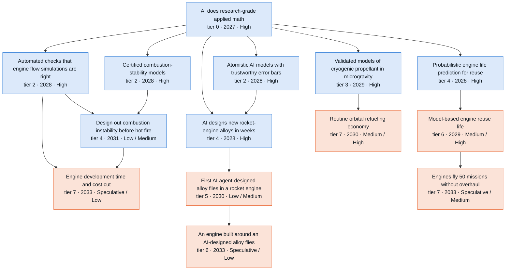

**Side lanes** (connected to the branch but off its main chain)

- Limits on measuring propellant in low gravity (tier 2 · 2028 · High)
- Tankers fuel five Mars ships for one window (tier 7 · 2033 · Speculative / Medium)
- One lunar lander makes three landings, refueled in space (tier 6 · 2033 · Speculative / Medium)

Where the reviewers disagreed: 2031 challenge round (14 disputes)

Recorded during the 2031 challenge round. Later passes adjusted some dates and bands; the node table below has the final values.

- **What paces engine reliability: 230 ground tests or fleet engine starts.** *Skeptic:* Reliability is still shown one hot fire at a time. About 230 zero-failure trials are needed for 0.99 at 90% confidence unless customers accept model priors. Models cut redesign loops, not demonstration tests. *Advocate:* A Starship flight logs about 65-70 engine starts, so 230 starts accrue in about four flights, and 100 flights a year gives ~3,900 engine-flights. Fleet data plus AI-built hierarchical models set the pace. The hook tells readers the opposite of the S2 base case. *Resolution:* Both are partly right. The arithmetic and the fleet volume stand. But starts on one vehicle or build lot are correlated, Flights 12-13 had engine-outs and relight failures, and every failure resets a zero-failure count. The hook now says a high-cadence fleet logs 230 starts in a handful of flights, so failure modes, not start counts, pace engines. That is a launch-clock effect, not an AI-math one. The proposed fleet-evidence node was rejected as a near-duplicate of "Reflight cleared by data, not teardown" plus "Model-based engine reuse life".
- **First AI-designed alloy flight ("First AI-agent-designed alloy flies in a rocket engine").** *Skeptic:* S2 Medium -> Low and S3 2029 -> 2030. Powder lots, AM parameter development (1-3 years per process), creep tests of 1,000-10,000 h and hot fire remain; material qualification compresses only 0.7-0.8x. The definition must exclude pre-existing alloys such as GRX-810 or the prerequisite is only definitional. The auditor agreed and also proposed S2 2031. *Advocate:* S2 2030 -> 2029 and High in S2 and S3, with gate -> experiment. Any small thruster or hot part on any commercial vehicle counts, the maker self-certifies, the U of T self-driving lab already designs printable Ni-Co-Cr alloys in weeks, and an AI-native spacecraft is already S2 2029 High. *Resolution:* Two lenses favoured later and lower: S3 2030; S2 Low; S3 Medium. S2 kept at 2030 as the optimistic edge (2028 design plus 2 years for a self-certifying maker's small part). The auditor's 2031 was not applied. The advocate's gate change was accepted because the Low band rests on physical clocks, not a certification cap. The U of T result was verified and added to "AI designs new rocket-engine alloys in weeks" status. The definition now excludes pre-2027 ML-assisted alloys so the chain stays causal.
- **Engine development compression: which tools are necessary, and when.** *Skeptic:* S3 Medium -> Low (the auditor agreed). New engines take 6-13 years and compress only 0.7-0.8x. Keep the stability tool hard, since instability historically drives redesign loops. Make the generative design loop and the turbopump tool soft. *Advocate:* Requiring all four tools is over-constrained. Make the stability and turbopump tools soft and add optimal test campaigns as hard. S2 >2031 -> 2031 Medium and S3 -> 2030. Derivative engines and small in-space engines can qualify in 2030-31 at self-certifying firms. *Resolution:* The edge structure follows the skeptic: hard prerequisites are "Automated checks that engine flow simulations are right" and "Design out combustion instability before hot fire"; the design loop, turbopump tool, optimal test campaigns and qual-by-analysis credit are soft. Test-design savings are not 'predictive tools' as the node defines them. Years and bands follow the two-lens view (S3 Low). The advocate's gate change (experiment) was accepted. A derivative engine needing fewer tests than a clean sheet is confounded, so the baseline is now the same organization's previous program of similar thrust class.
- **Model-based engine reuse life ("Model-based engine reuse life").** *Skeptic:* S2 2029 -> 2030. The physclock row says data-based clearance pulls the curve only 6-12 months and each life data point costs a flight. 'Doubled interval' overstates what models deliver. *Advocate:* S2 and S3 Medium -> High. Data arrive on the launch exponential, and Mach33's base case needs flights per stack to go from 3.3 to 18 by 2030. At near-zero cognitive cost operators will set intervals by model, and there is no regulator cap. *Resolution:* Both year and band were kept (S2 2029 Medium). About 90 Starship flights in the 2028 reference case make model-set intervals in 2029 a fair optimistic edge. Validation on fleet leaders and visible attribution keep it Medium. The skeptic's text correction (a 6-12-month pull; a 2x interval has to be earned in flight cycles) and the advocate's heavy-cadence soft edge were both adopted.
- **AI alloy design timing and prerequisites ("AI designs new rocket-engine alloys in weeks").** *Skeptic:* Learned functionals should be soft and AM defect physics a soft input. AMRL 4-5 cannot come in the same year as the design capability, so the signpost should be re-timed. *Advocate:* Drop design optimization and learned functionals as hard prerequisites, add "AI does research-grade applied math", and pull the node to 2027, since weeks-scale AI alloy design already works in 2026. *Resolution:* Edge demotions accepted from both lenses: alloy ICME runs on CALPHAD, kinetics and active learning. The 2027 pull-in was rejected because the hard prerequisite "Atomistic AI models with trustworthy error bars" moved to 2028 (two lenses) and a high coupon hit rate needs coupons tested after the capability arrives. Signpost changed to AMRL 3 by 2029 and AMRL 4-5 by 2030.
- **Creep and oxidation life models.** *Skeptic:* S2 2029 -> 2030 and S3 2028 -> 2029, gate -> experiment. A blind 10,000-h prediction needs a ~14-month test started after the model exists. MLIPs are not required. *Advocate:* S3 Medium -> High. Models can be validated now on legacy creep databases (tests beyond 100,000 h), and autonomous labs run parallel short tests. *Resolution:* Gate -> experiment and the MLIP demotion were accepted, along with soft edges from autonomous labs and test stands. Years kept, because a blind prediction can be checked against long tests already under way, so the 14-month clock overlaps model building. S3 High rejected: legacy hold-outs validate heritage alloys, not the new chemistries where long-time mechanisms appear.
- **Flame response and turbopump tools after demoting closure theory.** *Skeptic:* Closure guarantees are not needed for either tool. Flame response S2 2029 -> 2030 for the blind rig year. Closure theory itself S2 2030 / S3 2029, Low in S2. *Advocate:* Same edge demotions. Pull flame response to S3 2028 (rig year at 1.3-1.5x, AI-run stands). Pull the turbopump tool to S2 2029 / S3 2028 with S3 High. *Resolution:* Edges demoted (both agreed). Flame response is S2 2030 and S3 2029: the S3 theory capability lands in 2028 and the blind campaign cannot finish the same year. The turbopump pull-in was accepted because cheap water rigs are now its only gate. Its S3 High was rejected (P6 default Low).
- **HLS refuelling campaign band (advocate vs auditor).** *Skeptic:* (The auditor took the opposing side here.) S3 2028 High contradicts the two-clocks rule and the node's own statement that AI math is off the critical path, so S3 should be 2029 Medium. *Advocate:* S2 Medium -> High. With 100+ heavy flights a year in 2029, a 10-20-tanker campaign is a few weeks of manifest with 2+ years of slack. *Resolution:* Bands unchanged (Medium/Medium/High). The event is launch-clocked. Physclock gives launch cadence 0-0.5 years earlier in S2 and 0.5-1 year earlier in S3, so S1 = S2 Medium and S3 one year earlier at High is the consistent mapping. The advocate's soft accelerators were added so the tree shows the CFM, relight, gauging, mishap and cadence links.
- **Routine cislunar refuelling economy (advocate vs auditor).** *Skeptic:* (The auditor took the opposing side here.) An S2 Medium band with an earliest year of 2031 is inconsistent, so S2 should drop to Low. *Advocate:* S2 2031 -> 2030 and S3 2030 -> 2029 with S3 High. Two HLS campaigns, or one plus Mars-window fuelling, exceed 20 transfers once the prerequisites land. *Resolution:* The advocate's years were accepted. All hard prerequisites (with heavy cadence promoted to hard, per the skeptic) land by 2029 in S2 and 2028 in S3, and the 2031 Mars window needs fuelling in late 2030. That also removes the auditor's inconsistency, so S2 stays Medium. S3 High rejected: this is a tier-7 outcome with AI math not on the critical path.
- **Start and relight transients S2 band.** *Skeptic:* Certified stiff chemistry is not a real dependency; relight failures come from conditioning, chilldown, igniters and spin-up. *Advocate:* S2 Medium -> High. Each Starship flight provides ~26+ relights, so validation data come free from the launch exponential. *Resolution:* Stiff chemistry was made soft. S2 stays Medium: booster relights after minutes of coast are plentiful, but the HLS case after days to weeks in orbit gets data only with the 2029 depot campaigns, and "Validated models of cryogenic propellant in microgravity" is now S2 2029.
- **Gate labels for self-certifying first movers.** *Skeptic:* Did not contest the labels. Argued the bands down on physical clocks (powder, creep, hot fire, fleet hours). *Advocate:* 'Qualification' silently imports the Medium certification cap. Uncrewed commercial firms certify their own engines and materials; Part 450 regulates public safety only. *Resolution:* Convention adopted. Alloy flight and the stability tool became 'experiment', engine-dev compression 'experiment', and hot-section reuse 'data'. The bands still fell, but on the physical clocks, which the revision notes now state explicitly. The new-propellant flight stays 'qualification', since hazard classification and customer qualification apply.
- **Hot-section reuse in S3; RDE mode theory in S3; CFD V&V in S2.** *Skeptic:* Hot-section reuse S2 -> >2031 (two lenses). RDE mode theory S2 -> 2029. V&V compute does not fall for unsteady LES. *Advocate:* Hot-section reuse S3 Low -> Medium (cadence times cognition). RDE mode theory S3 -> High. "Automated checks that engine flow simulations are right" S2 2028 -> 2027. *Resolution:* All three advocate upgrades rejected. With alloy flight at S3 2030, one year is left for fleet hours and attribution. P6/P7 defaults sit one or two bands lower. An adoption gate cannot land the same year as its capability prerequisites.
- **New node: AI-generated engine flies (prop-ai-engine-flight).** *Skeptic:* Did not address it. The node's own strongest case says Noyron encodes rules, not frontier math. *Advocate:* A hardware bridge between the design loop and dev-compression, High in all scenarios. Cites LEAP 71 hot fires, a five-year TEC licence and Nyx in 2028. *Resolution:* Rejected. It is not driven by AI math (would be 'P1 marginal'), its attribution is fuzzy, and the TEC/Nyx evidence could not be verified (403). The verified LEAP 71 Dec 2025 results were added to "AI-generated engines at scale" status instead, whose signpost already includes the first orbital flight of an AI-generated engine.
- **Compute effect of LES convergence theory (skeptic vs auditor).** *Skeptic:* Error bounds will mostly show that propulsion design LES is under-resolved, so compute may rise. *Advocate:* (The auditor took the other side.) Carry the dropped node's '2-4x design-LES compute saving' into the merged node. *Resolution:* The skeptic's mechanism was adopted. Propulsion LES is cost-limited (48,000 core-hours for 2 ms of one spray LES), so the merged node says bounds are more likely to raise compute than cut it (judgment).

Where the reviewers disagreed: 2035 and Embodied extension round (8 disputes)

- **S4 credit on "A new large engine flies four years after program start".** *Skeptic:* No credit. The node's binding gate is hot-fire failure discovery, which is experiment-bound and fails condition 1. Parallel engines need large stands that take 2-4 years to build. Robot integration and test is only Low in S4 2031, and requalification takes 6-24 months. The S4 analysis named only a three-year launcher for this gate row. *Advocate:* Credit in both year and band (S4 2032, Medium). Robots add value in the back half of a program, during hot-fire iteration. The gate table gives a leading firm 0.60-0.69x in 2031 and 0.45-0.51x by 2035, and the S4 analysis listed a year-scale engine credit for 2032-34. *Resolution:* Band step only. Each failure still costs a redesign, but the rate of finding failures is throughput (development engines built, stand turnaround). That is what robot-first firms raise, and leading firms already have several large stands (McGregor has 15). Development engines are test articles outside flight requalification. Condition 2 holds only for programs whose hot fire runs 2031-35, so S4 is Medium by 2035 and the year stays 2033. A 2032 flight would do most of its hot fire before 24/7 robot test is likely (Low in 2031). This matches the trunk final, where robot credit starts with programs begun in 2032.
- **When tankers can fuel a five-ship Mars campaign.** *Skeptic:* S3 2031 is too early. 40-75 tanker flights in a few months is an annualized 160-300 heavy flights. S3 reaches 300+ a year only in 2032, and SpaceX put the Moon first. Proposed 2033, Speculative by 2031, and a hard edge from 300+ heavy flights a year. *Advocate:* Keep the bands and add edges from pads and robot-built propellant plants. The Pecan Island campus (five complexes, on-site propellant, first launches as soon as 2029) offsets the Moon-first risk. *Resolution:* S3/S4 move to the Apr 2033 window and are Speculative by 2031. The cadence link is a soft edge: the surge can sit below 300 flights a year, and the trunk final rates 300+ a year only Medium by 2035, so a hard edge would overstate the gate. The bands stay Medium by 2035 in S2-S4 because two windows remain. The robot-pad edge was rejected because it lands too late. Pecan Island and the Moon-first pivot were added to the status. The node left the spine because AI mathematics is off its critical path.
- **Which clock paces rocket-engine alloys.** *Skeptic:* Multi-heat lots, long property tests and hot fire set the pace. Historical insertions took 6-8 years (GRCop-42 about 8, Ferrium M54 under 6), so the base case cannot be High by 2035. Starts on one Starship flight are correlated and each failure resets the count. *Advocate:* A reusable rocket engine spends 3-6 minutes at temperature per flight, about 5 hours over 50 flights. 10,000 h creep tests bind reactors and aero turbines, not rocket engines. Measured short-time data on a flown alloy are enough to design an engine around it, so the creep-model hard edge should go. *Resolution:* Both points hold. The hook and the alloy texts now use the duty-cycle point, and creep-life models become a soft edge into the alloy-enabled engine. The base-case alloy flight still drops from High to Medium on the 6-8 year track record. GRX-810, computationally designed in 2022, had not flown in an engine by Oct 2026. The S1 year moves earlier to 2032 on the same 2-year optimistic floor used for S2, while the S1 band drops to Low.
- **Alloy-enabled engine and hot-section reuse in the base case.** *Skeptic:* Hot-section reuse skips a step. The first AI alloy likely flies in a small thruster, so reaching a reusable main engine needs a second insertion, which gives S2 2033 and Low. A node cannot be as likely as a hard prerequisite it needs years after. *Advocate:* Disclosure risk applies to S3 as much as S2, so the alloy-enabled engine should be S2 Medium. With creep tests off the critical path there is slack. *Resolution:* Both nodes are S2 Low by 2035, because each sits behind an alloy flight that is now only Medium in S2. Earliest years keep the fastest path (direct insertion into a reusable engine): hot-section reuse stays S2 2032, and the S1 years follow the earlier alloy flight (2034, 2035). This applies one rule throughout: a node is never more likely by 2035 than a hard prerequisite it needs years after.
- **2035 bands for launch-bound and exogenous nodes.** *Skeptic:* Lower RDE operational service, the depot market and flame response by one band. Qualification, customers, vertical integration and high-pressure rigs bind, and none of these moves with cognition. *Advocate:* Raise the RDE flight demo, S1 reuse life, S1 routine refueling and S3 50-flight engine life to High. The launch clock is exogenous, flight slots get cheap, and Mach33 already assumes 60-flight stacks. *Resolution:* Accepted where the gate is truly scenario-independent and every prerequisite is High: S1 routine refueling becomes High. Lowered where a non-cognitive gate binds: RDE operational, the depot market and flame response. The rest of the advocate's raises were rejected. An RDE flight demo needs a funded flight-ready stage and a customer, which cheap launch does not supply. S1 reuse life tracks Plateau cognition, which by 2035 is about where the base case is in 2029-30. The 50-flight life now requires an operator-set overhaul interval and disclosure, and the 60-flight stack lifetime is a model assumption.
- **AI-designed propellant in flight by 2035.** *Skeptic:* Low in S2-S4. Compatibility and thruster tests run in real time, past green propellants took 13-20 years, and the market is thin. *Advocate:* S3/S4 High. One cubesat-class flight satisfies the node, rideshare is cheap, and the S3 floor is 2030. *Resolution:* S2 Low and S3/S4 Medium. In S3, qualification runs at 0.5-0.7x against 0.7-0.8x in S2. With a 2030 floor and five years of slack, a startup can fly a formulation tuned to existing thrusters. The thin market keeps it below High.
- **Engine-development compression in the base case.** *Skeptic:* S2 2032 is too early. A program cannot adopt a 2031 tool and also qualify with 30% fewer tests a year later, because most development tests come before qualification. *Advocate:* S2 should be Medium by 2035. It shares the 2031 tool with S3, and cognitive work is abundant by 2033-35. *Resolution:* S2 moves to 2033 and stays Low. A version designed with the tool needs about two years, which leaves one version cycle before 2035, and the saving must be attributed against the firm's previous program. S3 2031 is kept from the B round: S3 can adopt the precursor models (2028-30) as they land. It is flagged for the integrator to recheck.
- **A lunar lander reuse node.** *Skeptic:* Not raised. The skeptic's general position is that exogenous, launch-bound outcomes should not carry the branch's spine. *Advocate:* Add "One lunar lander makes three landings, refueled in space". Under the Moon-first pivot, lander reuse with refueling in space is the main 2032-35 use of orbital refueling. Blue Moon MK2 is designed for it, and "Lunar oxygen fuels landers at 10 t a year" presumes a reusable lander that nothing supplies. *Resolution:* Added as a side-chain node off the spine, P7 exogenous, Medium by 2035 in S2-S4 because two programs aim at it. It feeds "Lunar oxygen fuels landers at 10 t a year" through a soft edge. S4 equals S3 because launches and funding bind.

All nodes in this branch

Years and likelihoods are listed for Plateau / Exponential / Recursive / Embodied. H = High, M = Medium, L = Low, S = Speculative.

| Node | Tier | Year | By 2031 | By 2035 | Binding gate | Pathway |
| --- | --- | --- | --- | --- | --- | --- |
| How chaotic systems respond to design changes | 1 | 2033 / 2029 / 2028 / 2028 | S / M / M / M | L / M / M / M | cognitive | P6 |
| Reliable automated structure identification | 2 | 2029 / 2027 / 2027 / 2027 | M / H / H / H | H / H / H / H | data | P1 |
| Atomistic AI models with trustworthy error bars | 2 | 2029 / 2028 / 2028 / 2028 | M / H / H / H | H / H / H / H | data | P1->P6 |
| Combustion chemistry simulated with certified error | 2 | 2030 / 2028 / 2028 / 2028 | M / H / H / H | H / H / H / H | adoption | P1->P4->P6 (+P2 for verified integrators) |
| Certified combustion-stability models | 2 | 2029 / 2028 / 2028 / 2028 | M / H / H / H | H / H / H / H | cognitive | P1 |
| Automated checks that engine flow simulations are right | 2 | 2029 / 2028 / 2028 / 2028 | M / H / H / H | H / H / H / H | adoption | P1->P2 |
| Limits on measuring propellant in low gravity | 2 | 2029 / 2028 / 2028 / 2028 | M / H / H / H | H / H / H / H | data | P1 (+P3 via classical log-stability limits, general) |
| Error bars for turbulent and shocked flows | 2 | >2035 / 2031 / 2030 / 2030 | S / S / L / L | S / L / L / L | cognitive | P6 |
| Chemical accuracy from cheap quantum chemistry | 3 | 2030 / 2028 / 2028 / 2028 | L / M / M / M | M / M / H / H | data | P1->P6 |
| Validated models of cryogenic propellant in microgravity | 3 | 2030 / 2029 / 2028 / 2028 | M / H / H / H | H / H / H / H | data | P1->P6 |
| Predictive theory of detonation-engine wave modes | 3 | 2031 / 2029 / 2028 / 2028 | L / M / M / M | M / M / H / H | experiment | P1->P6 |
| Long-life predictions from short tests | 3 | 2031 / 2029 / 2028 / 2028 | L / M / M / M | M / M / H / H | experiment | P1->P6 |
| Turbulence and combustion models with guarantees | 3 | 2035 / 2030 / 2030 / 2030 | S / L / M / M | L / M / M / M | data | P1->P6 |
| Predictive flame response at engine pressures | 3 | 2034 / 2030 / 2030 / 2030 | S / M / M / M | L / M / M / M | experiment | P6 |
| Quantum computers beat classical chemistry | 3 | 2033 / 2031 / 2030 / 2030 | S / L / L / L | L / M / M / M | fabrication | P4->P7 |
| AI-generated engines at scale | 4 | 2027 / 2027 / 2027 / 2027 | H / H / H / H | H / H / H / H | fabrication | P1 (marginal; not AI-math-driven) |
| AI-designed green and high-energy propellants | 4 | 2029 / 2028 / 2028 / 2028 | M / H / H / H | H / H / H / H | experiment | P1->P6 |
| AI designs new rocket-engine alloys in weeks | 4 | 2030 / 2028 / 2028 / 2028 | M / H / H / H | H / H / H / H | experiment | P1->P6 |
| Probabilistic engine life prediction for reuse | 4 | 2030 / 2028 / 2028 / 2028 | M / H / H / H | H / H / H / H | data | P1->P6 |
| Predictive engine start and relight transients | 4 | 2031 / 2029 / 2028 / 2028 | L / M / H / H | M / H / H / H | experiment | P1->P6 |
| Predictive turbopump cavitation and stability | 4 | 2032 / 2029 / 2028 / 2028 | S / M / M / M | M / H / H / H | experiment | P1->P6 |
| Gradient design of turbulent and chaotic systems | 4 | >2035 / 2030 / 2029 / 2029 | S / L / L / L | S / L / M / M | experiment | P6 |
| Design out combustion instability before hot fire | 4 | 2035 / 2031 / 2031 / 2031 | S / L / L / L | S / M / M / M | experiment | P1->P6 |
| Ship-to-ship cryogenic transfer demonstrated | 5 | 2027 / 2027 / 2027 / 2027 | H / H / H / H | H / H / H / H | launch-internal | P7 (exogenous) |
| Public flight data on storing cryogenic propellant in orbit | 5 | 2028 / 2028 / 2028 / 2028 | M / M / M / M | M / M / M / M | launch-external | P7 (exogenous) |
| Autonomous labs discover real new materials | 5 | 2030 / 2029 / 2029 / 2029 | L / M / H / H | M / H / H / H | experiment | P1->P7 |
| Detonation engine flies in space | 5 | 2029 / 2029 / 2029 / 2029 | M / M / M / M | M / M / M / M | qualification | P7 (exogenous) |
| First AI-agent-designed alloy flies in a rocket engine | 5 | 2032 / 2030 / 2030 / 2030 | S / L / M / M | L / M / H / H | experiment | P1->P7 |
| AI-designed propellant flies | 5 | 2034 / 2031 / 2030 / 2030 | S / L / L / L | L / L / M / M | qualification | P1->P7 |
| Full lunar-lander refueling campaign | 6 | 2029 / 2029 / 2028 / 2028 | M / M / H / H | H / H / H / H | launch-internal | P7 (exogenous) |
| Model-based engine reuse life | 6 | 2031 / 2029 / 2029 / 2029 | L / M / M / M | M / H / H / H | data | P1->P6->P7 |
| Detonation engines in operational service | 6 | 2033 / 2031 / 2031 / 2031 | S / S / L / L | L / L / L / L | qualification | P1->P6->P7 |
| Longer-life reusable engines from new alloys | 6 | 2034 / 2032 / 2031 / 2031 | S / S / L / L | S / L / M / M | data | P7 |
| An engine built around an AI-designed alloy flies | 6 | 2035 / 2033 / 2032 / 2032 | S / S / S / S | S / L / M / M | experiment | P1->P6->P7 |
| One lunar lander makes three landings, refueled in space | 6 | 2034 / 2033 / 2032 / 2032 | S / S / S / S | L / M / M / M | launch-internal | P7 (exogenous) |
| Routine orbital refueling economy | 7 | 2032 / 2030 / 2029 / 2029 | S / M / M / M | H / H / H / H | launch-internal | P1->P6->P7 |
| Engine development time and cost cut | 7 | >2035 / 2033 / 2031 / 2031 | S / S / L / L | S / L / M / M | experiment | P1->P6 |
| Engines fly 50 missions without overhaul | 7 | 2034 / 2033 / 2032 / 2032 | S / S / S / S | L / M / M / M | data | P1->P6->P7 |
| Propellant sold in orbit to outside customers | 7 | 2034 / 2033 / 2032 / 2032 | S / S / S / S | L / L / L / L | capital | P1->P7 |
| Tankers fuel five Mars ships for one window | 7 | 2035 / 2033 / 2033 / 2033 | S / S / S / S | L / M / M / M | launch-internal | P7 (exogenous) |
| A new large engine flies four years after program start | 7 | >2035 / 2035 / 2033 / 2033 | S / S / S / S | S / L / L / M | experiment | P1->P6->P7 |

### Getting through the atmosphere

*AI uncertainty analysis lets commercial capsules fly thinner heat shields around 2030 (central scenario, Medium). Ship heat shields reach five reflights by 2030. Three-day turnaround and crewed reusable ships stay Low by 2035. Windows, budgets and certifiers pace Mars landings and crewed margins. Robots (Embodied) speed only arc-jet testing.*

On-demand AI mathematics first changes how heat-shield margins are set and arc-jet tests planned. A team can swap stacked factors, such as 1.5 on radiative heating, for one probabilistic budget ending in a bondline reliability figure. A preliminary [NASA study](https://ntrs.nasa.gov/api/citations/20260005218/downloads/SRL_TPS_IPPW.pdf) for the cancelled Mars Sample Retrieval Lander, an 8 km/s entry, kept the bondline within limits in about 99% of cases at about 75% of baseline thickness, at one location.

In the Exponential case, research-grade applied math arrives about 2027 and on-demand margin analysis about 2028 (both High by 2031). Capsule makers adopt probabilistic sizing about 2029 (Medium by 2031, High by 2035). A flown shield thinned at least 10% by model-based margins comes about 2030 (Medium by 2031 and 2035), freeing up to 1–3% of entry mass (analyst judgment). Commercial capsules lead because they fly often and need no certifier. Starship's rapidly reusable heat shield, five reflights at under two weeks each, comes about 2030 (Medium by 2031, High by 2035), paced by flight count. AI saves perhaps 6–12 months.

A ship heat shield turned around in three days, and people returning from orbit on a reusable ship, come about 2034 in the Exponential case (Low by 2035) and 2033 in Recursive (Medium). An AI-designed shield material reaches regular service on the same years. A crewed shield sized by probabilistic margins waits on certifiers (Speculative by 2035). Embodied differs from Recursive at one node. Arc-jet runs per year double about 2033 (Medium by 2035), a year earlier, because robots take model change, instrumentation and turnaround, about 40% of queue time (analyst estimate). Ames is [NASA's only reentry heat-shield test facility](https://ntrs.nasa.gov/citations/20240013620). Elsewhere robots change nothing; flight counts, disclosure, launch windows, budgets and certifiers bind.

The openai/math catalog contributes little. Families 365, 372 and 366 bear on finding hidden shield damage, 363 and 364 on thin-air flow, and 275 and 278 set chemistry ceilings. All are T1 and conditional, except one 365 side result with agent-written Lean (T3). No chain step rests on them.

The strongest case for a small effect is that the mathematics was never the barrier. Probabilistic heat-shield methods are about 20 years old, and Artemis I's char loss pushes NASA toward more margin. The NASA study capped heating error at existing factors, yet radiation models under-predicted shock-tube data for that entry by up to 2x ([Hansson, 2026](https://indico.esa.int/event/594/contributions/12539/)). The advocate's High for the thinner shield failed at both checkpoints, since operators may spend margin on reliability and stay silent. The skeptic removed Embodied's credit on three-day turnaround, a one-off record people can staff, and ship reuse keeps High by 2035 only while tiles work. Watch the first Starship ship catch and reflight, with published tile-replacement counts.

37 nodes. Rated High or Medium by 2031: Plateau 11, Exponential 18, Recursive 22, Embodied 22. By 2035: Plateau 19, Exponential 25, Recursive 28, Embodied 29. Main binding gate: experiment.

**Main chain** (each node: tier · earliest year in the Exponential case · likelihood by 2031 / by 2035; Recursive and Embodied years shown where they differ)

- **AI does research-grade applied math** (tier 0 · 2027 · High; gate: cognitive, then data)
  - → **Heat-shield margins from on-demand uncertainty analysis** (tier 2 · 2028 · High; gate: cognitive, then data)
    - → **Probabilistic heat-shield sizing adopted in practice** (tier 4 · 2029 · Medium / High; gate: adoption, then cognitive)
      - → **Flown heat shield sized with reduced, model-based margins** (tier 5 · 2030 · Low / Medium; gate: launch-external, then adoption)
  - → **Damage-accumulation model for reusable ceramic tiles** (tier 3 · 2029 · Medium / High; gate: data, then adoption)
- **High-cadence instrumented reentry flights** (tier 0 · 2027 · High; gate: launch-internal, then capital)
  - → **Flown heat shield sized with reduced, model-based margins** (tier 5 · 2030 · Low / Medium; gate: launch-external, then adoption) (see above)
  - → **Routine, cheap reentry: 50+ commercial returns a year** (tier 7 · 2031 · Low / Medium; Recursive 2030; gate: capital, then launch-external)
- **Both Starship stages caught and reflown** (tier 5 · 2027 · High; gate: experiment, then fabrication)
  - → **Damage-accumulation model for reusable ceramic tiles** (tier 3 · 2029 · Medium / High; gate: data, then adoption) (see above)
  - → **Rapidly reusable orbital heat shield (ship scale)** (tier 5 · 2030 · Medium / High; Recursive 2029; gate: launch-internal, then fabrication)
    - → **Ship heat shield turned around in three days** (tier 6 · 2034 · Speculative / Low; Recursive 2033; gate: data, then fabrication)

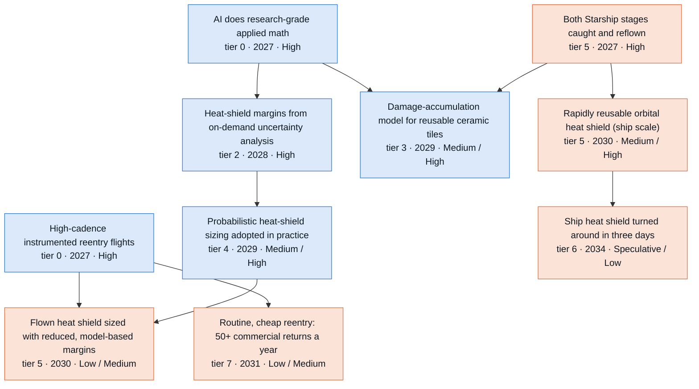

**Side lanes** (connected to the branch but off its main chain)

- Information-optimal ground and flight test design (tier 2 · 2028 · High)
- Math for finding hidden heat-shield damage (tier 2 · 2028 · Medium)
- Fleet-trained reentry heating model for one reusable vehicle (tier 4 · 2029 · Medium / High)
- Validated models of braking with engines at supersonic speed (tier 4 · 2029 · Medium)
- First landing of 20 t or more on Mars (tier 6 · 2031 · Low / Medium)

Where the reviewers disagreed: 2031 challenge round (12 disputes)

Recorded during the 2031 challenge round. Later passes adjusted some dates and bands; the node table below has the final values.

- **Rapid reuse of the ship-scale heat shield: timing versus band.** *Skeptic:* No ship had been caught as of Oct 2026, and V3 boosters failed their landing burns in 2026. The physclock data say each life data point costs a flight. Shift the years one later (2031/2030/2029) and keep Medium. *Advocate:* Mach33's base case (8.9 and then 18 flights per stack in 2029-30) and the physclock nodes rated High (100+ reusable launches a year, under $300/kg) assume ship reuse at scale. For consistency the band should be High in S2 and S3. *Resolution:* Years moved to 2031/2030/2029, and Medium kept in every scenario. The advocate's own arithmetic (18 flights per stack, about a 20-day average turnaround in 2030) puts the base path near 2030, not 2029. This node (5 reflights with under-2-week turnaround) is strictly harder than 100+ launches a year, so High there implies roughly Medium here. The physclock nodes stay consistent with that. All three lenses agreed to make the AI-math edges soft.
- **Flight data: linear or exponential.** *Skeptic:* Most data are classified or proprietary, and the node's own nil_effects say they never reach civil model builders. Narrow the definition to data available to the operator or sponsor. Downstream nodes that need shared data cannot count on it. Varda's monthly cadence has not materialized (3 attempts in 2026, one lost). *Advocate:* Owner and defense data ride the launch exponential: Starship goes from 3 flights to 12+ to ~90, and MACH-TB targets up to 50 tests a year. For the owner the data gate dissolves, so a fleet-trained heating model belongs in the graph. *Resolution:* Both views are carried. The pipeline node is narrowed to data shared beyond the operator, keeps 2027/High and grows linearly. The owner curve is a new, narrowed node ("Fleet-trained reentry heating model for one reusable vehicle", Medium x3, 2029/2029/2028). Hard edges whose real data source is owner data (tile damage, SRP, Mars landing) were made soft from the pipeline. The advocate's second new node (a 40+/yr testbed market, High in 2028) was rejected. It duplicates the pipeline and cadence thresholds, the 2026 record contradicts it, and the advocate concedes it arrives at S1 pace.
- **Margin UQ timing and the S2 = S3 rule before 2028.** *Skeptic:* Margin UQ in S3 2027 has zero lag after applied math and no S3 mechanism before 2028, so move S3 to 2028. Its distinctive content (model-form error) needs flight data, so the gate should be data and S2 should be Medium. *Advocate:* Because S3 equals S2 until 2028, S3 2027 implies S2 2027. The joint-margin part was already demonstrated by SRL in 2026, so pull S2 forward to 2027 and keep High. *Resolution:* The node was split as the auditor proposed. Joint budgets on demand have a cognitive gate and stay High in S2. Both S2 and S3 are set to 2028, because the signpost needs publication and P1 lags public access. The open model-form part became a separate data-gated node (Medium in S2, 2030). That addresses the skeptic's band and gate concern without downgrading the solved part.
- **Thinner flown heat shield: S2 band.** *Skeptic:* LEO capsules have little radiative heating, so the transferable thinning is smaller. The years follow the sizing shift plus a 12-18 month lag (2030). S3 High is three bands above the P7 default. *Advocate:* S2 and S3 share the chain and the year, so the S2/S3 split has no mechanism; raise S2 to High. Varda's Part 450 licence and in-house shields remove the gates, and there are 2 years of slack. *Resolution:* The years moved to 2030, and S2 and S3 are both Medium. The no-mechanism point was resolved downward: the node cannot be more likely than its hard prerequisite (probabilistic sizing, now Medium for adoption reasons). The licence and W-6 tiles were added to status as support for Medium.
- **Cadence economy of 50+ commercial returns a year in S3.** *Skeptic:* This is a market and licensing outcome with no AI-math lever. Moving from about 3 returns in 2026 to 50+ is a >10x increase, and slip ratios run 1.5-3x or worse. Low in every scenario. *Advocate:* Varda names automation and labour as its binding constraint, and S3 brings AI-run operations and factories. Licensing is already compressing. S3 should be High. *Resolution:* Low in every scenario (>2031/2031/2030). Demand, landing sites and rideshare slots bind ahead of labour. The auditor's exclusion of Starship returns removes the route by which launch cadence alone would satisfy the node. Licensing and heavy cadence are linked as soft edges.
- **SBLI turbulence closures.** *Skeptic:* Closures are trained and validated on DNS and ground data, not flight. Out-of-distribution generalization is where ML RANS closures fail, and +/-15-20% approaches the experimental scatter. S2 should be Low. *Advocate:* DNS is compute-bound and compute grows about 3.4x a year. In S3, "AI builds validated physics theory" is High from 2028. Change the gate to cognitive and raise S3 to High. *Resolution:* S2 dropped to Low and S3 kept at Medium, with the data gate kept. More DNS does not fix out-of-distribution failure, and blind validation still needs ground experiments. Both lenses agreed to make the pipeline edge soft.
- **AI-run aerothermal design loop.** *Skeptic:* Margins and stability analysis are accelerators, not gates. The gate is adoption, which S3 does not compress before 2028, so drop S3 to Medium. *Advocate:* The capability branch rates engineering adoption High in S2 2028 and AI-native spacecraft High in S2 2029. The threshold is only a design review citing AI-surrogate trades, so raise S2 to High. *Resolution:* The edges were made soft (skeptic), and S2 was raised to High for consistency across branches (advocate). S3 stays High, because the band is judged at 2031, three years after S3 diverges from S2.
- **Hypersonic transition theory.** *Skeptic:* A blind prediction on a new flight needs a BOLT-class article (about 14 months) after the theory exists, so S3 moves from 2029 to 2030. *Advocate:* Flight transition datasets grow on the testbed curve, and S2 models can reach classified data from 2027. Raise S2 from Low to Medium. *Resolution:* S3 moved to 2030 and S2 stays Low. Classified validation may never be published, the disturbance environment remains uncharacterized, and the domain's own signpost makes a flight-validated prediction the trigger for any raise. The soft edge from controlled data access was added.
- **Pre-2028 timing splits (blackout tools).** *Skeptic:* S3 2027 has no S3-specific mechanism, so move it to 2028. A validated, published tool needs about a year after "AI does research-grade applied math" access. *Advocate:* S3 equals S2 until 2028, so pull S2 to 2027. *Resolution:* 2028 for both, with the auditor concurring with the skeptic. The same principle (S2 = S3 before 2028, with a publication lag after access) was applied to stability on demand, optimal test design and margin UQ.
- **Materials: AI-designed TPS flight.** *Skeptic:* The design node assumed zero lag. Arc-jet coupons take 6-18 months, so the flight comes about a year after screening (2030). 'AI-designed' was unfalsifiable. *Advocate:* Under a coupon threshold, flight slots are abundant (Varda-sponsored experiments, Starship experimental tiles). Raise S2 and S3 to High. *Resolution:* Achievement is defined at the coupon flight, 'AI-designed' is defined, years are 2031/2030/2030, and bands are Low/Medium/High. S3 High is accepted (closed-loop labs plus cheap slots). S2 stays Medium because the prerequisite design capability is Medium and arrives only in 2029.
- **Verified aerothermal numerics.** *Skeptic:* The description promised certified heat-flux error bars, which contradicts the node's own why. Numerical error is not the dominant uncertainty, so production adoption lacks pull: S2 Low. *Advocate:* The why uses a stale toolchain date. The libraries arrive in 2028 (S2) and 2027 (S3), so move the node to 2029 and 2028. *Resolution:* Description corrected, S2 dropped to Low, and the stale date fixed. The years are unchanged, because the signpost is production adoption and P2 runs 2-4 years after the libraries exist.
- **Arc-jet capacity and optimal test design.** *Skeptic:* Optimal test design is an accelerator, not a prerequisite. Its signpost is an adoption event, and fabrication plus scheduling take 6-12 months, so move it one year later and set the gate to adoption. *Advocate:* The 'no new arc jets' nil effect is outdated: Kratos Helios (20-25 MW) and AEDC capacity are being built. Combined with AI-run test stands, effective throughput rises. *Resolution:* Both accepted: the edges are soft, the years are 2029/2028/2028, the Kratos facts are in status, and the soft edge from "Test stands that run themselves" goes into 4 data-gated nodes. The domain-level nil_effect text is outside branch scope and is flagged instead.

Where the reviewers disagreed: 2035 and Embodied extension round (15 disputes)

- **S4 credit on the three-day ship heat-shield turnaround ("Ship heat shield turned around in three days").** *Skeptic:* The draft gave S4 a year (2032 against 2033), but it fails the four-condition rule. A single 72-hour turnaround is a record that SpaceX can staff with people. Its tile and pin robots are S2/S3 baseline. The reviewed S4 analysis calls the tile risk a materials risk robots do not touch. The trunk gives S4 nothing on twin clearance or 300/yr cadence, which is where turnaround labor would actually bind. *Advocate:* S4 should get a band step to High as well as the year. Tile inspection, removal and bonding are the binding labor, there are three years of slack, and Mars-window tanker surges create demand for days-long turnaround. The robots branch itself says refurbishment robots matter once ship turnaround falls under a week. *Resolution:* Skeptic accepted: S4 = S3 in both year (2033) and band. Labor binds sustained fleet turnaround. A one-off record does not need it, so condition 1 fails, and the advocate's band step fails with it. The "Robots inspect and refurbish rockets between flights" soft edge stays because it describes the sustained-turnaround mechanism.
- **How likely a three-day turnaround is by 2035, and whether data-based clearance is a hard gate.** *Skeptic:* A 72-hour turnaround leaves no time for teardown, so "Reflight cleared by data, not teardown" should be a hard prerequisite. This node is stricter than that one, which was Medium, so it cannot be Medium itself. Falcon 9 took 8 years to reach a 9-day record. Set S2-S4 to Low by 2035 and S1 to Speculative. The gate is data. *Advocate:* The trunk should raise twin clearance to High, because the heat-shield premise behind its Medium is gone. That leaves room above this node. *Resolution:* Partly accepted. Hard edge, gate data, S1 Speculative and S2 Low are adopted. S3 and S4 stay Medium. The trunk final raised twin clearance to High in S2-S4, so the cap argument no longer forces Low. S3 is a year ahead on the launch clock and has two years of slack. A two-week record in 2030 that falls 25-30% a year reaches 72 hours about 2034-36. S3 sits at the low end of Medium (about 30-40%, judgment).
- **A node for arc-jet test throughput, the branch's labor-bound S4 lever.** *Skeptic:* Not raised directly. The skeptic's general test for S4 is that a credit must act on a labor-bound gate at the firm that achieves the node, and that specialized automation already counted in S3 cannot be counted again. *Advocate:* The branch's binding gate is arc-jet time, about 40% of which is labor. No node carries that throughput. Add 'Arc-jet test runs per year double' with years S2 2034, S3 2033, S4 2032 and the 2035 band Low/Medium/Medium/High. The S4 review puts leading facilities at 0.41-0.47 of 2026 queue time by 2035. *Resolution:* Accepted with the years and bands toned down: S1 >2035, S2 2035, S3 2034, S4 2033, with the 2035 band Speculative/Low/Low/Medium. Arc-jet operators are government or typical firms, not robot-first firms. The S4 review's typical figure for 2035 (0.56-0.64 of 2026 queue time) reaches a doubling only together with new capital such as Kratos Helios. The node passes all four S4 conditions: S3's AI-run stands leave article setup to people, and robots are useful at the bench from 2030-31. This is now the branch's only S4 credit.
- **S1/S2 band splits on capital- and regulatory-bound nodes (aerocapture demo, p2p demo and their children).** *Skeptic:* The draft raised S2-S4 to Medium by 2035 while S1 stayed Low. But the nodes' own rationales say analysis cost was never the barrier and that AI has essentially no effect on the regulatory and range gates. The split therefore has no mechanism. All four scenarios should be Low, and the children (outer-planet baseline, planetary aerocapture, p2p service) should drop to Speculative. *Advocate:* Not raised. The draft's position was that five more years, cheaper launch and more maneuvering capsules make an Earth demo about an even bet if NASA or a defense customer pays. *Resolution:* Skeptic accepted. Capital, appropriations and site approvals bind equally in every scenario. The aerocapture demo is Low in all four until a NASA or Inversion flight award arrives, and the p2p demo is Low in all four. The p2p why gains the remote-site landing and recovery gate. The outer-planet aerocapture baseline is Speculative in every scenario.
- **Launch windows for the first planetary aerocapture.** *Skeptic:* S3 2033 needs an Apr 2033 Mars launch, so the mission must be in build by 2030-31, the same year the first-ever Earth demo can fly. The mid-2035 Mars window arrives in 2036. Only a mid-2034 Venus launch fits. Move every year back by one and make all four Speculative. *Advocate:* Not raised. *Resolution:* Accepted. Years are now >2035/2035/2034/2034 and every scenario is Speculative by 2035. Orbital mechanics checked: Venus inferior conjunctions in Mar 2033 and Oct 2034 put launches around Dec 2032-Jan 2033 and Jul-Aug 2034, with arrival in late 2034 or early 2035.
- **When a crewed vehicle flies a heat shield sized by probabilistic margins.** *Skeptic:* The draft allowed 1-2 years from a margin policy to a flown crewed shield, against about 5 years from the Artemis I char loss to a modified shield. The certifier's credibility standard should be a hard gate. Move S2 to 2035 and S3/S4 to 2034, with S2 Speculative. *Advocate:* Not raised. *Resolution:* Accepted. Added a hard edge from "A rulebook for trusting AI-made analysis" and a qualification step of 3 years or more. Years are >2035/2035/2034/2034 and the 2035 band is Speculative/Speculative/Low/Low. Institutions bind equally in S2-S4, so S3's one-year lead comes only from model-form bounds.
- **AI-designed heat-shield material in regular service: timing and S4.** *Skeptic:* The coupon flies in 2030 in both S2 and S3, so S3's claimed head start in discovering candidates does nothing. Two years from a coupon to three primary-zone missions leaves no time for lot acceptance. Move S2 to 2034 and S3/S4 to 2033, with S2 Low by 2035. *Advocate:* S4 should be High. Arc-jet queues fall to about 0.44 of today, and a new material line built robot-first carries no requalification penalty. *Resolution:* Skeptic accepted. S3's lead is now credited to AI-run test stands during qualification. The advocate's S4 High is rejected. Arc jets are government or typical facilities, the S4 review gives no queue credit beyond the labor term, and the S4 arc-jet doubling (2033) lands as qualification ends. Flight heritage at small operators binds. S4 = S3 at Medium.
- **Second heavy Mars lander near the first: definition and year.** *Skeptic:* The why says several ships in one window could do it, which would date the node to 2031, not 2033. Landing within 1 km is easy for propulsive landers, and the real content is the plume and ejecta keep-out. Redefine or drop the node, and make it Speculative. *Advocate:* Move S3/S4 to 2031. The prop branch fuels five ships for the early-2031 window, so a second ship could target the first site in late 2031. *Resolution:* Definition fixed: same-window or later-window landers both count, and the title names the ejecta keep-out. The advocate's 2031 is rejected because the engines-materials final moved the five-ship fueling campaign to the 2033 window in S2-S4. A 2031 landing most likely rests on one ship. Bands: S1 Speculative, because its plume-surface models are Low. S2-S4 stay Low, because a first landing in the 2033 window followed by a second ship near it also counts.
- **Should the branch carry a node for people returning on a reusable ship?** *Skeptic:* Not raised on this node. The skeptic objected to similar exogenous outcomes (p2p service) as weak links in an AI-math tree. *Advocate:* The most important 2032-35 entry unlock is missing. Cadence is the route to reliability statistics: 229 zero-failure trials take 2.3 years at 100 flights a year. Add it with years S2 2034 and S3 2033, Medium in S3/S4 and capped at Medium. *Resolution:* Accepted. Unlike the p2p service, the AI-math link is real: tile damage models, the fleet heating twin and model-based reliability priors act on the entry risk directly. S1 moved from >2035 to 2035, since the trunk gives S1 the same 100-flight cadence date as S2. Bands are Speculative/Low/Medium/Medium. The strongest case against: SpaceX may keep crews on Dragon and Orion, and Starship has no launch escape system.
- **Thinner capsule heat shields by 2035 ("Flown heat shield sized with reduced, model-based margins").** *Skeptic:* Not raised. *Advocate:* The prerequisites are now High by 2035 in S2-S4, and the ablator response is High in S3. Raise S3/S4 to High, and fix the stale sentence that says the node cannot exceed a Medium prerequisite. *Resolution:* Stale sentence fixed: the cap now applies through 2031 only. High rejected. A High prerequisite allows a High child but does not imply one. The node needs a thinner shield, attribution to probabilistic sizing and published flight confirmation together, and operators may spend the margin on reliability. Medium in all scenarios.
- **Hidden-damage inspection math ("Math for finding hidden heat-shield damage") and robot soft edges.** *Skeptic:* Soft edges from "Robots do general lab bench work at scale" to four nodes dated 2028-29 are decorative. Lab robots arrive in S4 2030 and move nothing. *Advocate:* Seeded-defect probability-of-detection campaigns are bench labor that S4 robots make cheap, and NASA can publish without SpaceX. So S4 should be High. *Resolution:* Skeptic accepted and advocate rejected. The four soft edges are dropped. What binds is whether an operator or NASA chooses to publish a model-based POD scheme, not specimen labor, so condition 1 fails. Medium in all scenarios.
- **Rapidly reusable ship heat shield High by 2035, and what follows for twin clearance.** *Skeptic:* High is defensible only if the tile concept works. A replacement architecture after a failure in 2028-29 would not reach five two-week reflights by 2035. The trunk's twin clearance should stay Medium, since Falcon 9's 2025 median turnaround was still 38 days. *Advocate:* With the heat shield now High, the trunk's reason for holding twin clearance at Medium is gone. Raise it to High in S2-S4. *Resolution:* High kept, and the note now states the tile condition. The draft's recommendation to the trunk was withdrawn. The trunk final had already raised twin clearance to High on its own evidence, and "Starship internal cost under $100 per kg" hard-depends on this node, so both trunk Highs rest on this node staying High. It stays High here.
- **Tile damage model in S1 by 2035.** *Skeptic:* Not raised. *Advocate:* S1's '100+ heavy flights a year' date is 2030, the same as S2. S1 cognition by 2035 matches S2 in 2029-30, which is S2's year for this node. S1 should be High. *Resolution:* Accepted. Reflight data and disclosure set the pace, and these are equal in S1 and S2. All four scenarios are High by 2035.
- **Binding gate of the 12-14 km/s entry design basis.** *Skeptic:* Not raised. *Advocate:* The note says mission pull and budgets hold every scenario at Low, but the gate field says experiment, so the four-condition test reads the wrong gate. Change it to capital and link arc-jet throughput instead of robot integration and test. *Resolution:* Accepted. The gate is now capital. The robots final had already dropped "Robots run integration and test around the clock" -> this node, and this file adds the arc-jet node as a soft edge. The note says the S4 arc-jet credit applies only once a crewed Mars-return program starts.
- **Branch thesis.** *Skeptic:* Drop 'three-day turnaround around 2034' and 'robots save a year on tile work'. The branch should say that robots move no node. *Advocate:* Say that robots save a year on tile work and on arc-jet testing. *Resolution:* New thesis: three-day turnaround and crews on a reusable ship stay long shots in the base case by 2035, and robots (S4) speed only arc-jet testing. This follows the skeptic on tiles and the advocate on arc jets.

All nodes in this branch

Years and likelihoods are listed for Plateau / Exponential / Recursive / Embodied. H = High, M = Medium, L = Low, S = Speculative.

| Node | Tier | Year | By 2031 | By 2035 | Binding gate | Pathway |
| --- | --- | --- | --- | --- | --- | --- |
| High-cadence instrumented reentry flights | 0 | 2027 / 2027 / 2027 / 2027 | H / H / H / H | H / H / H / H | launch-internal | n/a (physical enabler; feeds P5/P6 calibration) |
| Information-optimal ground and flight test design | 2 | 2029 / 2028 / 2028 / 2028 | M / H / H / H | H / H / H / H | adoption | P1 |
| On-demand airflow stability analysis for any vehicle | 2 | 2029 / 2028 / 2028 / 2028 | M / H / H / H | H / H / H / H | cognitive | P1 |
| Heat-shield margins from on-demand uncertainty analysis | 2 | 2029 / 2028 / 2028 / 2028 | M / H / H / H | H / H / H / H | cognitive | P1->P5 |
| Math for finding hidden heat-shield damage | 2 | 2030 / 2028 / 2028 / 2028 | M / M / M / M | M / M / M / M | data | P1->P6 (365/372/366: P5, conditional) |
| Certified simulation of thin upper-atmosphere flow | 2 | 2033 / 2029 / 2028 / 2028 | S / M / M / M | M / H / H / H | cognitive | P5 |
| Certified error bounds for hypersonic flow codes | 2 | 2034 / 2030 / 2029 / 2029 | S / L / M / M | L / M / H / H | formalization | P2 |
| Error bounds for carrying ground-test heating data to flight | 2 | 2033 / 2030 / 2029 / 2029 | S / M / M / M | M / H / H / H | data | P1->P5 |
| Damage-accumulation model for reusable ceramic tiles | 3 | 2030 / 2029 / 2029 / 2029 | M / M / M / M | H / H / H / H | data | P1->P6 |
| Predicting how heat-shield material burns away | 3 | 2033 / 2030 / 2029 / 2029 | S / M / M / M | M / M / H / H | experiment | P1->P6 |
| Heat-shield surface chemistry from first principles | 3 | 2034 / 2030 / 2029 / 2029 | S / M / M / M | L / M / M / M | experiment | P1->P6 (278/275: P3 ceilings) |
| Predicting glowing-gas heating on the fastest entries | 3 | 2034 / 2030 / 2029 / 2029 | S / L / M / M | L / M / H / H | experiment | P1->P6 |
| Better heating models where shock waves hit the vehicle | 3 | 2034 / 2030 / 2029 / 2029 | S / L / M / M | L / M / M / M | data | P1->P6 |
| Predicting when hypersonic airflow turns turbulent | 3 | 2034 / 2030 / 2030 / 2030 | S / L / M / M | L / M / M / M | data | P1->P6 |
| Predicting radio blackout during reentry | 4 | 2029 / 2028 / 2028 / 2028 | M / H / H / H | H / H / H / H | data | P1 |
| Probabilistic heat-shield sizing adopted in practice | 4 | 2030 / 2029 / 2029 / 2029 | M / M / M / M | M / H / H / H | adoption | P1->P5 |
| AI-designed heat shields and hot structures | 4 | 2030 / 2029 / 2029 / 2029 | M / M / H / H | M / H / H / H | experiment | P1->P6 |
| AI co-designs vehicle shape, entry path and heat shield | 4 | 2031 / 2029 / 2028 / 2028 | L / H / H / H | H / H / H / H | adoption | P1->P6 |
| Validated models of braking with engines at supersonic speed | 4 | 2030 / 2029 / 2028 / 2028 | L / M / M / M | M / M / M / M | data | P1->P6 |
| Fleet-trained reentry heating model for one reusable vehicle | 4 | 2029 / 2029 / 2029 / 2029 | M / M / M / M | H / H / H / H | data | P1->P6 (owner data; AI effect ~months) |
| Arc-jet test runs per year double | 4 | >2035 / 2035 / 2034 / 2033 | S / S / S / S | S / L / L / M | capital | P7 (test infrastructure; S4 lever is robot labor at the facilities) |
| First aerocapture flight demonstration | 5 | 2030 / 2030 / 2030 / 2030 | L / L / L / L | L / L / L / L | capital | P1->P7 |
| Rapidly reusable orbital heat shield (ship scale) | 5 | 2031 / 2030 / 2029 / 2029 | M / M / M / M | H / H / H / H | launch-internal | P7 (exogenous) |
| Flown heat shield sized with reduced, model-based margins | 5 | 2031 / 2030 / 2030 / 2030 | L / L / L / L | M / M / M / M | launch-external | P5->P7 |
| AI-designed heat-shield material flies | 5 | 2031 / 2030 / 2030 / 2030 | L / M / H / H | M / H / H / H | experiment | P1->P7 |
| Next large inflatable or folding heat shield flies | 5 | 2030 / 2030 / 2030 / 2030 | L / L / L / L | L / L / L / L | capital | P1->P7 |
| Ground-validated design basis for 12-14 km/s Earth return | 5 | >2035 / 2031 / 2030 / 2030 | S / L / L / L | S / L / L / L | capital | P6 |
| First landing of 20 t or more on Mars | 6 | 2031 / 2031 / 2031 / 2031 | L / L / L / L | M / M / M / M | launch-internal | P1->P7 |
| Point-to-point rocket cargo, repeated demonstration flights | 6 | 2032 / 2031 / 2030 / 2030 | S / L / L / L | L / L / L / L | regulatory | P7 |
| Second heavy Mars lander lands within 1 km of the first | 6 | 2033 / 2033 / 2033 / 2033 | S / S / S / S | S / L / L / L | launch-internal | P7 (launch windows; AI-math effect through guidance and plume-surface models) |
| Ship heat shield turned around in three days | 6 | 2035 / 2034 / 2033 / 2033 | S / S / S / S | S / L / M / M | data | P7 (exogenous launch clock; AI-math effect through damage and inspection models, P1->P6) |
| AI-designed heat-shield material in regular service | 6 | 2035 / 2034 / 2033 / 2033 | S / S / S / S | S / L / M / M | qualification | P1->P7 |
| People return from orbit on a reusable ship | 6 | 2035 / 2034 / 2033 / 2033 | S / S / S / S | S / L / M / M | launch-internal | P7 (exogenous launch clock; AI-math effect through tile damage models and reliability priors, P1->P6) |
| First aerocapture into orbit around another planet | 6 | >2035 / 2035 / 2034 / 2034 | S / S / S / S | S / S / S / S | capital | P1->P7 |
| Crewed heat shield sized by probabilistic margins flies | 6 | >2035 / 2035 / 2034 / 2034 | S / S / S / S | S / S / L / L | regulatory | P1->P5->P7 |
| Routine, cheap reentry: 50+ commercial returns a year | 7 | 2033 / 2031 / 2030 / 2030 | S / L / L / L | L / M / M / M | capital | P7 (market and physical clock; AI-math effect marginal) |
| Aerocapture baselined for an outer-planet flagship | 7 | 2033 / 2032 / 2031 / 2031 | S / S / S / S | S / S / S / S | capital | P1->P7 |

### Orbital compute and power

*SpaceX's launch, hardware and capital clock paces orbital compute. Base case: 100-kW-class satellites fly about 2028, 1 GW is Low by 2031 and Medium by 2035, and 10 GW comes after 2035. AI math adds a few percent. Arrays and chip temperatures matter more. Robots (Embodied) change nothing: launch binds.*

On-demand AI mathematics first turns limited beam-test data into mission-level error rates for AI chips and memory. It also designs radiators and cold plates together and lets weeks of hot testing stand in for years. In the Exponential case, our central scenario, *Predicting radiation errors in commercial AI chips* and *AI-optimized radiators and heat transport* arrive about 2028 (High by 2031).

The main chain is hardware on SpaceX's clock, and we size it on one satellite: SpaceX's AI1, the compute satellite of its Starmind program, as Mach33 reconstructed it ([Jun 2026](https://research.33fg.com/analysis/spacex-ai1-a-subsystem-level-reconstruction)). AI1 delivers 150 kW peak and 120 kW average, weighs about 2.1 t (71 kW/t) and flies in dawn-dusk sun-synchronous orbit (SSO), where a Starship carries about 60-90 t. A gigawatt is then about 6,700 satellites at peak (8,300 at average) and about 14,000 t, or 155-235 flights; at the 100 kW/t SpaceX's S-1 cites it is about 10,000 t and 110-170 flights. A 250 kW unit would be a later generation at S-1 density, not AI1.

*100-kW-class deployable radiators fly on compute satellites* about 2028 in every scenario, and *Commercial AI chips running in orbit at scale*, rated on AI1 on SpaceX's own manifest, follow about 2029 (both High by 2031); outside operators buy launch and come later. *AI chips and memory qualified to run hot in orbit* come about 2029 (Medium by 2031, High by 2035). *1 GW of compute operating in orbit* comes about 2031, Medium from 2031 and High from 2034 in the Exponential case; Recursive and Embodied start a year earlier on faster cadence. Plateau pushes it to about 2033, Medium only in 2035. Bands are analyst judgments.

Mach33's [AI Compute Keystone](https://research.33fg.com/analysis/ai-compute-keystone-model-download) measures something different: a modeled build-out path, not the odds that a milestone has happened. Its base case installs 1.5 GW in orbit in 2028 (2029 in its cadence-bound lens) and 437.9 GW by 2040. We slip SpaceX's dates by our usual one to two years, so the tree's odds pass 30% in 2031. In that model launch price barely moves the cost crossover (x1.5 leaves it in 2029), so launch cadence, not price, sets our dates. The SSO figures rest on the keystone's 1.5x SSO delivery placeholder while its SSO re-base is open.

After 2031 the Exponential case trains *a large AI model in orbit* about 2032 and flies *megawatt-class compute satellites* about 2033 (both Medium by 2035). Long training runs make silent errors costly, so *proven radiation-fault tolerance for orbital AI* reaches High by 2035. *10 GW of compute operating in orbit*, about 67,000 AI1-class satellites and 1,100-2,350 SSO flights, comes after 2035 in the Exponential case, with 4-5 GW by end-2035 (calculation), and about 2035 in Recursive (Low by 2035). Embodied equals Recursive on every node. Launch binds, factory lines already outrun flights, and satellites deploy their own arrays. Robot-built pads arrive only about 2035 in Embodied (Low), too late to add compute by end-2035.

The openai/math catalog contributes nothing; no node here cites it. Family 107 (matrix multiplication exponent at most 9/4, T3) is a galactic algorithm. Families 177 and 178 (expander graphs) and 369 (hot spots) are T1 and conditional and change no fault-tolerance or radiator design.

The strongest case for a small effect is that other levers are bigger. Solar arrays are about 56% of AI1's mass ([33FG](https://research.33fg.com/analysis/spacex-ai1-a-subsystem-level-reconstruction)). Qualifying hotter chips would save more mass per GW than the 2-9% of launched mass assumed for AI radiator design, and neither moves the launch market. Google saw memory irregularities only beyond a shielded five-year dose ([Google](https://research.google/blog/exploring-a-space-based-scalable-ai-infrastructure-system-design/)), so better error models add about 5-20% compute per watt (assumption). The skeptic won on 1 GW by 2031, 10 GW and Embodied credit. Mach33 places scaled deployment in the early 2030s ([Mach33](https://research.33fg.com/analysis/orbital-data-centers-report-the-comprehensive-institutional-analysis)); the AI Compute Keystone's base reaches about 9 GW in 2032 on a launch clock several times faster than ours. Mach33's Nov 2025 estimate of 100 GW from about 1,200 launches counted solar-array power, not whole-satellite mass, and predates AI1. The advocate won earlier training in orbit. Watch AI1 production and dedicated SSO flights. At about 2,000 satellites a year, 1 GW by 2033 moves to High in the Exponential case.

31 nodes. Rated High or Medium by 2031: Plateau 7, Exponential 18, Recursive 18, Embodied 18. By 2035: Plateau 19, Exponential 26, Recursive 26, Embodied 26. Main binding gate: launch.

**Main chain** (each node: tier · earliest year in the Exponential case · likelihood by 2031 / by 2035; Recursive and Embodied years shown where they differ)

- **100-kW-class deployable radiators fly on compute satellites** (tier 5 · 2028 · High; gate: fabrication, then qualification)
  - → **AI chips and memory qualified to run hot in orbit** (tier 5 · 2029 · Medium / High; gate: qualification, then fabrication)
  - → **Commercial AI chips running in orbit at scale** (tier 6 · 2029 · High; gate: launch-internal, then fabrication)
    - → **1 GW of compute operating in orbit** (tier 7 · 2031 · Medium / High; Recursive 2030; gate: launch-internal, then fabrication)
      - → **10 GW of compute operating in orbit** (tier 7 · >2035 · Speculative; Recursive 2035; gate: launch-internal, then fabrication)
  - → **Ultralight radiators in serial production** (tier 5 · 2030 · Medium; gate: fabrication, then adoption)
  - → **100 kW-per-tonne compute satellites in serial production** (tier 6 · 2031 · Low / Medium; gate: fabrication, then qualification)
  - → **1 GW of compute operating in orbit** (tier 7 · 2031 · Medium / High; Recursive 2030; gate: launch-internal, then fabrication) (see above)
- **Lightweight solar arrays at compute-constellation volume** (tier 5 · 2029 · Medium; gate: fabrication, then adoption)
  - → **100 kW-per-tonne compute satellites in serial production** (tier 6 · 2031 · Low / Medium; gate: fabrication, then qualification) (see above)

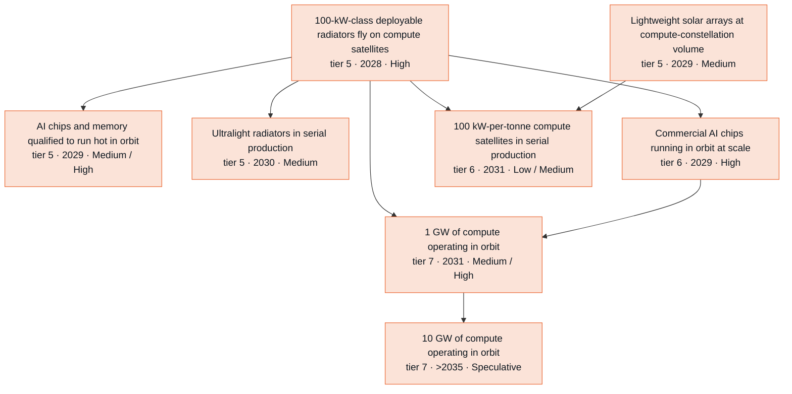

**Side lanes** (connected to the branch but off its main chain)

- Predicting radiation errors in commercial AI chips (tier 3 · 2028 · High) → Proven radiation-fault tolerance for orbital AI (tier 4 · 2029 · Medium / High) → A large AI model is trained in orbit (tier 7 · 2032 · Speculative / Medium)
- AI-optimized radiators and heat transport (tier 4 · 2028 · High)
- Lightweight solar arrays at compute-constellation volume (tier 5 · 2029 · Medium) → Megawatt-class compute satellites fly (tier 6 · 2033 · Speculative / Medium)
- Commercial AI chips running in orbit at scale (tier 6 · 2029 · High) → 100 MW of orbital compute outside dawn-dusk orbits (tier 6 · 2035 · Speculative / Low)

Where the reviewers disagreed: 2031 challenge round (6 disputes)

Recorded during the 2031 challenge round. Later passes adjusted some dates and bands; the node table below has the final values.

- **1 GW of compute in orbit by 2031 ("1 GW of compute operating in orbit").** *Skeptic:* S2 Medium -> Low. Under the Sep 2026 envelope, mass per GW is ~16,000-18,000 t and ~160-180 flights, 1.3-1.8x the old basis. First flight slips to 2028 and commercial operation to 2029. 1 GW by end-2031 then needs ~1,600-2,000 four-tonne satellites a year, competing with Starlink V3 for Starship flights, plus km2-scale array production. AI math moves none of this. *Advocate:* Musk's Aug 25 2026 target is 1 GW by end-2027, then 10x a year. The tree's own 1.5-3x slip puts that at 2029-31. Chips, capital and licensing are not binding. Proposed S1 >2031 -> 2031, S2 2031 -> 2030, S3 2031 -> 2030 and S3 Medium -> High. *Resolution:* S2 Low, S3 Medium, years unchanged (>2031/2031/2031). The advocate's chain assumed "100+ fully reusable heavy launches a year" at S2 2029 / S3 2028. The trunk resolver has since moved it to 2030 / 2029. The trunk's "AI compute becomes Starship's second anchor customer" node (10 compute flights in one year) is only S2 2030 Medium, while 1 GW needs ~110-180 dedicated flights. Mach33 itself puts scaled deployment in the early 2030s. Musk's target has the first satellites and 1 GW in the same quarter. S3 keeps Medium because cadence and demand arrive a year earlier and the physical multiplier is 1.3-1.5x, not because of mathematics.
- **When 100-kW-class compute-satellite radiators first fly ("100-kW-class deployable radiators fly on compute satellites").** *Skeptic:* 2027 -> 2028 in all scenarios. Between June and October 2026 the power point moved twice and the radiator envelope grew from 110 to up to 200 m2. HBM thermal closure is still open. A derivative payload flies 12-18 months after design-complete, and SpaceX schedules run 1.5-3x long. *Advocate:* Keep 2027. Musk targets prototypes in early 2027, first-generation launches in Q4 2027 and 'significant scale' in 2028. The advocate's downstream chains assume that schedule. *Resolution:* 2028 in every scenario, the same 1.5-3x slip calibration the trunk resolver applied to launch-clock nodes. The Q4 2027 target is recorded in status and signpost. Commercial operations move to 2029.
- **Where the AI-math lever sits and how to price it (radiators vs solar vs chip temperature; tonnes vs $/GW).** *Skeptic:* Radiator design optimization is not a binding mass lever. Solar is 56% of AI1's mass, and every kg/m2 off the array is worth ~6x the same cut on the radiator. Allowable chip/HBM temperature is a bigger lever than design. AI math is worth a few percent of launched mass. Proposed a T5 hot-HBM qualification node gated by qualification. *Advocate:* Tonnes undercount the value once launch is cheap. Thermal is the largest $/GW sensitivity in Mach33's model (+/-30% -> +/-8.9%). The T^4 chip-temperature lever is unlocked by AI wear-out models, proposed as a T3 node at High by 2028. Also proposed an orbital-ground cost-parity outcome node. *Resolution:* Both currencies now appear in the text: ~2-9% of launched mass, and ~3-7% of $/GW, about 0.3-0.6 year on Mach33's cost curve. Hot chips are a single merged T5 node (qualification gate, Medium in every scenario) with AI applied math as a soft P1/P5 accelerator. Physics-of-failure models already exist at chip vendors, and validation needs life tests plus flight telemetry, so High by 2028 overstated the AI share. The cost-parity node is rejected: it rests on one commercial forecaster, its year depends on which terrestrial benchmark is chosen, and contract prices are rarely disclosed.
- **Sub-2.5 kg/m2 radiators in serial production ("Ultralight radiators in serial production").** *Skeptic:* S3 High -> Medium, and AI design becomes a soft input. Prototypes already reach 1.9-3.9 kg/m2. The October design is short of radiator area, not areal density. AI-run factories speed a ramp but do not create demand for it. The auditor agreed. *Advocate:* S2 Medium -> High. The filed <4,000 kg envelope, which 33FG's 4,487 kg reference already exceeds, pulls mass down for regulatory reasons. No regulator certifies the hardware, and annual satellite generations give two build-fly-fix loops before 2031. *Resolution:* Medium in both S2 and S3, and S1 Medium. The envelope pull is real but lands mainly on solar mass. Fabrication compresses only 1.05-1.15x in S2. The year is set by the production ramp. The advocate's soft edges (satellite-generation cadence, optimal test campaigns, two-phase models) were accepted.
- **100 kW per tonne compute satellites ("100 kW-per-tonne compute satellites in serial production").** *Skeptic:* S2 Medium -> Low. The design trend runs away from 100 kW/t: June ~71, Sep envelope >=~62, Oct reference ~56 kW/t. Reaching 100 needs a ~60-80% gain within ~3 years of first flight, driven mainly by solar. *Advocate:* S3 2031 -> 2030 with bands held. Hotter chips cut radiator area ~33%, solar rather than radiator is the constraint, and S3's yearly generations and AI-run factories make 2030 reachable. *Resolution:* S2 Low, S3 Medium, S3 year stays 2031. Under the October trend, two design generations would be needed in two years. The auditor's S3 Low was not taken: SpaceX's stated long-run goal is 100 kW/t and S3 carries yearly generations, so S3 sits at the Low/Medium boundary.
- **Does compute-fleet telemetry relieve the physics data gates (two-phase cooling, deployment dynamics, radiation errors)?** *Skeptic:* Fleet telemetry arrives ~2028-29, not 2027-28, because first flights slipped. AI1's 'deployable liquid radiator' may be single-phase, so its data may not be two-phase data at all. *Advocate:* S2 2030 -> 2029 for both two-phase and deployment physics. Add a fleet-telemetry-lab node: thousands of identical satellites produce orders of magnitude more data than ISS campaigns or beam time. *Resolution:* The mechanism is captured as soft edges from "100-kW-class deployable radiators fly on compute satellites" to the radiation-error, two-phase and deployment nodes, plus text in their rationales. Years are kept: the earlier year would sit at zero lag behind "AI builds validated physics theory" (S2 2029), fleet data starts 2028-29, and it may be single-phase. The lab node is rejected as overlapping "AI-ready structural and thermal test data" and the existing 'whoever owns the fleet owns the model' insight.

Where the reviewers disagreed: 2035 and Embodied extension round (9 disputes)

- **Can 10 GW of orbital compute be reached by 2035?** *Skeptic:* The draft's own arithmetic fails. A third to a half of 300 flights a year at 100-150 t gives 0.6-2.3 GW a year, short of the claimed 2-3 GW. S3 cannot reach 10 GW by 2034, and S2 cannot reach it by 2035. Chips (about 2.9 million GPU packages) and the dawn-dusk payload penalty also bind. *Advocate:* Mach33's Launch Keystone reference passes 10 GW of SpaceX's own compute in 2032. A ramp on the trunk's clock with V4 payloads and 100 kW/t reaches about 10 GW at end-2035 in S2, so S2 should be Medium. *Resolution:* Skeptic accepted: S2 after 2035 (Speculative), S3/S4 2035 (Low). The Mach33 reference is verified, but it launches 108,000 t of compute in 2032, which is about 700-1,100 flights. That is roughly three times the 300 heavy flights a year the trunk first reaches in 2032-33, and this branch must follow the trunk's clock. The advocate's 'central' ramp uses the trunk's earliest (optimistic) years plus V4 payload and 100 kW/t together. A rough simulation over plausible ranges gives medians of 5-6 GW (S3) and 4-5 GW (S2) at end-2035. The Mach33 figures are recorded in the node status. If the trunk speeds up cadence, revisit.
- **Do general-purpose robots (S4) earn credit at the launch gate?** *Skeptic:* Launch binds and robots do not touch it. With the "Kilometre-scale monolithic structure in orbit" credit removed, the branch has no S4 credit anywhere, which is the right result. *Advocate:* The trunk promised S4 credit for robot-built pads 'on later build-outs', but no node carries it. Robot crews build pads and propellant plants from 2033 at 0.50-0.57x of the usual time. That adds 1.2-1.35x flights in 2034-35, so S4 makes 10 GW in every case and should be High. *Resolution:* Mechanism accepted, magnitude rejected. A soft edge from "Robot crews build a launch pad or propellant plant" to 10 GW records the link. Pads started in 2033 finish in 2034-35, adding roughly 0.2-2 GW by end-2035 against a central S3 path of about 5-6 GW. That lifts S4 within Low but not to a band step. Airspace, approvals, SSO-capable Florida sites, chips and capital do not compress, and the advocate's S3 ramp (700 flights in 2035) runs above the trunk. S4 equals S3 on every node. The trunk resolver should fix its own note that points to a credit no node carries.
- **What is a kilogram saved worth on a compute satellite?** *Skeptic:* The draft argues both sides. It uses 'cadence capped' to raise arrays and 100 kW/t, and '$13/kg makes mass cheap' to hold radiators. The fix is to lower arrays in S2, drop the $13/kg clause and keep radiators Medium. *Advocate:* When flights bind, a kg saved flies more compute, worth billions a year at 2-3 GW a year. Radiators should go to High in S2-S4 and 100 kW/t to High in S3/S4. *Resolution:* One rule now applies to all mass levers: mass matters through flight count where flights bind, and flights bind growth past about 1 GW. That is likely by 2035 in S3/S4 and less so in S2. Arrays: S2 Medium, S3/S4 High. Radiators stay Medium everywhere. The cut is about 5% of mass per GW, hot chips (High by 2035) shrink radiator area and with it this lever, and arrays carry about six times the leverage per kg/m2. 100 kW/t stays Medium because it needs roughly twice AI1's array specific power plus hot chips together. The $13/kg and 'capped cadence' texts are removed.
- **Kilometre-scale monolith and the only S4 credit.** *Skeptic:* s4-embodied credits '100-m-class assembly plausible by 2035', which says nothing about a 1 km node. The gate is capital, so S4 rule 1 fails. No program is funded and formation flying meets the need, so every scenario should be after 2035. *Advocate:* Keep the one-year S4 credit with a new reason: robotic assembly at scale (2033) plus launch under $100/kg makes a km truss a question of capital. *Resolution:* Skeptic accepted: after 2035 and Speculative in every scenario. A capital-gated node gets no S4 credit by rule. A 1 km structure has about 100 times the area of the 100 m class that robots reach by 2035, and nobody funds one while formation clusters work.
- **1 GW in orbit by 2035 (base case).** *Skeptic:* Going from Low to High in four years, before any Starmind has flown and before the pre-registered signal (production above about 1,000 satellites a year), is premature. S1 cannot sit level with 'ten compute flights in a year'. *Advocate:* No direct challenge. The advocate's thesis kept 1 GW High by 2035. *Resolution:* S2 Medium, S3/S4 High, S1 Low. Launch has slack for 1 GW (about 400 compute flights in 2030-35 against 110-180 needed), so demand and execution bind. S2 moves to High when the production signpost is met.
- **When is a model trained in orbit?** *Skeptic:* No finding. The draft had S2 2033, S3 2032 and Medium by 2035, since ground sites may stay cheaper and labs may not disclose. *Advocate:* 1e26 FLOP is about 100 satellites for a month, a few percent of the fleet. The 'largest runs' objection does not apply to this threshold. SpaceXAi runs both the fleet and a lab and has reason to announce, so S2 2032, S3 2031 and High by 2035 in S2-S4. *Resolution:* Mostly accepted: S2 2032, S3/S4 2031 (Low by 2031), High by 2035 in S3/S4. S2 stays Medium because in S2 the fleet itself (1 GW) is only Medium by 2035.
- **Megawatt-class compute satellites.** *Skeptic:* A 1 MW satellite is about 3-4x outside the filed FCC envelope, so it needs a modification (the Gen2 precedent took about 16 months). It also needs 4,000-6,000 m2 of array, and Starlink's size steps took 3-4 years. Move the years one later. *Advocate:* Starlink mass grew about 1.34x a year. At that rate Starmind passes 1 MW about 2033, so the satellites should be High by 2035. *Resolution:* Years move later (S2 2033, S3/S4 2032), and the band stays Medium. The trend extrapolation reaches 1 MW only about 2033, with no margin. SpaceX's stated architecture is ten-satellite clusters of 250 kW satellites, and no filing covers MW-class satellites.
- **Does the power-per-kilogram step wait for perovskites?** *Skeptic:* No finding. *Advocate:* The node's definition accepts thin-film or thinned III-V cells, and the perovskite node's own strongest case says these can deliver the gain. The hard edge is stricter than the definition. *Resolution:* Accepted. The perovskite edge becomes soft and a light-array hard edge is added. S2-S4 move to 2032, Medium by 2035, and S1 to 2035, Low.
- **New 2032-35 nodes: captive chip fab and robotic compute-module swaps.** *Skeptic:* No proposal. Chips and packaging co-bind 10 GW and belong in its text. *Advocate:* Add a Terafab-style captive fab node (10 million accelerators a year by 2032 in S2) and an S4-led robotic module-swap node (S4 2034). *Resolution:* Both rejected. The fab is a terrestrial supply anchor outside the branch's space scope. A logic fab does not supply HBM or packaging, and by the advocate's own strongest case it changes the cost of 10 GW more than its date. Terafab is recorded in the 10 GW status and signpost (facts verified via 33FG). Module swaps rest on an adoption gate, which S4 rule 1 excludes, and on a servicing business no operator has signalled. Starlink's practice is to deorbit and replace, with annual generations.

All nodes in this branch

Years and likelihoods are listed for Plateau / Exponential / Recursive / Embodied. H = High, M = Medium, L = Low, S = Speculative.

| Node | Tier | Year | By 2031 | By 2035 | Binding gate | Pathway |
| --- | --- | --- | --- | --- | --- | --- |
| Knowing how long perovskite cells last in orbit | 3 | 2030 / 2028 / 2028 / 2028 | L / M / M / M | M / H / H / H | data | P1->P6 |
| Predicting radiation errors in commercial AI chips | 3 | 2029 / 2028 / 2028 / 2028 | M / H / H / H | H / H / H / H | experiment | P1 |
| Predictive simulation of large deployable structures | 3 | 2033 / 2030 / 2029 / 2029 | S / M / M / M | M / M / H / H | experiment | P6 |
| Predictive two-phase cooling physics in microgravity | 3 | 2033 / 2030 / 2029 / 2029 | S / M / M / M | M / M / H / H | data | P6 |
| AI-optimized radiators and heat transport | 4 | 2030 / 2028 / 2028 / 2028 | M / H / H / H | H / H / H / H | adoption | P1 |
| Proven-stable power grids for big spacecraft and Moon bases | 4 | 2030 / 2028 / 2028 / 2028 | L / M / H / H | M / H / H / H | adoption | P1->P2 |
| Proof agents verify space processors and chip logic | 4 | 2029 / 2028 / 2028 / 2028 | M / H / H / H | H / H / H / H | adoption | P2 |
| Battery qualification without years of cycling | 4 | 2030 / 2029 / 2029 / 2029 | L / M / M / M | M / H / H / H | qualification | P1->P6 |
| Proven radiation-fault tolerance for orbital AI | 4 | 2030 / 2029 / 2028 / 2028 | L / M / H / H | M / H / H / H | adoption | P2 |
| Second-generation fission power designs | 4 | 2032 / 2030 / 2029 / 2029 | S / L / L / L | L / M / M / M | capital | P1->P6 |
| 100-kW-class deployable radiators fly on compute satellites | 5 | 2028 / 2028 / 2028 / 2028 | H / H / H / H | H / H / H / H | fabrication | P7 (exogenous) |
| AI chips and memory qualified to run hot in orbit | 5 | 2030 / 2029 / 2029 / 2029 | M / M / M / M | M / H / H / H | qualification | P7 (exogenous) |
| Lightweight solar arrays at compute-constellation volume | 5 | 2029 / 2029 / 2029 / 2029 | M / M / M / M | M / M / H / H | fabrication | P7 (exogenous) |
| Lightweight 600 K radiators qualified for fission power | 5 | 2030 / 2030 / 2030 / 2030 | L / L / L / L | M / M / M / M | qualification | P7 (not AI-math-driven) |
| Ultralight radiators in serial production | 5 | 2031 / 2030 / 2030 / 2030 | L / M / M / M | M / M / M / M | fabrication | P7 (exogenous) |
| AI-designed radiation-tolerant space processor | 5 | 2032 / 2030 / 2029 / 2029 | S / M / M / M | M / H / H / H | fabrication | P1->P7 |
| Model-qualified perovskite tandem proves itself in orbit | 5 | 2033 / 2030 / 2030 / 2030 | S / L / L / L | L / M / M / M | experiment | P1->P7 |
| Radiation-robust high-voltage power electronics | 5 | 2031 / 2030 / 2029 / 2029 | L / M / M / M | M / H / H / H | fabrication | P7 (exogenous) |
| A 1,000 m2-class solar sail flies | 5 | 2034 / 2031 / 2031 / 2031 | S / L / L / L | L / L / L / L | capital | P6->P7 |
| Commercial AI chips running in orbit at scale | 6 | 2029 / 2029 / 2029 / 2029 | M / H / H / H | H / H / H / H | launch-internal | P7 (exogenous) |
| Tight-formation compute clusters operate in orbit | 6 | 2030 / 2029 / 2029 / 2029 | L / M / M / M | M / H / H / H | fabrication | P7 (exogenous) |
| 100 kW-per-tonne compute satellites in serial production | 6 | 2033 / 2031 / 2031 / 2031 | S / L / L / L | L / M / M / M | fabrication | P7 (AI math second-order via P1 thermal and structural design and P5 chip-life evidence) |
| Perovskite arrays power operational satellites | 6 | 2034 / 2031 / 2031 / 2031 | S / L / L / L | L / M / M / M | qualification | P7 |
| A 100 kW-electric fission reactor operating on the Moon | 6 | 2033 / 2033 / 2033 / 2033 | S / S / S / S | L / L / L / L | launch-external | P7 (not AI-math-driven) |
| Megawatt-class compute satellites fly | 6 | 2034 / 2033 / 2032 / 2032 | S / S / S / S | L / M / M / M | qualification | P7 (exogenous) |
| 100 MW of orbital compute outside dawn-dusk orbits | 6 | >2035 / 2035 / 2034 / 2034 | S / S / S / S | S / L / L / L | capital | P1->P7 |
| Kilometre-scale monolithic structure in orbit | 6 | >2035 / >2035 / >2035 / >2035 | S / S / S / S | S / S / S / S | capital | P6->P7 |
| 1 GW of compute operating in orbit | 7 | 2033 / 2031 / 2030 / 2030 | S / M / M / M | M / H / H / H | launch-internal | P7 (not AI-math-driven; AI math second-order via P1 thermal and reliability design) |
| A step change in spacecraft power per kilogram | 7 | 2035 / 2032 / 2032 / 2032 | S / S / S / S | L / M / M / M | qualification | P7 |
| A large AI model is trained in orbit | 7 | 2035 / 2032 / 2031 / 2031 | S / S / L / L | L / M / H / H | adoption | P2->P7 |
| 10 GW of compute operating in orbit | 7 | >2035 / >2035 / 2035 / 2035 | S / S / S / S | S / S / L / L | launch-internal | P7 (exogenous) |

### Living and working off Earth

*AI-planned, machine-checked operations give Moon and Mars robots severalfold more work per operator about 2029 (central scenario). A self-running Moon base and tonne-scale lunar oxygen are Medium by 2035. Landed mass, night power, funding and Mars windows set the pace. Robots (Embodied) lift one band, on lunar robot fleet size.*

On-demand AI mathematics first gives lunar and Mars teams expert analysis they now ration. From about 2027 in the Exponential (base) case, teams get a rover-task planner with a machine-checked certificate within days (High by 2031). Oxygen-reactor models with error bounds follow about 2028. [Perseverance's AI-planned drives](https://www.jpl.nasa.gov/news/nasas-perseverance-rover-completes-first-ai-planned-drive-on-mars/) in December 2025 show the channel works.

In the Exponential case, *AI plans rover operations, machines check the plans* becomes routine about 2028 (High by 2031). *Severalfold more robot work per operator* (3-10x, a judgment) follows about 2029 (Medium by 2031, High by 2035). *Heavy cargo landed on the Moon* and *first oxygen made on the Moon* arrive about 2029 (Medium by 2031, High by 2035). A *lunar base runs itself between crew visits* and a *tonne-per-year lunar oxygen plant* are Low by 2031, held by appropriations, anode life and funding. Plateau runs one to two years behind. Recursive makes productivity High and the base Medium.

The tonne-per-year plant arrives about 2032 in the Exponential case. Both it and the self-running base are Medium by 2035. *First water mined from lunar polar ice*, *a hundred robots work on the Moon at once* and 90-day crew stays come about 2033, each Low by 2035. On Mars, the April 2033 window makes kilogram-per-hour propellant production Low by 2035, and a Starship-scale plant comes after 2035. Embodied changes one rating. The hundred-robot fleet is Medium by 2035, one band above Recursive, as robot variants of Earth designs supply lunar-rated machines after 2031 (a judgment). Elsewhere robots change nothing; labor does not bind. Run hours, anode life, night power, funding and Mars windows do.

The openai/math catalog contributes little. Family 104 (T3 in part, otherwise conditional) improves planner-synthesis theory, but practical solvers already handle realistic sizes. Families 102 and 125 (T3) and 124, 110 and 111 (conditional) inform fleet scheduling but gate nothing. Family 149 (conditional) covers idealized reaction networks unlike real life-support loops.

The strongest case for a small effect is that AI planning works without new mathematics, and nights, dust and failures cap robot output. [A 2024 electrolysis rig made 0.07 kg of oxygen an hour](https://doi.org/10.32865/2346/108973), against 0.11 kg/h year-round for 1 t/yr. Mars-class closed-loop life support stays Low by 2035, short of flight hours and [failure data, last released in 2004](https://doi.org/10.32865/2346/102631). The skeptic won both rounds. Tenfold became severalfold, the self-running base fell to Low by 2031 because Moon Base Phase 2 runs 2029-2032 (NBC), and the resolver removed Embodied credit from robot-built pads, the oxygen plants and the assembly demo. The advocate's launch case survives as the heavy-cargo step. Watch for NASA funding an ISRU pilot plant with a delivery date; none by end-2030 pushes that plant past 2032 (a judgment).

44 nodes. Rated High or Medium by 2031: Plateau 11, Exponential 24, Recursive 27, Embodied 27. By 2035: Plateau 21, Exponential 33, Recursive 36, Embodied 37. Main binding gate: launch.

**Main chain** (each node: tier · earliest year in the Exponential case · likelihood by 2031 / by 2035; Recursive and Embodied years shown where they differ)

- **Research-grade math for outside teams** (tier 0 · 2027 · High; gate: regulatory, then capital)
  - → **AI does research-grade applied math** (tier 0 · 2027 · High; gate: cognitive, then data)
    - → **Fast, trustworthy models of oxygen reactors** (tier 2 · 2028 · High; gate: data, then experiment)
      - → **Tonne-per-year lunar oxygen plant** (tier 6 · 2032 · Speculative / Medium; Recursive 2031; gate: capital, then experiment)
        - → **Lunar oxygen fuels landers at 10 t a year** (tier 7 · 2035 · Speculative / Low; Recursive 2034; gate: capital, then experiment)
  - → **Mission planners that are correct by design** (tier 2 · 2027 · High; gate: adoption, then formalization)
    - → **Proof-checked autonomy software for lunar robots** (tier 4 · 2028 · High; gate: adoption, then formalization)
      - → **A lunar robot operates with proof-checked autonomy** (tier 5 · 2029 · Medium / High; gate: launch-external, then adoption)
  - → **Honest reliability numbers for life support** (tier 2 · 2028 · Medium / High; gate: data, then adoption)
    - → **Mars-class closed-loop life support, demonstrated** (tier 6 · 2033 · Speculative / Low; Recursive 2031; gate: qualification, then fabrication)
  - → **AI plans rover operations, machines check the plans** (tier 6 · 2028 · High; gate: adoption, then formalization)
    - → **Severalfold more robot work per operator** (tier 7 · 2029 · Medium / High; gate: adoption, then formalization)
      - → **A hundred robots work on the Moon at once** (tier 7 · 2033 · Speculative / Low; Recursive 2032; gate: fabrication, then capital)
    - → **Lunar base runs itself between crew visits** (tier 6 · 2031 · Low / Medium; gate: capital, then launch-internal)
      - → **Crews stay on the Moon for 90 days or more** (tier 7 · 2033 · Speculative / Low; Recursive 2032; gate: capital, then qualification)
- **First oxygen made on the Moon** (tier 5 · 2029 · Medium / High; Recursive 2028; gate: launch-external, then capital)
  - → **Tonne-per-year lunar oxygen plant** (tier 6 · 2032 · Speculative / Medium; Recursive 2031; gate: capital, then experiment) (see above)
- **Heavy cargo landed on the Moon** (tier 6 · 2029 · Medium / High; Recursive 2028; gate: launch-internal, then qualification)
  - → **Moon Base Phase 2 infrastructure on the surface** (tier 6 · 2031 · Low / Medium; Recursive 2030; gate: capital, then launch-internal)
    - → **Lunar base runs itself between crew visits** (tier 6 · 2031 · Low / Medium; gate: capital, then launch-internal) (see above)
    - → **Crews stay on the Moon for 90 days or more** (tier 7 · 2033 · Speculative / Low; Recursive 2032; gate: capital, then qualification) (see above)
    - → **A hundred robots work on the Moon at once** (tier 7 · 2033 · Speculative / Low; Recursive 2032; gate: fabrication, then capital) (see above)
  - → **A hundred robots work on the Moon at once** (tier 7 · 2033 · Speculative / Low; Recursive 2032; gate: fabrication, then capital) (see above)

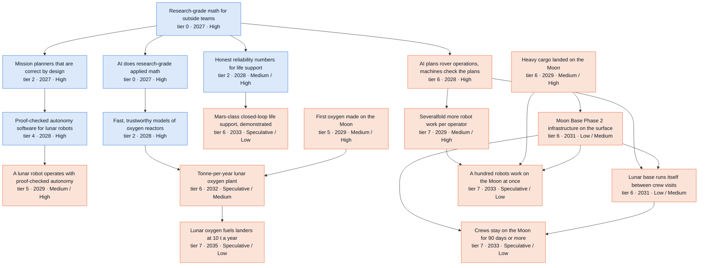

**Side lanes** (connected to the branch but off its main chain)

- Crew-side fault diagnosis without Mission Control (tier 4 · 2028 · Medium)

Where the reviewers disagreed: 2031 challenge round (11 disputes)

Recorded during the 2031 challenge round. Later passes adjusted some dates and bands; the node table below has the final values.

- **When a crew-optional lunar base becomes plausible ("Lunar base runs itself between crew visits").** *Skeptic:* The node names its own gate: there must be enough base to operate. NASA puts semi-permanent infrastructure in Phase 2 (2029-2032) and sustained presence in Phase 3 (from 2032). Appropriations compress 1.0x and flagships slip 2-7 years. Proposed S3 2030 -> 2031, S2 Medium -> Low, and a new base-infrastructure node. *Advocate:* Capital is not binding: a ~$30B Moon Base, NASA bulk launch buys, SpaceX's Moon-first pivot and $100.8B in cash. The gate is landed infrastructure on the Starship exponential. Proposed S2 2031 -> 2030, S3 2030 -> 2029, gate capital -> launch, plus heavy-cargo and solar-grid nodes. *Resolution:* Skeptic's timing and band adopted (years >2031/2031/2031, bands Low/Low/Medium). I verified the phase years: they come from NBC reporting, while NASA's release gives no years. The advocate's launch argument is captured in the new "Heavy cargo landed on the Moon" node (2030/2029/2028, Medium). That node feeds the new "Moon Base Phase 2 infrastructure on the surface" node (skeptic; 2031/2031/2030, Low/Low/Medium), which is now a hard prerequisite of crew-optional ops. The gate stays capital because launch now sits on the heavy-cargo node. On edges, both lenses agreed to make the ceilings and verified autonomy soft. FDIR was also made soft, following the skeptic over the advocate: crew-side diagnosis serves a crew that is present, and the Earth is 1.3 s away.
- **First oxygen made on the Moon ("First oxygen made on the Moon") once the hard ROM edge is removed.** *Skeptic:* Remove the edge, but AI still buys about a year between S1 and S2 (Amdahl ~18% vs ~38%). S1 2031 -> 2030, band S1 Low kept. *Advocate:* The date is set by manifests, and there are several independent attempts (LIFT-1, Helios, ProSPA, Moon Base Phase 1's 30 landings). Proposed S1 2029 Medium, S2 2028 High, S3 High, plus a threshold of at least 1 g. *Resolution:* Years 2030/2029/2028 (skeptic's S1). Bands Medium/Medium/High: S1 is restored to Medium because a schedule that does not depend on AI should not sit below S2, and S3 High is accepted because cadence runs 0.5-1 year earlier there. The advocate's S2 2028 and S2 High were rejected: no payload making 1 g or more is manifested as of Oct 2026, and a payload needs 12-18 months after manifesting. I verified ProSPA (2027 Nova-C flight, sub-gram) and LIFT-1 ($200-250M, 2027 target from the 2023 plan, current status unconfirmed). The 1 g threshold was adopted.
- **Robot work per operator ("Severalfold more robot work per operator").** *Skeptic:* A fleet-level outcome cannot come before the first flight of the autonomy it is credited to, and the 10x figure has no source. Proposed S2 2030, S3 2029, S3 High -> Medium, S1 -> Low, and 'severalfold'. *Advocate:* The metric is a ratio that Mars rovers already flying AI-planned drives can show, so no fleet is needed. Proposed S2 2028 and S2 Medium -> High. *Resolution:* All three lenses agreed to make the verified-autonomy edge soft, and that removes the skeptic's ordering problem. 'Severalfold (3-10x)' and the new title were adopted. S3 moves 2028 -> 2029 to follow the later routine-adoption date (S3 2028) plus measurement across missions, and S2 stays 2029. Bands stay Medium/Medium/High. The advocate's S2 High was rejected because public reporting of the ratio is uncertain, and the skeptic's band cuts were rejected because the bar is now lower.
- **Whether proof-carrying surface autonomy is capped by certification ("Proof-checked autonomy software for lunar robots") and how likely a flight is ("A lunar robot operates with proof-checked autonomy").** *Skeptic:* P2 defaults to Medium. The node names NASA acceptance, and LTVs carry crew, so S2 should drop to Medium unless LTVs are removed and the gate becomes adoption. For the flight node, S3 High is too confident at about 50% landing odds. *Advocate:* No certifier applies: CLPS is a commercial service buy and uncrewed robots need only an Article VI authorization under EO 14335. Set the gate to adoption, keep High, and raise the flight node's S2 to High given many landings and software uplinks. *Resolution:* The alternative that both cappers offered was adopted: LTVs (human-rated software) are out of scope, the gate is adoption, and Medium/High/High is kept. For the flight node, S3 High -> Medium (skeptic and auditor) and the advocate's S2 High was rejected. Provider demand and landing odds do not change with cheaper cognition.
- **Lunar oxygen plant ("Tonne-per-year lunar oxygen plant").** *Skeptic:* S2 Low -> Speculative. The chain runs from a 2029 demo through a funded pilot plant, landing and a year of operation with anode swaps, which does not fit by 2031. *Advocate:* 1 t/yr needs only ~3-4 kW, so fission is not a gate. Proposed S2 >2031 -> 2031 and S3 Low -> Medium, plus soft inputs from anodes, a solar grid and heavy cargo. *Resolution:* The power claim is corrected to ~3-6 kW; I checked the scaling (30 kW x 8,766 h / 10 t = ~26 kWh/kg). I added a constraint neither lens raised: a ~1,600 C melt must ride through ridge-site dark periods. Both band moves were rejected, leaving Speculative/Low/Low and years >2031/>2031/2031. Pilot-plant funding, endurance hours and landing odds compress in no scenario. Soft inputs were added from anode materials, heavy cargo and base infrastructure.
- **Closed-loop habitat ("Mars-class closed-loop life support, demonstrated").** *Skeptic:* Flight unit-hours are capped by ISS retirement, upmass and crew time, and parallel ground units do not meet the flight criterion. Proposed S3 Low and S2/S1 Speculative. *Advocate:* Model-based priors cut the required unit-hours to 0.3-0.6x (physclock), about 18-36k hours. Proposed S2 >2031 -> 2031 plus soft edges from the credibility standard and AI-run test stands. *Resolution:* S3 Low (skeptic and auditor) and S1 Speculative, since no credibility standard arrives before 2031 in S1. S2 stays >2031 Low because the two lenses' S2 moves cancel. The priors mechanism is real but needs both regulator acceptance (S2 2029, Medium) and the oxygen-recovery hardware in flight, so it went in as soft edges rather than a year change.
- **Inert MRE anodes ("Anodes that survive molten regolith").** *Skeptic:* Autonomous labs cannot process refractory ceramics, endurance runs at 1,600 C take thousands of hours, and materials qualification is slow. Proposed S2 2031 Low and S3 2030. *Advocate:* In S3, parallel AI-run stands mean one 6-week screen plus one 14-month confirmation finishes before 2031. Proposed S3 High. *Resolution:* S3 moves 2029 -> 2030 because it equalled its hard prerequisite's year. S2 stays 2030 Medium, since a 1,000 h screen is only six weeks. S3 stays Medium: parallel stands shorten serial cycles, not individual tests. Both lenses agreed on the soft edge into the oxygen plant.
- **Ground truth on polar icy regolith ("First measurements of how hard polar ice is to dig").** *Skeptic:* Strength data are needed, not just detection. VIPER is exposed to the LC-36 loss, Chang'e-7 carries no drill, and landings succeed about 40-50% of the time. Proposed High -> Medium with the year kept at 2028. *Advocate:* Several independent attempts (PROSPECT's ~1 m drill in 2027, LUPEX, VIPER) keep it High and 2028. *Resolution:* Medium in all scenarios, year 2028 (two lenses each). The auditor's 2029 was rejected because PROSPECT and LUPEX are 2027-28 attempts. The PROSPECT fact is verified and added, with the caveat that its sunlit site may not reach ice. Because the year stays 2028, the auditor's knock-on to the regolith and excavator nodes does not apply.
- **Mars ISRU demo in S3 ("Kilogram-per-hour propellant production on Mars").** *Skeptic:* A Feb-Mar 2031 launch arrives Sep-Nov 2031. The demo also needs 25-30 kW landed, a MOMS contract that does not exist and a hydrogen source, so S3 Low -> Speculative. *Advocate:* Conceded that SpaceX's Feb 2026 Moon-first pivot removes the main route, but kept Low. *Resolution:* Speculative in every scenario. The concession plus the uncompressed physical chain leave under 10% even in S3. This forces "Mars outpost logistics cut by local resources and recycling" S3 to Speculative as well.
- **New physical-gate nodes.** *Skeptic:* Add Moon Base Phase 2 infrastructure (capital gate), the missing gate behind crew-optional ops. *Advocate:* Add heavy lunar cargo (15 t or more), a lunar solar grid (10 kW or more) and a robot-built landing pad. The auditor separately proposed routine landings of 1 t or more. *Resolution:* Added heavy cargo (merged with the auditor's node, keeping the 15 t threshold; S3 High tempered to Medium), base infrastructure (skeptic) and the landing pad (advocate). The solar grid was rejected as a separate node and folded into base infrastructure: a 1 t/yr plant can carry its own few-kW array, so the grid gates nothing in this branch. The edge from heavy cargo into "A 100 kW-electric fission reactor operating on the Moon" was not applied because that node is outside this branch.
- **Branch thesis.** *Skeptic:* Severalfold by about 2030 (S2, Medium). The base waits on Phase 2 and stays Low by 2031. *Advocate:* Tenfold by 2028 and a crew-optional base by 2030; a 1 t/yr oxygen plant needs only ~3 kW. *Resolution:* The skeptic's frame was adopted with the auditor's hedging (bands stated) and the advocate's power correction. Severalfold by about 2029 (Medium) and the base Low by 2031; the oxygen plant needs a few kW and is gated by anodes, dark-period ride-through and funding; Mars stays window-gated.

Where the reviewers disagreed: 2035 and Embodied extension round (13 disputes)

- **S4 band credits on the 1 t/yr oxygen plant, robot-built pad and assembly flight demo.** *Skeptic:* All three fail the four-condition rule. Their binding gates are landed mass, power, sintering physics, run hours, a flight slot and funding. Labor does not bind them. The oxygen credit rested on 10+ cargo landings a year, which no node models. The pad is built by specialized sintering machines, and the demo needs a host plus 2-4 years of flight qualification. *Advocate:* Rewrite the notes so upkeep is the gate after 2031: about 9 anode swaps a year, regolith feed and dust cleaning for the oxygen plant, and grading and tending for the pad. General-purpose robots do that work from about 2032, and one or two cargo landings are enough. *Resolution:* Skeptic. Medium to High needs more than 70%. General-purpose robots doing outpost work on the Moon are themselves only Medium in S4 by 2035, so they cannot lift these nodes that far. With 10,000 h anodes (High by 2035) swaps fall to about one a year. Upkeep inside a plant is specialized automation already in S3, and the robots branch now makes the pad a prerequisite of robot construction. S4 equals S3 on all three.
- **S4 year and band credit on 10 t/yr lunar oxygen.** *Skeptic:* A buyer and plant funding bind, and one excavator covers the regolith feed. The plant is built on Earth, where robots reach suppliers only after 2031 and need 6-24 months of requalification. A 2033 landing freezes its design around 2031, before pilot run data exist. *Advocate:* The robots branch should move "Robots build lunar pads, berms and roads at outpost scale" to S4 2032 so the credit passes rule 2. Failing that, keep the band credit and drop only the year to 2034. *Resolution:* Skeptic. The robots final keeps "Robots build lunar pads, berms and roads at outpost scale" at S4 2033, and changing it is outside this branch. Condition 1 fails on demand and funding, so the band credit goes as well: 2034 and Low in S3 and S4.
- **Moon Base Phase 2 band by 2035.** *Skeptic:* The draft held S1 and S2 at Medium because appropriations and slips do not compress. That reason applies equally to S3 and S4, so they should be Medium too. A child node rated High would sit above its hard prerequisite. *Advocate:* The threshold is modest: tens of kW and one semi-habitable element. The 2025 executive order, the Moon-first pivots at NASA and SpaceX and routine heavy cargo justify High from S2 up. *Resolution:* Medium in S1-S4. Both reviewers found the same inconsistency. The executive order and the Moon-first plans set targets and carry no appropriations. Flagships slip 2-7 years, and the 100 kWe reactor is Low by 2035. Crew-optional ops drops to Medium with the base.
- **A hundred robots on the Moon at once: where S4 belongs.** *Skeptic:* S3 2031 is too early, since fewer than ten robots have ever worked on the Moon at once. The fabrication gate looks chosen to pass condition 1. Lunar units need new actuators, seals and thermal control, so terrestrial volume does not make them cheap. S4 High exceeds "Robots build lunar pads, berms and roads at outpost scale". Make every scenario Medium. *Advocate:* This is a spine node, and the S4 band step rests on the reviewed fleet-size argument. Add "Robots assemble flight hardware at leading space firms" as an input and name the fleet in the thesis. *Resolution:* Split decision. I accepted the skeptic's years (2032 in S3 and S4), the 20 kg threshold, the hard edge from the base and S4 Medium. I kept the fabrication gate, because the metric is the robot count and 100 robots weigh 2-10 t, a fraction of one landing. I also lowered S2 and S3 to Low, which neither reviewer proposed. On the S4 base path the S4 analysis puts off-Earth robots at tens in 2031 and hundreds by 2035, and then only with ten cargo landings a year. "Robots build lunar pads, berms and roads at outpost scale" is Low in S3. This is the one S4 credit left in the branch.
- **Unmodeled lunar landed-mass rate.** *Skeptic:* No credit can rest on 10+ landings a year until a gate node exists for that rate. *Advocate:* Add 'Ten heavy cargo landings on the Moon in one year' at S3 2032, Medium by 2035 in S2-S4, as an exogenous anchor with soft edges into the 2033-35 lunar outcomes. *Resolution:* Added as the advocate proposed, with no S4 credit. I dropped "Robot crews build a launch pad or propellant plant" as an accelerator because it lands later than the node. The node makes the S4 analysis's condition visible, and no band currently depends on it.
- **Lunar power without fission.** *Skeptic:* The 100 kWe reactor is Low by 2035 everywhere, so night power rests on ridge solar and storage. This keeps the long stay and the water pilot low. *Advocate:* Add a node for 100 kW of continuous ridge-solar power at S3 2033, Medium by 2035, because the 2033-35 lunar spine needs it. *Resolution:* Node rejected. The Moon base node already carries tens of kW of night-surviving ridge solar, which covers the 1 t/yr and 10 t/yr plants (under 30 kW) and a habitat. No node here strictly needs 100 kW. I accepted the text fix: chains now cite ridge solar from Moon Base Phase 2 instead of 2030 base power.
- **Do test-bound nodes converge between S2 and S3 by 2035?** *Skeptic:* Not contested. *Advocate:* Anodes, certified contact simulation and certified assembly skills share S2/S3 gates. Every hard parent is High in S2 by 2035, and S2 cognition is abundant by 2033-35, so S2 should be High. *Resolution:* Advocate. On anodes the draft's S2 reason, that the carbothermal route may draw the funding, applies equally to S3. Contact-sim acceptance runs through NASA-STD-7009, an existing named mechanism, so the 2035 cap allows High.
- **First water from polar ice.** *Skeptic:* No extraction payload is funded. NASA ISRU payloads take about 5 years from selection to flight. Power must come by cable because fission is Low by 2035. S2 Medium needs funding before its own models exist, and the S1 lag is inconsistent. *Advocate:* Extracting 1 t takes one lunar day (about 1.3 MWh). The draft adds a needless landing-to-extraction year, so every year should move one earlier. *Resolution:* Both in part. The extraction year is folded into the landing year, but the 3-year lag after excavator design now covers funding, build and landing, so S2 2033 and S3 2032 stay. S1 moves to 2035 on the same lag, and S2 drops to Low.
- **Starship-scale Mars propellant plant by 2035.** *Skeptic:* Only the Apr 2033 window works. The plant needs about 1 MW, about 1 t of water a day and a design frozen before any Mars ISRU data, plus a second landing near the first. *Advocate:* No Mars band moves. Windows and landed power already bind. *Resolution:* Skeptic. The plant moves to >2035 in every scenario and gets a hard edge from the second-precision-landing node. The other Mars nodes are unchanged except architecture close, which falls to Speculative because of the joint chance of its three hard parents.
- **Regulatory cap on crew-side fault diagnosis.** *Skeptic:* Not contested. The draft capped it at Medium everywhere. *Advocate:* NASA's EIMO framework names clinical AI as a target, which is a named mechanism in motion, so S3 and S4 should be High by 2035. *Resolution:* Rejected. EIMO is a capability roadmap with no acceptance route for crew-facing diagnosis, and the ISS test report is unverified. Rating S3 above S2 on acceptance would also break the extension rules' rule that the institutional overlay applies equally to S2-S4.
- **S4 credit for AI-found sorbents and catalysts.** *Skeptic:* Not contested. *Advocate:* Qualification is throughput-bound, and general lab robots from 2030 tend many parallel thousand-hour rigs, so S4 should be High by 2035. *Resolution:* Rejected. The S4 analysis finds that robots collapse synthesis but characterization then binds, and they add about 5 points to materials, which is not a band step. AI-run test stands are already in S3 (condition 4), and program acceptance binds.
- **Long crew stays and lunar crop harvests.** *Skeptic:* A 90-day stay needs both Medium hard parents, a pressurized habitat beyond Phase 2, power through three nights and a ride home whose propellant is kept cold for 90 days. Low in S2-S4. *Advocate:* Add robot-built berms as an accelerator. *Resolution:* Skeptic on bands. The berm edge was not added because "Robots build lunar pads, berms and roads at outpost scale" lands later than the stay in every scenario. Crop harvests are unchanged apart from text.
- **Soft-edge direction around robot lunar construction.** *Skeptic:* Edges from "Robots build lunar pads, berms and roads at outpost scale" into nodes dated earlier in every scenario carry S4 credit backward and form a loop with the pad. *Advocate:* Two soft 2-cycles hide which node drives the credit. Remove them and route the pad's robot input through "Robot AI models that work on sites they have never seen". *Resolution:* Both accepted. Construction is now downstream of the fleet and of the cargo cadence.

All nodes in this branch

Years and likelihoods are listed for Plateau / Exponential / Recursive / Embodied. H = High, M = Medium, L = Low, S = Speculative.

| Node | Tier | Year | By 2031 | By 2035 | Binding gate | Pathway |
| --- | --- | --- | --- | --- | --- | --- |
| Reaction networks that never lose an ingredient | 1 | 2027 / 2027 / 2027 / 2027 | L / M / M / M | M / M / M / M | formalization | P5 |
| Rigorous theory of frictional contact | 1 | 2032 / 2028 / 2028 / 2028 | S / M / H / H | M / H / H / H | cognitive | P1->P5 |
| Reliable equations for flowing lunar soil | 1 | 2033 / 2029 / 2028 / 2028 | S / M / M / M | M / H / H / H | cognitive | P1->P5 |
| Known limits for robot fleet scheduling | 2 | 2027 / 2027 / 2027 / 2027 | H / H / H / H | H / H / H / H | adoption | P3 (102 hardness; 125 lower bound) + P4 (124, 110, 111 and the 125 algorithm; constants unstated or galactic, not counted as practical) |
| Mission planners that are correct by design | 2 | 2029 / 2027 / 2027 / 2027 | M / H / H / H | H / H / H / H | adoption | P1->P2 |
| Honest reliability numbers for life support | 2 | 2029 / 2028 / 2028 / 2028 | M / M / H / H | M / H / H / H | data | P1 |
| Fast, trustworthy models of oxygen reactors | 2 | 2030 / 2028 / 2028 / 2028 | M / H / H / H | H / H / H / H | data | P1 (P6 only for scale-up tools) |
| Contact simulators with error bars | 2 | 2033 / 2029 / 2028 / 2028 | S / M / M / M | L / H / H / H | experiment | P1->P6 |
| Knowing what is worth making in orbit | 3 | 2030 / 2028 / 2028 / 2028 | L / M / M / M | M / H / H / H | data | P1->P6 |
| Biological life-support loops with stability guarantees | 3 | 2033 / 2029 / 2029 / 2029 | S / M / M / M | L / M / H / H | data | P5->P6 |
| Validated models of digging icy regolith | 3 | 2030 / 2029 / 2029 / 2029 | L / M / M / M | M / H / H / H | data | P6 |
| Predicting how lander exhaust erodes the surface | 3 | 2032 / 2029 / 2029 / 2029 | S / M / M / M | M / H / H / H | data | P1->P6 (363/364 P5 link has nil engineering effect) |
| Anodes that survive molten regolith | 3 | 2032 / 2030 / 2030 / 2030 | S / M / M / M | L / H / H / H | experiment | P1->P6 |
| Narrower uncertainty on crew radiation risk | 3 | 2034 / 2033 / 2031 / 2031 | S / S / L / L | L / L / M / M | data | P1->P6 |
| Crew-side fault diagnosis without Mission Control | 4 | 2030 / 2028 / 2028 / 2028 | M / M / M / M | M / M / M / M | qualification | P1->P2 |
| Proof-checked autonomy software for lunar robots | 4 | 2030 / 2028 / 2028 / 2028 | M / H / H / H | H / H / H / H | adoption | P2 |
| Reliable recipes for sintering regolith | 4 | 2031 / 2029 / 2028 / 2028 | L / M / H / H | M / H / H / H | experiment | P1->P6 |
| Robot assembly skills with proven safety envelopes | 4 | 2034 / 2030 / 2029 / 2029 | S / M / M / M | L / H / H / H | experiment | P2->P6 |
| Design excavators from models, not guesses | 4 | 2032 / 2030 / 2029 / 2029 | S / M / M / M | M / H / H / H | data | P6 |
| First measurements of how hard polar ice is to dig | 5 | 2028 / 2028 / 2028 / 2028 | M / M / M / M | H / H / H / H | launch-external | P7 (exogenous) |
| First oxygen made on the Moon | 5 | 2030 / 2029 / 2028 / 2028 | M / M / H / H | H / H / H / H | launch-external | P7 (exogenous) |
| A lunar robot operates with proof-checked autonomy | 5 | 2031 / 2029 / 2029 / 2029 | L / M / M / M | M / H / H / H | launch-external | P2 |
| Long closed life-support test run by certified control | 5 | 2034 / 2030 / 2030 / 2030 | S / L / M / M | L / M / M / M | capital | P5->P6->P7 |
| Kilogram-per-hour propellant production on Mars | 5 | 2034 / 2031 / 2031 / 2031 | S / S / S / S | S / L / L / L | launch-internal | P1->P6->P7 |
| Robotic assembly in space with certified skills | 5 | 2035 / 2031 / 2030 / 2030 | S / L / L / L | L / M / M / M | launch-external | P2->P6->P7 |
| First robot-built landing pad or blast berm on the Moon | 5 | 2033 / 2031 / 2030 / 2030 | S / L / L / L | L / M / M / M | launch-external | P1->P6->P7 |
| AI-found air-scrubber or fuel-plant material qualified | 5 | 2033 / 2031 / 2030 / 2030 | S / L / L / L | L / M / M / M | qualification | P1->P7 |
| AI plans rover operations, machines check the plans | 6 | 2029 / 2028 / 2028 / 2028 | H / H / H / H | H / H / H / H | adoption | P1->P2 |
| Heavy cargo landed on the Moon | 6 | 2030 / 2029 / 2028 / 2028 | M / M / M / M | H / H / H / H | launch-internal | P7 (exogenous) |
| Lunar base runs itself between crew visits | 6 | 2033 / 2031 / 2031 / 2031 | S / L / M / M | L / M / M / M | capital | P1->P2->P7 |
| Products made in orbit sold at recurring volume | 6 | 2033 / 2031 / 2030 / 2030 | S / L / L / L | L / M / M / M | capital | P1->P7 |
| Moon Base Phase 2 infrastructure on the surface | 6 | 2031 / 2031 / 2030 / 2030 | L / L / M / M | M / M / M / M | capital | P7 (physical and appropriations gate) |
| Tonne-per-year lunar oxygen plant | 6 | 2034 / 2032 / 2031 / 2031 | S / S / L / L | L / M / M / M | capital | P1->P6->P7 |
| Robots prepare a Mars landing site and power | 6 | 2034 / 2032 / 2032 / 2032 | S / S / S / S | S / L / L / L | launch-internal | P1->P2->P7 |
| Mars-class closed-loop life support, demonstrated | 6 | 2035 / 2033 / 2031 / 2031 | S / S / L / L | L / L / M / M | qualification | P1->P7 |
| First water mined from lunar polar ice | 6 | 2035 / 2033 / 2032 / 2032 | S / S / S / S | L / L / M / M | capital | P1->P6->P7 |
| Ten heavy cargo landings on the Moon in one year | 6 | 2034 / 2033 / 2032 / 2032 | S / S / S / S | L / M / M / M | launch-internal | P7 (exogenous) |
| Crops grown through repeated harvests on the Moon | 6 | >2035 / 2034 / 2033 / 2033 | S / S / S / S | S / L / L / L | capital | P5->P6->P7 |
| Starship-scale propellant plant on Mars | 6 | >2035 / >2035 / >2035 / >2035 | S / S / S / S | S / S / S / S | launch-internal | P7 |
| Severalfold more robot work per operator | 7 | 2031 / 2029 / 2029 / 2029 | M / M / H / H | H / H / H / H | adoption | P1->P2 |
| A hundred robots work on the Moon at once | 7 | 2035 / 2033 / 2032 / 2032 | S / S / S / S | S / L / L / M | fabrication | P1->P2->P7 |
| Crews stay on the Moon for 90 days or more | 7 | 2035 / 2033 / 2032 / 2032 | S / S / S / S | S / L / L / L | capital | P1->P2->P7 |
| Mars outpost logistics cut by local resources and recycling | 7 | >2035 / 2034 / 2032 / 2032 | S / S / S / S | S / S / S / S | launch-internal | P1->P6->P7 |
| Lunar oxygen fuels landers at 10 t a year | 7 | >2035 / 2035 / 2034 / 2034 | S / S / S / S | S / L / L / L | capital | P1->P6->P7 |

### Seeing farther: space science and Earth observation

*Base case: AI doubles archival science per dollar from 2028 and readies LISA's analysis around 2031, well before its planned 2035 launch. Satellite methane numbers become compliance evidence around 2030. Photons, budgets, regulators and launch dates set the pace. Embodied adds no year, even on a second private telescope.*

On-demand AI mathematics first reaches mission theory and inference that wait on scarce experts. Teams can ask which molecules an exoplanet spectrum can determine, or for the waveforms LISA needs to hear a small black hole spiral into a giant one. Those waveforms exist only for circular orbits around non-spinning black holes ([arXiv 2606.04998](https://arxiv.org/abs/2606.04998)).

*AI mines the space-science archive at scale* arrives about 2027 in every scenario (High by 2031). In the Exponential case, our central scenario, *More science per mission dollar* follows about 2028 (Medium by 2031, High by 2035), held by referees and budget cuts. *LISA's hardest waveforms computed for spinning black holes* land about 2030 (Medium by 2031, High by 2035), three to five years early (our judgment). *LISA analysis stack passes its accuracy tests* follows about 2031 (Low by 2031, Medium by 2035). *Satellite methane data used as compliance evidence* comes about 2030 (Low by 2031, Medium by 2035), held by regulators. Recursive runs a year ahead on most steps; Plateau lags two to three years.

*LISA launches* is planned for 2035 ([ESA](https://www.esa.int/Science_Exploration/Space_Science/LISA)) but is Low by 2035 in every scenario, since any slip moves it out. ARIEL now launches in 2031, so an *Exoplanet atmosphere census with honest error bars* lands about 2033 in the Exponential case (Medium by 2035). A second private space telescope returns data about 2034 (Low by 2035). Embodied equals Recursive on every node. Photons, budgets, launch dates, referees and regulators set the pace, and robots supply none of them. Lab robots arrive about 2030, no earlier than the Recursive dates for the lab-bound work. On that telescope, robots save about 2-4 months (model estimate), since mirror and detector suppliers get them only after 2031.

The openai/math catalog contributes almost nothing. Family 260 (T1, conditional) extends black-hole mass bounds but binds no published warp-drive design. With family 264 (T1, conditional) it holds *Black-hole foundations settled and checked* at Low by 2035 in every scenario. Families 374 (T1, conditional) and 139 (T3) touch cosmology inference only in theory.

The strongest case for a small effect is that space science is short of photons and money, and no theorem adds either. The FY2027 request is $18.8B against $24.4B in FY2026 ([Planetary Society](https://www.planetary.org/space-policy/nasa-budget)) and cuts the Habitable Worlds Observatory from $150M to $5M, so its AI-closed design stays Low through 2035. The skeptic won most disputes. Self-force stayed at 2030 because the advocate's cited speed came from a simpler problem. Methane compliance was held at Medium by 2035, since no EU method names satellite measurement. The advocate won two new nodes and a High by 2035 for a Recursive quantum-sensor flight. Watch for second-order self-force results for spinning black holes by 2028, with AI credited.

43 nodes. Rated High or Medium by 2031: Plateau 14, Exponential 23, Recursive 28, Embodied 28. By 2035: Plateau 20, Exponential 31, Recursive 32, Embodied 32. Main binding gate: capital.

**Main chain** (each node: tier · earliest year in the Exponential case · likelihood by 2031 / by 2035; Recursive and Embodied years shown where they differ)

- **AI does research-grade applied math** (tier 0 · 2027 · High; gate: cognitive, then data)
  - → **Earth-observation retrievals with honest error bars** (tier 2 · 2028 · Medium / High; gate: data, then adoption)
    - → **Satellite methane data used as compliance evidence** (tier 6 · 2030 · Low / Medium; Recursive 2029; gate: regulatory, then data)
      - → **Satellite methane data routinely correct reported emissions** (tier 7 · 2034 · Speculative / Low; Recursive 2033; gate: regulatory, then data)
  - → **Exoplanet atmosphere readings with honest error bars** (tier 2 · 2028 · High; gate: adoption, then data)
    - → **More science per mission dollar** (tier 7 · 2028 · Medium / High; gate: adoption, then capital)
      - → **Space science shifts money from analysis to photons** (tier 7 · 2031 · Low / Medium; gate: capital, then adoption)
  - → **LISA's hardest waveforms computed for spinning black holes** (tier 2 · 2030 · Medium / High; Recursive 2029; gate: cognitive, then capital)
    - → **LISA analysis stack passes its accuracy tests** (tier 5 · 2031 · Low / Medium; Recursive 2030; gate: adoption, then cognitive)
      - → **LISA does precision strong-gravity science from day one** (tier 6 · >2035 · Speculative; gate: launch-external, then adoption)
  - → **LISA analysis stack passes its accuracy tests** (tier 5 · 2031 · Low / Medium; Recursive 2030; gate: adoption, then cognitive) (see above)
- **Warp drives: sharp no-go theorems** (tier 1 · 2027 · High; gate: cognitive, then formalization)
  - → **No-go theorems redirect breakthrough-propulsion money** (tier 7 · 2028 · Low; gate: adoption, then cognitive)
- **Extraordinary claims audited in weeks** (tier 4 · 2027 · High; gate: adoption, then formalization)
  - → **No-go theorems redirect breakthrough-propulsion money** (tier 7 · 2028 · Low; gate: adoption, then cognitive) (see above)
  - → **More science per mission dollar** (tier 7 · 2028 · Medium / High; gate: adoption, then capital) (see above)
- **AI mines the space-science archive at scale** (tier 4 · 2027 · High; gate: adoption, then data)
  - → **More science per mission dollar** (tier 7 · 2028 · Medium / High; gate: adoption, then capital) (see above)
- **LISA launches** (tier 6 · 2035 · Speculative / Low; gate: launch-external, then capital)
  - → **LISA does precision strong-gravity science from day one** (tier 6 · >2035 · Speculative; gate: launch-external, then adoption) (see above)

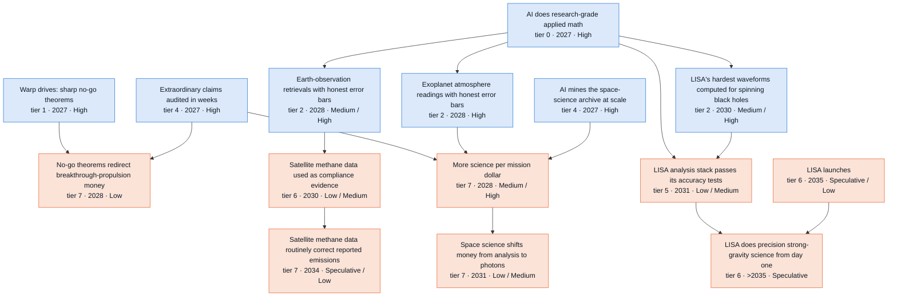

**Side lanes** (connected to the branch but off its main chain)

- Proven limits for starlight suppression (tier 2 · 2027 · High)
- Habitable Worlds Observatory design closed by AI modeling (tier 4 · 2030 · Low)

Where the reviewers disagreed: 2031 challenge round (10 disputes)

Recorded during the 2031 challenge round. Later passes adjusted some dates and bands; the node table below has the final values.

- **Second-order self-force for generic Kerr orbits: timing and band.** *Skeptic:* Part of the work is research-hard: second-order metric reconstruction and gauge in Kerr are open, and only quasicircular Schwarzschild has been done. After that comes a quadratic mode-coupling compute campaign and cross-code validation. Move S2 to 2030 and S3 to 2029, make S3 Medium, and set the gate to capital. *Advocate:* The formalism is complete ('solved in principle, expert-scarce') and humans already extended it to eccentric Schwarzschild in 2025. Compute is not binding: SpECTRE runs 20 m-modes in seconds. Raise S2 to High. *Resolution:* Mostly the skeptic. I took S2 2030 / S3 2029 and S3 Medium. First-order adiabatic Kerr inputs exist only for equatorial orbits, and the 'seconds' evidence comes from a first-order scalar-charge problem, not second-order gravitational self-force, so I rejected S2 High. The advocate's 2504.09640 fact is verified and added to the status. The gate stays cognitive in the base case; compute and validation are named as the S3 binders. 'Four to six years' became 'roughly three to five years (analyst judgment)'.
- **Numerical relativity for LISA: compute-bound or algorithm-bound.** *Skeptic:* The gap is ~400x, from a median of 4e-4 to 1e-6. The current SXS catalog alone took ~480M core-hours, which supports keeping the capital gate and S3 Medium. *Advocate:* Wall-clock at high mass ratio is set by time-stepping and code efficiency (GPU ports, local time-stepping, AI kernel search), which is cognitive. Change the gate to cognitive and raise S3 to High. *Resolution:* Kept the capital gate and S3 Medium. The cited GPU speedups are for an elliptic initial-data solver, not evolutions, and the 480M core-hour scale is verified. I accepted the advocate's soft edge from "AI-discovered algorithms in space codes" as acceleration. As a result, the advocate's conditional push of LISA readiness to S3 High also fails.
- **Is there a fast lane where AI moves observatory flight dates? (thesis and private observatories).** *Skeptic:* No observatory flies sooner. Agency flagships and Explorers move with appropriations: the FY2027 request cuts SMD 47% and HWO to $5M, BHEX cannot fly before about 2032, and politics compresses 1.0x. *Advocate:* Privately funded and subscription observatories (Lazuli 3 m, July 2028 target; Mauve) have no selection or appropriations gate. The Amdahl bound (38% in S2, 51% in S3) therefore shows up as earlier flight dates, and S3 is High through a second AI-native observatory. *Resolution:* I added "A privately funded space telescope returns data", but with no AI hard prerequisite and Medium, 2029 in every scenario. Lazuli's funding and schedule predate public "AI does research-grade applied math" capability, the 1.5-3x slip calibration gives a launch between late 2029 and 2033, and Mauve (13 cm) falls below the node's own 1 m threshold. The thesis now names the private lane but says the physical clock, not AI, sets its date. The skeptic's appropriations point became the exogenous gate "NASA science budget held near its 2026 level".
- **HWO design closure: band and prerequisites.** *Skeptic:* Design freeze is an appropriations-paced agency decision (FY2027 HWO $5M versus $150M), and the AI part is uncertain on top of that, so the joint chance is Low in every scenario and S3 cannot run ahead of S2. Make coronagraph bounds, certified WFSC and retrieval identifiability soft, and add a hard budget gate. *Advocate:* Leave the band alone because politics binds. Make WFSC soft, and add cheap Starship mass plus a mass-rich design node as accelerators. *Resolution:* Took the skeptic's bands (Low/Low/Low), S3 2030, and the hard budget gate; the budget facts are verified. All three edge softenings are applied, WFSC with the advocate's agreement. The advocate's cheap-mass point became a soft edge from "Starship internal cost under $300 per kg"; the HWO page notes that larger mirrors depend on launch vehicles. The separate mass-rich design node was rejected as overlapping HWO closure.
- **Quantum-sensor flight by 2031.** *Skeptic:* S3 should be 2031: the design lands in 2028 in both S2 and S3, a new atom interferometer is not a derivative payload, and qualification compresses only 1.3-1.7x. *Advocate:* A next-generation clock on a smallsat or hosted slot follows the 12-18 month lag ladder with no certifying regulator. Move S2 to 2030 and S3 to 2029, both Medium. *Resolution:* Middle course. S2 and S3 are both 2031 and Low, with the full smallsat chain written out: a new instrument takes 18-24 months, then launch around 2030, then months of in-orbit characterization. The auditor's alternative (S2 after 2031, Speculative) and the advocate's Medium were both rejected. Gradiometers fly after 2031.
- **Lightsail demonstration: what counts.** *Skeptic:* Remove 'or smaller'; it must be propulsion over meters, not a force measurement. Accelerating 1 g at 1 m/s^2 needs about 150 kW. *Advocate:* Lab beam-riding (restoring force and torque on micro-to-gram sails) is cheap university work, citing Caltech 2025 and RIT. Retitle the node as a lab demo with an experiment gate and Medium bands in S2 and S3. *Resolution:* Skeptic and auditor. The demo node means gram-scale propulsion and is Speculative after 2031 in all scenarios, since no sponsor or facility is named. The advocate's lab force and torque tests (Caltech 2025, verified) moved into "Lightsails proven to ride the beam"'s signpost, where they are the validation step.
- **Coronal heating: settled theory or blind test.** *Skeptic:* 'Settled' needs new in-situ data and a consensus that forms slowly, so S3 should drop to Low. Tomography should be a soft edge. *Advocate:* 'Settled' is an unnamed consensus gate. Redefine the node by its own signpost (a confirmed blind prediction) and raise S2 to Medium. *Resolution:* Adopted the advocate's measurable definition, tightened to a discriminating prediction. Bands stay at Speculative/Low/Medium. S2 cannot exceed its hard prerequisite "AI builds validated physics theory" (S2 Medium) once model-building and encounter timing are added, and the skeptic's reason for S3 Low (consensus) no longer applies. The tomography edge is soft.
- **More science per mission dollar in the base case.** *Skeptic:* The gate is adoption (referee bandwidth), not data. Fix S3 to 2028. *Advocate:* This is P1 output on data already paid for, with no physical gate and referee bandwidth itself compressing. Give it a measurable doubling test and make S2 High. *Resolution:* Kept S2 Medium, in line with the earlier A3 calibration and the auditor. Absorption binds, and the FY2027 request cuts SMD 47%, including the research-and-analysis grants that fund archival work. I adopted the measurable test, the adoption gate, S3 2028 and soft edges from the new onboard-inference and private-observatory nodes.
- **Smaller advocate band raises (beyond-GR well-posedness S2, WFSC S3, opacity S3, helio constellation S2).** *Skeptic:* Physical gates (testbeds, lab spectroscopy) and budgets bind. The FY2027 HWO cut threatens the testbed funding behind WFSC. *Advocate:* Each node has 2+ years of slack after its cognitive input, and AI-run test stands and autonomous labs give 1.3-1.5x in S3. *Resolution:* Rejected beyond-GR S2 High: strong-coupling results may be partial, and S3 is already High. Rejected WFSC S3 High because testbeds are funded through the HWO line, but accepted the soft edges from optimal test campaigns and AI-run test stands. Rejected opacity S3 High because toxic and high-temperature spectroscopy is slow. For helio constellation design, accepted the adoption gate and S3 High but kept S2 Medium so it does not exceed its tomography prerequisite (now S2 Medium).
- **Black-hole foundations into LISA science.** *Skeptic:* Remove the edge entirely. Strong cosmic censorship is unobservable, and the domain's own nil effect says it has no mission implication. *Advocate:* Make it a soft edge; the auditor agrees. *Resolution:* Made it soft (two lenses), and the node's why now says the link is confidence-only and changes no model.

Where the reviewers disagreed: 2035 and Embodied extension round (11 disputes)

- **ARIEL atmosphere census timing.** *Skeptic:* ESA now lists a 2031 launch. About two years of survey puts population papers in 2034 in every scenario, and one more slip pushes them past 2035, so the band is Low. Drop '1,000' from the title. *Advocate:* The launch is 2031, but fast analysis is an S3/S4 edge. Use S3/S4 2033, S2 2034 and S1 2035, keep Medium by 2035, and drop '1,000'. *Resolution:* 2031 launch verified on ESA's page. S2-S4 are 2033 as the earliest credible date: spectra from early 2032, a few hundred planets by mid-2033, papers late 2033. S2 cognition is cheap by 2033 and photons bind, so S3 gains nothing over S2. S1 is 2034. Medium by 2035 in S2-S4, because a 1-year slip still lands inside the horizon and only a 2-year slip moves it out. S1 is Low. Title changed. No ARIEL launch anchor was added, because the description also admits other surveys.
- **Heliophysics constellation flight.** *Skeptic:* Multi-spacecraft missions take 6-7 years from selection to launch (PUNCH, HelioSwarm), and off-line viewpoints need 1-3 years of cruise (Vigil to L5). A 2030-31 selection returns 3D data in 2038-40. The S3 lead has no source. *Advocate:* Add a robot soft edge for cheaper units, with no year credit. *Resolution:* Skeptic accepted: >2035 and Speculative everywhere. The robot edge was declined because spacecraft cost is already carried by satellite-generation cadence and the gate is selection and budgets.
- **Satellite methane as compliance evidence by 2035.** *Skeptic:* EU 2024/1787 names satellites for monitoring and super-emitter alerts, not compliance. Political risk is the same in S2 and S3, so the cap holds S2-S4 at Medium. *Advocate:* The mechanism and the political risk are the same in S2 and S3, and both cognitive inputs are High by 2035, so S2 should rise to High along with S3. *Resolution:* Both agreed S2 and S3 belong in the same band. the extension rules allows High only when a named mechanism already makes the path live. No mechanism yet makes satellite numbers compliance evidence, and the Commission has moved to 'pragmatic implementation' of the import rules (Dec 2025). So S2-S4 are Medium. Routine MRV follows one band below: Low, at S3 2033 and S2 2034.
- **Answer-first science missions.** *Skeptic:* The onboard-inference input is 2029 in S2 and S3, so S3 has no lead. Explorers take 5-6 years from selection, and selections are scarce, so S2-S4 should be Low by 2035. The title nearly duplicates its prerequisite and uses a banned construction. *Advocate:* Commercial and non-US constellations iterate yearly with no agency selection, so S3/S4 should be High. *Resolution:* Years set to S2=S3=2033 and S1 >2035, with the new title. S3/S4 are Medium and S2 Low: the inputs share a year, but S3's input is High by 2031 and non-NASA agencies add chances. Commercial imaging services are excluded, because their onboard analytics is already under way and would redate the node.
- **S4 credit on a second private telescope.** *Skeptic:* (Not reviewed. The skeptic's general point: robot edges must act before the node's year, and no science node gains S4 credit.) *Advocate:* The private lane is the one place where builder throughput binds. A second telescope started in 2030 would meet all four S4 conditions and gain a year (S4 2032), with Medium by 2035 in S3/S4. Without it, 'S4 adds no year' holds only because no build after 2031 is modelled. *Resolution:* The node was added, which answers the selection-bias point, but it gets no S4 credit. The funder decision comes first, and mirrors and detectors come from suppliers, who get robots after 2031. A 2030-33 build sits inside the 6-24 month requalification window. The S4 gate table gives leading firms about 15% on environmental qualification by 2031, which is 2-4 months on a 3-year build. Bands are Low in S2-S4 because no second funder is named. The thesis keeps 'S4 adds no year'.
- **Earth-twin radial-velocity detection.** *Skeptic:* (Not reviewed.) *Advocate:* The branch's biggest unlock for 2032-35. Separating stellar activity is statistics that cheap cognition attacks, and the Terra Hunting Experiment starts a 10-year survey in 2026. S3 2033, Medium. *Resolution:* The node was added after checking the facts (ING page, DLR on PLATO), with years S3 2033 and S2 2034. It is Low by 2035 in S2-S4. Granulation and supergranulation set noise floors that only more nights reduce, seasons fix the cadence, and Earth-mass claims have a record of failing re-analysis. Data and seasons bind, so S4 equals S3.
- **Quantum sensor flight by 2035.** *Skeptic:* Medium is right, but the note says 'likely', which contradicts a 30-70% band. No funded flight can take AI-derived control late. *Advocate:* A gradiometer pathfinder is now named and funded for a 2030 launch, and AI-derived design is routine from 2029 in S3, so S3/S4 should be High. *Resolution:* Advocate accepted after checking the source: JPL leads, launch 2030, more than $20M contracted. The partner list was corrected to Goddard, UT Austin, Infleqtion, Monarch Quantum and Jemba9. S3/S4 are High and S2 stays Medium. The skeptic's wording fix is applied.
- **Coronal heating blind test.** *Skeptic:* (No finding.) *Advocate:* With E-trunk's "AI builds validated physics theory" at S3 High, the only remaining reason for Medium is data risk, and Solar Orbiter covers it. Raise S3/S4 to High. *Resolution:* Rejected. The advocate is right that data risk is small, so the note now gives a different reason: several mechanisms probably operate, and a clean discriminating prediction may not exist. Medium is kept, and it no longer depends on E-trunk.
- **2035 bands that rose on time alone or on thin evidence.** *Skeptic:* Four 2035 raises lack support. Private observatories rest on one first-of-kind program (about 0.65). Helio tomography assumes Vigil data about two years early. LISA readiness S2 breaks its own AND rule. HWO closure is conditional on a Medium budget gate. *Advocate:* (No objection to these, apart from proposing raises elsewhere.) *Resolution:* All four accepted, along with the helio constellation-design knock-on. Private observatories are Medium. Tomography and design are S1 Low and S2 Medium. LISA readiness S2 is Medium. HWO closure is Low in S2-S4. The LISA launch-slip argument was not used, because readiness is a mock-data-challenge result set by the consortium's cadence.
- **Robot soft edges into science nodes.** *Skeptic:* Both draft edges are inert. robo-24x7 (S4 2031) points at a node dated 2029. robo-lab-bench (S4 2030) is not earlier than biosignature's S4 2030, and lab work already flows through the line-list node. *Advocate:* Remove the observatory edge and point robots at the second private telescope and the helio constellation. Keep the biosignature edge. *Resolution:* Both inert edges were removed. The robot edges go to the second private telescope, where robots exist before its year but earn no year. The helio edge and the biosignature edge were not kept.
- **Small consistency fixes.** *Skeptic:* Biosignature S1 has zero lag behind its line-list input. Portfolio shift is dated 2030, but its why says the next survey (2031-32). The lightsail note's 100 kW claim is wrong: 10 kW moves a 1 g sail 0.8-3 m in drop towers. *Advocate:* The LISA launch why should use sourced slip cases (PLATO about 3 months, ARIEL about 2 years) and say that robots give no credit. Lazuli's coronagraph should softly feed certified wavefront control. E-science depends on E-trunk. *Resolution:* All accepted. Portfolio shift is set to 2031, the earliest credible report year, where the skeptic proposed 2032. The E-trunk dependency is written into the notes and six revision notes.

All nodes in this branch

Years and likelihoods are listed for Plateau / Exponential / Recursive / Embodied. H = High, M = Medium, L = Low, S = Speculative.

| Node | Tier | Year | By 2031 | By 2035 | Binding gate | Pathway |
| --- | --- | --- | --- | --- | --- | --- |
| NASA science budget held near its 2026 level | 0 | 2027 / 2027 / 2027 / 2027 | M / M / M / M | M / M / M / M | capital | exogenous (not an AI pathway; politics and appropriations compress 1.0x) |
| Warp drives: sharp no-go theorems | 1 | 2028 / 2027 / 2027 / 2027 | H / H / H / H | H / H / H / H | cognitive | P3 |
| Black-hole foundations settled and checked | 1 | 2029 / 2028 / 2028 / 2028 | S / L / L / L | L / L / L / L | adoption | P5 (+P3 for mass-area bounds) |
| Beyond-Einstein gravity made simulable | 1 | 2030 / 2028 / 2028 / 2028 | L / M / H / H | M / H / H / H | cognitive | P5->P6 |
| Hard limits on negative energy from quantum fields | 1 | 2032 / 2029 / 2028 / 2028 | S / L / M / M | L / M / H / H | cognitive | P3 |
| Proven limits for starlight suppression | 2 | 2028 / 2027 / 2027 / 2027 | M / H / H / H | H / H / H / H | cognitive | P3->P4 |
| What space interferometry can prove about black holes | 2 | 2028 / 2027 / 2027 / 2027 | M / H / H / H | H / H / H / H | cognitive | P3->P5 |
| Cosmology inference that knows its own errors | 2 | 2030 / 2028 / 2028 / 2028 | M / M / H / H | H / H / H / H | adoption | P1->P4 |
| 3D Sun-to-Earth reconstructions with guarantees | 2 | 2030 / 2028 / 2028 / 2028 | L / M / H / H | L / M / H / H | data | P5->P6 |
| Exoplanet atmosphere readings with honest error bars | 2 | 2030 / 2028 / 2028 / 2028 | M / H / H / H | H / H / H / H | adoption | P1->P5 |
| Earth-observation retrievals with honest error bars | 2 | 2030 / 2028 / 2028 / 2028 | L / M / H / H | M / H / H / H | data | P1->P5 |
| LISA's hardest waveforms computed for spinning black holes | 2 | 2033 / 2030 / 2029 / 2029 | S / M / M / M | M / H / H / H | cognitive | P1->P6 |
| Merger simulations precise enough for LISA's loudest signals | 2 | 2033 / 2030 / 2029 / 2029 | S / M / M / M | M / H / H / H | capital | P1->P4 |
| Is dark energy changing? A decisive answer | 3 | 2030 / 2029 / 2029 / 2029 | M / M / M / M | H / H / H / H | data | P1 |
| Coronal heating: an AI-built model passes a blind test | 3 | 2033 / 2030 / 2029 / 2029 | S / L / M / M | L / M / M / M | data | P6 |
| Molecular fingerprints good enough for biosignature claims | 3 | 2033 / 2030 / 2029 / 2029 | S / M / M / M | M / H / H / H | experiment | P1->P6 |
| Knowing when 'signs of life' are not life | 3 | 2034 / 2031 / 2030 / 2030 | S / L / M / M | L / M / H / H | experiment | P6 |
| Earth-mass planet found in a Sun-like star's habitable zone | 3 | >2035 / 2034 / 2033 / 2033 | S / S / S / S | S / L / L / L | data | P1->P5 (statistics on exogenous ground data) |
| AI mines the space-science archive at scale | 4 | 2027 / 2027 / 2027 / 2027 | H / H / H / H | H / H / H / H | adoption | P1 |
| Extraordinary claims audited in weeks | 4 | 2028 / 2027 / 2027 / 2027 | M / H / H / H | H / H / H / H | adoption | P1->P3 |
| Lightsails proven to ride the beam | 4 | 2030 / 2028 / 2028 / 2028 | M / H / H / H | H / H / H / H | experiment | P1->P4 |
| Quantum sensors designed against full error budgets | 4 | 2030 / 2028 / 2028 / 2028 | M / H / H / H | H / H / H / H | experiment | P1 |
| Sun-watching constellations designed for best coverage | 4 | 2032 / 2029 / 2029 / 2029 | S / M / H / H | L / M / H / H | adoption | P1->P6 |
| Picometer-stable telescopes with guaranteed control | 4 | 2033 / 2029 / 2028 / 2028 | S / M / M / M | L / M / M / M | experiment | P1->P6 |
| Habitable Worlds Observatory design closed by AI modeling | 4 | 2033 / 2030 / 2030 / 2030 | S / L / L / L | L / L / L / L | capital | P1->P6 |
| Spacecraft send answers, not raw data, with error bounds | 5 | 2031 / 2029 / 2029 / 2029 | L / M / H / H | M / H / H / H | adoption | P1->P4 |
| LISA analysis stack passes its accuracy tests | 5 | 2034 / 2031 / 2030 / 2030 | S / L / M / M | L / M / H / H | adoption | P1->P6 |
| AI-co-designed quantum sensor flies | 5 | 2033 / 2031 / 2031 / 2031 | S / L / L / L | L / M / H / H | qualification | P7 |
| Laser-propelled gram-scale sail demonstrated | 5 | >2035 / 2034 / 2034 / 2034 | S / S / S / S | S / L / L / L | capital | P7 |
| Next-generation dark-energy survey data in hand | 6 | 2028 / 2028 / 2028 / 2028 | H / H / H / H | H / H / H / H | data | P7 (exogenous) |
| A privately funded space telescope returns data | 6 | 2029 / 2029 / 2029 / 2029 | M / M / M / M | M / M / M / M | fabrication | P7 (exogenous) |
| Satellite methane data used as compliance evidence | 6 | 2033 / 2030 / 2029 / 2029 | S / L / M / M | L / M / M / M | regulatory | P1->P5 (adoption into regulation; no hardware change) |
| First space mission to sharpen black-hole images flies | 6 | 2033 / 2033 / 2033 / 2033 | S / S / S / S | L / L / L / L | capital | P7 |
| Exoplanet atmosphere census with honest error bars | 6 | 2034 / 2033 / 2033 / 2033 | S / S / S / S | L / M / M / M | data | P1->P5 (exogenous data supply plus identifiability) |
| Science mission built to downlink onboard answers flies | 6 | >2035 / 2033 / 2033 / 2033 | S / S / S / S | S / L / M / M | capital | P1->P4 |
| A second privately funded space telescope returns data | 6 | 2035 / 2034 / 2033 / 2033 | S / S / S / S | S / L / L / L | capital | P7 (exogenous) |
| LISA launches | 6 | 2035 / 2035 / 2035 / 2035 | S / S / S / S | L / L / L / L | launch-external | P7 (exogenous) |
| LISA does precision strong-gravity science from day one | 6 | >2035 / >2035 / >2035 / >2035 | S / S / S / S | S / S / S / S | launch-external | P7 |
| Sun-watching fleet built to map the solar wind in 3D flies | 6 | >2035 / >2035 / >2035 / >2035 | S / S / S / S | S / S / S / S | capital | P1->P6 |
| No-go theorems redirect breakthrough-propulsion money | 7 | 2029 / 2028 / 2028 / 2028 | L / L / L / L | L / L / L / L | adoption | P3 |
| More science per mission dollar | 7 | 2030 / 2028 / 2028 / 2028 | M / M / H / H | H / H / H / H | adoption | P1 |
| Space science shifts money from analysis to photons | 7 | 2033 / 2031 / 2031 / 2031 | S / L / L / L | L / M / M / M | capital | P1 |
| Satellite methane data routinely correct reported emissions | 7 | >2035 / 2034 / 2033 / 2033 | S / S / S / S | S / L / L / L | regulatory | P1->P5 (adoption into regulation; no hardware change) |

### Crowded orbits and space weather

*AI makes orbit, collision and storm forecasts honest. Certified million-object screening and AI-designed trajectories arrive by 2029 (central scenario), recurring paid debris removal about 2030. Safe low orbit waits on small-debris sensors, standards and US-China politics through 2035. Storm forecasts reach 8 hours, then need Vigil. Embodied adds nothing.*

On-demand AI mathematics first supplies scarce uncertainty expertise. Teams can get proven error bounds on collision probabilities for skewed orbit uncertainty, where NASA uses brute-force Monte Carlo, and screening filters that provably miss no dangerous conjunction. In July 2026 the [HELIOS agent](https://arxiv.org/abs/2607.24051), on its best model, wrote compiling trajectory solvers for all 11 test problems.

In the Exponential case, our central scenario, *Trajectory design on demand* arrives about 2027 and *Certified collision-probability math* about 2028. *Certified screening that scales to a million objects* and *Missions fly AI-designed trajectories* follow about 2029, all High by 2031. *Autonomous cross-operator collision avoidance*, the *Screening-grade catalog of small debris* and a *Solar-storm arrival forecast within about 8 hours* arrive about 2031 (Low by 2031, Medium by 2035). Recursive moves these three a year earlier, to Medium by 2031. Plateau lags one to three years.

*Low Earth orbit stays safe at 100,000 satellites* comes about 2032 in the Exponential case. The skeptic held it Low by 2035, because fleets grow fastest in 2032-35. Recursive dates it 2031, Medium by 2035. *Chinese and Western fleets coordinate maneuvers automatically* about 2033 even in Recursive, since politics does not speed up. *Debris tracked down to about 2 cm in the busiest shells* and *Vigil side views time storm arrivals to within 6 hours* land about 2035. These three are Low by 2035. ESA plans to launch Vigil in 2031. Embodied equals Recursive on every node here, because sensors, standards, payers, politics and launches set the pace. For removal at scale, labor is about 20% of a servicer's build, so robots cut costs by well under 10% (analyst estimate).

The openai/math catalog contributes almost nothing. Family 139 (T3) links weakly to collision probability; orbit uncertainties are rarely log-concave. Family 104 touches coordination games (T3 only for mean-payoff; its stochastic-game part is T1, conditional). Families 146, 343 (T1, conditional) and 347 (T3) concern model maps. No chain step rests on them.

The strongest case for a small effect is that data limit this field. A precise collision probability from a wrong orbit uncertainty is still wrong. About 1.2 million 1-10 cm fragments go untracked ([ESA, 2026](https://www.sdo.esoc.esa.int/publications/Space_Environment_Report_I10R0_20260501.pdf)). LeoLabs designed a 2 cm radar in 2019, yet no 2 cm catalog exists. Storm arrival forecasts have missed by about 13 hours on average for 11 years ([Kay et al., 2024](https://predsci.com/~epalmerio/pubs/Kay2024b.pdf)). The skeptic won most disputes, cutting a claimed 2-5x drop in avoidance maneuvers to 1.5-1.8x (analyst arithmetic), and only if operators relax thresholds. The advocate moved recurring paid removal to about 2030 in every scenario (Medium by 2035) and lost its claim that robots matter at scale. Watch whether close approaches under 1 km per satellite flatten through 2028 as fleets grow.

38 nodes. Rated High or Medium by 2031: Plateau 11, Exponential 21, Recursive 26, Embodied 26. By 2035: Plateau 23, Exponential 28, Recursive 31, Embodied 31. Main binding gate: data.

**Main chain** (each node: tier · earliest year in the Exponential case · likelihood by 2031 / by 2035; Recursive and Embodied years shown where they differ)

- **Research-grade math for outside teams** (tier 0 · 2027 · High; gate: regulatory, then capital)
  - → **AI does research-grade applied math** (tier 0 · 2027 · High; gate: cognitive, then data)
    - → **Certified collision-probability math** (tier 2 · 2028 · High; gate: cognitive, then adoption)
      - → **Certified screening that scales to a million objects** (tier 4 · 2029 · High; gate: formalization, then cognitive)
        - → **Autonomous cross-operator collision avoidance** (tier 6 · 2031 · Low / Medium; Recursive 2030; gate: adoption, then formalization)
          - → **Low Earth orbit stays safe at 100,000 satellites** (tier 7 · 2032 · Speculative / Low; Recursive 2031; gate: data, then adoption)
          - → **Chinese and Western fleets coordinate maneuvers by machine** (tier 7 · 2033 · Speculative / Low; gate: regulatory, then adoption)
    - → **Sun-to-Earth ensemble forecasting with honest uncertainty** (tier 2 · 2028 · High; gate: data, then cognitive)
      - → **Knowing a solar storm's magnetic punch a day ahead** (tier 6 · 2034 · Speculative / Low; Recursive 2033; gate: data, then cognitive)
    - → **Upper-atmosphere density and drag with honest error bars** (tier 3 · 2029 · High; Recursive 2028; gate: data, then cognitive)
      - → **Storm-proof low-orbit operations** (tier 6 · 2030 · Medium / High; Recursive 2029; gate: adoption, then data)
      - → **Low Earth orbit stays safe at 100,000 satellites** (tier 7 · 2032 · Speculative / Low; Recursive 2031; gate: data, then adoption) (see above)
    - → **Radiation-belt and charging risk forecasts days ahead** (tier 6 · 2029 · Medium / High; Recursive 2028; gate: adoption, then cognitive)
  - → **Trajectory design on demand** (tier 4 · 2027 · High; gate: adoption, then cognitive)
    - → **Missions fly AI-designed trajectories** (tier 6 · 2030 · Medium / High; Recursive 2029; gate: launch-external, then adoption)
- **Screening-grade catalog of small debris** (tier 6 · 2031 · Low / Medium; Recursive 2030; gate: data, then cognitive)
  - → **Low Earth orbit stays safe at 100,000 satellites** (tier 7 · 2032 · Speculative / Low; Recursive 2031; gate: data, then adoption) (see above)
  - → **Debris tracked down to about 2 cm in the busiest shells** (tier 6 · 2035 · Speculative / Low; Recursive 2034; gate: data, then capital)

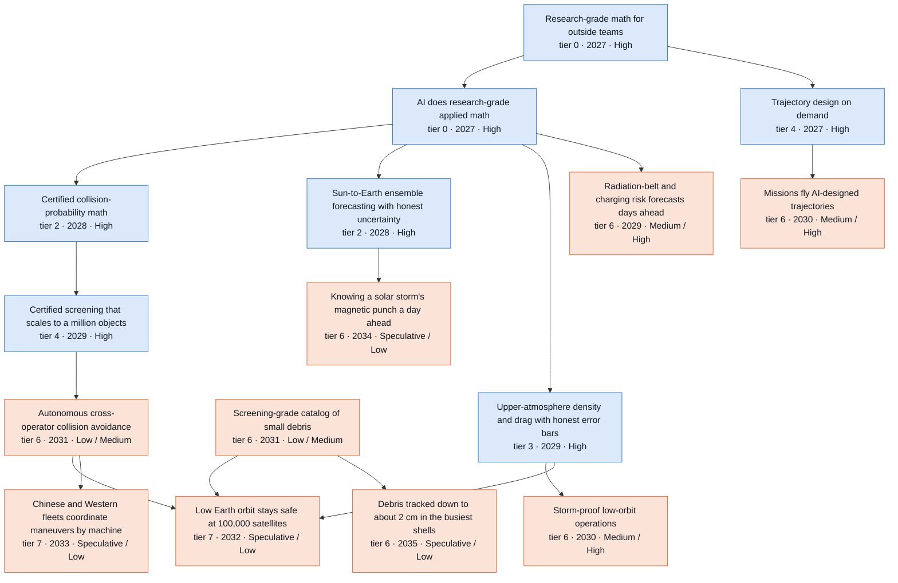

Where the reviewers disagreed: 2031 challenge round (12 disputes)

Recorded during the 2031 challenge round. Later passes adjusted some dates and bands; the node table below has the final values.

- **What certified collision-probability math buys (spine root) and whether a 'maneuver burden falls' node belongs in the tree.** *Skeptic:* The 2-5x reduction does not follow from the node's own assumption. A distribution even across decades gives 1.5-1.8x for 3e-7 -> 1e-5. The reduction comes from a risk-acceptance choice to relax the threshold, not from certifying the arithmetic. Certified Pc does not fix covariance realism and can mislead in the dilution region. *Advocate:* Certified Pc plus realistic covariances lets the largest operator cut maneuvers per satellite at least 2x by 2029 in S2, citing the branch's own 2-5x arithmetic. A measurable single-operator intermediate is missing from the tree. *Resolution:* Skeptic accepted. The resolver re-derived 3.52/2.0 = 1.76x and 4.52/3.0 = 1.51x, and the why now frames the gain as P5 confidence. The advocate's maneuver-burden node is rejected: its premise is the debunked figure, and Starlink's own threshold policy and its 550 -> 480 km lowering would drive any drop. The measurable intermediate survives as a threshold-independent signpost on LEO safety (conjunctions under 1 km per satellite per year).
- **SpaceX Stargaze: data gate loosening, and what it means for AI math.** *Skeptic:* Stargaze (about 30M star-tracker transits a day, free screening) and the Space Force's HASDM show the data gate moving on a non-math track. That shrinks the AI-math increment, and it is a non-formal substitute for guaranteed coordination. *Advocate:* Two curves combine. The constellation exponential puts sensors up for free and AI math turns tens of millions of detections into honest covariances. Add a T6 node ('Every satellite a tracking sensor') with 2029/2028/2027 Medium/High/High, soft-linked to screening, density, storm operations, collision avoidance, debris models and LEO safety. *Resolution:* Both views kept. Stargaze goes into the status fields and the thesis. The advocate's node is added but rescoped as an anchor with no hard AI-math prerequisite ("AI does research-grade applied math" soft). Its achievement is the step beyond Stargaze: use beyond SpaceX plus published covariance realism. Years and bands are tempered to 2029/2028/2028 Low/Medium/High, because S3 equals S2 through 2028 and sharing is SpaceX's choice. The node also answers the skeptic's covariance-realism objection to certified Pc.
- **Timing of thermospheric density with honest uncertainty.** *Skeptic:* HASDM already assimilates drag operationally and ML emulators give calibrated uncertainty. The increment is scale and public access. The gate is operator thrust and attitude logs (Starlink station-keeps continuously). Keep the years. *Advocate:* Nowcasting needs no Sun-to-Earth assimilation, so with that edge softened the node moves to S2 2028 / S3 2027. Starlink ephemerides are public. *Resolution:* Edge softened (advocate and auditor). Years kept at 2030/2029/2028. The node's signpost is an operational product with data access, which follows a year after the 2028 methods, and S3 cannot run ahead before 2028. HASDM was added and the description rebased.
- **Storm-robust LEO operations.** *Skeptic:* The S3 High band has no basis because the adoption gate barely compresses. Storm-driver forecasts caused the May 2024 problems. 'Storms no longer cause...' is untestable. Fast-revisit sensing can deliver custody without density math. *Advocate:* Custody loss is an observation-density problem. Minutes-latency tracking plus calibrated nowcasts keep custody, and commercial adopters need no regulator. Pull to S2 2029 High and S3 2028. *Resolution:* Skeptic (with the auditor) accepted: S3 Medium, S2 2030 Medium. The advocate's dates assume zero adoption lag after the 2029 density product, credit a non-AI system (Stargaze) to the AI-math node, and ignore the cut of about 80% to the government catalog's budget. The description now has a testable criterion (at least halved versus May 2024). The advocate's soft edge from constellation-hosted tracking is accepted.
- **Autonomous cross-operator collision avoidance: gate and bands.** *Skeptic:* Standards take 3-5 years at 1.5-2x compression, the same in S2 and S3. Politics runs at 1.0x. The FCC's aggregate-risk rule is still unadopted after 6 years. Free hosted screening substitutes for a formal protocol. Move to 2031/2030 with S2 Low. *Advocate:* No regulator approves bilateral machine-to-machine coordination, so the gate is adoption. Starlink is about three-quarters of active satellites and already autonomous. Near-free cognition from 2029 makes S3 High. *Resolution:* Years 2031/2030 accepted (skeptic and auditor agree). The gate change to adoption is accepted (advocate). S2 Low (skeptic), because the window is one year and a non-formal substitute exists. The advocate's S3 High is rejected: adoption, standards and politics do not compress with recursive cognition, so S3 stays Medium.
- **Capacity-based orbital licensing.** *Skeptic:* The FCC's 2020 aggregate collision-risk proposal (refreshed in 2024) is unadopted and current FCC direction is faster licensing. The regulatory multiplier is the same in S2 and S3. Set S2 Low and S3 2031 Low. *Advocate:* The node ignores the tree's 1.5-2x regulatory multiplier. The 2026 FCC moved fast (EPFD Apr 30, Part 100 Jul 22, NEPA exclusion Sep 30). An NPRM triggered by the 1-million-satellite filing could produce an order by 2029-30. Move earlier to 2030/2029. *Resolution:* Skeptic accepted: S2 and S3 both 2031 Low. The resolver checked the 2024 record refresh (system-wide metric, ODMSP 0.001 safe harbor) and the 33FG items on the 2026 FCC actions. Those actions are deregulatory streamlining, the opposite direction to capacity caps, and the physclock table gives S3 no extra regulatory compression. A license condition on the 1-million-satellite application is kept as the faster route in the signpost.
- **Radiation-belt and charging forecasts.** *Skeptic:* The data-assimilation edge is not causal. SWPC REFM already gives deterministic 1-3 day forecasts. Week-ahead skill exists only for recurrent high-speed streams. Designers keep AE9/AP9, so delete the margin-sizing claim. Keep years and bands. *Advocate:* Week-ahead products already exist without coupled assimilation, so pull S2 forward to 2028. *Resolution:* Edge softened (all three lenses). The advocate's S2 2028 is rejected: the signpost needs agency R2O plus an operator citation, which cannot happen in the year after applied math arrives. The auditor's S1 Low / S2 Medium and adoption gate are accepted. S3 stays High.
- **AI-designed trajectory flown: 2028 or 2029.** *Skeptic:* The design tool is 2027 in S2 and its GTOC signpost is unmet. A 2028 flight needs a 2027 freeze, re-verification and no launch slip, while small lunar missions slip months to years. *Advocate:* The thesis keeps 'AI-designed trajectories fly from 2028' as the near-term exponential headline. *Resolution:* Skeptic accepted: 2030/2029/2029, and the thesis now says 2029. The pathway is retagged P1, since a trajectory is not hardware, and the chain is written out.
- **Certified cislunar stability atlas.** *Skeptic:* Halo and NRHO orbits are linearly unstable, so uncontrolled decade-scale boundedness is false. Halving the margin buys about 10-15% more life, not 'years'. *Advocate:* The gate is purely cognitive plus verified numerics. Near-free cognition in S3 from 2029 makes S3 High. *Resolution:* Both accepted. The description is narrowed (stable families get bounds; unstable ones get controlled envelopes) and the life gain recomputed at 11-13%. S3 High, an S3-only argument as the decision rule allows. S3 year set to 2029, equal to S2, to avoid a zero lag after its 2028 prerequisites.
- **LEO safety at 100k satellites in S3.** *Skeptic:* The sensor and political gates the node itself names do not compress in S3. Set >2031 and Low. *Advocate:* Keep 2031 Medium. The physics floor (1-10 cm debris) is conceded, but certified Pc, verified coordination and constellation tracking act on the tracked population. *Resolution:* Band Low (skeptic and auditor agree). Year 2031 kept, with the auditor's chain: earliest evidence in 2031 and only for the tracked population. The new small-debris catalog is made the hard binding gate.
- **CME arrival-time skill.** *Skeptic:* Validation runs on an event-count clock: 256 impacting CMEs in 11 years and an SD of 17.4 h. About 40 events are needed, and solar minimum falls around 2030. Move to 2031/2030 with S2 Low. *Advocate:* STEREO-A is 70.6 degrees ahead of Earth now, so 'AI cannot observe a CME from the side' is wrong. The gain must come from multi-view assimilation. Add a soft edge from "3D Sun-to-Earth reconstructions with guarantees". Keep years and bands. *Resolution:* Both accepted. Timing follows the skeptic: the resolver computed an MAE standard error of about 2.3 h at 20 events. The strongest case and status follow the advocate (STEREO-A position checked). The baseline follows the auditor (10.3 h best ensemble, checked in Kay 2024 Table 3).
- **How to model the small-debris sensor gate.** *Skeptic:* Add "Screening-grade catalog of small debris": at least 100k objects, ~5 cm in the main shells, >2031/2031/2030 Low/Medium/Medium, as a hard prerequisite of LEO safety. *Advocate:* The auditor proposes 1-10 cm tracking at >2031 Speculative/Low/Low as a soft edge. The advocate agrees there is a physics floor (cm-class debris is invisible to star trackers). *Resolution:* Merged into one node using the skeptic's attainable threshold and years, with the auditor's caution on bands (Speculative/Low/Medium). Wired as a hard prerequisite because LEO safety's own why names it as the binding gate; no year changes result.

Where the reviewers disagreed: 2035 and Embodied extension round (5 disputes)

- **When debris removal becomes a recurring paid service.** *Skeptic:* Removal missions slip two to four years, no one is obliged to pay, and ESA money arrives only through ministerial councils about every 3 years. The first removal is itself only Medium by 2031. Move the node to 2034 and Low by 2035. *Advocate:* A payer already exists. Starfish holds an SDA contract (Jan 2026) to dispose of retired PWSA satellites, with launch targeted for 2027. It raised more than $100M to build Otters in series. Move the node to 2030, Low by 2031 and High by 2035, and raise the first removal to High by 2031. *Resolution:* Verified: the SDA contract ($52.5M, one mission with options, launch 2027), the Series B and the Airbus docking-plate order are all real. The skeptic's case rests on there being no payer, which the SDA contract refutes, and the ESA-council clock does not govern the US route. The year moves to 2030 and the 2031 band to Low in every scenario. The first removal goes to High by 2031 on four tries from three companies. the 2035 band stays Medium because slips of two years or more are the norm. The skeptic's point on Cycle 26 drag survives in strongest_case_small: below about 600 km, drag removes the case for paid removal, and demand sits at 1,000-1,200 km.
- **Do robots (S4) speed debris removal at scale?** *Skeptic:* No gate in this branch is labor-bound. Servicers are built on the ground, and in-space assembly robots arrive after the removal service. The robot soft edges are weak or anachronistic. *Advocate:* In orbit, robotics is the product. The S4 research gives in-space servicing 0.45-0.6x by 2035. Under fixed budgets, cheaper servicers buy more removals. Add a ten-removals-a-year node with S4 one year earlier and Medium by 2035, and change the thesis to 'robots matter only for removal at scale'. *Resolution:* The node is added because removal at scale is the step that would bend the debris curve. Its S4 credit is rejected. Payers set the count. Labor is about 20% of servicer build, so robot-built servicers cut cost per removal by well under 10%. Servicer makers are small firms that get robots after 2031 and must requalify each process. Capture arms are specialized machines already counted in S2/S3. The research's 0.45-0.6x is measured against today and includes S3 effects. S4 = S3, and the thesis keeps 'S4 adds nothing'.
- **Timing of centimetre-class debris custody.** *Skeptic:* Government radars take about 6 years from contract to operation (Space Fence), and the planned second Space Fence site was never built. The S3 chain needs radars ordered in 2030-31. Move the node to S2 >2035 and S3/S4 2035. *Advocate:* LeoLabs' Kiwi radar was designed in 2019 for 2 cm objects. The real gates are revisit and association, and S3 makes association nearly free. Move the node to S2 2034 and S3/S4 2033, Medium by 2035. Also add a hosted-camera route. *Resolution:* Both reviewers agree on the facts: 2 cm detection exists, and the population was overstated, so it is now roughly 50,000-100,000 objects. Years and bands are kept. The commercial route, with existing 2 cm-capable designs and sites built in 1-2 years, is faster than the government precedent. No 2 cm catalog appeared in seven years after Kiwi, and sixth-power Rayleigh losses below about 3 cm cost power-aperture that math cannot supply. The hosted-camera route becomes its own node at Low.
- **Event-count clocks for space-weather forecasts.** *Skeptic:* Bz and S1 CME arrival ignore the low CME rate near the 2030-31 minimum. Bz needs 50+ real-time events, so S3 2034 and S2 2035. S1 CME arrival needs about three years of minimum-phase events, so 2034. *Advocate:* In S3 the multi-view ensembles are ready the day Vigil data start, and the rising phase of Cycle 26 supplies events quickly, so the L5 storm forecast can be 2034. *Resolution:* The event clock is applied evenly. CME arrival S1 is 2034. Bz is a year earlier than the skeptic proposed, S3/S4 2033 and S2 2034, because every impacting CME counts toward the 50 and rates rise from 2032. The L5 forecast stays 2035 in S2-S4. From early 2033 at about 20-25 events a year, 40 events take until about early 2035, and the same argument would move S2 as well.
- **2035 bands for outcomes in the 2032-35 window.** *Skeptic:* LEO safety in S2 faces peak fleet growth. VLEO faces the Cycle 26 rise, and its business case is weak. For capacity licensing in S1, the regulatory cap is a ceiling, not a default. All three should be Low. *Advocate:* Vigil's side views, the lunar navigation service and cislunar traffic management should be High. Vigil slips still land by 2035. Uncrewed lunar users need no certifier. MADCAP already screens lunar orbiters. The small-debris catalog should be High through commercial sharing. *Resolution:* The skeptic's three cuts are accepted. The advocate's four raises are rejected. Vigil flies as a secondary passenger and its CDR is not until 2028. The lunar service's odds follow the surface base, so S2 drops to Low after the new hard edge. MADCAP covers only cooperative screening, while the node needs a catalog that includes non-cooperative objects; the status was corrected. Single-site 2 cm detection has existed since 2019 without producing a 100,000-object catalog.

All nodes in this branch

Years and likelihoods are listed for Plateau / Exponential / Recursive / Embodied. H = High, M = Medium, L = Low, S = Speculative.

| Node | Tier | Year | By 2031 | By 2035 | Binding gate | Pathway |
| --- | --- | --- | --- | --- | --- | --- |
| Proven bounds on how Earth-Moon trajectories drift | 1 | 2029 / 2028 / 2028 / 2028 | M / H / H / H | H / H / H / H | cognitive | P1->P5 |
| Long-term orbit stability proven for realistic systems | 1 | 2033 / 2029 / 2028 / 2028 | S / M / M / M | M / H / H / H | cognitive | P5->P6 |
| Tracking objects in chaotic Earth-Moon space | 2 | 2030 / 2028 / 2028 / 2028 | M / H / H / H | H / H / H / H | data | P1->P6 |
| Provably safe maneuver-coordination rules | 2 | 2029 / 2028 / 2028 / 2028 | M / H / H / H | H / H / H / H | cognitive | P2 |
| Navigation filters with proven error bounds | 2 | 2030 / 2028 / 2028 / 2028 | M / H / H / H | H / H / H / H | cognitive | P1->P2 |
| Certified collision-probability math | 2 | 2030 / 2028 / 2028 / 2028 | M / H / H / H | H / H / H / H | cognitive | P1->P4 |
| Sun-to-Earth ensemble forecasting with honest uncertainty | 2 | 2029 / 2028 / 2028 / 2028 | M / H / H / H | H / H / H / H | data | P1->P6 |
| Certified merging of tracks from many sensors | 2 | 2030 / 2028 / 2028 / 2028 | M / H / H / H | H / H / H / H | cognitive | P1->P4 |
| Certified map of stable Earth-Moon orbits | 2 | 2031 / 2029 / 2029 / 2029 | L / M / H / H | M / H / H / H | cognitive | P1->P6 |
| Debris-cascade tipping-point models with error bars | 3 | 2030 / 2028 / 2028 / 2028 | M / H / H / H | H / H / H / H | data | P1->P5 |
| Upper-atmosphere density and drag with honest error bars | 3 | 2030 / 2029 / 2028 / 2028 | M / H / H / H | H / H / H / H | data | P1->P6 |
| Predicting when the Sun erupts | 3 | 2033 / 2030 / 2029 / 2029 | S / M / M / M | L / M / M / M | cognitive | P1->P6 |
| Trajectory design on demand | 4 | 2028 / 2027 / 2027 / 2027 | H / H / H / H | H / H / H / H | adoption | P1 |
| Certified screening that scales to a million objects | 4 | 2031 / 2029 / 2029 / 2029 | L / H / H / H | M / H / H / H | formalization | P2+P4 |
| Proven safe capture of tumbling debris | 4 | 2031 / 2029 / 2029 / 2029 | L / M / M / M | M / H / H / H | experiment | P1->P2 |
| Autonomous Earth-Moon navigation with proven error bounds | 5 | 2031 / 2029 / 2029 / 2029 | L / M / M / M | M / H / H / H | launch-external | P2->P7 |
| Constellations track debris with honest error bars | 6 | 2029 / 2028 / 2028 / 2028 | L / M / H / H | M / H / H / H | adoption | P1 (association, orbit determination and covariance realism); the sensor network itself is not AI-math-driven |
| First large debris object removed from orbit | 6 | 2028 / 2028 / 2028 / 2028 | H / H / H / H | H / H / H / H | launch-external | P7 (exogenous) |
| Radiation-belt and charging risk forecasts days ahead | 6 | 2030 / 2029 / 2028 / 2028 | L / M / H / H | M / H / H / H | adoption | P1->P6 |
| Missions fly AI-designed trajectories | 6 | 2030 / 2030 / 2029 / 2029 | L / M / M / M | H / H / H / H | launch-external | P1 (operational adoption; no hardware change) |
| Storm-proof low-orbit operations | 6 | 2031 / 2030 / 2029 / 2029 | L / M / M / M | M / H / H / H | adoption | P1->P6 |
| Missile-tracking satellites cite certified track merging | 6 | 2033 / 2030 / 2029 / 2029 | S / L / L / L | L / L / L / L | adoption | P1->P4 (ground software; sensors and launch are not AI-math-driven) |
| Autonomous cross-operator collision avoidance | 6 | 2033 / 2031 / 2030 / 2030 | S / L / M / M | L / M / M / M | adoption | P2 |
| Solar-storm arrival forecast within about 8 hours | 6 | 2034 / 2031 / 2030 / 2030 | S / L / M / M | L / M / M / M | data | P1->P6 |
| Traffic management service for Earth-Moon space | 6 | 2032 / 2031 / 2030 / 2030 | S / L / M / M | M / M / M / M | capital | P1->P7 |
| Commercial constellations below 300 km | 6 | 2033 / 2031 / 2030 / 2030 | S / L / M / M | L / L / M / M | capital | P1->P7 |
| Screening-grade catalog of small debris | 6 | 2032 / 2031 / 2030 / 2030 | S / L / M / M | L / M / M / M | data | P1 (track association and orbit determination); sensor build-out and data sharing are not AI-math-driven |
| Lunar navigation with proven error bounds in routine use | 6 | 2034 / 2032 / 2032 / 2032 | S / S / S / S | L / L / M / M | launch-external | P2->P7 |
| Side-view and upstream solar-wind monitoring | 6 | 2033 / 2033 / 2033 / 2033 | S / S / S / S | M / M / M / M | launch-external | P7 (not AI-math-driven) |
| Constellation cameras detect debris down to about 2 cm | 6 | >2035 / 2033 / 2032 / 2032 | S / S / S / S | S / L / L / L | adoption | P1 (too-short-arc orbit determination and association at millions of detections a day) |
| Knowing a solar storm's magnetic punch a day ahead | 6 | >2035 / 2034 / 2033 / 2033 | S / S / S / S | S / L / L / L | data | P6 |
| Debris tracked down to about 2 cm in the busiest shells | 6 | >2035 / 2035 / 2034 / 2034 | S / S / S / S | S / L / L / L | data | P1 (association and orbit determination at 10^5-10^6 scale); sensor build-out and data sharing are not AI-math-driven |
| Solar-storm arrival forecast within 6 hours, using Vigil | 6 | >2035 / 2035 / 2035 / 2035 | S / S / S / S | S / L / L / L | data | P1->P6 |
| Debris removal becomes a recurring paid service | 7 | 2030 / 2030 / 2030 / 2030 | L / L / L / L | M / M / M / M | capital | P7 (exogenous; AI math enters through safety-case and autonomy tools) |
| Licensing satellites against an orbital capacity budget | 7 | 2032 / 2031 / 2031 / 2031 | S / L / L / L | L / M / M / M | regulatory | P5->P7 |
| Low Earth orbit stays safe at 100,000 satellites | 7 | 2034 / 2032 / 2031 / 2031 | S / S / L / L | L / L / M / M | data | P1->P2->P7 |
| Chinese and Western fleets coordinate maneuvers by machine | 7 | 2035 / 2033 / 2033 / 2033 | S / S / S / S | S / L / L / L | regulatory | P2 (verified protocol); the agreement itself is political |
| Ten or more dead satellites removed in one year | 7 | >2035 / 2035 / 2034 / 2034 | S / S / S / S | S / L / L / L | capital | P7 (exogenous; AI math enters through safety-case and autonomy tools) |

### Plasma, nuclear and fusion propulsion

*If AI and diagnostics solve Hall-thruster electron transport around 2030 (central scenario), thrusters are designed before being built. Cheap full-thruster simulations add a second design route by 2033 (Recursive). Analysis-based life credit and a U.S. reactor launch stay Low by 2035. Fusion propulsion waits past 2035. Robots (Embodied) move nothing.*

On-demand AI mathematics first gives thruster teams kinetic algorithms and transport models with error bars. *Full-thruster kinetic simulation becomes affordable* about 2028 in the Exponential case, our central scenario (Medium by 2031, High by 2035), if algorithms cut a 5 kW Hall thruster run from weeks or months to days on an exascale machine (analyst estimate). Stellarator design loops come then (High by 2031).

*Solving the 60-year Hall-thruster electron transport puzzle* and *Design-before-build electric thrusters* follow about 2030 in the Exponential case (both Low by 2031, Medium by 2035). *AI-designed thruster flies and performs as predicted* skips the transport model and lands about 2031 (Low by 2031, High by 2035). *Thruster life proven with shorter wear tests* and *A U.S. fission reactor launched* also come about 2031, Low at both checkpoints. Life credit needs agency acceptance. The reactor has $10M recommended against a $2.1B estimate and launches only in Mars windows. Recursive moves the transport model and design to 2029 (Medium by 2031).

After 2031 gains are mostly adoption (analyst judgment). *AI-designed thrusters fly across a whole constellation* about 2033 in the Exponential case. *Whole-thruster kinetic runs fast enough for design loops* arrive about 2034 as a second design route. Both are Low by 2035 and Medium in Recursive. *Faster, cheaper electric-propulsion development* follows about 2034 (Low by 2035). *Nuclear thermal engine ground hot fire* comes about 2033 (Low by 2035), and fusion thrust in space after 2035 everywhere. Embodied equals Recursive on every node, in years and both bands. Robots change nothing because wear hours, chamber time, irradiation, budgets, Mars windows and agency rules bind, and thruster lines already use specialized automation.

The openai/math catalog adds almost nothing. Family 362 (T3) claims all-time smooth solutions for one-species 3D relativistic Vlasov-Maxwell plasma in unchecked agent-written Lean. An outside check is likely about 2027 (High by 2031). It adds confidence only, since thruster codes mostly solve electrostatic equations proved smooth in 1991-92. Families 146, 275, 278, 363 and 364 are T1, conditional and context only.

The strongest case for a small effect is that a crewed Mars thruster needs 23,000 hours of life, 2.6 years of firing that no proof shortens. [NASA already credits](https://ntrs.nasa.gov/api/citations/20260002899/downloads/20260002899%20Final.pdf) the 50% life margin by analysis, so crediting part of the test is an institutional step. A [calibrated model already extrapolates](https://pepl.engin.umich.edu/pdf/Whittaker_AIAA_2026.pdf) ground tests to orbit within 8% for thrust. The skeptic won life credit and the reactor launch, Low by 2035 everywhere, and blocked all Embodied credit. The advocate won the second design route and High by 2035 for the AI-designed thruster flight. Bands are analyst judgments. Watch for a full-device Hall thruster simulation at real mass ratio finished in under a week by 2028.

35 nodes. Rated High or Medium by 2031: Plateau 8, Exponential 12, Recursive 17, Embodied 17. By 2035: Plateau 12, Exponential 18, Recursive 20, Embodied 20. Main binding gate: experiment.

**Main chain** (each node: tier · earliest year in the Exponential case · likelihood by 2031 / by 2035; Recursive and Embodied years shown where they differ)

- **AI builds validated physics theory** (tier 0 · 2029 · Medium / High; gate: data, then cognitive)
  - → **Solving the 60-year Hall-thruster electron transport puzzle** (tier 3 · 2030 · Low / Medium; Recursive 2029; gate: experiment, then cognitive)
    - → **Thruster life proven with shorter wear tests** (tier 4 · 2031 · Low; gate: qualification, then experiment)
  - → **Nuclear thermal fuel behavior model** (tier 3 · 2030 · Low; gate: experiment, then capital)
    - → **Nuclear thermal stage for crewed Mars** (tier 6 · >2035 · Speculative; gate: capital, then experiment)
  - → **A credible paper design of a fusion rocket** (tier 4 · 2031 · Low; Recursive 2030; gate: experiment, then cognitive)
    - → **Fusion-drive ground prototype makes fusion and thrust** (tier 5 · >2035 · Speculative; Recursive 2035; gate: experiment, then capital)
      - → **Fusion-powered thrust in space** (tier 5 · >2035 · Speculative; gate: experiment, then fabrication)
    - → **Fusion-powered thrust in space** (tier 5 · >2035 · Speculative; gate: experiment, then fabrication) (see above)
- **Full-thruster kinetic simulation becomes affordable** (tier 2 · 2028 · Medium / High; gate: cognitive, then fabrication)
  - → **Solving the 60-year Hall-thruster electron transport puzzle** (tier 3 · 2030 · Low / Medium; Recursive 2029; gate: experiment, then cognitive) (see above)
  - → **How plasma leaves a magnetic nozzle, settled** (tier 3 · 2030 · Low / Medium; Recursive 2029; gate: experiment, then cognitive)
    - → **A credible paper design of a fusion rocket** (tier 4 · 2031 · Low; Recursive 2030; gate: experiment, then cognitive) (see above)
  - → **Design-before-build electric thrusters** (tier 4 · 2030 · Low / Medium; Recursive 2029; gate: data, then cognitive)
    - → **Faster, cheaper electric-propulsion development** (tier 7 · 2034 · Speculative / Low; Recursive 2033; gate: qualification, then experiment)
- **Nuclear thermal engine ground hot fire** (tier 5 · 2033 · Speculative / Low; Recursive 2032; gate: capital, then regulatory)
  - → **Nuclear thermal stage for crewed Mars** (tier 6 · >2035 · Speculative; gate: capital, then experiment) (see above)

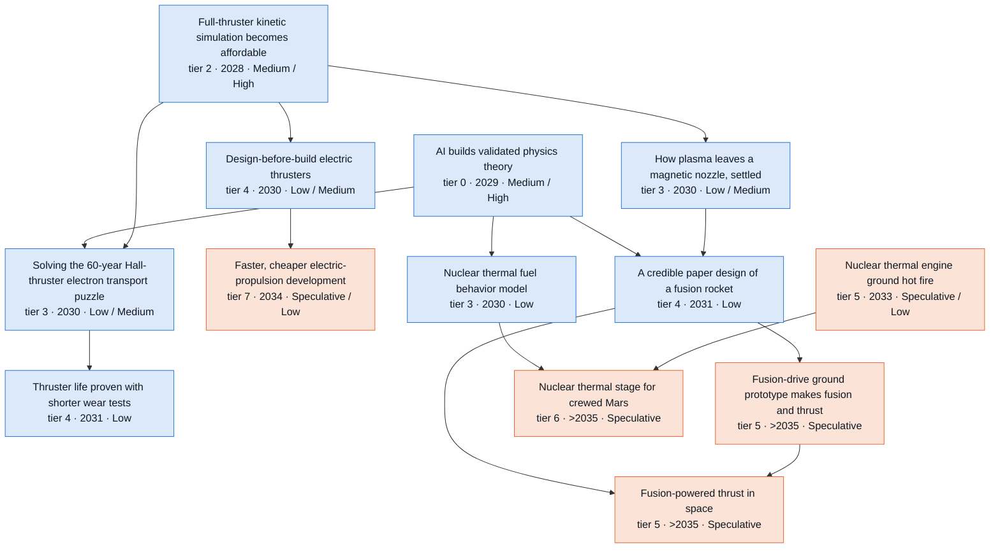

**Side lanes** (connected to the branch but off its main chain)

- Nuclear launch safety cases in months (tier 4 · 2028 · Medium)
- A U.S. fission reactor launched (tier 5 · 2031 · Low) → A reactor-powered electric spacecraft thrusts for a year (tier 6 · 2032 · Speculative / Low)

Where the reviewers disagreed: 2031 challenge round (13 disputes)

Recorded during the 2031 challenge round. Later passes adjusted some dates and bands; the node table below has the final values.

- **Does the Landau-damping node keep a High band despite the scorecard's 'internal model must become public' cap?** *Skeptic:* Keep S2 High only if the node means 'at least one variant settled'. As written, it targets statements known to be partly false: transverse Bernstein modes do not damp, and echo counterexamples apply. *Advocate:* Not addressed. The advocate only softened the edge into closures. *Resolution:* Reframed so that settling at least one variant counts, including a proven failure. High kept. The auditor wanted the cap at Medium. premise_tier now explains why the band does not rest on public release: human programs have produced about one new setting a year since 2022, and labs can pose the problem internally.
- **How far is whole-device kinetic Hall-thruster simulation from affordable, and what band does it deserve?** *Skeptic:* Order 1e17-1e18 particle pushes (~1e8 cells): days on a large share of a leadership machine, feasible as hero runs. Keep High but narrow the signpost to affordability. S3 2027->2028. *Advocate:* Not addressed. The advocate treats the solvers as arriving in 2028 (S2) and builds an earlier EP chain on them. *Resolution:* The auditor's figure (1e12 cells x 1e8 explicit steps, a 1e6-1e8x gap) ignores implicit PIC, and the skeptic's undercounts cells. The resolver's estimate is ~1e9-1e10 ECDI-resolving cells and ~1e18-1e19 pushes: weeks to months on a full exascale machine today, so 10-100x more is needed. Result: S2 High->Medium, S1 Low, S3 High kept, P1->P4, the skeptic's signpost adopted, S3 2028.
- **Is the Hall-thruster transport closure the gate for design-before-build, and how fast does it arrive?** *Skeptic:* Kinetic runs costing days are a validation tool, not a design loop, so predictive design needs a hard edge from the closure. Closure and predictive design both S2 Medium->Low (P6 default; compounded Medium prerequisites; a 60-year problem with a strict 5% criterion). *Advocate:* Data-driven closures (Jorns 2018/2020) and JANUS data make the closure S2 2029. Predictive design is reachable by either route (soft edge), so S2 2029, S3 2028 and S3 High. *Resolution:* Skeptic on structure and bands: the hard edge is added and both nodes are S2 Low, S3 Medium. Advocate on substance: the closure node now admits data-driven closures, and the "Turbulence and combustion models with guarantees" edge is soft. The advocate's earlier years are rejected, because validating across three thrusters takes about a year after the 2028 solvers and the 2029 theory.
- **Does an AI-designed thruster need predictive design before it can fly, and when could it fly?** *Skeptic:* Through predictive design (S3 2029, Medium), plus 18-24 months of build and a ride, the node lands in 2031 with zero slack, so S3 Medium->Low (the auditor agreed, citing the P7 default of Speculative). *Advocate:* The node only needs flight inside a stated band. An AI loop over Bayesian-calibrated models (8%/17% ground-to-orbit today), like LEAP 71 for engines, flown by a commercial operator with no certifier, gives S2 2030 Medium and S3 2029 High. It is inconsistent for an AI-native spacecraft to fly in 2029 while this node sits at >2031. *Resolution:* Advocate on structure: predictive design becomes soft, "AI multiphysics design with guarantees" becomes hard, pathway P1->P7. On timing the resolver splits the difference: without a closure the first article needs an extra build-test iteration, giving S2 2031 Low and S3 2030 Medium. The skeptic/auditor S3 Low was not applied, because their zero-slack chain ran through the prerequisite that is now soft. The AI-native spacecraft node concerns engineering labor, not a new plasma device performing as predicted.
- **When can model-based life credit shorten EP wear tests?** *Skeptic:* Analysis already supplies the 50% margin, so the new step is credit for part of the 100% test, which needs a standards change. The closure is validated in 2029, then ~10,000 h of partial wear test, then review: S3 2031, Low. No program is in a life-qualification review in 2030. *Advocate:* This extends a 17-year-old practice. Fixed-throttle calibration suffices without a universal closure, and the AEPS QM-2 early-stop decision window is 2028-29, so S2 2030 Medium and S3 2029. Soften the closure and "Regulators accept AI-produced proofs" edges. *Resolution:* All three lenses agreed on the fact and the redefinition, which the resolver verified in Williams et al. 2026. Timing goes to the skeptic (S3 2031 Low; S2 2031 Low): AEPS has committed to an at-least-100% test that is funded to Sep 2029, and predicting erosion evolution beyond the test needs a near-wall model that stays valid as surfaces wear. So the closure stays hard against the advocate. "Regulators accept AI-produced proofs" (DO-178C proof credit) and predictive design are soft.
- **Can EP development cycle time visibly shorten by 2031?** *Skeptic:* The 30-50% cut exceeds the Amdahl bounds, so it becomes 15-30% (S2) and up to 40% (S3). One full program must start after the tools exist: >2031. S2 Speculative, S3 Low. *Advocate:* EP is a favourable case (small hardware, cheap tests). Generic program and qualification compression nodes are S2 2030, so S2 2031 Low and S3 2030 Medium. *Resolution:* Skeptic and auditor: >2031 and Speculative in all scenarios. Life credit now lands in 2031 at the earliest, and the advocate's comparison nodes have since moved to S2 2031 / S3 2030 under other resolvers. Magnitude set to 15-30% (S2), up to ~40% (S3).
- **Magnetic-nozzle detachment theory: edge and band.** *Skeptic:* S2 Medium->Low. Settling it needs far-plume data that ground chambers distort. The only in-space candidate (Sunbird 2027) has no committed far-field diagnostic. *Advocate:* Fully kinetic PIC already attributes detachment, so the "Turbulence and combustion models with guarantees" edge should be soft, and S2 2029 via the solvers plus a rideshare plume experiment. *Resolution:* Both partly accepted. The edge is soft (the fully kinetic route needs only the solvers), and S2 is Low. The advocate's S2 2029 is rejected because no in-space validation measurement is planned.
- **What counts as fusion propulsion flight, and which edges are real?** *Skeptic:* 'Measurable thrust from fusion' lets a sub-breakeven stunt qualify, so redefine the node as mission-useful thrust at or above breakeven on low-neutron fuel and keep the edges. *Advocate:* As worded, an externally powered D-D or D-T device needs neither Q>1 nor D-He3, so those edges should be soft. *Resolution:* Skeptic. The stronger definition is what the skill tree's 'X unlocks Y' reading needs, and under it the net-gain and D-He3 edges are valid ordering constraints. Speculative in all scenarios either way.
- **Does AI-run fusion operation lift first net gain to High in S3?** *Skeptic:* Net gain is a physical-clock node. SPARC's first plasma is itself 2027, so S3 cannot be 2027. Year to 2028, Medium kept. *Advocate:* Three independent attempts plus DeepMind-CFS TORAX/RL scenario optimization, with S3's 1.3-1.5x experiment multiplier, justify S3 High. Add an AI fusion-operations node. *Resolution:* S3 2028, Medium kept. Hardware (magnets, vessel, tritium systems) binds, not scenario design, and the auditor verified that TAE's Copernicus, one of the advocate's three attempts, was cancelled in Nov 2025. The advocate's node is added as "AI runs fusion-device experiment campaigns and control": P1, 2028, High in all scenarios because the tooling already exists, with soft edges only.
- **Does a U.S. space reactor launch by 2031 deserve Medium in S2/S3?** *Skeptic:* Capital and politics compress 1.0x. SR-1 has $10M against a $2.1B estimate, and every program since 1965 was cancelled. The only S1-to-S2 difference is AI analysis off the critical path, so Low in all scenarios, aligned with "A 100 kW-electric fission reactor operating on the Moon". *Advocate:* Bands unchanged. A Space Reactor Office (May 2026) and streamlined management (Jun 2026) lighten the gate, and Tier II approval is lighter than presidential approval. *Resolution:* Skeptic: Low in all scenarios. Scenario-invariant gates cannot justify a band jump between scenarios. The advocate's facts and the lighter Tier II gate are recorded and show up as earlier S2/S3 years, not a higher band. All lenses agreed the safety-case edge is soft.
- **Is a 100 kW-class thruster a prerequisite for megawatt EP cargo, and should a compute-bus SEP tug be added?** *Skeptic:* Not addressed. The skeptic said no new nodes are needed and that MW cargo stays beyond 2031. *Advocate:* NASA clusters 12 kW thrusters up to 300 kW, so soften "100 kW-class thruster runs for thousands of hours" and add plasma-sep-100kw-compute-bus (150-250 kW compute-satellite solar buses plus Starship) as the hard route. *Resolution:* Hard edge kept. NASA's stated clustering range stops at 300 kW, and MW class would need ~80-330 AEPS units. The tug node is rejected: no customer, near-zero AI-math content, and not a causal precondition of MW cargo. The route is recorded as a soft edge from "100 kW-per-tonne compute satellites in serial production" plus text, using the verified AI1 figures (150 kW, 2.1 t, 127 W/kg).
- **Can constellation fleet telemetry stand in for thruster wear tests (advocate's new node)?** *Skeptic:* Not addressed directly. The skeptic located the binding life gates in NASA's standard and wear-test hours. *Advocate:* About 10,400 Starlink satellites form the largest EP life dataset, owned by an operator with no qualification authority above it. Hierarchical Bayesian degradation models make it a regulator-free substitute (S2 2029 Medium). *Resolution:* Rejected as a node. It is proprietary practice that cannot be observed (SpaceX may already do it and would not publish), and it mirrors the fleet-reliability node the trunk resolver rejected. The commercial-operator point is kept in the thruster-flight and life-credit text.
- **Stellarator design loop: a tool or a built machine?** *Skeptic:* The gate must match the claim. Either recode the gate as data, or redefine the node as a built coil set within error bars, which would put it at >2031. *Advocate:* It is a tool: gate becomes data and S2 moves 2029->2028, since surrogates are already in optimization loops (Sep 2026), ConStellaration is public and STELLAR-AI is funded. *Resolution:* Advocate. Gate becomes data, S2 2028, and the signpost is rewritten so the tool can be observed without a built coil. Proxima's 2027 model coil becomes the follow-on check.

Where the reviewers disagreed: 2035 and Embodied extension round (9 disputes)

- **Model-based thruster life credit by 2035 ("Thruster life proven with shorter wear tests").** *Skeptic:* The draft raised the band to Medium 'at the regulatory cap', but a cap is a ceiling and gives no reason to rise. The hard prerequisite, the Hall closure, is only Medium by 2035, with truth risk that time does not fix. Agencies have required a 100% wear test since the 2009 standard, and erosion models have underpredicted pole erosion. The node's own text says it compounds to Low. *Advocate:* Did not contest the band. Proposed a soft edge from the new kinetic design loop, because full-device kinetic runs resolve the near-wall erosion that life credit needs. *Resolution:* Low in S2-S4 by 2035, and S1 moves to >2035 after the trunk sync. The soft edge was added, because it adds evidence but does not lift a gate set by sputter-yield data and agency practice. The wear test is restated at the AEPS QM-2 duty cycle, about 16 months for 10,000 h.
- **A U.S. reactor launch and a year of nuclear-electric thrust by 2035.** *Skeptic:* No funded start exists. SR-1 has $10M recommended against a $2.1B estimate, the LR-1 posting is inactive, and every U.S. space reactor program since 1965 has been cancelled. SR-1 flies past Mars, so it launches only in a Mars window (early 2031, about Apr 2033, about mid 2035). Low, with a Medium trigger. The year of thrust follows the windows. *Advocate:* The lunar reactor is Low by 2035, so a reactor launch most likely means SR-1, whose AEPS thrusters are already life-tested. The year of nuclear-electric thrust should be Medium in S2-S4. *Resolution:* The skeptic was accepted: the reactor is Low in all scenarios with a stated Medium trigger, and the year of thrust is Low. That removes the advocate's premise. The resolver also fixed a latent inconsistency: the reactor's S2-S4 year moves 2030 -> 2031. No route gives 2030, since SR-1 is tied to windows and the lunar unit is 2033 in the orbital-compute branch. As a result the year of thrust is 2032 in every scenario. The skeptic's S1 2034 was not taken, because S1 can also use the early-2031 window.
- **Kinetic design loops: when, and do they route around the transport closure?** *Skeptic:* The loop needs another 10-100x after the 2028 hero runs. The parent node already spends the same algorithm families, so 100-1000x from one family is implausible. Surrogates may make the loop unnecessary. Proposed S3 2033, S2 2035, and Low or Speculative bands. *Advocate:* Commercial AI clusters are about ten times a 2022 exascale machine, so 3-10x hardware is a floor. S2 should be 2033, and the bands Medium for S2 and High for S3. The loop is never connected to the nodes it routes around. Make the closure a soft edge into predictive design, and raise predictive design and the closure to High by 2035. *Resolution:* Split. S3 moves to 2033 with a second 3-10x from algorithms and 3-5x from hardware. By 2028, leadership machines are built from the same accelerators, so AI clusters are not a separate factor. S2 stays 2034 and Low; S3 and S4 stay Medium. The structural point was accepted: closure -> predictive design becomes soft, and the loop gets soft edges into predictive design, the closure and life credit. No band rises, because both routes share wall and emission physics and the need for test data across designs.
- **EP development cycle-time outcome: agency gate, years and S4 credit.** *Skeptic:* A program must start after life credit exists (S3 2031), and partial wear tests run at about 80-85% duty. That gives S3 2034 and S2 2035, Speculative by 2035. *Advocate:* Commercial thrusters have no certifier, and predictive design alone cuts 25-40% from a 4-6 year program. Soften the life-credit edge, move S3 to 2032 and Medium. Robots running integration and test and building parallel test articles earn S4 credit. *Resolution:* The structure follows the advocate: life credit becomes a soft edge. Years follow neither reviewer. S3 stays 2033 and S2 stays 2034, because a program must start after predictive design is validated and still runs a full wear test. Bands stay Low. S4 credit was rejected: the remaining cycle is wear hours and chamber time, thruster fabrication already uses specialized automation, and the node credits models.
- **Fusion propulsion chain (D-He3 burn, design closure, ground prototype).** *Skeptic:* AI moves the D-He3 heating gate by about a year, so a one-year scenario difference cannot carry a band step to Medium in S3. The design closure cannot sit above its D-He3 premise. A new fusion device takes 4-6 years after funding, as SPARC and Polaris did, so the ground test is S3 2035 at the earliest and Speculative. 'Flight-like mass per unit of power' has no meaning below breakeven. The link from ground test to flight should be a hard edge. *Advocate:* Agreed that the ground-test link should be hard. Wanted magnetic-nozzle theory at High in S3 because launch is cheap and Sunbird flies in 2027. *Resolution:* The skeptic was accepted in full. D-He3 and the design closure are Low by 2035, and the design closure's S1 is Speculative. The ground test is S3/S4 2035 and S1/S2 >2035, Speculative everywhere, with a checkable one-tenth-power definition. It is now a hard prerequisite of fusion flight. Nozzle theory stays Medium, because no far-field diagnostic flight is funded.
- **Nuclear thermal ground test and fuel model.** *Skeptic:* The EIS (2-4 years) and construction of the exhaust-capture facility (2-4 years, after the record of decision) do not compress, and a FY2027 start is unfunded. S3 should equal S2 at 2033. The fuel-model Medium depends on funding that does not exist, and validation needs fluence and hot-cell work that no combined facility can provide. *Advocate:* Did not contest. Agreed that nuclear nodes get no S4 credit. *Resolution:* The fuel model is Low by 2035 (accepted). The ground-test years are kept at S3 2032, S2 2033 and S1 2034. EIS drafting is cognitive work: the S4 analysis rates NEPA work at 1.5-2x in S3. The sequential floor (start 2027, EIS about 2 years, construction about 2 years, then the test) still reaches 2032, and Congress put at least $110M into NTP for FY2026. The note now states the construction-after-decision sequence.
- **100 kW-class thruster life test.** *Skeptic:* Appropriations and a facility taking 2-4 years to build gate every scenario equally, so S3 should be 2033. 5,000 h at a normal duty cycle is 8-9 months. *Advocate:* JPL's lithium MPD passed 120 kW, NEP is the national priority, and S3 has three years of slack, so Medium by 2035. *Resolution:* Years kept (S3 2032), because design iterations differ by scenario and a lithium MPD can run in an existing facility since lithium condenses on the walls. The duty-cycle wording was accepted (about eight months). Low in all scenarios: no funded program targets 5,000 h, NASA's stated path clusters 12 kW thrusters up to 300 kW, and electrode erosion has historically limited MPD life.
- **Robots in a physics- and appropriations-bound branch.** *Skeptic:* Four of the five robot soft edges fail the extension rules' rule. The robot node lands in the same year or later, or the binding steps (fluence, hot cells, full-coil tests, reactor suppliers after 2031, a facility built before construction robots) are not labor. *Advocate:* 'Robots change nothing' is too absolute. The S4 research gives queue-limited test programs 0.4-0.6x and space nuclear 0.7-0.85x by 2035. Proposed a new node in which high-power EP test capacity doubles, at S4 2032 and Medium. *Resolution:* The four edges were dropped. Only in-space assembly -> MW cargo is kept, because it is the only edge whose mechanism acts before its target. The new node was rejected: its own why says funding binds, so its S4 band step fails condition 1. The facility gate stays in "100 kW-class thruster runs for thousands of hours". The thesis now states exactly what the graph shows: robots move no year or band in this branch.
- **AI-designed thrusters: first flight and constellation scale.** *Skeptic:* Did not contest. *Advocate:* With four years of slack, no certifier and many smallsat makers, the first AI-designed thruster flight should be High in S2 and Medium in S1 by 2035. The constellation node should rise too, because any 1,000-satellite operator can disclose. *Resolution:* First flight accepted: S1 Medium and S2 High, in line with "Spacecraft engineered mostly by AI flies" and "AI-designed radiation-tolerant space processor" in other final files. Constellation rejected: one operator must fly 1,000 units of one AI-designed thruster and say so, and the leading in-house maker does not publish design methods. It stays S2 Low and S3 Medium.

All nodes in this branch

Years and likelihoods are listed for Plateau / Exponential / Recursive / Embodied. H = High, M = Medium, L = Low, S = Speculative.

| Node | Tier | Year | By 2031 | By 2035 | Binding gate | Pathway |
| --- | --- | --- | --- | --- | --- | --- |
| Landau damping settled for realistic plasmas | 1 | 2029 / 2027 / 2027 / 2027 | M / H / H / H | H / H / H / H | cognitive | P5->P6 |
| Relativistic plasma equations proved well-behaved (checked) | 1 | 2027 / 2027 / 2027 / 2027 | H / H / H / H | H / H / H / H | formalization | P5 |
| Millisecond fusion-turbulence models trusted in design | 2 | 2027 / 2027 / 2027 / 2027 | H / H / H / H | H / H / H / H | data | P1->P6 |
| Full-thruster kinetic simulation becomes affordable | 2 | 2030 / 2028 / 2028 / 2028 | L / M / H / H | M / H / H / H | cognitive | P1->P4 |
| A formal library for plasma equations | 2 | 2030 / 2028 / 2028 / 2028 | M / H / H / H | H / H / H / H | formalization | P2 |
| Plasma simulations with certified error bars | 2 | 2033 / 2029 / 2028 / 2028 | S / M / H / H | M / H / H / H | formalization | P2->P6 |
| Simpler plasma models with proven error bounds | 3 | 2034 / 2029 / 2029 / 2029 | S / M / M / M | L / M / H / H | data | P6 |
| Validated models of superconducting magnets | 3 | 2031 / 2029 / 2029 / 2029 | L / L / M / M | M / M / H / H | experiment | P1->P6 |
| Solving the 60-year Hall-thruster electron transport puzzle | 3 | 2034 / 2030 / 2029 / 2029 | S / L / M / M | L / M / M / M | experiment | P1->P6 |
| How plasma leaves a magnetic nozzle, settled | 3 | 2033 / 2030 / 2029 / 2029 | S / L / M / M | L / M / M / M | experiment | P6 |
| Nuclear thermal fuel behavior model | 3 | 2034 / 2030 / 2030 / 2030 | S / L / L / L | L / L / L / L | experiment | P1->P6 |
| Deuterium-helium-3 fusion demonstrated at useful rates | 3 | 2033 / 2032 / 2031 / 2031 | S / S / L / L | L / L / L / L | experiment | P7 |
| Nuclear launch safety cases in months | 4 | 2030 / 2028 / 2028 / 2028 | L / M / M / M | L / M / M / M | regulatory | P1->P2 |
| AI design loop for stellarator fusion machines | 4 | 2030 / 2028 / 2028 / 2028 | M / H / H / H | H / H / H / H | data | P1->P6 |
| AI runs fusion-device experiment campaigns and control | 4 | 2028 / 2028 / 2028 / 2028 | H / H / H / H | H / H / H / H | experiment | P1 (capability transfer; not AI-math-driven) |
| Design-before-build electric thrusters | 4 | 2035 / 2030 / 2029 / 2029 | S / L / M / M | L / M / M / M | data | P1->P6 |
| Thruster life proven with shorter wear tests | 4 | >2035 / 2031 / 2031 / 2031 | S / L / L / L | S / L / L / L | qualification | P6 |
| A credible paper design of a fusion rocket | 4 | 2034 / 2031 / 2030 / 2030 | S / L / L / L | S / L / L / L | experiment | P6 |
| Full-thruster plasma simulation fast enough for design work | 4 | >2035 / 2034 / 2033 / 2033 | S / S / S / S | S / L / M / M | cognitive | P1->P4 |
| First magnetic-fusion net energy gain | 5 | 2028 / 2028 / 2028 / 2028 | M / M / M / M | H / H / H / H | fabrication | P7 (exogenous) |
| 12 kW Gateway thruster passes a three-year wear test | 5 | 2029 / 2029 / 2029 / 2029 | H / H / H / H | H / H / H / H | experiment | P7 (exogenous) |
| A U.S. fission reactor launched | 5 | 2031 / 2031 / 2031 / 2031 | L / L / L / L | L / L / L / L | capital | P7 |
| Air-breathing electric propulsion flight test | 5 | 2033 / 2031 / 2030 / 2030 | S / L / L / L | L / M / M / M | fabrication | P7 |
| AI-designed thruster flies and performs as predicted | 5 | 2033 / 2031 / 2030 / 2030 | S / L / M / M | M / H / H / H | fabrication | P1->P7 |
| 100 kW-class thruster runs for thousands of hours | 5 | 2034 / 2033 / 2032 / 2032 | S / S / S / S | L / L / L / L | experiment | P7 |
| Nuclear thermal engine ground hot fire | 5 | 2034 / 2033 / 2032 / 2032 | S / S / S / S | S / L / L / L | capital | P1 (marginal) |
| Magnetic radiation shield for crews | 5 | >2035 / >2035 / >2035 / >2035 | S / S / S / S | S / S / S / S | fabrication | P7 |
| Fusion-powered thrust in space | 5 | >2035 / >2035 / >2035 / >2035 | S / S / S / S | S / S / S / S | experiment | P7 |
| Fusion-drive ground prototype makes fusion and thrust | 5 | >2035 / >2035 / 2035 / 2035 | S / S / S / S | S / S / S / S | experiment | P6->P7 |
| A reactor-powered electric spacecraft thrusts for a year | 6 | 2032 / 2032 / 2032 / 2032 | S / S / S / S | L / L / L / L | capital | P7 |
| AI-designed thrusters fly across a whole constellation | 6 | 2035 / 2033 / 2032 / 2032 | S / S / S / S | S / L / M / M | adoption | P1->P7 |
| Air-breathing electric propulsion in operational service | 6 | >2035 / 2035 / 2034 / 2034 | S / S / S / S | S / S / L / L | adoption | P1->P7 |
| Megawatt electric cargo ships to Mars | 6 | >2035 / >2035 / >2035 / >2035 | S / S / S / S | S / S / S / S | capital | P7 |
| Nuclear thermal stage for crewed Mars | 6 | >2035 / >2035 / >2035 / >2035 | S / S / S / S | S / S / S / S | capital | P7 |
| Faster, cheaper electric-propulsion development | 7 | >2035 / 2034 / 2033 / 2033 | S / S / S / S | S / L / L / L | qualification | P6->P7 |

## 11. The waterfall by year, 2026–2035

Read down the years to see the waterfall unfold in the Exponential case. Bands in parentheses are the likelihoods by end-2031 and end-2035, read off each node's year-by-year odds.

- **2026.** The capability exists inside the labs. Agents formalize mathematics at scale, and outside checking of AI results begins. None of this is yet available to space engineers.
- **2027.** Research-grade mathematics reaches outside teams, and with it research-grade applied mathematics (High). The first engineering uses are the ones with no physical gate, all High:
  - agents that prove flight code;
  - AI-drafted specifications;
  - exhaustive checks of fault logic;
  - trajectory design on demand;
  - mesh routing with a proven optimality gap;
  - structural analysis run by agents;
  - archive mining for science.

  Starship's two stages are caught and reflown. That is an exogenous step, but it starts the flight-data stream that later closes heat-shield and engine models.
- **2028.** The trust infrastructure arrives: Lean libraries for applied mathematics, a verified numerics toolchain, and audits of AI results in days. These High-rated uses follow:
  - routine on-demand applied mathematics across space engineering;
  - guaranteed error bars;
  - certified combustion-stability models;
  - collision-probability math;
  - space-weather ensembles;
  - uncertainty-based heat-shield margins.

  Verified flight code is 15–120x cheaper per line on the model's cost assumptions. The first 100-kW-class radiators fly on compute satellites, on SpaceX's schedule (High).
- **2029.** The first physical steps attributable to AI mathematics appear where no regulator certifies the work:
  - a lander flies proof-checked descent software (Medium);
  - constellations take proof-checked updates (Medium);
  - commercial operators fly hardware qualified mainly by analysis (Medium);
  - engines earn model-based reuse life (Medium);
  - missions fly AI-designed trajectories (High);
  - lunar robots do severalfold more work per operator (Medium).

  AI begins building validated physics theory (Medium), and a rulebook for trusting AI-made analysis arrives (Medium). An AI answer on unforced Navier–Stokes passes outside checks (Medium), and nothing in engineering changes.
- **2030.**
  - Regulators accept AI-produced proofs through already-qualified checkers (Medium).
  - Capsules fly thinner, model-based heat shields (Medium).
  - Ship-scale heat shields become rapidly reusable on flight data (Medium).
  - Orbital refueling becomes routine on the launch clock (Medium).
  - Heavy launch passes 100 flights a year (High; an exogenous anchor).
- **2031.** These land, mostly Low by 2031 but Medium or High by 2035:
  - program cycles 20–30% shorter (Medium);
  - qualification campaigns at least 15% shorter (Low; the base-case estimate is 10–20%);
  - internal launch cost under $100/kg and customer prices under $1,000/kg (both Low);
  - a gigawatt of compute in orbit (Low);
  - certified crewed-lander autonomy (Low);
  - a self-running lunar base (Low).
- **2032.** A second wave begins (each Medium by 2035 unless marked):
  - constellation shells designed with certified tools are in service (High);
  - robots assemble flight hardware at leading space firms;
  - certified mathematics on demand reaches the supplier base;
  - a large AI model is trained in orbit;
  - a step change arrives in spacecraft power per kilogram;
  - a tonne-a-year lunar oxygen plant runs;
  - satellites switch to post-quantum encryption in orbit over proven update paths.
- **2033.** Scale arrives where launch allows (each Medium by 2035):
  - 300 or more fully reusable heavy launches a year;
  - megawatt-class compute satellites;
  - ten heavy cargo landings on the Moon in a year;
  - a lunar lander making three landings, refueled in space;
  - tankers fueling five Mars ships for one window;
  - engines flying 50 missions without overhaul;
  - robots running integration and test around the clock;
  - an exoplanet atmosphere census with honest error bars;
  - side-view and upstream solar-wind monitoring.
- **2034–35.** Nothing first credible in these years is rated Medium or better by 2035 in the Exponential case. Each of these is Low or Speculative:
  - three-day heat-shield turnaround;
  - crews returning from orbit on a reusable ship;
  - LISA's launch;
  - ten tonnes a year of lunar oxygen fueling landers;
  - robots in the plants that make robot parts.
- **What Embodied adds after 2031.** Outside the robots branch, robots lift a handful of space nodes by 2035. Among them are qualification campaigns 30% shorter at leading firms (2033, High by 2035) and leading firms halving development cycles (2034, Medium); section 4 lists them all. The robots branch itself runs one to four years ahead of Recursive, with ten million robots from late 2032.
- **After 2035.** These lie beyond the window in every scenario:
  - fusion propulsion;
  - a nuclear thermal stage for crewed Mars;
  - LISA's science;
  - robots supplying 10% of global manufacturing labor.

  10 GW of compute in orbit comes after 2035 in the Exponential case, and about 2035 in Recursive and Embodied (Low by 2035).

The full list follows. It gives every tier 4–7 node rated High or Medium by 2031 or by 2035, by Exponential-case year, with the Plateau, Recursive and Embodied years for comparison. A last group lists every tier 4–7 node dated after 2035, whatever its rating.

All tier 4–7 nodes by year, Exponential case

**2027** (High or Medium by 2031 or by 2035; likelihoods shown as 2031 / 2035)
- AI agents run and check structural and thermal analysis (tier 4, High; Plateau 2028, Recursive 2027, Embodied 2027)
- AI mines the space-science archive at scale (tier 4, High; Plateau 2027, Recursive 2027, Embodied 2027)
- AI red-teaming of flight assumptions (tier 4, High; Plateau 2028, Recursive 2027, Embodied 2027)
- AI-generated engines at scale (tier 4, High; Plateau 2027, Recursive 2027, Embodied 2027)
- Anomaly diagnosis 3-10x faster (tier 4, High; Plateau 2029, Recursive 2027, Embodied 2027)
- Exhaustive checks of fault logic and configuration (tier 4, High; Plateau 2028, Recursive 2027, Embodied 2027)
- Extraordinary claims audited in weeks (tier 4, High; Plateau 2028, Recursive 2027, Embodied 2027)
- License analyses drafted and checked by AI (tier 4, High; Plateau 2029, Recursive 2027, Embodied 2027)
- Trajectory design on demand (tier 4, High; Plateau 2028, Recursive 2027, Embodied 2027)
- Both Starship stages caught and reflown (tier 5, High; Plateau 2027, Recursive 2027, Embodied 2027)
- Ship-to-ship cryogenic transfer demonstrated (tier 5, High; Plateau 2027, Recursive 2027, Embodied 2027)

**2028** (High or Medium by 2031 or by 2035; likelihoods shown as 2031 / 2035)
- AI design loop for stellarator fusion machines (tier 4, High; Plateau 2030, Recursive 2028, Embodied 2028)
- AI designs new rocket-engine alloys in weeks (tier 4, High; Plateau 2030, Recursive 2028, Embodied 2028)
- AI runs fusion-device experiment campaigns and control (tier 4, High; Plateau 2028, Recursive 2028, Embodied 2028)
- AI-designed green and high-energy propellants (tier 4, High; Plateau 2029, Recursive 2028, Embodied 2028)
- AI-optimized radiators and heat transport (tier 4, High; Plateau 2030, Recursive 2028, Embodied 2028)
- Crew-side fault diagnosis without Mission Control (tier 4, Medium; Plateau 2030, Recursive 2028, Embodied 2028)
- Lightsails proven to ride the beam (tier 4, High; Plateau 2030, Recursive 2028, Embodied 2028)
- Nuclear launch safety cases in months (tier 4, Medium; Plateau 2030, Recursive 2028, Embodied 2028)
- On-demand applied math in space engineering (tier 4, High; Plateau 2029, Recursive 2028, Embodied 2028)
- Predicting radio blackout during reentry (tier 4, High; Plateau 2029, Recursive 2028, Embodied 2028)
- Probabilistic engine life prediction for reuse (tier 4, High; Plateau 2030, Recursive 2028, Embodied 2028)
- Proof agents verify space processors and chip logic (tier 4, High; Plateau 2029, Recursive 2028, Embodied 2028)
- Proof-checked autonomy software for lunar robots (tier 4, High; Plateau 2030, Recursive 2028, Embodied 2028)
- Proven safety wrappers for unverifiable autonomy (tier 4, High; Plateau 2030, Recursive 2028, Embodied 2028)
- Proven-stable power grids for big spacecraft and Moon bases (tier 4, Medium / High; Plateau 2030, Recursive 2028, Embodied 2028)
- Quantum sensors designed against full error budgets (tier 4, High; Plateau 2030, Recursive 2028, Embodied 2028)
- Satellite antenna beams with proven emission limits (tier 4, Medium / High; Plateau 2030, Recursive 2028, Embodied 2028)
- Tasking and ground planning built on hardness limits (tier 4, High; Plateau 2029, Recursive 2028, Embodied 2028)
- Toolchain that ships guidance code with its proofs (tier 4, High; Plateau 2030, Recursive 2028, Embodied 2028)
- Upgradeable satellite encryption with proven update paths (tier 4, High; Plateau 2029, Recursive 2028, Embodied 2028)
- 100-kW-class deployable radiators fly on compute satellites (tier 5, High; Plateau 2028, Recursive 2028, Embodied 2028)
- First magnetic-fusion net energy gain (tier 5, Medium / High; Plateau 2028, Recursive 2028, Embodied 2028)
- First measurements of how hard polar ice is to dig (tier 5, Medium / High; Plateau 2028, Recursive 2028, Embodied 2028)
- Monthly flight testing of a fully reusable heavy launcher (tier 5, High; Plateau 2028, Recursive 2028, Embodied 2028)
- Multi-node satellite quantum-key demonstrations (tier 5, High; Plateau 2028, Recursive 2028, Embodied 2028)
- Public flight data on storing cryogenic propellant in orbit (tier 5, Medium; Plateau 2028, Recursive 2028, Embodied 2028)
- AI plans rover operations, machines check the plans (tier 6, High; Plateau 2029, Recursive 2028, Embodied 2028)
- Constellations track debris with honest error bars (tier 6, Medium / High; Plateau 2029, Recursive 2028, Embodied 2028)
- First large debris object removed from orbit (tier 6, High; Plateau 2028, Recursive 2028, Embodied 2028)
- Launch licensing in weeks (tier 6, Medium; Plateau 2029, Recursive 2028, Embodied 2028)
- Next-generation dark-energy survey data in hand (tier 6, High; Plateau 2028, Recursive 2028, Embodied 2028)
- Second-generation direct-to-cell service (V2 D2C) in commercial use (tier 6, High; Plateau 2028, Recursive 2028, Embodied 2028)
- More science per mission dollar (tier 7, Medium / High; Plateau 2030, Recursive 2028, Embodied 2028)
- Verified flight code 15-120x cheaper per line (tier 7, High; Plateau 2030, Recursive 2028, Embodied 2028)

**2029** (High or Medium by 2031 or by 2035; likelihoods shown as 2031 / 2035)
- AI co-designs vehicle shape, entry path and heat shield (tier 4, High; Plateau 2031, Recursive 2028, Embodied 2028)
- AI-designed heat shields and hot structures (tier 4, Medium / High; Plateau 2030, Recursive 2029, Embodied 2029)
- AI-designed photonics with proven performance bounds (tier 4, Medium / High; Plateau 2031, Recursive 2029, Embodied 2029)
- Battery qualification without years of cycling (tier 4, Medium / High; Plateau 2030, Recursive 2029, Embodied 2029)
- Certified screening that scales to a million objects (tier 4, High; Plateau 2031, Recursive 2029, Embodied 2029)
- Constellation design with proven compliance (tier 4, Medium / High; Plateau 2031, Recursive 2028, Embodied 2028)
- Fleet-trained reentry heating model for one reusable vehicle (tier 4, Medium / High; Plateau 2029, Recursive 2029, Embodied 2029)
- Insurance-grade models of launch and in-orbit risk (tier 4, Medium / High; Plateau 2031, Recursive 2028, Embodied 2028)
- Lighter buckling design rules for tanks and interstages (tier 4, Medium; Plateau 2031, Recursive 2029, Embodied 2029)
- Picometer-stable telescopes with guaranteed control (tier 4, Medium; Plateau 2033, Recursive 2028, Embodied 2028)
- Predictive engine start and relight transients (tier 4, Medium / High; Plateau 2031, Recursive 2028, Embodied 2028)
- Predictive turbopump cavitation and stability (tier 4, Medium / High; Plateau 2032, Recursive 2028, Embodied 2028)
- Probabilistic heat-shield sizing adopted in practice (tier 4, Medium / High; Plateau 2030, Recursive 2029, Embodied 2029)
- Proven radiation-fault tolerance for orbital AI (tier 4, Medium / High; Plateau 2030, Recursive 2028, Embodied 2028)
- Proven safe capture of tumbling debris (tier 4, Medium / High; Plateau 2031, Recursive 2029, Embodied 2029)
- Reliable recipes for sintering regolith (tier 4, Medium / High; Plateau 2031, Recursive 2028, Embodied 2028)
- Satellites screened by statistics, not unit tests (tier 4, Medium / High; Plateau 2030, Recursive 2028, Embodied 2028)
- Sun-watching constellations designed for best coverage (tier 4, Medium; Plateau 2032, Recursive 2029, Embodied 2029)
- Test stands that run themselves (tier 4, Medium / High; Plateau 2030, Recursive 2028, Embodied 2028)
- Validated models of braking with engines at supersonic speed (tier 4, Medium; Plateau 2030, Recursive 2028, Embodied 2028)
- 12 kW Gateway thruster passes a three-year wear test (tier 5, High; Plateau 2029, Recursive 2029, Embodied 2029)
- A lunar robot operates with proof-checked autonomy (tier 5, Medium / High; Plateau 2031, Recursive 2029, Embodied 2029)
- AI chips and memory qualified to run hot in orbit (tier 5, Medium / High; Plateau 2030, Recursive 2029, Embodied 2029)
- Autonomous Earth-Moon navigation with proven error bounds (tier 5, Medium / High; Plateau 2031, Recursive 2029, Embodied 2029)
- Autonomous labs discover real new materials (tier 5, Medium / High; Plateau 2030, Recursive 2029, Embodied 2029)
- Detonation engine flies in space (tier 5, Medium; Plateau 2029, Recursive 2029, Embodied 2029)
- First oxygen made on the Moon (tier 5, Medium / High; Plateau 2030, Recursive 2028, Embodied 2028)
- Flight demo of verified post-quantum command links (tier 5, Medium / High; Plateau 2030, Recursive 2029, Embodied 2029)
- Formally verified onboard software stack (tier 5, Medium / High; Plateau 2030, Recursive 2029, Embodied 2029)
- Lander flies proof-checked descent guidance and fault logic (tier 5, Medium / High; Plateau 2030, Recursive 2029, Embodied 2029)
- Lightweight solar arrays at compute-constellation volume (tier 5, Medium; Plateau 2029, Recursive 2029, Embodied 2029)
- Operators fly new hardware qualified mainly by AI analysis (tier 5, Medium / High; Plateau 2030, Recursive 2029, Embodied 2029)
- Proof-checked autonomous docking, servicing and refueling (tier 5, Medium / High; Plateau 2031, Recursive 2029, Embodied 2029)
- Spacecraft send answers, not raw data, with error bounds (tier 5, Medium / High; Plateau 2031, Recursive 2029, Embodied 2029)
- A privately funded space telescope returns data (tier 6, Medium; Plateau 2029, Recursive 2029, Embodied 2029)
- Commercial AI chips running in orbit at scale (tier 6, High; Plateau 2029, Recursive 2029, Embodied 2029)
- Full lunar-lander refueling campaign (tier 6, Medium / High; Plateau 2029, Recursive 2028, Embodied 2028)
- Heavy cargo landed on the Moon (tier 6, Medium / High; Plateau 2030, Recursive 2028, Embodied 2028)
- Mega-constellation mesh run with certified optimality (tier 6, Medium / High; Plateau 2030, Recursive 2029, Embodied 2029)
- Model-based engine reuse life (tier 6, Medium / High; Plateau 2031, Recursive 2029, Embodied 2029)
- Onboard AI agents fly under proof-checked command guards (tier 6, Medium / High; Plateau 2031, Recursive 2029, Embodied 2029)
- Pads and propellant plants for hundreds of heavy flights (tier 6, High; Plateau 2029, Recursive 2029, Embodied 2029)
- Phone-to-satellite service scheduled around interference (tier 6, Medium / High; Plateau 2031, Recursive 2028, Embodied 2028)
- Proof-backed guidance software in operational spacecraft (tier 6, Medium / High; Plateau 2031, Recursive 2029, Embodied 2029)
- Proof-checked software updates across constellations (tier 6, Medium / High; Plateau 2031, Recursive 2029, Embodied 2029)
- Radiation-belt and charging risk forecasts days ahead (tier 6, Medium / High; Plateau 2030, Recursive 2028, Embodied 2028)
- Reusable launchers re-prove flight software every flight (tier 6, Medium; Plateau 2031, Recursive 2029, Embodied 2029)
- Spacecraft engineered mostly by AI flies (tier 6, Medium / High; Plateau 2031, Recursive 2029, Embodied 2029)
- Tight-formation compute clusters operate in orbit (tier 6, Medium / High; Plateau 2030, Recursive 2029, Embodied 2029)
- AI cuts new space hardware development cost by about 10-20% (tier 7, Medium / High; Plateau 2031, Recursive 2029, Embodied 2029)
- Math expertise stops limiting space programs (tier 7, Medium / High; Plateau 2033, Recursive 2028, Embodied 2028)
- Severalfold more robot work per operator (tier 7, Medium / High; Plateau 2031, Recursive 2029, Embodied 2029)
- Starlink Mobile serves 100 million phones a month (tier 7, Medium / High; Plateau 2029, Recursive 2029, Embodied 2029)
- Starship internal cost under $300 per kg (tier 7, High; Plateau 2029, Recursive 2029, Embodied 2029)
- Structures and thermal analysis cycles 2-5x faster (tier 7, High; Plateau 2030, Recursive 2028, Embodied 2028)

**2030** (High or Medium by 2031 or by 2035; likelihoods shown as 2031 / 2035)
- Certify each printed part from its build data (tier 4, Medium; Plateau 2031, Recursive 2029, Embodied 2029)
- Design excavators from models, not guesses (tier 4, Medium / High; Plateau 2032, Recursive 2029, Embodied 2029)
- Design-before-build electric thrusters (tier 4, Low / Medium; Plateau 2035, Recursive 2029, Embodied 2029)
- Models cut the test flights needed to prove reliability (tier 4, Low / Medium; Plateau 2033, Recursive 2029, Embodied 2029)
- Qualification by analysis replaces some structural tests (tier 4, Low / Medium; Plateau 2033, Recursive 2029, Embodied 2029)
- Robot assembly skills with proven safety envelopes (tier 4, Medium / High; Plateau 2034, Recursive 2029, Embodied 2029)
- Second-generation fission power designs (tier 4, Low / Medium; Plateau 2032, Recursive 2029, Embodied 2029)
- Tighter launch vibration and acoustic environments (tier 4, Low / Medium; Plateau 2033, Recursive 2029, Embodied 2029)
- AI-designed heat-shield material flies (tier 5, Medium / High; Plateau 2031, Recursive 2030, Embodied 2030)
- AI-designed radiation-tolerant space processor (tier 5, Medium / High; Plateau 2032, Recursive 2029, Embodied 2029)
- First AI-agent-designed alloy flies in a rocket engine (tier 5, Low / Medium; Plateau 2032, Recursive 2030, Embodied 2030)
- Flown heat shield sized with reduced, model-based margins (tier 5, Low / Medium; Plateau 2031, Recursive 2030, Embodied 2030)
- Lightweight 600 K radiators qualified for fission power (tier 5, Low / Medium; Plateau 2030, Recursive 2030, Embodied 2030)
- Long closed life-support test run by certified control (tier 5, Low / Medium; Plateau 2034, Recursive 2030, Embodied 2030)
- Model-qualified perovskite tandem proves itself in orbit (tier 5, Low / Medium; Plateau 2033, Recursive 2030, Embodied 2030)
- Radiation-robust high-voltage power electronics (tier 5, Medium / High; Plateau 2031, Recursive 2029, Embodied 2029)
- Rapidly reusable orbital heat shield (ship scale) (tier 5, Medium / High; Plateau 2031, Recursive 2029, Embodied 2029)
- Reflight cleared by data, not teardown (tier 5, Medium / High; Plateau 2031, Recursive 2029, Embodied 2029)
- Sensor-based inspection credit for reusable stages (tier 5, Medium; Plateau 2032, Recursive 2030, Embodied 2030)
- Ultralight radiators in serial production (tier 5, Medium; Plateau 2031, Recursive 2030, Embodied 2030)
- 100+ fully reusable heavy launches a year (tier 6, High; Plateau 2030, Recursive 2029, Embodied 2029)
- A second reusable heavy-lift fleet at scale (tier 6, Medium / High; Plateau 2030, Recursive 2029, Embodied 2029)
- Low-orbit navigation service with published error bounds (tier 6, Medium / High; Plateau 2031, Recursive 2029, Embodied 2029)
- Missions fly AI-designed trajectories (tier 6, Medium / High; Plateau 2030, Recursive 2029, Embodied 2029)
- Outside customers can book launch again after the rideshare closure (tier 6, Medium / High; Plateau 2030, Recursive 2029, Embodied 2029)
- Satellite fleets can swap encryption before the 2035 cutoff (tier 6, Low / Medium; Plateau 2033, Recursive 2029, Embodied 2029)
- Satellite methane data used as compliance evidence (tier 6, Low / Medium; Plateau 2033, Recursive 2029, Embodied 2029)
- Storm-proof low-orbit operations (tier 6, Medium / High; Plateau 2031, Recursive 2029, Embodied 2029)
- Third-generation direct-to-cell satellites (V3 D2C) in service (tier 6, Medium / High; Plateau 2030, Recursive 2029, Embodied 2029)
- Weather-robust optical ground network service (tier 6, Medium; Plateau 2031, Recursive 2030, Embodied 2030)
- AI compute becomes Starship's second anchor customer (tier 7, Medium / High; Plateau 2031, Recursive 2029, Embodied 2029)
- Assurance stops being a moat for primes (tier 7, Medium / High; Plateau 2032, Recursive 2029, Embodied 2029)
- Debris removal becomes a recurring paid service (tier 7, Low / Medium; Plateau 2030, Recursive 2030, Embodied 2030)
- Machine-checked crypto becomes a procurement norm (tier 7, Low / Medium; Plateau 2033, Recursive 2030, Embodied 2030)
- New satellite generations every year (tier 7, Medium; Plateau 2031, Recursive 2029, Embodied 2029)
- Routine orbital refueling economy (tier 7, Medium / High; Plateau 2032, Recursive 2029, Embodied 2029)
- Software adds 10%+ capacity per satellite at fixed spectrum (tier 7, Low / Medium; Plateau 2033, Recursive 2030, Embodied 2030)

**2031** (High or Medium by 2031 or by 2035; likelihoods shown as 2031 / 2035)
- Analysis replaces some environmental qualification tests (tier 4, Low / Medium; Plateau 2034, Recursive 2030, Embodied 2030)
- Design out combustion instability before hot fire (tier 4, Low / Medium; Plateau 2035, Recursive 2031, Embodied 2031)
- Formally verified engine control software (tier 4, Low / Medium; Plateau 2033, Recursive 2030, Embodied 2030)
- Proven-correct guidance for entry and landing (tier 4, Low / Medium; Plateau 2033, Recursive 2030, Embodied 2030)
- AI-co-designed quantum sensor flies (tier 5, Low / Medium; Plateau 2033, Recursive 2031, Embodied 2031)
- AI-designed thruster flies and performs as predicted (tier 5, Low / High; Plateau 2033, Recursive 2030, Embodied 2030)
- AI-found air-scrubber or fuel-plant material qualified (tier 5, Low / Medium; Plateau 2033, Recursive 2030, Embodied 2030)
- Air-breathing electric propulsion flight test (tier 5, Low / Medium; Plateau 2033, Recursive 2030, Embodied 2030)
- First flight structure sized with AI-certified margins (tier 5, Low / Medium; Plateau 2033, Recursive 2031, Embodied 2031)
- First robot-built landing pad or blast berm on the Moon (tier 5, Low / Medium; Plateau 2033, Recursive 2030, Embodied 2030)
- General-purpose robots do multi-task factory work at scale (tier 5, Medium / High; Plateau 2032, Recursive 2031, Embodied 2029)
- LISA analysis stack passes its accuracy tests (tier 5, Low / Medium; Plateau 2034, Recursive 2030, Embodied 2030)
- Robot fleets run 1,000 hours between interventions (tier 5, Medium / High; Plateau 2032, Recursive 2031, Embodied 2030)
- Robotic assembly in space with certified skills (tier 5, Low / Medium; Plateau 2035, Recursive 2030, Embodied 2030)
- 100 kW-per-tonne compute satellites in serial production (tier 6, Low / Medium; Plateau 2033, Recursive 2031, Embodied 2031)
- Autonomous cross-operator collision avoidance (tier 6, Low / Medium; Plateau 2033, Recursive 2030, Embodied 2030)
- Crew and defense payloads fly on data-cleared reused rockets (tier 6, Low / Medium; Plateau 2033, Recursive 2030, Embodied 2030)
- Crewed lander autonomy certified with AI proofs (tier 6, Low / Medium; Plateau 2033, Recursive 2030, Embodied 2030)
- First landing of 20 t or more on Mars (tier 6, Low / Medium; Plateau 2031, Recursive 2031, Embodied 2031)
- Lunar base runs itself between crew visits (tier 6, Low / Medium; Plateau 2033, Recursive 2031, Embodied 2031)
- Moon Base Phase 2 infrastructure on the surface (tier 6, Low / Medium; Plateau 2031, Recursive 2030, Embodied 2030)
- One million general-purpose robots in service (tier 6, Medium / High; Plateau 2032, Recursive 2031, Embodied 2029)
- Perovskite arrays power operational satellites (tier 6, Low / Medium; Plateau 2034, Recursive 2031, Embodied 2031)
- Products made in orbit sold at recurring volume (tier 6, Low / Medium; Plateau 2033, Recursive 2030, Embodied 2030)
- Real-time spectrum sharing among rival constellations (tier 6, Low / Medium; Plateau 2034, Recursive 2030, Embodied 2030)
- Robots inspect and refurbish rockets between flights (tier 6, Low / Medium; Plateau 2033, Recursive 2031, Embodied 2029)
- Screening-grade catalog of small debris (tier 6, Low / Medium; Plateau 2032, Recursive 2030, Embodied 2030)
- Sensors and models track wear on reusable stages (tier 6, Low / Medium; Plateau 2033, Recursive 2031, Embodied 2031)
- Solar-storm arrival forecast within about 8 hours (tier 6, Low / Medium; Plateau 2034, Recursive 2030, Embodied 2030)
- Traffic management service for Earth-Moon space (tier 6, Low / Medium; Plateau 2032, Recursive 2030, Embodied 2030)
- 1 GW of compute operating in orbit (tier 7, Medium / High; Plateau 2033, Recursive 2030, Embodied 2030)
- Customers buy orbit under $1,000 per kg (tier 7, Low / High; Plateau 2032, Recursive 2030, Embodied 2030)
- Development cycles 20-30% shorter, not 10x (tier 7, Medium / High; Plateau 2035, Recursive 2030, Embodied 2030)
- Licensing satellites against an orbital capacity budget (tier 7, Low / Medium; Plateau 2032, Recursive 2031, Embodied 2031)
- Model-priced insurance for new rockets and constellations (tier 7, Low / Medium; Plateau 2034, Recursive 2030, Embodied 2030)
- Qualification campaigns at least 15% shorter (tier 7, Low / Medium; Plateau >2035, Recursive 2030, Embodied 2030)
- Routine, cheap reentry: 50+ commercial returns a year (tier 7, Low / Medium; Plateau 2033, Recursive 2030, Embodied 2030)
- Space science shifts money from analysis to photons (tier 7, Low / Medium; Plateau 2033, Recursive 2031, Embodied 2031)
- Starship internal cost under $100 per kg (tier 7, Low / High; Plateau 2032, Recursive 2031, Embodied 2031)
- Verified autonomy becomes cheap (tier 7, Medium / High; Plateau 2034, Recursive 2030, Embodied 2030)

**2032** (High or Medium by 2031 or by 2035; likelihoods shown as 2031 / 2035)
- An accepted route to requalify robot-made flight hardware (tier 4, Low / Medium; Plateau 2034, Recursive 2032, Embodied 2029)
- Constellation designed with certified tools enters service (tier 6, Speculative / High; Plateau 2034, Recursive 2031, Embodied 2031)
- Robots assemble flight hardware at leading space firms (tier 6, Low / Medium; Plateau 2034, Recursive 2032, Embodied 2030)
- Tonne-per-year lunar oxygen plant (tier 6, Speculative / Medium; Plateau 2034, Recursive 2031, Embodied 2031)
- A large AI model is trained in orbit (tier 7, Speculative / Medium; Plateau 2035, Recursive 2031, Embodied 2031)
- A step change in spacecraft power per kilogram (tier 7, Speculative / Medium; Plateau 2035, Recursive 2032, Embodied 2032)
- Certified math on demand reaches the supplier base (tier 7, Speculative / Medium; Plateau >2035, Recursive 2031, Embodied 2031)
- Fewer missions lost to software logic (hard to see by 2031) (tier 7, Speculative / Medium; Plateau >2035, Recursive 2031, Embodied 2031)
- Satellites in service switch to post-quantum encryption (tier 7, Speculative / Medium; Plateau 2033, Recursive 2032, Embodied 2032)

**2033** (High or Medium by 2031 or by 2035; likelihoods shown as 2031 / 2035)
- AI-designed codes ship in a satellite link standard (tier 5, Speculative / Medium; Plateau 2035, Recursive 2033, Embodied 2033)
- Precision actuators for 1 million robots a year (tier 5, Low / High; Plateau 2034, Recursive 2033, Embodied 2029)
- 300+ fully reusable heavy launches a year (tier 6, Speculative / Medium; Plateau 2034, Recursive 2032, Embodied 2032)
- Exoplanet atmosphere census with honest error bars (tier 6, Speculative / Medium; Plateau 2034, Recursive 2033, Embodied 2033)
- Megawatt-class compute satellites fly (tier 6, Speculative / Medium; Plateau 2034, Recursive 2032, Embodied 2032)
- One lunar lander makes three landings, refueled in space (tier 6, Speculative / Medium; Plateau 2034, Recursive 2032, Embodied 2032)
- Robots run integration and test around the clock (tier 6, Low / Medium; Plateau 2035, Recursive 2033, Embodied 2031)
- Side-view and upstream solar-wind monitoring (tier 6, Speculative / Medium; Plateau 2033, Recursive 2033, Embodied 2033)
- Ten heavy cargo landings on the Moon in one year (tier 6, Speculative / Medium; Plateau 2034, Recursive 2032, Embodied 2032)
- Engines fly 50 missions without overhaul (tier 7, Speculative / Medium; Plateau 2034, Recursive 2032, Embodied 2032)
- Tankers fuel five Mars ships for one window (tier 7, Speculative / Medium; Plateau 2035, Recursive 2033, Embodied 2033)

**after 2035**
- Fusion-drive ground prototype makes fusion and thrust (tier 5, Speculative; Plateau >2035, Recursive 2035, Embodied 2035)
- Fusion-powered thrust in space (tier 5, Speculative; Plateau >2035, Recursive >2035, Embodied >2035)
- Magnetic radiation shield for crews (tier 5, Speculative; Plateau >2035, Recursive >2035, Embodied >2035)
- Kilometre-scale monolithic structure in orbit (tier 6, Speculative; Plateau >2035, Recursive >2035, Embodied >2035)
- LISA does precision strong-gravity science from day one (tier 6, Speculative; Plateau >2035, Recursive >2035, Embodied >2035)
- Megawatt electric cargo ships to Mars (tier 6, Speculative; Plateau >2035, Recursive >2035, Embodied >2035)
- Nuclear thermal stage for crewed Mars (tier 6, Speculative; Plateau >2035, Recursive >2035, Embodied >2035)
- Robot crews build a launch pad or propellant plant (tier 6, Speculative; Plateau >2035, Recursive >2035, Embodied 2035)
- Robots assemble large structures in orbit at scale (tier 6, Speculative; Plateau >2035, Recursive 2035, Embodied 2033)
- Robots build lunar pads, berms and roads at outpost scale (tier 6, Speculative; Plateau >2035, Recursive 2035, Embodied 2033)
- Robots do general lab bench work at scale (tier 6, Speculative / Low; Plateau >2035, Recursive >2035, Embodied 2030)
- Starship-scale propellant plant on Mars (tier 6, Speculative; Plateau >2035, Recursive >2035, Embodied >2035)
- Sun-watching fleet built to map the solar wind in 3D flies (tier 6, Speculative; Plateau >2035, Recursive >2035, Embodied >2035)
- 10 GW of compute operating in orbit (tier 7, Speculative; Plateau >2035, Recursive 2035, Embodied 2035)
- Flight-software verification takes half the calendar time (tier 7, Speculative; Plateau >2035, Recursive 2035, Embodied 2033)
- Leading firms halve development cycles (tier 7, Speculative; Plateau >2035, Recursive 2035, Embodied 2034)
- Robots supply 10% of global manufacturing labor (tier 7, Speculative; Plateau >2035, Recursive >2035, Embodied >2035)
- Robots supply a quarter of aerospace production labor (tier 7, Speculative; Plateau >2035, Recursive >2035, Embodied >2035)
- Robots work in the plants that make heavy equipment (tier 7, Speculative; Plateau >2035, Recursive >2035, Embodied 2035)
- Ten million general-purpose robots in service (tier 7, Speculative / Low; Plateau >2035, Recursive >2035, Embodied 2032)

## 12. Critical paths to flown systems

This section looks at every validated technology, operational system and outcome (tiers 5–7) that has reached its year and is rated High or Medium at the checkpoint. For each, it follows the latest prerequisite back at every step. That path sets the node's date. It also satisfies the framework's rule that any hardware or physical outcome forecast must have its chain written out.

**Exponential case, by 2031: 76 nodes.**

- AI mathematics lies on the date-setting path for 34; 18 of those paths run through public access in 2027.
- 42 date-setting paths have no AI-mathematics step. They run on launch, pads, propellant transfer and hardware alone, which is the two-clocks finding in its plainest form.
- 37 nodes have no AI-mathematics prerequisite anywhere. They are physical anchors that AI-math nodes depend on.
- The final binding gates are adoption (25), fabrication (15), launch-external (11), launch-internal (9), experiment (5), qualification (4), data (4), capital (2), regulatory (1).

**Exponential case, by 2035: 135 nodes.**

- AI mathematics lies on the date-setting path for 60; 37 of those paths run through public access in 2027.
- 75 date-setting paths have no AI-mathematics step.
- The final binding gates are adoption (34), fabrication (19), launch-external (17), qualification (15), launch-internal (14), capital (12), experiment (8), data (8), regulatory (8).

**Embodied case, by 2035: 172 nodes.**

- AI mathematics lies on the date-setting path for 85.
- Robots lie on the date-setting path for 13, and appear somewhere upstream of 50.
- 69 nodes have no AI-mathematics prerequisite anywhere.
- The final binding gates are adoption (37), qualification (26), fabrication (23), launch-external (18), launch-internal (16), capital (16), regulatory (13), experiment (12), data (11).

Even by 2035, every date-setting path that robots lie on ends at a robots-branch milestone. Outside that branch robots enter only through soft dependencies: they make a node earlier or more likely, but they are never its latest hard prerequisite.

Date-setting paths, Exponential case, rated High or Medium by 2031

| Technology, system or outcome | Tier | Exponential year | By 2031 | Binding gate | AI-math step on the date-setting path | Robots | Path (latest prerequisite at each step, Exponential years) |
| --- | --- | --- | --- | --- | --- | --- | --- |
| Both Starship stages caught and reflown | 5 | 2027 | High | experiment | none |  | Both Starship stages caught and reflown (2027) |
| Ship-to-ship cryogenic transfer demonstrated | 5 | 2027 | High | launch-internal | none |  | Ship-to-ship cryogenic transfer demonstrated (2027) |
| First measurements of how hard polar ice is to dig | 5 | 2028 | Medium | launch-external | none |  | First measurements of how hard polar ice is to dig (2028) |
| Multi-node satellite quantum-key demonstrations | 5 | 2028 | High | launch-external | none |  | Multi-node satellite quantum-key demonstrations (2028) |
| Monthly flight testing of a fully reusable heavy launcher | 5 | 2028 | High | fabrication | none |  | Monthly flight testing of a fully reusable heavy launcher (2028) |
| First magnetic-fusion net energy gain | 5 | 2028 | Medium | fabrication | none |  | First magnetic-fusion net energy gain (2028) |
| 100-kW-class deployable radiators fly on compute satellites | 5 | 2028 | High | fabrication | none |  | 100-kW-class deployable radiators fly on compute satellites (2028) |
| Public flight data on storing cryogenic propellant in orbit | 5 | 2028 | Medium | launch-external | none |  | Public flight data on storing cryogenic propellant in orbit (2028) |
| Autonomous Earth-Moon navigation with proven error bounds | 5 | 2029 | Medium | launch-external | yes |  | Research-grade math inside the labs (2026) → Research-grade math for outside teams (2027) → AI does research-grade applied math (2027) → Navigation filters with proven error bounds (2028) → Autonomous Earth-Moon navigation with proven error bounds (2029) |
| First oxygen made on the Moon | 5 | 2029 | Medium | launch-external | none |  | First oxygen made on the Moon (2029) |
| A lunar robot operates with proof-checked autonomy | 5 | 2029 | Medium | launch-external | yes |  | Research-grade math inside the labs (2026) → Research-grade math for outside teams (2027) → AI does research-grade applied math (2027) → Machine-checked stability for guidance and control (2027) → Proven safety wrappers for unverifiable autonomy (2028) → Proof-checked autonomy software for lunar robots (2028) → A lunar robot operates with proof-checked autonomy (2029) |
| Flight demo of verified post-quantum command links | 5 | 2029 | Medium | launch-external | yes |  | Research-grade math inside the labs (2026) → AI turns math into machine-checked proofs at scale (2026) → Proven-correct post-quantum crypto for space processors (2028) → Upgradeable satellite encryption with proven update paths (2028) → Flight demo of verified post-quantum command links (2029) |
| Autonomous labs discover real new materials | 5 | 2029 | Medium | experiment | yes |  | Research-grade math inside the labs (2026) → Research-grade math for outside teams (2027) → AI does research-grade applied math (2027) → Atomistic AI models with trustworthy error bars (2028) → Autonomous labs discover real new materials (2029) |
| Detonation engine flies in space | 5 | 2029 | Medium | qualification | none |  | Detonation engine flies in space (2029) |
| Formally verified onboard software stack | 5 | 2029 | Medium | qualification | yes |  | Research-grade math inside the labs (2026) → AI turns math into machine-checked proofs at scale (2026) → Agents that prove real flight code (2027) → Formally verified onboard software stack (2029) |
| Lander flies proof-checked descent guidance and fault logic | 5 | 2029 | Medium | adoption | yes |  | Research-grade math inside the labs (2026) → Research-grade math for outside teams (2027) → AI does research-grade applied math (2027) → Verified floating-point and numerics toolchain (2028) → Guidance code with proven floating-point math (2028) → Toolchain that ships guidance code with its proofs (2028) → Lander flies proof-checked descent guidance and fault logic (2029) |
| Proof-checked autonomous docking, servicing and refueling | 5 | 2029 | Medium | launch-external | yes |  | Research-grade math inside the labs (2026) → Research-grade math for outside teams (2027) → AI does research-grade applied math (2027) → Machine-checked stability for guidance and control (2027) → Proven safety wrappers for unverifiable autonomy (2028) → Proof-checked autonomous docking, servicing and refueling (2029) |
| Operators fly new hardware qualified mainly by AI analysis | 5 | 2029 | Medium | adoption | yes |  | Research-grade math inside the labs (2026) → AI turns math into machine-checked proofs at scale (2026) → Independent checks of AI math (2026) → AI results audited and trusted in days (2028) → On-demand applied math in space engineering (2028) → Tests chosen for information, not habit (2028) → Operators fly new hardware qualified mainly by AI analysis (2029) |
| AI chips and memory qualified to run hot in orbit | 5 | 2029 | Medium | qualification | none |  | 100-kW-class deployable radiators fly on compute satellites (2028) → AI chips and memory qualified to run hot in orbit (2029) |
| Lightweight solar arrays at compute-constellation volume | 5 | 2029 | Medium | fabrication | none |  | Lightweight solar arrays at compute-constellation volume (2029) |
| Spacecraft send answers, not raw data, with error bounds | 5 | 2029 | Medium | adoption | yes |  | Research-grade math inside the labs (2026) → Research-grade math for outside teams (2027) → AI does research-grade applied math (2027) → Error-rate guarantees for onboard machine learning (2028) → Spacecraft send answers, not raw data, with error bounds (2029) |
| 12 kW Gateway thruster passes a three-year wear test | 5 | 2029 | High | experiment | none |  | 12 kW Gateway thruster passes a three-year wear test (2029) |
| AI-designed radiation-tolerant space processor | 5 | 2030 | Medium | fabrication | yes |  | Research-grade math inside the labs (2026) → AI turns math into machine-checked proofs at scale (2026) → AI-drafted formal specifications (2027) → Proof agents verify space processors and chip logic (2028) → AI-designed radiation-tolerant space processor (2030) |
| Rapidly reusable orbital heat shield (ship scale) | 5 | 2030 | Medium | launch-internal | none | helps | Both Starship stages caught and reflown (2027) → Rapidly reusable orbital heat shield (ship scale) (2030) |
| AI-designed heat-shield material flies | 5 | 2030 | Medium | experiment | yes | helps | Research-grade math inside the labs (2026) → Research-grade math for outside teams (2027) → AI does research-grade applied math (2027) → Atomistic AI models with trustworthy error bars (2028) → AI-designed heat shields and hot structures (2029) → AI-designed heat-shield material flies (2030) |
| Radiation-robust high-voltage power electronics | 5 | 2030 | Medium | fabrication | none |  | Radiation-robust high-voltage power electronics (2030) |
| Reflight cleared by data, not teardown | 5 | 2030 | Medium | data | off the date-setting path | helps | Both Starship stages caught and reflown (2027) → Rapidly reusable orbital heat shield (ship scale) (2030) → Reflight cleared by data, not teardown (2030) |
| Sensor-based inspection credit for reusable stages | 5 | 2030 | Medium | qualification | off the date-setting path |  | AI-ready structural and thermal test data (2028) → Damage detection with proven detection limits (2028) → Sensor-based inspection credit for reusable stages (2030) |
| Ultralight radiators in serial production | 5 | 2030 | Medium | fabrication | none | helps | 100-kW-class deployable radiators fly on compute satellites (2028) → Ultralight radiators in serial production (2030) |
| Robot fleets run 1,000 hours between interventions | 5 | 2031 | Medium | data | none | yes | Robot AI models that work on sites they have never seen (2030) → Robot fleets run 1,000 hours between interventions (2031) |
| General-purpose robots do multi-task factory work at scale | 5 | 2031 | Medium | adoption | none | yes | Robot AI models that work on sites they have never seen (2030) → General-purpose robots do multi-task factory work at scale (2031) |
| AI plans rover operations, machines check the plans | 6 | 2028 | High | adoption | yes |  | Research-grade math inside the labs (2026) → AI turns math into machine-checked proofs at scale (2026) → AI-drafted formal specifications (2027) → Exhaustive checks of fault logic and configuration (2027) → AI plans rover operations, machines check the plans (2028) |
| Launch licensing in weeks | 6 | 2028 | Medium | regulatory | yes |  | Research-grade math inside the labs (2026) → Research-grade math for outside teams (2027) → Frontier math on export-controlled and classified networks (2028) → Regulators review with AI tools (2028) → Launch licensing in weeks (2028) |
| Next-generation dark-energy survey data in hand | 6 | 2028 | High | data | none |  | Next-generation dark-energy survey data in hand (2028) |
| Constellations track debris with honest error bars | 6 | 2028 | Medium | adoption | none |  | Constellations track debris with honest error bars (2028) |
| First large debris object removed from orbit | 6 | 2028 | High | launch-external | none |  | First large debris object removed from orbit (2028) |
| Second-generation direct-to-cell service (V2 D2C) in commercial use | 6 | 2028 | High | adoption | none |  | Second-generation direct-to-cell service (V2 D2C) in commercial use (2028) |
| Proof-backed guidance software in operational spacecraft | 6 | 2029 | Medium | adoption | yes |  | Research-grade math inside the labs (2026) → Research-grade math for outside teams (2027) → AI does research-grade applied math (2027) → Verified floating-point and numerics toolchain (2028) → Guidance code with proven floating-point math (2028) → Toolchain that ships guidance code with its proofs (2028) → Proof-backed guidance software in operational spacecraft (2029) |
| Spacecraft engineered mostly by AI flies | 6 | 2029 | Medium | fabrication | yes |  | Research-grade math inside the labs (2026) → AI turns math into machine-checked proofs at scale (2026) → Independent checks of AI math (2026) → AI results audited and trusted in days (2028) → On-demand applied math in space engineering (2028) → Spacecraft engineered mostly by AI flies (2029) |
| Mega-constellation mesh run with certified optimality | 6 | 2029 | Medium | adoption | yes |  | Research-grade math inside the labs (2026) → Research-grade math for outside teams (2027) → Formally verified constellation routing software (2028) → Mega-constellation mesh run with certified optimality (2029) |
| Phone-to-satellite service scheduled around interference | 6 | 2029 | Medium | adoption | yes |  | Research-grade math inside the labs (2026) → Research-grade math for outside teams (2027) → AI does research-grade applied math (2027) → Provable interference compliance for shared spectrum (2028) → Phone-to-satellite service scheduled around interference (2029) |
| Commercial AI chips running in orbit at scale | 6 | 2029 | High | launch-internal | none |  | 100-kW-class deployable radiators fly on compute satellites (2028) → Commercial AI chips running in orbit at scale (2029) |
| Pads and propellant plants for hundreds of heavy flights | 6 | 2029 | High | fabrication | none |  | Pads and propellant plants for hundreds of heavy flights (2029) |
| Radiation-belt and charging risk forecasts days ahead | 6 | 2029 | Medium | adoption | yes |  | Research-grade math inside the labs (2026) → Research-grade math for outside teams (2027) → AI does research-grade applied math (2027) → Radiation-belt and charging risk forecasts days ahead (2029) |
| Full lunar-lander refueling campaign | 6 | 2029 | Medium | launch-internal | none |  | Ship-to-ship cryogenic transfer demonstrated (2027) → Full lunar-lander refueling campaign (2029) |
| Model-based engine reuse life | 6 | 2029 | Medium | data | yes | helps | Research-grade math inside the labs (2026) → Research-grade math for outside teams (2027) → AI does research-grade applied math (2027) → Probabilistic engine life prediction for reuse (2028) → Model-based engine reuse life (2029) |
| Proof-checked software updates across constellations | 6 | 2029 | Medium | adoption | yes |  | Research-grade math inside the labs (2026) → AI turns math into machine-checked proofs at scale (2026) → AI-drafted formal specifications (2027) → Exhaustive checks of fault logic and configuration (2027) → Proof-checked software updates across constellations (2029) |
| Reusable launchers re-prove flight software every flight | 6 | 2029 | Medium | adoption | yes |  | Research-grade math inside the labs (2026) → AI turns math into machine-checked proofs at scale (2026) → AI-drafted formal specifications (2027) → Exhaustive checks of fault logic and configuration (2027) → Reusable launchers re-prove flight software every flight (2029) |
| Onboard AI agents fly under proof-checked command guards | 6 | 2029 | Medium | adoption | yes |  | Research-grade math inside the labs (2026) → Research-grade math for outside teams (2027) → AI does research-grade applied math (2027) → Machine-checked stability for guidance and control (2027) → Proven safety wrappers for unverifiable autonomy (2028) → Onboard AI agents fly under proof-checked command guards (2029) |
| Tight-formation compute clusters operate in orbit | 6 | 2029 | Medium | fabrication | none |  | 100-kW-class deployable radiators fly on compute satellites (2028) → Tight-formation compute clusters operate in orbit (2029) |
| Heavy cargo landed on the Moon | 6 | 2029 | Medium | launch-internal | none |  | Ship-to-ship cryogenic transfer demonstrated (2027) → Full lunar-lander refueling campaign (2029) → Heavy cargo landed on the Moon (2029) |
| A privately funded space telescope returns data | 6 | 2029 | Medium | fabrication | none |  | A privately funded space telescope returns data (2029) |
| Missions fly AI-designed trajectories | 6 | 2030 | Medium | launch-external | off the date-setting path |  | Pads and propellant plants for hundreds of heavy flights (2029) → 100+ fully reusable heavy launches a year (2030) → Outside customers can book launch again after the rideshare closure (2030) → Missions fly AI-designed trajectories (2030) |
| Weather-robust optical ground network service | 6 | 2030 | Medium | capital | yes |  | Research-grade math inside the labs (2026) → Research-grade math for outside teams (2027) → AI does research-grade applied math (2027) → Certified availability for optical ground networks (2029) → Weather-robust optical ground network service (2030) |
| 100+ fully reusable heavy launches a year | 6 | 2030 | High | fabrication | none | helps | Pads and propellant plants for hundreds of heavy flights (2029) → 100+ fully reusable heavy launches a year (2030) |
| A second reusable heavy-lift fleet at scale | 6 | 2030 | Medium | fabrication | none |  | A second reusable heavy-lift fleet at scale (2030) |
| Storm-proof low-orbit operations | 6 | 2030 | Medium | adoption | yes |  | Research-grade math inside the labs (2026) → Research-grade math for outside teams (2027) → AI does research-grade applied math (2027) → Upper-atmosphere density and drag with honest error bars (2029) → Storm-proof low-orbit operations (2030) |
| Low-orbit navigation service with published error bounds | 6 | 2030 | Medium | launch-external | off the date-setting path |  | Pads and propellant plants for hundreds of heavy flights (2029) → 100+ fully reusable heavy launches a year (2030) → Outside customers can book launch again after the rideshare closure (2030) → Low-orbit navigation service with published error bounds (2030) |
| Outside customers can book launch again after the rideshare closure | 6 | 2030 | Medium | adoption | none |  | Pads and propellant plants for hundreds of heavy flights (2029) → 100+ fully reusable heavy launches a year (2030) → Outside customers can book launch again after the rideshare closure (2030) |
| Third-generation direct-to-cell satellites (V3 D2C) in service | 6 | 2030 | Medium | launch-internal | none |  | Pads and propellant plants for hundreds of heavy flights (2029) → 100+ fully reusable heavy launches a year (2030) → Third-generation direct-to-cell satellites (V3 D2C) in service (2030) |
| One million general-purpose robots in service | 6 | 2031 | Medium | fabrication | none | yes | One million general-purpose robots in service (2031) |
| More science per mission dollar | 7 | 2028 | Medium | adoption | yes |  | Research-grade math inside the labs (2026) → Research-grade math for outside teams (2027) → AI does research-grade applied math (2027) → Cosmology inference that knows its own errors (2028) → More science per mission dollar (2028) |
| Verified flight code 15-120x cheaper per line | 7 | 2028 | High | adoption | yes |  | Research-grade math inside the labs (2026) → AI turns math into machine-checked proofs at scale (2026) → AI-drafted formal specifications (2027) → Exhaustive checks of fault logic and configuration (2027) → Verified flight code 15-120x cheaper per line (2028) |
| Severalfold more robot work per operator | 7 | 2029 | Medium | adoption | yes | helps | Research-grade math inside the labs (2026) → AI turns math into machine-checked proofs at scale (2026) → AI-drafted formal specifications (2027) → Exhaustive checks of fault logic and configuration (2027) → AI plans rover operations, machines check the plans (2028) → Severalfold more robot work per operator (2029) |
| Math expertise stops limiting space programs | 7 | 2029 | Medium | adoption | yes |  | Research-grade math inside the labs (2026) → AI turns math into machine-checked proofs at scale (2026) → Independent checks of AI math (2026) → AI results audited and trusted in days (2028) → On-demand applied math in space engineering (2028) → Math expertise stops limiting space programs (2029) |
| Starship internal cost under $300 per kg | 7 | 2029 | High | launch-internal | none |  | Both Starship stages caught and reflown (2027) → Starship internal cost under $300 per kg (2029) |
| AI cuts new space hardware development cost by about 10-20% | 7 | 2029 | Medium | adoption | yes |  | Research-grade math inside the labs (2026) → AI turns math into machine-checked proofs at scale (2026) → Independent checks of AI math (2026) → AI results audited and trusted in days (2028) → On-demand applied math in space engineering (2028) → AI cuts new space hardware development cost by about 10-20% (2029) |
| Structures and thermal analysis cycles 2-5x faster | 7 | 2029 | High | adoption | yes |  | Research-grade math inside the labs (2026) → AI turns math into machine-checked proofs at scale (2026) → Independent checks of AI math (2026) → AI results audited and trusted in days (2028) → On-demand applied math in space engineering (2028) → Structures and thermal analysis cycles 2-5x faster (2029) |
| Starlink Mobile serves 100 million phones a month | 7 | 2029 | Medium | adoption | none |  | Second-generation direct-to-cell service (V2 D2C) in commercial use (2028) → Starlink Mobile serves 100 million phones a month (2029) |
| New satellite generations every year | 7 | 2030 | Medium | fabrication | yes | helps | Research-grade math inside the labs (2026) → AI turns math into machine-checked proofs at scale (2026) → Independent checks of AI math (2026) → AI results audited and trusted in days (2028) → On-demand applied math in space engineering (2028) → New satellite generations every year (2030) |
| Routine orbital refueling economy | 7 | 2030 | Medium | launch-internal | off the date-setting path |  | Pads and propellant plants for hundreds of heavy flights (2029) → 100+ fully reusable heavy launches a year (2030) → Routine orbital refueling economy (2030) |
| Assurance stops being a moat for primes | 7 | 2030 | Medium | adoption | yes |  | Research-grade math inside the labs (2026) → AI turns math into machine-checked proofs at scale (2026) → AI-drafted formal specifications (2027) → Exhaustive checks of fault logic and configuration (2027) → Verified flight code 15-120x cheaper per line (2028) → Assurance stops being a moat for primes (2030) |
| AI compute becomes Starship's second anchor customer | 7 | 2030 | Medium | capital | none |  | 100-kW-class deployable radiators fly on compute satellites (2028) → AI compute becomes Starship's second anchor customer (2030) |
| Verified autonomy becomes cheap | 7 | 2031 | Medium | adoption | yes |  | Research-grade math inside the labs (2026) → Research-grade math for outside teams (2027) → AI does research-grade applied math (2027) → Verified floating-point and numerics toolchain (2028) → Guidance code with proven floating-point math (2028) → Toolchain that ships guidance code with its proofs (2028) → Proof-backed guidance software in operational spacecraft (2029) → Verified autonomy becomes cheap (2031) |
| Development cycles 20-30% shorter, not 10x | 7 | 2031 | Medium | experiment | yes | helps | Research-grade math inside the labs (2026) → AI turns math into machine-checked proofs at scale (2026) → Independent checks of AI math (2026) → AI results audited and trusted in days (2028) → On-demand applied math in space engineering (2028) → Development cycles 20-30% shorter, not 10x (2031) |
| 1 GW of compute operating in orbit | 7 | 2031 | Medium | launch-internal | none |  | Pads and propellant plants for hundreds of heavy flights (2029) → 100+ fully reusable heavy launches a year (2030) → 1 GW of compute operating in orbit (2031) |

Date-setting paths, Embodied case, rated High or Medium by 2035

| Technology, system or outcome | Tier | Embodied year | By 2035 | Binding gate | AI-math step on the date-setting path | Robots | Path (latest prerequisite at each step, Embodied years) |
| --- | --- | --- | --- | --- | --- | --- | --- |
| Both Starship stages caught and reflown | 5 | 2027 | High | experiment | none |  | Both Starship stages caught and reflown (2027) |
| Ship-to-ship cryogenic transfer demonstrated | 5 | 2027 | High | launch-internal | none |  | Ship-to-ship cryogenic transfer demonstrated (2027) |
| First measurements of how hard polar ice is to dig | 5 | 2028 | High | launch-external | none |  | First measurements of how hard polar ice is to dig (2028) |
| First oxygen made on the Moon | 5 | 2028 | High | launch-external | none |  | First oxygen made on the Moon (2028) |
| Multi-node satellite quantum-key demonstrations | 5 | 2028 | High | launch-external | none |  | Multi-node satellite quantum-key demonstrations (2028) |
| Monthly flight testing of a fully reusable heavy launcher | 5 | 2028 | High | fabrication | none |  | Monthly flight testing of a fully reusable heavy launcher (2028) |
| First magnetic-fusion net energy gain | 5 | 2028 | High | fabrication | none |  | First magnetic-fusion net energy gain (2028) |
| 100-kW-class deployable radiators fly on compute satellites | 5 | 2028 | High | fabrication | none |  | 100-kW-class deployable radiators fly on compute satellites (2028) |
| Public flight data on storing cryogenic propellant in orbit | 5 | 2028 | Medium | launch-external | none |  | Public flight data on storing cryogenic propellant in orbit (2028) |
| Autonomous Earth-Moon navigation with proven error bounds | 5 | 2029 | High | launch-external | yes |  | Research-grade math inside the labs (2026) → Research-grade math for outside teams (2027) → AI does research-grade applied math (2027) → Navigation filters with proven error bounds (2028) → Autonomous Earth-Moon navigation with proven error bounds (2029) |
| A lunar robot operates with proof-checked autonomy | 5 | 2029 | High | launch-external | yes |  | Research-grade math inside the labs (2026) → Research-grade math for outside teams (2027) → AI does research-grade applied math (2027) → Machine-checked stability for guidance and control (2027) → Proven safety wrappers for unverifiable autonomy (2028) → Proof-checked autonomy software for lunar robots (2028) → A lunar robot operates with proof-checked autonomy (2029) |
| AI-designed radiation-tolerant space processor | 5 | 2029 | High | fabrication | yes |  | Research-grade math inside the labs (2026) → AI turns math into machine-checked proofs at scale (2026) → AI-drafted formal specifications (2027) → Proof agents verify space processors and chip logic (2028) → AI-designed radiation-tolerant space processor (2029) |
| Flight demo of verified post-quantum command links | 5 | 2029 | High | launch-external | yes |  | Research-grade math inside the labs (2026) → AI turns math into machine-checked proofs at scale (2026) → Proven-correct post-quantum crypto for space processors (2028) → Upgradeable satellite encryption with proven update paths (2028) → Flight demo of verified post-quantum command links (2029) |
| Rapidly reusable orbital heat shield (ship scale) | 5 | 2029 | High | launch-internal | none | helps | Both Starship stages caught and reflown (2027) → Rapidly reusable orbital heat shield (ship scale) (2029) |
| Autonomous labs discover real new materials | 5 | 2029 | High | experiment | yes |  | Research-grade math inside the labs (2026) → Research-grade math for outside teams (2027) → AI does research-grade applied math (2027) → Atomistic AI models with trustworthy error bars (2028) → Autonomous labs discover real new materials (2029) |
| Radiation-robust high-voltage power electronics | 5 | 2029 | High | fabrication | none |  | Radiation-robust high-voltage power electronics (2029) |
| Reflight cleared by data, not teardown | 5 | 2029 | High | data | off the date-setting path | helps | Both Starship stages caught and reflown (2027) → Rapidly reusable orbital heat shield (ship scale) (2029) → Reflight cleared by data, not teardown (2029) |
| Detonation engine flies in space | 5 | 2029 | Medium | qualification | none |  | Detonation engine flies in space (2029) |
| Formally verified onboard software stack | 5 | 2029 | High | qualification | yes |  | Research-grade math inside the labs (2026) → AI turns math into machine-checked proofs at scale (2026) → Agents that prove real flight code (2027) → Formally verified onboard software stack (2029) |
| Lander flies proof-checked descent guidance and fault logic | 5 | 2029 | High | adoption | yes |  | Research-grade math inside the labs (2026) → Research-grade math for outside teams (2027) → AI does research-grade applied math (2027) → Verified floating-point and numerics toolchain (2028) → Guidance code with proven floating-point math (2028) → Toolchain that ships guidance code with its proofs (2028) → Lander flies proof-checked descent guidance and fault logic (2029) |
| Proof-checked autonomous docking, servicing and refueling | 5 | 2029 | High | launch-external | yes |  | Research-grade math inside the labs (2026) → Research-grade math for outside teams (2027) → AI does research-grade applied math (2027) → Machine-checked stability for guidance and control (2027) → Proven safety wrappers for unverifiable autonomy (2028) → Proof-checked autonomous docking, servicing and refueling (2029) |
| Operators fly new hardware qualified mainly by AI analysis | 5 | 2029 | High | adoption | yes |  | Research-grade math inside the labs (2026) → AI turns math into machine-checked proofs at scale (2026) → Independent checks of AI math (2026) → AI results audited and trusted in days (2028) → On-demand applied math in space engineering (2028) → Tests chosen for information, not habit (2028) → Operators fly new hardware qualified mainly by AI analysis (2029) |
| AI chips and memory qualified to run hot in orbit | 5 | 2029 | High | qualification | none |  | 100-kW-class deployable radiators fly on compute satellites (2028) → AI chips and memory qualified to run hot in orbit (2029) |
| Lightweight solar arrays at compute-constellation volume | 5 | 2029 | High | fabrication | none |  | Lightweight solar arrays at compute-constellation volume (2029) |
| Spacecraft send answers, not raw data, with error bounds | 5 | 2029 | High | adoption | yes |  | Research-grade math inside the labs (2026) → Research-grade math for outside teams (2027) → AI does research-grade applied math (2027) → Error-rate guarantees for onboard machine learning (2028) → Spacecraft send answers, not raw data, with error bounds (2029) |
| 12 kW Gateway thruster passes a three-year wear test | 5 | 2029 | High | experiment | none |  | 12 kW Gateway thruster passes a three-year wear test (2029) |
| Precision actuators for 1 million robots a year | 5 | 2029 | High | fabrication | none | yes | Precision actuators for 1 million robots a year (2029) |
| General-purpose robots do multi-task factory work at scale | 5 | 2029 | High | adoption | none | yes | Robot AI models that work on sites they have never seen (2028) → General-purpose robots do multi-task factory work at scale (2029) |
| Long closed life-support test run by certified control | 5 | 2030 | Medium | capital | yes |  | Research-grade math inside the labs (2026) → Month-long autonomous research tasks (2028) → AI builds validated physics theory (2029) → Biological life-support loops with stability guarantees (2029) → Long closed life-support test run by certified control (2030) |
| Robotic assembly in space with certified skills | 5 | 2030 | Medium | launch-external | yes | helps | Research-grade math inside the labs (2026) → Research-grade math for outside teams (2027) → AI does research-grade applied math (2027) → Machine-checked stability for guidance and control (2027) → Proven safety wrappers for unverifiable autonomy (2028) → Robot assembly skills with proven safety envelopes (2029) → Robotic assembly in space with certified skills (2030) |
| Flown heat shield sized with reduced, model-based margins | 5 | 2030 | Medium | launch-external | off the date-setting path |  | Pads and propellant plants for hundreds of heavy flights (2029) → 100+ fully reusable heavy launches a year (2029) → Outside customers can book launch again after the rideshare closure (2029) → Flown heat shield sized with reduced, model-based margins (2030) |
| First AI-agent-designed alloy flies in a rocket engine | 5 | 2030 | High | experiment | yes | helps | Research-grade math inside the labs (2026) → Research-grade math for outside teams (2027) → AI does research-grade applied math (2027) → Atomistic AI models with trustworthy error bars (2028) → AI designs new rocket-engine alloys in weeks (2028) → First AI-agent-designed alloy flies in a rocket engine (2030) |
| AI-designed heat-shield material flies | 5 | 2030 | High | experiment | yes | helps | Research-grade math inside the labs (2026) → Research-grade math for outside teams (2027) → AI does research-grade applied math (2027) → Atomistic AI models with trustworthy error bars (2028) → AI-designed heat shields and hot structures (2029) → AI-designed heat-shield material flies (2030) |
| Model-qualified perovskite tandem proves itself in orbit | 5 | 2030 | Medium | experiment | yes |  | Research-grade math inside the labs (2026) → Research-grade math for outside teams (2027) → AI does research-grade applied math (2027) → Knowing how long perovskite cells last in orbit (2028) → Model-qualified perovskite tandem proves itself in orbit (2030) |
| AI-designed propellant flies | 5 | 2030 | Medium | qualification | yes |  | AI-run closed-loop labs at scale (2028) → AI-designed green and high-energy propellants (2028) → AI-designed propellant flies (2030) |
| AI-designed thruster flies and performs as predicted | 5 | 2030 | High | fabrication | yes |  | Research-grade math inside the labs (2026) → Research-grade math for outside teams (2027) → AI does research-grade applied math (2027) → AI multiphysics design with guarantees (2028) → AI-designed thruster flies and performs as predicted (2030) |
| Air-breathing electric propulsion flight test | 5 | 2030 | Medium | fabrication | none |  | Air-breathing electric propulsion flight test (2030) |
| LISA analysis stack passes its accuracy tests | 5 | 2030 | High | adoption | yes |  | Research-grade math inside the labs (2026) → Research-grade math for outside teams (2027) → AI does research-grade applied math (2027) → LISA's hardest waveforms computed for spinning black holes (2029) → LISA analysis stack passes its accuracy tests (2030) |
| Sensor-based inspection credit for reusable stages | 5 | 2030 | Medium | qualification | off the date-setting path |  | AI-ready structural and thermal test data (2028) → Damage detection with proven detection limits (2028) → Sensor-based inspection credit for reusable stages (2030) |
| Ultralight radiators in serial production | 5 | 2030 | Medium | fabrication | none | helps | 100-kW-class deployable radiators fly on compute satellites (2028) → Ultralight radiators in serial production (2030) |
| Lightweight 600 K radiators qualified for fission power | 5 | 2030 | Medium | qualification | none |  | Lightweight 600 K radiators qualified for fission power (2030) |
| First robot-built landing pad or blast berm on the Moon | 5 | 2030 | Medium | launch-external | yes | helps | Research-grade math inside the labs (2026) → Research-grade math for outside teams (2027) → AI does research-grade applied math (2027) → Reliable recipes for sintering regolith (2028) → First robot-built landing pad or blast berm on the Moon (2030) |
| AI-found air-scrubber or fuel-plant material qualified | 5 | 2030 | Medium | qualification | yes | helps | Research-grade math inside the labs (2026) → Research-grade math for outside teams (2027) → AI does research-grade applied math (2027) → Atomistic AI models with trustworthy error bars (2028) → Autonomous labs discover real new materials (2029) → AI-found air-scrubber or fuel-plant material qualified (2030) |
| Robot fleets run 1,000 hours between interventions | 5 | 2030 | High | data | none | yes | Robot AI models that work on sites they have never seen (2028) → Robot fleets run 1,000 hours between interventions (2030) |
| AI-co-designed quantum sensor flies | 5 | 2031 | High | qualification | yes |  | Research-grade math inside the labs (2026) → Research-grade math for outside teams (2027) → AI does research-grade applied math (2027) → Quantum sensors designed against full error budgets (2028) → AI-co-designed quantum sensor flies (2031) |
| First flight structure sized with AI-certified margins | 5 | 2031 | Medium | qualification | off the date-setting path |  | AI-ready structural and thermal test data (2028) → Worst-case imperfection theory for thin shells (2028) → First flight structure sized with AI-certified margins (2031) |
| Test standards write in credit for AI analysis | 5 | 2032 | Medium | regulatory | yes |  | Research-grade math inside the labs (2026) → Research-grade math for outside teams (2027) → AI does research-grade applied math (2027) → Structural margins with certified uncertainty bounds (2028) → Qualification by analysis replaces some structural tests (2029) → Analysis replaces some environmental qualification tests (2030) → Test standards write in credit for AI analysis (2032) |
| Multicore space chip flies with proven worst-case timing | 5 | 2033 | Medium | qualification | yes |  | Research-grade math inside the labs (2026) → AI turns math into machine-checked proofs at scale (2026) → Agents that prove real flight code (2027) → Formally verified onboard software stack (2029) → Multicore space chip flies with proven worst-case timing (2033) |
| AI-designed codes ship in a satellite link standard | 5 | 2033 | Medium | adoption | yes |  | Research-grade math inside the labs (2026) → Research-grade math for outside teams (2027) → Custom channel codes on request (2028) → AI-designed codes ship in a satellite link standard (2033) |
| Independent suppliers ship 3,000 laser terminals a year | 5 | 2033 | Medium | fabrication | none | helps | Independent suppliers ship 3,000 laser terminals a year (2033) |
| AI plans rover operations, machines check the plans | 6 | 2028 | High | adoption | yes |  | Research-grade math inside the labs (2026) → AI turns math into machine-checked proofs at scale (2026) → AI-drafted formal specifications (2027) → Exhaustive checks of fault logic and configuration (2027) → AI plans rover operations, machines check the plans (2028) |
| Phone-to-satellite service scheduled around interference | 6 | 2028 | High | adoption | yes |  | Research-grade math inside the labs (2026) → Research-grade math for outside teams (2027) → AI does research-grade applied math (2027) → Provable interference compliance for shared spectrum (2028) → Phone-to-satellite service scheduled around interference (2028) |
| Launch licensing in weeks | 6 | 2028 | Medium | regulatory | yes |  | Research-grade math inside the labs (2026) → Research-grade math for outside teams (2027) → Frontier math on export-controlled and classified networks (2028) → Regulators review with AI tools (2028) → Launch licensing in weeks (2028) |
| Radiation-belt and charging risk forecasts days ahead | 6 | 2028 | High | adoption | yes |  | Research-grade math inside the labs (2026) → Research-grade math for outside teams (2027) → AI does research-grade applied math (2027) → Radiation-belt and charging risk forecasts days ahead (2028) |
| Full lunar-lander refueling campaign | 6 | 2028 | High | launch-internal | none |  | Ship-to-ship cryogenic transfer demonstrated (2027) → Full lunar-lander refueling campaign (2028) |
| Heavy cargo landed on the Moon | 6 | 2028 | High | launch-internal | none |  | Ship-to-ship cryogenic transfer demonstrated (2027) → Full lunar-lander refueling campaign (2028) → Heavy cargo landed on the Moon (2028) |
| Next-generation dark-energy survey data in hand | 6 | 2028 | High | data | none |  | Next-generation dark-energy survey data in hand (2028) |
| Constellations track debris with honest error bars | 6 | 2028 | High | adoption | none |  | Constellations track debris with honest error bars (2028) |
| First large debris object removed from orbit | 6 | 2028 | High | launch-external | none |  | First large debris object removed from orbit (2028) |
| Second-generation direct-to-cell service (V2 D2C) in commercial use | 6 | 2028 | High | adoption | none |  | Second-generation direct-to-cell service (V2 D2C) in commercial use (2028) |
| Missions fly AI-designed trajectories | 6 | 2029 | High | launch-external | off the date-setting path |  | Pads and propellant plants for hundreds of heavy flights (2029) → 100+ fully reusable heavy launches a year (2029) → Outside customers can book launch again after the rideshare closure (2029) → Missions fly AI-designed trajectories (2029) |
| Proof-backed guidance software in operational spacecraft | 6 | 2029 | High | adoption | yes |  | Research-grade math inside the labs (2026) → Research-grade math for outside teams (2027) → AI does research-grade applied math (2027) → Verified floating-point and numerics toolchain (2028) → Guidance code with proven floating-point math (2028) → Toolchain that ships guidance code with its proofs (2028) → Proof-backed guidance software in operational spacecraft (2029) |
| Spacecraft engineered mostly by AI flies | 6 | 2029 | High | fabrication | yes |  | Research-grade math inside the labs (2026) → AI turns math into machine-checked proofs at scale (2026) → Independent checks of AI math (2026) → AI results audited and trusted in days (2028) → On-demand applied math in space engineering (2028) → Spacecraft engineered mostly by AI flies (2029) |
| Mega-constellation mesh run with certified optimality | 6 | 2029 | High | adoption | yes |  | Research-grade math inside the labs (2026) → Research-grade math for outside teams (2027) → Formally verified constellation routing software (2028) → Mega-constellation mesh run with certified optimality (2029) |
| Satellite fleets can swap encryption before the 2035 cutoff | 6 | 2029 | Medium | regulatory | yes |  | Research-grade math inside the labs (2026) → AI turns math into machine-checked proofs at scale (2026) → Proven-correct post-quantum crypto for space processors (2028) → Upgradeable satellite encryption with proven update paths (2028) → Satellite fleets can swap encryption before the 2035 cutoff (2029) |
| Commercial AI chips running in orbit at scale | 6 | 2029 | High | launch-internal | none |  | 100-kW-class deployable radiators fly on compute satellites (2028) → Commercial AI chips running in orbit at scale (2029) |
| Pads and propellant plants for hundreds of heavy flights | 6 | 2029 | High | fabrication | none |  | Pads and propellant plants for hundreds of heavy flights (2029) |
| 100+ fully reusable heavy launches a year | 6 | 2029 | High | fabrication | none | helps | Pads and propellant plants for hundreds of heavy flights (2029) → 100+ fully reusable heavy launches a year (2029) |
| A second reusable heavy-lift fleet at scale | 6 | 2029 | High | fabrication | none |  | A second reusable heavy-lift fleet at scale (2029) |
| Storm-proof low-orbit operations | 6 | 2029 | High | adoption | yes |  | Research-grade math inside the labs (2026) → Research-grade math for outside teams (2027) → AI does research-grade applied math (2027) → Upper-atmosphere density and drag with honest error bars (2028) → Storm-proof low-orbit operations (2029) |
| Model-based engine reuse life | 6 | 2029 | High | data | yes | helps | Research-grade math inside the labs (2026) → Research-grade math for outside teams (2027) → AI does research-grade applied math (2027) → Probabilistic engine life prediction for reuse (2028) → Model-based engine reuse life (2029) |
| Proof-checked software updates across constellations | 6 | 2029 | High | adoption | yes |  | Research-grade math inside the labs (2026) → AI turns math into machine-checked proofs at scale (2026) → AI-drafted formal specifications (2027) → Exhaustive checks of fault logic and configuration (2027) → Proof-checked software updates across constellations (2029) |
| Proof-backed autonomous flight termination under FAA rules | 6 | 2029 | Medium | regulatory | yes |  | Research-grade math inside the labs (2026) → AI turns math into machine-checked proofs at scale (2026) → AI-drafted formal specifications (2027) → Exhaustive checks of fault logic and configuration (2027) → Proof-backed autonomous flight termination under FAA rules (2029) |
| Reusable launchers re-prove flight software every flight | 6 | 2029 | Medium | adoption | yes |  | Research-grade math inside the labs (2026) → AI turns math into machine-checked proofs at scale (2026) → AI-drafted formal specifications (2027) → Exhaustive checks of fault logic and configuration (2027) → Reusable launchers re-prove flight software every flight (2029) |
| Onboard AI agents fly under proof-checked command guards | 6 | 2029 | High | adoption | yes |  | Research-grade math inside the labs (2026) → Research-grade math for outside teams (2027) → AI does research-grade applied math (2027) → Machine-checked stability for guidance and control (2027) → Proven safety wrappers for unverifiable autonomy (2028) → Onboard AI agents fly under proof-checked command guards (2029) |
| Tight-formation compute clusters operate in orbit | 6 | 2029 | High | fabrication | none |  | 100-kW-class deployable radiators fly on compute satellites (2028) → Tight-formation compute clusters operate in orbit (2029) |
| A privately funded space telescope returns data | 6 | 2029 | Medium | fabrication | none |  | A privately funded space telescope returns data (2029) |
| Satellite methane data used as compliance evidence | 6 | 2029 | Medium | regulatory | yes |  | Research-grade math inside the labs (2026) → Research-grade math for outside teams (2027) → AI does research-grade applied math (2027) → Earth-observation retrievals with honest error bars (2028) → Satellite methane data used as compliance evidence (2029) |
| Low-orbit navigation service with published error bounds | 6 | 2029 | High | launch-external | off the date-setting path |  | Pads and propellant plants for hundreds of heavy flights (2029) → 100+ fully reusable heavy launches a year (2029) → Outside customers can book launch again after the rideshare closure (2029) → Low-orbit navigation service with published error bounds (2029) |
| One million general-purpose robots in service | 6 | 2029 | High | fabrication | none | yes | One million general-purpose robots in service (2029) |
| Robots inspect and refurbish rockets between flights | 6 | 2029 | High | adoption | none | yes | Robot AI models that work on sites they have never seen (2028) → General-purpose robots do multi-task factory work at scale (2029) → Robots inspect and refurbish rockets between flights (2029) |
| Outside customers can book launch again after the rideshare closure | 6 | 2029 | High | adoption | none |  | Pads and propellant plants for hundreds of heavy flights (2029) → 100+ fully reusable heavy launches a year (2029) → Outside customers can book launch again after the rideshare closure (2029) |
| Third-generation direct-to-cell satellites (V3 D2C) in service | 6 | 2029 | High | launch-internal | none |  | Pads and propellant plants for hundreds of heavy flights (2029) → 100+ fully reusable heavy launches a year (2029) → Third-generation direct-to-cell satellites (V3 D2C) in service (2029) |
| Autonomous cross-operator collision avoidance | 6 | 2030 | Medium | adoption | yes |  | Research-grade math inside the labs (2026) → Research-grade math for outside teams (2027) → AI does research-grade applied math (2027) → Certified collision-probability math (2028) → Certified screening that scales to a million objects (2029) → Autonomous cross-operator collision avoidance (2030) |
| Traffic management service for Earth-Moon space | 6 | 2030 | Medium | capital | yes |  | Research-grade math inside the labs (2026) → Research-grade math for outside teams (2027) → AI does research-grade applied math (2027) → Certified collision-probability math (2028) → Tracking objects in chaotic Earth-Moon space (2028) → Traffic management service for Earth-Moon space (2030) |
| Weather-robust optical ground network service | 6 | 2030 | Medium | capital | yes |  | Research-grade math inside the labs (2026) → Research-grade math for outside teams (2027) → AI does research-grade applied math (2027) → Certified availability for optical ground networks (2029) → Weather-robust optical ground network service (2030) |
| Products made in orbit sold at recurring volume | 6 | 2030 | Medium | capital | none |  | Products made in orbit sold at recurring volume (2030) |
| Crew and defense payloads fly on data-cleared reused rockets | 6 | 2030 | Medium | qualification | off the date-setting path |  | Both Starship stages caught and reflown (2027) → Rapidly reusable orbital heat shield (ship scale) (2029) → Reflight cleared by data, not teardown (2029) → Crew and defense payloads fly on data-cleared reused rockets (2030) |
| Solar-storm arrival forecast within about 8 hours | 6 | 2030 | Medium | data | yes |  | Research-grade math inside the labs (2026) → Research-grade math for outside teams (2027) → AI does research-grade applied math (2027) → Sun-to-Earth ensemble forecasting with honest uncertainty (2028) → Solar-storm arrival forecast within about 8 hours (2030) |
| Commercial constellations below 300 km | 6 | 2030 | Medium | capital | none |  | Commercial constellations below 300 km (2030) |
| Crewed lander autonomy certified with AI proofs | 6 | 2030 | Medium | regulatory | yes |  | Research-grade math inside the labs (2026) → Research-grade math for outside teams (2027) → AI does research-grade applied math (2027) → Verified floating-point and numerics toolchain (2028) → Guidance code with proven floating-point math (2028) → Toolchain that ships guidance code with its proofs (2028) → Proof-backed guidance software in operational spacecraft (2029) → Crewed lander autonomy certified with AI proofs (2030) |
| Real-time spectrum sharing among rival constellations | 6 | 2030 | Medium | adoption | yes |  | Research-grade math inside the labs (2026) → Research-grade math for outside teams (2027) → AI does research-grade applied math (2027) → Provable interference compliance for shared spectrum (2028) → Real-time spectrum sharing among rival constellations (2030) |
| Moon Base Phase 2 infrastructure on the surface | 6 | 2030 | Medium | capital | none |  | Ship-to-ship cryogenic transfer demonstrated (2027) → Full lunar-lander refueling campaign (2028) → Heavy cargo landed on the Moon (2028) → Moon Base Phase 2 infrastructure on the surface (2030) |
| Screening-grade catalog of small debris | 6 | 2030 | Medium | data | none |  | Screening-grade catalog of small debris (2030) |
| Robots do general lab bench work at scale | 6 | 2030 | High | adoption | none | yes | Robot AI models that work on sites they have never seen (2028) → Robots do general lab bench work at scale (2030) |
| Robots assemble flight hardware at leading space firms | 6 | 2030 | High | qualification | none | yes | Robot AI models that work on sites they have never seen (2028) → General-purpose robots do multi-task factory work at scale (2029) → Robots assemble flight hardware at leading space firms (2030) |
| Lunar base runs itself between crew visits | 6 | 2031 | Medium | capital | off the date-setting path |  | Ship-to-ship cryogenic transfer demonstrated (2027) → Full lunar-lander refueling campaign (2028) → Heavy cargo landed on the Moon (2028) → Moon Base Phase 2 infrastructure on the surface (2030) → Lunar base runs itself between crew visits (2031) |
| Tonne-per-year lunar oxygen plant | 6 | 2031 | Medium | capital | off the date-setting path | helps | First oxygen made on the Moon (2028) → Tonne-per-year lunar oxygen plant (2031) |
| Mars-class closed-loop life support, demonstrated | 6 | 2031 | Medium | qualification | yes |  | Research-grade math inside the labs (2026) → Research-grade math for outside teams (2027) → Honest reliability numbers for life support (2028) → Mars-class closed-loop life support, demonstrated (2031) |
| First landing of 20 t or more on Mars | 6 | 2031 | Medium | launch-internal | none |  | Ship-to-ship cryogenic transfer demonstrated (2027) → First landing of 20 t or more on Mars (2031) |
| Perovskite arrays power operational satellites | 6 | 2031 | Medium | qualification | none |  | Perovskite arrays power operational satellites (2031) |
| Longer-life reusable engines from new alloys | 6 | 2031 | Medium | data | yes | helps | Research-grade math inside the labs (2026) → Research-grade math for outside teams (2027) → AI does research-grade applied math (2027) → Atomistic AI models with trustworthy error bars (2028) → AI designs new rocket-engine alloys in weeks (2028) → First AI-agent-designed alloy flies in a rocket engine (2030) → Longer-life reusable engines from new alloys (2031) |
| Sensors and models track wear on reusable stages | 6 | 2031 | Medium | experiment | off the date-setting path | helps | AI-ready structural and thermal test data (2028) → Damage detection with proven detection limits (2028) → Sensor-based inspection credit for reusable stages (2030) → Sensors and models track wear on reusable stages (2031) |
| 100 kW-per-tonne compute satellites in serial production | 6 | 2031 | Medium | fabrication | none | helps | Lightweight solar arrays at compute-constellation volume (2029) → 100 kW-per-tonne compute satellites in serial production (2031) |
| Robots run integration and test around the clock | 6 | 2031 | High | qualification | none | yes | Robot AI models that work on sites they have never seen (2028) → General-purpose robots do multi-task factory work at scale (2029) → Robots assemble flight hardware at leading space firms (2030) → Robots run integration and test around the clock (2031) |
| Constellation designed with certified tools enters service | 6 | 2031 | High | launch-external | off the date-setting path |  | Pads and propellant plants for hundreds of heavy flights (2029) → 100+ fully reusable heavy launches a year (2029) → Outside customers can book launch again after the rideshare closure (2029) → Constellation designed with certified tools enters service (2031) |
| Robots work in the plants that make robot parts | 6 | 2032 | High | fabrication | none | yes | Robot AI models that work on sites they have never seen (2028) → General-purpose robots do multi-task factory work at scale (2029) → Robots work in the plants that make robot parts (2032) |
| General-purpose robots do construction trade work at scale | 6 | 2032 | High | adoption | none | yes | Robot AI models that work on sites they have never seen (2028) → General-purpose robots do multi-task factory work at scale (2029) → General-purpose robots do construction trade work at scale (2032) |
| 300+ fully reusable heavy launches a year | 6 | 2032 | Medium | regulatory | none | helps | Pads and propellant plants for hundreds of heavy flights (2029) → 100+ fully reusable heavy launches a year (2029) → 300+ fully reusable heavy launches a year (2032) |
| A launcher or large spacecraft engineered mostly by AI flies | 6 | 2032 | Medium | qualification | yes | helps | Research-grade math inside the labs (2026) → AI turns math into machine-checked proofs at scale (2026) → Independent checks of AI math (2026) → AI results audited and trusted in days (2028) → On-demand applied math in space engineering (2028) → Spacecraft engineered mostly by AI flies (2029) → A launcher or large spacecraft engineered mostly by AI flies (2032) |
| First water mined from lunar polar ice | 6 | 2032 | Medium | capital | none |  | Ship-to-ship cryogenic transfer demonstrated (2027) → Full lunar-lander refueling campaign (2028) → Heavy cargo landed on the Moon (2028) → First water mined from lunar polar ice (2032) |
| Ten heavy cargo landings on the Moon in one year | 6 | 2032 | Medium | launch-internal | none | helps | Pads and propellant plants for hundreds of heavy flights (2029) → 100+ fully reusable heavy launches a year (2029) → Ten heavy cargo landings on the Moon in one year (2032) |
| An engine built around an AI-designed alloy flies | 6 | 2032 | Medium | experiment | yes | helps | Research-grade math inside the labs (2026) → Research-grade math for outside teams (2027) → AI does research-grade applied math (2027) → Atomistic AI models with trustworthy error bars (2028) → AI designs new rocket-engine alloys in weeks (2028) → First AI-agent-designed alloy flies in a rocket engine (2030) → An engine built around an AI-designed alloy flies (2032) |
| One lunar lander makes three landings, refueled in space | 6 | 2032 | Medium | launch-internal | off the date-setting path | helps | Pads and propellant plants for hundreds of heavy flights (2029) → 100+ fully reusable heavy launches a year (2029) → Routine orbital refueling economy (2029) → One lunar lander makes three landings, refueled in space (2032) |
| Megawatt-class compute satellites fly | 6 | 2032 | Medium | qualification | none | helps | 100-kW-class deployable radiators fly on compute satellites (2028) → Commercial AI chips running in orbit at scale (2029) → Megawatt-class compute satellites fly (2032) |
| New government designs fly qualified mostly by analysis | 6 | 2032 | Medium | regulatory | yes |  | Research-grade math inside the labs (2026) → Research-grade math for outside teams (2027) → AI does research-grade applied math (2027) → Structural margins with certified uncertainty bounds (2028) → Qualification by analysis replaces some structural tests (2029) → Analysis replaces some environmental qualification tests (2030) → New government designs fly qualified mostly by analysis (2032) |
| Lunar navigation with proven error bounds in routine use | 6 | 2032 | Medium | launch-external | off the date-setting path |  | Ship-to-ship cryogenic transfer demonstrated (2027) → Full lunar-lander refueling campaign (2028) → Heavy cargo landed on the Moon (2028) → Moon Base Phase 2 infrastructure on the surface (2030) → Lunar navigation with proven error bounds in routine use (2032) |
| AI-designed thrusters fly across a whole constellation | 6 | 2032 | Medium | adoption | yes |  | Research-grade math inside the labs (2026) → Research-grade math for outside teams (2027) → AI does research-grade applied math (2027) → AI multiphysics design with guarantees (2028) → AI-designed thruster flies and performs as predicted (2030) → AI-designed thrusters fly across a whole constellation (2032) |
| Side-view and upstream solar-wind monitoring | 6 | 2033 | Medium | launch-external | none |  | Side-view and upstream solar-wind monitoring (2033) |
| Robots build lunar pads, berms and roads at outpost scale | 6 | 2033 | Medium | launch-internal | yes | yes | Research-grade math inside the labs (2026) → Research-grade math for outside teams (2027) → AI does research-grade applied math (2027) → Reliable recipes for sintering regolith (2028) → First robot-built landing pad or blast berm on the Moon (2030) → Robots build lunar pads, berms and roads at outpost scale (2033) |
| Robots do flight-hardware work across the supplier base | 6 | 2033 | Medium | qualification | none | yes | Robot AI models that work on sites they have never seen (2028) → General-purpose robots do multi-task factory work at scale (2029) → Robots assemble flight hardware at leading space firms (2030) → Robots do flight-hardware work across the supplier base (2033) |
| Ship heat shield turned around in three days | 6 | 2033 | Medium | data | off the date-setting path | helps | Both Starship stages caught and reflown (2027) → Rapidly reusable orbital heat shield (ship scale) (2029) → Ship heat shield turned around in three days (2033) |
| AI-designed heat-shield material in regular service | 6 | 2033 | Medium | qualification | yes | helps | Research-grade math inside the labs (2026) → Research-grade math for outside teams (2027) → AI does research-grade applied math (2027) → Atomistic AI models with trustworthy error bars (2028) → AI-designed heat shields and hot structures (2029) → AI-designed heat-shield material flies (2030) → AI-designed heat-shield material in regular service (2033) |
| People return from orbit on a reusable ship | 6 | 2033 | Medium | launch-internal | none |  | Pads and propellant plants for hundreds of heavy flights (2029) → 100+ fully reusable heavy launches a year (2029) → People return from orbit on a reusable ship (2033) |
| Exoplanet atmosphere census with honest error bars | 6 | 2033 | Medium | data | yes |  | Research-grade math inside the labs (2026) → Research-grade math for outside teams (2027) → AI does research-grade applied math (2027) → Exoplanet atmosphere readings with honest error bars (2028) → Exoplanet atmosphere census with honest error bars (2033) |
| Science mission built to downlink onboard answers flies | 6 | 2033 | Medium | capital | yes |  | Research-grade math inside the labs (2026) → Research-grade math for outside teams (2027) → AI does research-grade applied math (2027) → Error-rate guarantees for onboard machine learning (2028) → Spacecraft send answers, not raw data, with error bounds (2029) → Science mission built to downlink onboard answers flies (2033) |
| Math expertise stops limiting space programs | 7 | 2028 | High | adoption | yes |  | Research-grade math inside the labs (2026) → AI turns math into machine-checked proofs at scale (2026) → Independent checks of AI math (2026) → AI results audited and trusted in days (2028) → On-demand applied math in space engineering (2028) → Math expertise stops limiting space programs (2028) |
| More science per mission dollar | 7 | 2028 | High | adoption | yes |  | Research-grade math inside the labs (2026) → Research-grade math for outside teams (2027) → AI does research-grade applied math (2027) → Cosmology inference that knows its own errors (2028) → More science per mission dollar (2028) |
| Structures and thermal analysis cycles 2-5x faster | 7 | 2028 | High | adoption | yes |  | Research-grade math inside the labs (2026) → AI turns math into machine-checked proofs at scale (2026) → Independent checks of AI math (2026) → AI results audited and trusted in days (2028) → On-demand applied math in space engineering (2028) → Structures and thermal analysis cycles 2-5x faster (2028) |
| Verified flight code 15-120x cheaper per line | 7 | 2028 | High | adoption | yes |  | Research-grade math inside the labs (2026) → AI turns math into machine-checked proofs at scale (2026) → AI-drafted formal specifications (2027) → Exhaustive checks of fault logic and configuration (2027) → Verified flight code 15-120x cheaper per line (2028) |
| Severalfold more robot work per operator | 7 | 2029 | High | adoption | yes | helps | Research-grade math inside the labs (2026) → AI turns math into machine-checked proofs at scale (2026) → AI-drafted formal specifications (2027) → Exhaustive checks of fault logic and configuration (2027) → AI plans rover operations, machines check the plans (2028) → Severalfold more robot work per operator (2029) |
| Starship internal cost under $300 per kg | 7 | 2029 | High | launch-internal | none |  | Both Starship stages caught and reflown (2027) → Starship internal cost under $300 per kg (2029) |
| AI cuts new space hardware development cost by about 10-20% | 7 | 2029 | High | adoption | yes |  | Research-grade math inside the labs (2026) → AI turns math into machine-checked proofs at scale (2026) → Independent checks of AI math (2026) → AI results audited and trusted in days (2028) → On-demand applied math in space engineering (2028) → AI cuts new space hardware development cost by about 10-20% (2029) |
| New satellite generations every year | 7 | 2029 | High | fabrication | yes | helps | Research-grade math inside the labs (2026) → AI turns math into machine-checked proofs at scale (2026) → Independent checks of AI math (2026) → AI results audited and trusted in days (2028) → On-demand applied math in space engineering (2028) → New satellite generations every year (2029) |
| Routine orbital refueling economy | 7 | 2029 | High | launch-internal | off the date-setting path |  | Pads and propellant plants for hundreds of heavy flights (2029) → 100+ fully reusable heavy launches a year (2029) → Routine orbital refueling economy (2029) |
| Assurance stops being a moat for primes | 7 | 2029 | High | adoption | yes |  | Research-grade math inside the labs (2026) → AI turns math into machine-checked proofs at scale (2026) → AI-drafted formal specifications (2027) → Exhaustive checks of fault logic and configuration (2027) → Verified flight code 15-120x cheaper per line (2028) → Assurance stops being a moat for primes (2029) |
| AI compute becomes Starship's second anchor customer | 7 | 2029 | High | capital | none |  | 100-kW-class deployable radiators fly on compute satellites (2028) → AI compute becomes Starship's second anchor customer (2029) |
| Starlink Mobile serves 100 million phones a month | 7 | 2029 | High | adoption | none |  | Second-generation direct-to-cell service (V2 D2C) in commercial use (2028) → Starlink Mobile serves 100 million phones a month (2029) |
| Verified autonomy becomes cheap | 7 | 2030 | High | adoption | yes |  | Research-grade math inside the labs (2026) → Research-grade math for outside teams (2027) → AI does research-grade applied math (2027) → Verified floating-point and numerics toolchain (2028) → Guidance code with proven floating-point math (2028) → Toolchain that ships guidance code with its proofs (2028) → Proof-backed guidance software in operational spacecraft (2029) → Verified autonomy becomes cheap (2030) |
| Development cycles 20-30% shorter, not 10x | 7 | 2030 | High | experiment | yes | helps | Research-grade math inside the labs (2026) → AI turns math into machine-checked proofs at scale (2026) → Independent checks of AI math (2026) → AI results audited and trusted in days (2028) → On-demand applied math in space engineering (2028) → Development cycles 20-30% shorter, not 10x (2030) |
| Software adds 10%+ capacity per satellite at fixed spectrum | 7 | 2030 | Medium | adoption | yes |  | Research-grade math inside the labs (2026) → Research-grade math for outside teams (2027) → Formally verified constellation routing software (2028) → Mega-constellation mesh run with certified optimality (2029) → Software adds 10%+ capacity per satellite at fixed spectrum (2030) |
| Machine-checked crypto becomes a procurement norm | 7 | 2030 | Medium | regulatory | yes |  | Research-grade math inside the labs (2026) → AI turns math into machine-checked proofs at scale (2026) → Proven-correct post-quantum crypto for space processors (2028) → Upgradeable satellite encryption with proven update paths (2028) → Flight demo of verified post-quantum command links (2029) → Machine-checked crypto becomes a procurement norm (2030) |
| Routine, cheap reentry: 50+ commercial returns a year | 7 | 2030 | Medium | capital | none |  | High-cadence instrumented reentry flights (2027) → Routine, cheap reentry: 50+ commercial returns a year (2030) |
| Customers buy orbit under $1,000 per kg | 7 | 2030 | High | adoption | none |  | Both Starship stages caught and reflown (2027) → Starship internal cost under $300 per kg (2029) → Customers buy orbit under $1,000 per kg (2030) |
| Qualification campaigns at least 15% shorter | 7 | 2030 | Medium | qualification | yes | helps | Research-grade math inside the labs (2026) → Research-grade math for outside teams (2027) → AI does research-grade applied math (2027) → Structural margins with certified uncertainty bounds (2028) → Qualification by analysis replaces some structural tests (2029) → Analysis replaces some environmental qualification tests (2030) → Qualification campaigns at least 15% shorter (2030) |
| 1 GW of compute operating in orbit | 7 | 2030 | High | launch-internal | none |  | Pads and propellant plants for hundreds of heavy flights (2029) → 100+ fully reusable heavy launches a year (2029) → 1 GW of compute operating in orbit (2030) |
| Model-priced insurance for new rockets and constellations | 7 | 2030 | Medium | capital | yes |  | Research-grade math inside the labs (2026) → Research-grade math for outside teams (2027) → AI does research-grade applied math (2027) → Certified rare-event probabilities (2028) → Insurance-grade models of launch and in-orbit risk (2028) → Model-priced insurance for new rockets and constellations (2030) |
| Debris removal becomes a recurring paid service | 7 | 2030 | Medium | capital | none |  | First large debris object removed from orbit (2028) → Debris removal becomes a recurring paid service (2030) |
| Low Earth orbit stays safe at 100,000 satellites | 7 | 2031 | Medium | data | yes |  | Research-grade math inside the labs (2026) → Research-grade math for outside teams (2027) → AI does research-grade applied math (2027) → Certified collision-probability math (2028) → Certified screening that scales to a million objects (2029) → Autonomous cross-operator collision avoidance (2030) → Low Earth orbit stays safe at 100,000 satellites (2031) |
| Licensing satellites against an orbital capacity budget | 7 | 2031 | Medium | regulatory | yes |  | Research-grade math inside the labs (2026) → Research-grade math for outside teams (2027) → AI does research-grade applied math (2027) → Debris-cascade tipping-point models with error bars (2028) → Licensing satellites against an orbital capacity budget (2031) |
| Code-breaking quantum computer exists | 7 | 2031 | Medium | fabrication | none |  | Code-breaking quantum computer exists (2031) |
| New space materials reach flight in five years or less | 7 | 2031 | Medium | qualification | yes | helps | Research-grade math inside the labs (2026) → Research-grade math for outside teams (2027) → AI does research-grade applied math (2027) → Atomistic AI models with trustworthy error bars (2028) → AI designs new rocket-engine alloys in weeks (2028) → First AI-agent-designed alloy flies in a rocket engine (2030) → New space materials reach flight in five years or less (2031) |
| A new reusable launcher from start to orbit in three years | 7 | 2031 | High | qualification | yes | helps | Research-grade math inside the labs (2026) → AI turns math into machine-checked proofs at scale (2026) → Independent checks of AI math (2026) → AI results audited and trusted in days (2028) → On-demand applied math in space engineering (2028) → A new reusable launcher from start to orbit in three years (2031) |
| Engine development time and cost cut | 7 | 2031 | Medium | experiment | yes | helps | Research-grade math inside the labs (2026) → Month-long autonomous research tasks (2028) → AI builds validated physics theory (2029) → Predictive flame response at engine pressures (2030) → Design out combustion instability before hot fire (2031) → Engine development time and cost cut (2031) |
| Space science shifts money from analysis to photons | 7 | 2031 | Medium | capital | yes |  | Research-grade math inside the labs (2026) → Research-grade math for outside teams (2027) → AI does research-grade applied math (2027) → Cosmology inference that knows its own errors (2028) → More science per mission dollar (2028) → Space science shifts money from analysis to photons (2031) |
| 5-15% lighter structures on new vehicles and spacecraft | 7 | 2031 | Medium | qualification | off the date-setting path |  | AI-ready structural and thermal test data (2028) → Worst-case imperfection theory for thin shells (2028) → First flight structure sized with AI-certified margins (2031) → 5-15% lighter structures on new vehicles and spacecraft (2031) |
| Fewer missions lost to software logic (hard to see by 2031) | 7 | 2031 | Medium | launch-external | yes |  | Research-grade math inside the labs (2026) → AI turns math into machine-checked proofs at scale (2026) → AI-drafted formal specifications (2027) → Exhaustive checks of fault logic and configuration (2027) → Proof-checked software updates across constellations (2029) → Fewer missions lost to software logic (hard to see by 2031) (2031) |
| Starship internal cost under $100 per kg | 7 | 2031 | High | launch-internal | none | helps | Both Starship stages caught and reflown (2027) → Starship internal cost under $300 per kg (2029) → Starship internal cost under $100 per kg (2031) |
| Certified math on demand reaches the supplier base | 7 | 2031 | High | adoption | yes |  | Research-grade math inside the labs (2026) → AI turns math into machine-checked proofs at scale (2026) → Independent checks of AI math (2026) → AI results audited and trusted in days (2028) → On-demand applied math in space engineering (2028) → Math expertise stops limiting space programs (2028) → Certified math on demand reaches the supplier base (2031) |
| A large AI model is trained in orbit | 7 | 2031 | High | adoption | none |  | 100-kW-class deployable radiators fly on compute satellites (2028) → Commercial AI chips running in orbit at scale (2029) → A large AI model is trained in orbit (2031) |
| A step change in spacecraft power per kilogram | 7 | 2032 | Medium | qualification | none |  | Lightweight solar arrays at compute-constellation volume (2029) → A step change in spacecraft power per kilogram (2032) |
| Ten million general-purpose robots in service | 7 | 2032 | High | capital | none | yes | One million general-purpose robots in service (2029) → Ten million general-purpose robots in service (2032) |
| A certifier audits AI analysis instead of redoing it | 7 | 2032 | Medium | regulatory | yes |  | Research-grade math inside the labs (2026) → AI turns math into machine-checked proofs at scale (2026) → Independent checks of AI math (2026) → AI results audited and trusted in days (2028) → On-demand applied math in space engineering (2028) → Math expertise stops limiting space programs (2028) → A certifier audits AI analysis instead of redoing it (2032) |
| Satellites in service switch to post-quantum encryption | 7 | 2032 | Medium | regulatory | yes |  | Research-grade math inside the labs (2026) → AI turns math into machine-checked proofs at scale (2026) → Proven-correct post-quantum crypto for space processors (2028) → Upgradeable satellite encryption with proven update paths (2028) → Flight demo of verified post-quantum command links (2029) → Satellites in service switch to post-quantum encryption (2032) |
| A hundred robots work on the Moon at once | 7 | 2032 | Medium | fabrication | off the date-setting path | helps | Ship-to-ship cryogenic transfer demonstrated (2027) → Full lunar-lander refueling campaign (2028) → Heavy cargo landed on the Moon (2028) → Moon Base Phase 2 infrastructure on the surface (2030) → A hundred robots work on the Moon at once (2032) |
| Engines fly 50 missions without overhaul | 7 | 2032 | Medium | data | yes | helps | Research-grade math inside the labs (2026) → Research-grade math for outside teams (2027) → AI does research-grade applied math (2027) → Probabilistic engine life prediction for reuse (2028) → Model-based engine reuse life (2029) → Engines fly 50 missions without overhaul (2032) |
| Flight-software standards write in credit for AI proofs | 7 | 2033 | Medium | regulatory | yes |  | Research-grade math inside the labs (2026) → AI turns math into machine-checked proofs at scale (2026) → Agents that prove real flight code (2027) → Regulators accept AI-produced proofs (2029) → Flight-software standards write in credit for AI proofs (2033) |
| Flight-software verification takes half the calendar time | 7 | 2033 | Medium | qualification | yes | helps | Research-grade math inside the labs (2026) → Research-grade math for outside teams (2027) → AI does research-grade applied math (2027) → Verified floating-point and numerics toolchain (2028) → Guidance code with proven floating-point math (2028) → Toolchain that ships guidance code with its proofs (2028) → Proof-backed guidance software in operational spacecraft (2029) → Verified autonomy becomes cheap (2030) → Flight-software verification takes half the calendar time (2033) |
| A new large engine flies four years after program start | 7 | 2033 | Medium | experiment | yes | helps | Research-grade math inside the labs (2026) → Month-long autonomous research tasks (2028) → AI builds validated physics theory (2029) → Predictive flame response at engine pressures (2030) → Design out combustion instability before hot fire (2031) → A new large engine flies four years after program start (2033) |
| Tankers fuel five Mars ships for one window | 7 | 2033 | Medium | launch-internal | off the date-setting path |  | Pads and propellant plants for hundreds of heavy flights (2029) → 100+ fully reusable heavy launches a year (2029) → Routine orbital refueling economy (2029) → Tankers fuel five Mars ships for one window (2033) |
| Qualification campaigns 30% shorter at leading firms | 7 | 2033 | High | qualification | yes | helps | Research-grade math inside the labs (2026) → AI turns math into machine-checked proofs at scale (2026) → Independent checks of AI math (2026) → AI results audited and trusted in days (2028) → On-demand applied math in space engineering (2028) → Tests chosen for information, not habit (2028) → Operators fly new hardware qualified mainly by AI analysis (2029) → Qualification campaigns 30% shorter at leading firms (2033) |
| Leading firms halve development cycles | 7 | 2034 | Medium | experiment | yes | helps | Research-grade math inside the labs (2026) → AI turns math into machine-checked proofs at scale (2026) → Independent checks of AI math (2026) → AI results audited and trusted in days (2028) → On-demand applied math in space engineering (2028) → Development cycles 20-30% shorter, not 10x (2030) → Leading firms halve development cycles (2034) |

## 13. Assumptions, limits and open questions

**The premise is an assumption.** Exponential is the central scenario because it is the premise this study was asked to test, and the capability record supports it. The analyst framework's own default is closer to Plateau. Readers should treat Exponential as a conditional forecast: if capability keeps compounding at about the measured rate, this is what follows.

**Bands are judgments.** They are not probabilities, and they are not independent. Many nodes share prerequisites, above all public access to research-grade models in 2027 and applied math the same year. If those slip, up to 298 nodes, about three-fifths of the tree, slip together. Do not multiply bands along a chain.

**Earliest year is optimistic by construction.** It marks the first credible year, not the expected year, and the likelihood band carries the expectation. The viewer counts a node as unlocked only when its year has arrived and its odds for that year are at least Medium.

**The catalog is unverified.** Every openai/math result used here is T1, T2 or T3. An independent check might find a statement gap or an error. The nodes resting on that family (mostly P3 ceilings and P5 confidence effects) would then weaken. The main conclusions would not, because they rest on the capability rather than the catalog.

**Attribution is often unobservable.** The firms most likely to use AI mathematics first publish least. These are vertically integrated launch-and-AI companies and self-certifying commercial operators. Several nodes define achievement as a public statement or filing, which makes them later and less likely than the underlying practice.

**Physical anchors are not AI implications.** Some nodes are included because AI-math nodes depend on them: Starship full reuse, launch cadence, launch cost and reactor launches. They are labeled exogenous, and their dates come from industry forecasts and schedule-slip calibration.

**Sources and their weight.** Facts were gathered on 7 October 2026 by AI agents. Part of the research ran after web-search quotas were exhausted, so some agents fetched pages directly or relied on secondary sources: Wikipedia, press and 33FG/Mach33 research.

- *Audit.* Auditors checked the load-bearing facts in every branch, flagged 173 and corrected about 40, including two that appeared fabricated. Facts that could not be checked are marked "(general)" or "(unverified)" in node text.
- *Mach33.* Mach33 supplies the launch-cost curve, the orbital-compute satellite reconstruction and several cadence figures. It states that it, its affiliates and its employees hold SpaceX equity, including pre-IPO positions, and that its work is not independent research. Those anchors should be cross-checked before publication.
- *Before publication.* Any figure the paper relies on should be checked against its primary source; appendix A is the starting list.

**The Embodied case rests on one assumption more than any other.** It assumes that Recursive-grade AI makes robot dexterity mainly a software problem by about 2028. Field reliability still accrues on the physical clock, so usefulness is dated by hardware generation. Plateau, Exponential and Recursive use a slow robot path. The robots branch places Plateau slightly behind the other two, because its cognition lags. In the robots branch, years follow the base robot path while bands also weigh the faster path, so a robot node dated after 2031 can still be Low by 2031. Robot fleet numbers come from shipment data through mid-2026 and from production-ramp analogues. The 2035 values are scenario estimates, not forecasts of record.

**Odds for the 2030s are less certain than those for the 2020s.** A nine-year horizon compounds every uncertainty in the model. Nodes first credible in 2034–35 are almost never rated more likely than not by 2035, and the tree says little about what happens just after its horizon.

**Coverage limits.** The model does not cover:

- classified national-security programs, beyond a high-level tracking node;
- Chinese and Russian programs, except where named;
- capital markets;
- second-order economic effects outside the space sector.

Sectors judged to change little are listed in section 7.

**Open questions the model cannot settle.**

- *Certification route.* Certification bodies may accept AI-written proofs checked by an already-qualified tool early (2028–29, the upside case) or on the central-scenario date (about 2030). Or they may wait until the AI toolchain itself is qualified, which would come later still.
- *Posing.* The binding constraint for applied work may stay posing and trust, or labs may start posing applied problems at the scale they posed pure ones.
- *Data versus theory.* It is open how much proprietary flight data, rather than theory, closes the physics models that gate heat shields, engines and space weather.
- *The recursive case.* It may not arrive at all, and if it does, labs may hold capability back.

## Appendix A. Numbers a writer may quote

The figures a writer is most likely to quote, with where each comes from and how far it has been checked. *Verified* means the final reviewers or branch auditors checked the figure against the source named. *Model* means the figure is this model's own assumption or calculation. *Judgment* means it is an analyst estimate.

| Figure | Meaning | Status | Source |
| --- | --- | --- | --- |
| 722 manuscripts, 372 families, about 4,000 problems posed, 127 families with agent-written Lean | Size of the openai/math release | Verified | [openai/math repository](https://github.com/openai/math) |
| 3 of 16 PDE families and 5 of 6 logic families formalized | Applied mathematics formalizes least | Verified | [openai/math repository](https://github.com/openai/math) |
| About $200–2,000 per research-grade result | Price of AI mathematics; $200 is the success-only cost of OpenAI's ten August results | Verified (OpenAI via press) | [The Decoder](https://the-decoder.com/openai-says-its-internal-model-solved-over-100-long-standing-math-problems-after-just-a-month-of-training/) |
| Task horizon doubling every 6–9 months (base case) | Scenario parameter, near the measured long-run trend | Model, anchored on METR | [METR time horizons](https://metr.org/time-horizons/) |
| 18% / 38% / 51% | Amdahl ceilings on new-program schedule compression by 2031 (Plateau / Exponential / Recursive; Recursive 56% by 2035) | Model (illustrative critical-path shares) | Section 3 table |
| 20–30% | Realistic program compression by 2031, Exponential | Judgment (reviewers' resolution) | Section 10, the engine branch |
| About a third | Realistic program compression by 2035, Exponential, for programs finished by then | Judgment (reviewers' resolution) | Section 10, the engine branch |
| $300–600 to $5–20 per verified line (15–120x) | Cost of formally verified flight code | Model (cost assumptions) | Section 10, Software you can prove |
| About 2x (1.8–2.4x) | Cost reduction for a highest-assurance (Level A) software program | Model | Section 10, Software you can prove |
| 9 of 12 notable losses and near-losses involved software or logic, each missing a correct assumption or specification | Why specification, not proof, binds | Judgment (analyst compilation of mishap reports) | Mishap summaries, for example [Ariane 501](https://www.ida.liu.se/~simna73/teaching/IT6/vinjett-ariane5.html) |
| 27 of 43 repository-scale verified builds | State of AI program verification, August 2026 | Verified | [Vero, arXiv 2608.13522](https://arxiv.org/abs/2608.13522) |
| seL4: about 25 person-years for design, implementation and proof; 7,500 of 8,700 lines verified | Pre-AI cost of full verification | Verified | [Trustworthy Systems](https://trustworthy.systems/projects/OLD/l4.verified/numbers) |
| 10 days, about $200, 229 human prompts | Agentic formalization of a plasma-physics result | Verified | [Ilin, arXiv 2603.15929](https://arxiv.org/abs/2603.15929) |
| About 355,000 Starlink avoidance maneuvers a year, at a 3-in-10-million threshold | Collision-avoidance burden today | Reported (operator figures via press) | [Space.com via N2YO](https://www.n2yo.com/satellite-news/Every-SpaceX-Starlink-satellite-has-to-dodge-a-collision-almost-weekly-and-experts-fear-the-worst/11012) |
| About 1.2 million untracked 1–10 cm fragments | Why sensors, not math, bound debris safety | Verified | [ESA Space Environment Report 2026](https://www.sdo.esoc.esa.int/publications/Space_Environment_Report_I10R0_20260501.pdf) |
| About 13 h average CME arrival error (about 10 h for the best ensemble) | Space-weather forecast skill, flat for 11 years | Verified | [Kay et al. 2024](https://predsci.com/~epalmerio/pubs/Kay2024b.pdf) |
| $4,915, $656 and about $300 per kg | SpaceX internal Starship cost delivered to low orbit (not a price), expended Flight 14 in 2026, then 2027 and 2028; Mach33 Launch Keystone v1.3, wave 44 base (this model dates under $300/kg to about 2029) | Verified against Mach33, post of 23 Sep 2026; Mach33 discloses SpaceX equity holdings | [Mach33, Starship's first orbital cargo](https://research.33fg.com/analysis/starship-s-first-orbital-cargo) |
| $6,200, $5,634, $820 and $562 per kg | Customer spot price in 2029, 2030, 2031 and 2033, reference case (Starship opens to customers in 2031, tested 2029 to 2033); Mach33 Launch Keystone v1.3, wave 38b | Verified against Mach33, post of 10 Sep 2026 | [Mach33, Launch providers earn $945 per customer kilogram](https://research.33fg.com/analysis/launch-providers-earn-945-per-customer-kilogram-in-our-median-2035-case) |
| $5,823 and $945 per kg | Customer realized price (revenue per customer kilogram, median) in 2030 and 2035; Mach33 Launch Keystone v1.3, wave 38b | Verified against Mach33, post of 10 Sep 2026 | [Mach33, Launch providers earn $945 per customer kilogram](https://research.33fg.com/analysis/launch-providers-earn-945-per-customer-kilogram-in-our-median-2035-case) |
| About 230 zero-failure trials | Test-only demonstration of 0.99 reliability at 90% confidence | Arithmetic | Binomial calculation |
| 23,000 hours = 2.6 years of firing | Hall-thruster life requirement | Verified | [Williams et al. 2026 (NTRS)](https://ntrs.nasa.gov/api/citations/20260002899/downloads/20260002899%20Final.pdf) |
| About 6,700 satellites (8,300 at average power), 14,000 t and 155–235 Starship flights per GW | Scale of a gigawatt of orbital compute on AI1 (150 kW peak, 120 kW average, about 2.1 t) in dawn-dusk sun-synchronous orbit at 60–90 t a flight; about 10,000 t and 110–170 flights at the S-1's 100 kW/t | Model (from Mach33's AI1 reconstruction, Jun 2026) | [Mach33, SpaceX AI1](https://research.33fg.com/analysis/spacex-ai1-a-subsystem-level-reconstruction); section 10, Orbital compute and power |
| 1.5 GW in 2028 (2029 cadence-bound), 437.9 GW by 2040 | Mach33 AI Compute Keystone v1.0 orbital build-out path, base case; a model path, not milestone odds | Verified against the model's series file | [Mach33, AI Compute Keystone](https://research.33fg.com/analysis/ai-compute-keystone-model-download) |
| 2–9% of launched mass | Saving from AI-optimized radiator design; small against launch-market volumes, not a launch driver | Model (assumption) | Section 10, Orbital compute and power |
| 0.07 kg/h (molten-regolith rig), 12 g/h (MOXIE), against about 0.11 kg/h for a 1 t/yr lunar plant | Scale gap for lunar and Mars oxygen | Verified | [MRE demonstration (ICES 2026)](https://doi.org/10.32865/2346/108973); [MOXIE](https://en.wikipedia.org/wiki/Mars_Oxygen_ISRU_Experiment) |
| 2040–2050 | NASA-sponsored studies' date for aircraft certification by analysis | Verified | [NASA NTRS 20230016541](https://ntrs.nasa.gov/citations/20230016541) |
| 3% throughput loss; 0.1% (GSO) or 0.4% (NGSO) added unavailability | FCC's 2026 performance-based spectrum-sharing criteria | Verified via 33FG summary of FCC documents | [33FG news](https://research.33fg.com/news/fcc-replaces-26-year-old-epfd-framework-with-performance-based-ngso-rules) |
| About 75% of baseline thickness, about 99% of cases | Heat-shield margin study for the cancelled Mars Sample Retrieval Lander | Verified (one stressing point; sampled error only up to existing margins) | [NASA NTRS 20260005218](https://ntrs.nasa.gov/api/citations/20260005218/downloads/SRL_TPS_IPPW.pdf) |
| LISA launch 2035 | Flagship date unchanged in every scenario | Verified | [ESA LISA](https://www.esa.int/Science_Exploration/Space_Science/LISA) |
| About 13,300 humanoids shipped in 2025; about 19,000–25,000 in the first half of 2026 | Starting point for the robot fleet | Verified (Omdia; Smart Analytics Global and IDC for the first half of 2026) | [TechNode](https://technode.com/2026/01/09/chinas-agibot-leads-global-humanoid-robot-shipments-in-2025-omdia-says/); [Robotics and Automation News](https://roboticsandautomationnews.com/2026/10/02/idc-data-shows-agibot-led-global-humanoid-robot-shipments-in-h1-2026/105463/) |
| About 6 million robots in 2031 and 60 million in 2035 | Embodied base path, general-purpose robots in service | Model (scenario estimate) | Section 4 |
| 0.7% (2031) and about 9% (2035) of global manufacturing labor | Robot share of work in the Embodied case | Model | Section 4 |
| 56% to 66–67% | Program compression ceiling at a robot-first firm, Recursive versus Embodied, 2035 | Model | Section 4 |
| 70–73% | Ceiling on program compression with unlimited cognition and robots, 2035 (roughly 3.5x faster) | Model | Section 3 |
| 34% | Most a drug program can shorten even with infinitely fast labs | Model, from BIO phase durations | [BIO](https://www.bio.org/clinical-development-success-rates-and-contributing-factors-2011-2020) |
| 61 months | Median time from interconnection request to operation, US power plants built in 2025 | Verified | [LBNL Queued Up 2026](https://eta-publications.lbl.gov/sites/default/files/2026-06/queued_up_2026_edition.pdf) |
| 116 GW of backlog and slot reservations (53 GW firm) against a 20 GW-a-year production target | GE Vernova gas-turbine queue | Verified (trade press) | [Turbomachinery International](https://www.turbomachinerymag.com/view/ge-vernova-gas-turbine-backlog-hits-116-gw-as-power-orders-more-than-double) |
| Robots built by robots since 2001; output doubling about every 7 years from 1983 to 2016 | FANUC precedent for the robots-build-robots loop | Model calculation from company and press figures | [FANUC](https://fanuc.co.jp/en/ir/announce_other/pdf/2016/notice20161011_e.pdf) |

## Appendix B. Sources by domain

Show all sources

**Astrodynamics, guidance and space traffic** (46 sources)

- [Every SpaceX Starlink satellite has to dodge a collision almost weekly (Space.com, mirrored by N2YO)](https://www.n2yo.com/satellite-news/Every-SpaceX-Starlink-satellite-has-to-dodge-a-collision-almost-weekly-and-experts-fear-the-worst/11012) (2026-07-16)
- [An Orbital House of Cards: Frequent Megaconstellation Close Conjunctions (Thiele, Heiland, Boley, Lawler), arXiv 2512.09643v2](https://arxiv.org/html/2512.09643v2) (2026-01-08)
- [Satellites Used to Have Months to Avoid Collisions - Now They Have Days (Scientific American)](https://www.scientificamerican.com/article/satellites-used-to-have-months-to-avoid-collisions-now-they-have-days) (2025-12)
- [SpaceX Starlink semiannual report extracts (Jonathan McDowell archive)](https://www.planet4589.org/astro/starsim/docs/Star2207.pdf) (2022-07)
- [Starlink conjunction cluster, Aug 2026 (FOD News)](https://fodnews.com/starlink-conjunction-cluster-leo-risk-august-2026/) (2026-08)
- [ESA Space Environment Report 2026](https://www.sdo.esoc.esa.int/publications/Space_Environment_Report_I10R0_20260501.pdf) (2026-05-01)
- [ESA Space Environment Report: LEO debris density nearing critical threshold as collision risk jumps 20% (FOD News)](https://fodnews.com/esa-space-environment-report-2026-leo-debris-collision-risk/) (2026)
- [China ITU filing to put ~200K satellites in LEO (IEEE ComSoc Techblog)](https://techblog.comsoc.org/2026/01/13/china-itu-filing-to-put-200k-satellites-in-orbit-fcc-authorizes-7-5k-additional-starlink-leo-satellites/) (2026-01-13)
- [SpaceX files FCC application for million-satellite orbital data center (Satnews)](https://satnews.com/2026/01/31/spacex-files-fcc-application-for-million-satellite-orbital-data-center/) (2026-01-31)
- [SpaceX Seeks FCC Approval For One Million Satellites in Space (Broadband Breakfast)](https://broadbandbreakfast.com/spacex-seeks-fcc-approval-for-one-million-satellites-in-space/) (2026-02)
- [Nvidia Vera Rubin goes to space: SpaceX to deploy Starmind AI satellites (TechNews)](https://technews.tw/2026/08/05/nvidia-vera-rubin-goes-space-spacex-deploy-starmind-ai-satellites-next-year/) (2026-08-05)
- [Starlink to lower satellite orbit to enhance safety (TimesLIVE/Reuters)](https://www.timeslive.co.za/news/sci-tech/2026-01-02-starlink-to-lower-satellite-orbit-to-enhance-safety/) (2026-01-02)
- [Spacecraft from Chinese launch nearly hit Starlink satellite (TechSpot)](https://www.techspot.com/news/110600-spacex-satellite-near-miss-china-spacecraft-highlights-growing.html) (2025-12)
- [TraCSS updates (Office of Space Commerce)](https://space.commerce.gov/category/ssa-stm/tracss/) (2026-06)
- [Space Commerce official: TraCSS continues despite budget uncertainty (FedScoop)](https://fedscoop.com/space-commerce-official-tracss-continues-despite-budget-uncertainty/) (2026)
- [NASA CARA research and development](https://www.nasa.gov/cara/research-and-development) (accessed 2026-10-07)
- [Satellite Drag Analysis During the May 2024 Gannon Geomagnetic Storm (Parker, Linares), arXiv 2406.08617](https://arxiv.org/abs/2406.08617v1) (2024-06)
- [May solar superstorm caused largest mass migration of satellites (Space.com)](https://space.com/may-solar-storm-largest-mass-migration-satellites) (2024)
- [Catalog-based atmosphere uncertainty quantification (UC3M)](https://researchportal.uc3m.es/display/act561355) (2022-2025)
- [CREAM: avoiding collisions in space through automation (ESA)](https://www.esa.int/Space_Safety/Space_Debris/CREAM_avoiding_collisions_in_space_through_automation) (accessed 2026-10-07)
- [ESA conference contribution on AutoCA and AutoSTM pilot use](https://indico.esa.int/event/644/contributions/12217/) (2026-06/07)
- [MIT Orbital Capacity Analysis Tool (MOCAT) publications](https://dspace.mit.edu/handle/1721.1/157822) (2024-2025)
- [Orbit Saturation: Still Centuries Away (Mach33 / 33FG Research)](https://research.33fg.com/analysis/orbit-saturation-still-centuries-away) (2025-10-29)
- [HELIOS: An LLM-Driven Autonomous Indirect Trajectory Optimization Agent, arXiv 2607.24051](https://arxiv.org/abs/2607.24051) (2026-07-27)
- [Can LLMs Do Rocket Science? Exploring the Limits of Complex Reasoning with GTOC 12, arXiv 2602.03630](https://arxiv.org/abs/2602.03630v1) (2026-02-03)
- [Polynomial-Based Solutions to Targeting Problems for Onboard Applications (Evans, Fossa, Armellin, Henrion, Zanetti), arXiv 2607.15801](https://arxiv.org/abs/2607.15801) (2026-07-17)
- [Fast and Certifiable Trajectory Optimization (STROM), arXiv 2406.05846](https://arxiv.org/pdf/2406.05846) (2024-06)
- [Continuous-Time Successive Convexification for Passively-Safe 6-DoF Powered-Descent Guidance (MERL TR2025-008)](https://merl.com/publications/TR2025-008) (2025-01)
- [Arnold Diffusion in the Full Three-Body Problem (Capinski, Gidea), arXiv 2504.09273](https://arxiv.org/abs/2504.09273v1) (2025-04-15)
- [Verified regularized interval orbit propagation (TU Delft)](https://research.tudelft.nl/en/publications/verified-regularized-interval-orbit-propagation) (2021)
- [Formalizing Numerical Analysis: An Agent Pipeline and Quality Audit Beyond Kernel Acceptance, arXiv 2606.14000](https://arxiv.org/abs/2606.14000) (2026-06-12)
- [Integral Curves and Flows on Banach Manifolds in Lean, arXiv 2602.13247](https://arxiv.org/pdf/2602.13247) (2026-02)
- [AFRL demonstrates neural network control of satellite bus in orbit](https://afresearchlab.com/afrl-demonstrates-neural-network-control-of-satellite-bus-in-orbit-2/) (2026-07-28)
- [Closing the Loop: Branch-and-Bound for Scalable Verification of Nonlinear Neural Feedback Systems, arXiv 2609.16298](https://arxiv.org/pdf/2609.16298) (2026-09)
- [NASA Formal Methods: FRET and Copilot integration (NTRS)](https://ntrs.nasa.gov/citations/20205010646) (2020)
- [NASA Formal Methods Symposium 2026 call for papers](https://easychair.org/cfp/nfm-2026) (2025-2026)
- [NASA to spend $20 billion on moon base, cancel orbiting lunar station (Reuters via TimesLIVE)](https://www.timeslive.co.za/news/world/2026-03-24-nasa-to-spend-20bn-on-moon-base-cancel-orbiting-lunar-station/) (2026-03-24)
- [Fly me to the Moon: NASA reshuffles the Artemis card deck (The Register)](https://www.theregister.com/2026/03/02/nasa_artemis_reshuffle/) (2026-03-02)
- [The (possibly) great lunar lander race (The Space Review)](https://thespacereview.com/article/5094/1) (2025-11-03)
- [Terran Orbital spacecraft advances through major milestone for AFRL's Oracle-Prime mission](https://terranorbital.com/terran-orbital-spacecraft-advances-through-major-milestone-for-afrls-oracle-prime-mission/) (2026-04)
- [With more Moon missions on the horizon, avoiding crowding and collisions will be a growing challenge (Georgia Tech)](https://spp.gatech.edu/news/item/686327/with-more-moon-missions-horizon-avoiding-crowding-collisions-will-growing) (2025)
- [ESA launches Moonlight to establish lunar communications and navigation infrastructure (ESA)](https://www.esa.int/Newsroom/Press_Releases/ESA_launches_Moonlight_to_establish_lunar_communications_and_navigation_infrastructure) (2024-10)
- [LuGRE successfully tracks GNSS signals in lunar orbit (Inside GNSS)](https://insidegnss.com/lugre-successfully-tracks-gnss-signals-in-lunar-orbit/) (2025-03)
- [NASA team first to demonstrate X-ray navigation in space (Design World)](https://www.designworldonline.com/nasa-team-first-to-demonstrate-x-ray-navigation-in-space/) (2018)
- [How many Kuiper satellites (Orbital Radar)](https://orbitalradar.com/how-many-kuiper-satellites) (2026)
- [Low-energy, low-thrust transfers to the Moon (Strathclyde) and related invariant-manifold transfer literature](https://strathprints.strath.ac.uk/46883/) (2013)

**Autonomy, robotics and resources** (50 sources)

- [NASA's Perseverance Rover Completes First AI-Planned Drive on Mars (JPL)](https://www.jpl.nasa.gov/news/nasas-perseverance-rover-completes-first-ai-planned-drive-on-mars/) (2026-01-30)
- [NASA Unveils Initiatives to Achieve America's National Space Policy (Ignition event)](https://www.nasa.gov/news-release/nasa-unveils-initiatives-to-achieve-americas-national-space-policy/) (2026-03-24)
- [NASA Rewires Artemis: Artemis III Moves to LEO Test in 2027 (33FG news, source Spaceflight Now)](https://research.33fg.com/news/nasa-rewires-artemis-artemis-iii-moves-to-leo-test-in-2027) (2026-02-27)
- [NASA Announces $20 Billion Moon Base Plan, Pauses Lunar Gateway (33FG news)](https://research.33fg.com/news/nasa-announces-20-billion-moon-base-plan-pauses-lunar-gateway) (2026-03-25)
- [NASA Reportedly Near Bulk Rocket Buys For Its $30B Moon Base (33FG news, source Bloomberg)](https://research.33fg.com/news/nasa-reportedly-near-bulk-rocket-buys-for-its-30b-moon-base) (2026-10-06)
- [NASA Seeks Alternative Launcher for Blue Moon Landers After New Glenn Pad Explosion (33FG news)](https://research.33fg.com/news/nasa-seeks-alternative-launcher-for-blue-moon-landers-after-new-glenn-pad-explosion) (2026-06-11)
- [NASA Lifts CLPS Contract Ceiling to $4.2 Billion (33FG news, source SpaceNews)](https://research.33fg.com/news/nasa-lifts-clps-contract-ceiling-to-4-2-billion-to-support-lunar-lander-surge) (2026-05-01)
- [Sunlight Extracts Oxygen From Regolith Using Solar Chemistry (NASA JSC)](https://www.nasa.gov/centers-and-facilities/johnson/sunlight-extracts-oxygen-from-regolith-using-solar-chemistry/) (2026-02-13)
- [Prototype Demonstration of an Integrated Solar Concentrator System and Carbothermal Reactor (NTRS 20260004723)](https://ntrs.nasa.gov/citations/20260004723) (2026-06-02)
- [Progress Review of NASA Lunar ISRU Development: 2019 to 2025 (NTRS 20250003730)](https://ntrs.nasa.gov/citations/20250003730) (2025-05-19)
- [Large-scale Demonstration of Molten Regolith Electrolysis for Oxygen Production in a Relevant Environment (ICES 2026)](https://doi.org/10.32865/2346/108973) (2026-07-12)
- [A Systems-Level Approach to Extracting Oxygen from Lunar Regolith via Molten Regolith Electrolysis](https://doi.org/10.31223/x5g438) (2025-02-12)
- [Year One Mars Oxygen and Methane System (MOMS) Progress Update (ICES 2026)](https://doi.org/10.32865/2346/108924) (2026-07-12)
- [MOMS: Mars Oxygen and Methane System (ICES 2025)](https://doi.org/10.32865/2346/102560) (2025-07-13)
- [Mars Oxygen ISRU Experiment (Wikipedia)](https://en.wikipedia.org/wiki/Mars_Oxygen_ISRU_Experiment) (2026-10-07)
- [US space firm Blue Origin just extracted oxygen from Moon dust (BBC Sky at Night)](https://www.skyatnightmagazine.com/news/blue-origin-air-pioneer) (2026-06-06)
- [Evolution of oxide composition, liquidus temperature, and viscosity during lunar molten regolith electrolysis (Acta Astronautica)](https://doi.org/10.1016/j.actaastro.2025.04.055) (2025-04-28)
- [Improving molten regolith electrolysis with zirconia-based hollow anode technology (Acta Astronautica)](https://doi.org/10.1016/j.actaastro.2025.06.028) (2025-06-14)
- [Exploring the Moon will require rovers that can think for themselves (Robohub, CADRE)](https://robohub.org/exploring-the-moon-will-require-rovers-that-can-think-for-themselves-an-upcoming-nasa-mission-will-test-whether-they-can/) (2026-09-04)
- [Trafficability and excavatability of icy lunar regolith simulants quantified using cone penetration (Space and Planetary Resources)](https://doi.org/10.1007/s44461-026-00015-w) (2026-09-01)
- [High-Fidelity Lunar Mare Agglutinates and Their Mechanical Effects on Lunar Regolith Simulants (JGR Planets)](https://doi.org/10.1029/2026je009810) (2026-10-01)
- [Designing an Efficient Excavator Bucket for Lunar ISRU (arXiv 2609.25724)](https://doi.org/10.48550/arxiv.2609.25724) (2026-09-22)
- [Lunar Surface Technology (NASA)](https://www.nasa.gov/lunar-surface-technology/) (2026-06-02)
- [NASA, Department of Energy to Develop Lunar Surface Reactor by 2030](https://www.nasa.gov/news-release/nasa-department-of-energy-to-develop-lunar-surface-reactor-by-2030/) (2026-01-13)
- [NASA Moon base announcement, May 2026 (BBC Sky at Night)](https://www.skyatnightmagazine.com/news/nasa-moon-base-announcement-may-2026) (2026-05-28)
- [ECLSS Analysis for Mars Missions: Addressing Failure and Crew Time Uncertainty Using Bayesian Estimation (ICES 2025)](https://doi.org/10.32865/2346/102779) (2025-07-13)
- [Advancing ECLSS Reliability Modeling: Integrating ISS Data for Sustainable Long-Duration Mission Planning (ICES 2025)](https://doi.org/10.32865/2346/102631) (2025-07-13)
- [International Space Station as a Testbed for Exploration ECLSS: 2026 Status (NTRS 20260003280)](https://ntrs.nasa.gov/citations/20260003280) (2026-07-12)
- [NASA Achieves Water Recovery Milestone on International Space Station](https://www.nasa.gov/missions/station/iss-research/nasa-achieves-water-recovery-milestone-on-international-space-station/) (2023-06-20)
- [Artemis II (Wikipedia)](https://en.wikipedia.org/wiki/Artemis_II) (2026-10-07)
- [MELiSSA Pilot Plant: Progressing in the MELiSSA Loop Closure (ICES 2025)](https://doi.org/10.32865/2346/102745) (2025-07-13)
- [Critical investments in bioregenerative life support systems for bioastronautics and sustainable lunar exploration (npj Microgravity)](https://doi.org/10.1038/s41526-025-00518-4) (2025-08-16)
- [The Constraint of Crewed Mars Missions Based on Current Radiation Dose Measurements (Space Weather)](https://doi.org/10.1029/2025sw004724) (2026-03-01)
- [Space Radiation and Cancer Risk in Astronauts: Models, Evidence, Uncertainties (Tomography review)](https://doi.org/10.3390/tomography12070106) (2026-07-17)
- [Validated space radiation exposure predictions from Earth to Mars during Artemis-I (npj Microgravity)](https://doi.org/10.1038/s41526-025-00459-y) (2025-02-11)
- [A Novel Fault Investigation Toolkit for System Health Management and Crew Autonomy in Off-World Habitats (AIAA SciTech 2026)](https://doi.org/10.2514/6.2026-0380) (2026-01-08)
- [Development of Progressively Earth-Independent Medical Operations to Enable NASA Exploration Missions](https://doi.org/10.1177/10806032241310386) (2025-01-27)
- [Closing the Loop: Branch-and-Bound for Scalable Verification of Nonlinear Neural Feedback Systems (arXiv 2609.16298)](https://doi.org/10.48550/arxiv.2609.16298) (2026-09-14)
- [Neural Backward Reach-Avoid Tubes with MPC Supervision: Safe Spacecraft Docking (arXiv 2605.02021)](https://doi.org/10.48550/arxiv.2605.02021) (2026-05-03)
- [Thermal Stress Evolution and Microstructural Development in Simulated Lunar Regolith During Microwave Sintering and Cooling (Coatings)](https://doi.org/10.3390/coatings16020222) (2026-02-09)
- [Exclusive: Lunar Forge Unveils Plans to Build Lunar Infrastructure Out of Dust (Payload)](https://payloadspace.com/exclusive-lunar-forge-unveils-plans-to-build-lunar-infrastructure-out-of-dust/) (2026-07-01)
- [Astroport and Vermeer collaborate on autonomous lunar construction machinery (The Next Web)](https://thenextweb.com/news/astroport-vermeer-lunar-iron-autonomous-construction-moon-base) (2026-04-15)
- [The State of ISAM 2026 (Payload)](https://payloadspace.com/the-state-of-isam-2026/) (2026-04-08)
- [Northrop Grumman's Mission Robotic Vehicle Launches](https://news.northropgrumman.com/launch/northrop-grummans-mission-robotic-vehicle-launches-ushering-in-a-new-era-of-in-space-servicing) (2026-07-22)
- [PickNik Robotics to work with Motiv Space Systems on NASA ISAM mission (The Robot Report)](https://www.therobotreport.com/picknik-robotics-to-work-with-motiv-space-systems-on-nasa-isam-mission/) (2026-02-12)
- [Starship (finally) reaches orbit (The Space Review)](https://www.thespacereview.com/article/5324/1) (2026-09-28)
- [Why Elon Musk now says it would be a 'distraction' for SpaceX to go to Mars this year (MarketWatch; headline only, not fetched)](https://www.marketwatch.com/story/why-elon-musk-now-says-it-would-be-a-distraction-for-spacex-to-go-to-mars-this-year-932e8f45) (2026-01-07)
- [How Much Does a Mars Payload Really Cost? (33FG / Mach33 analysis)](https://research.33fg.com/analysis/how-much-does-a-mars-payload-really-cost) (2025-05-28)
- [openai/math repository: lean/docs/149.md (Classwise permanence for weakly reversible mass-action systems)](https://github.com/openai/math/blob/main/lean/docs/149.md) (2026-10-06)
- [openai/math repository: lean/docs/104.md and 124.md; CONTENTS.md](https://github.com/openai/math) (2026-10-06)

**AI capability curve** (34 sources)

- [openai/math repository (README) and commit history](https://github.com/openai/math/commits/main) (2026-10-06 (checked 2026-10-07))
- [Kingy AI, 'One OpenAI Math Proof Target Passed Twice. Two Hit Our Memory Cap.'](https://kingy.ai/blog/openai-math-proof-test-local-memory-limit/) (2026-10-06)
- [Terence Tao, 'Hexagon'](https://terrytao.wordpress.com/2026/10/06/hexagon/) (2026-10-06)
- [Terence Tao, 'Two reports'](https://terrytao.wordpress.com/2026/09/30/two-reports/) (2026-09-30)
- [Simons Institute working group, 'AI and TCS: The Next Six Months'](https://simons.berkeley.edu/AITCSreport) (2026-09-28)
- [Advisory Group on Mathematics and AI, statement on OpenAI release](https://agmai.org/) (2026-10-06)
- [Kevin Buzzard, Xena project blog (latest posts)](https://xenaproject.wordpress.com/) (2026-10-01 (latest post))
- [Frank Calegari, 'The OpenAI problem dump'](https://galoisrepresentations.org/2026/10/06/the-openai-problem-dump/) (2026-10-06)
- [tech-insider, 'Tao Group Scrutinizes OpenAI's 722 Math Claims'](https://tech-insider.org/openai-722-math-claims-mathematician-scrutiny-2026/) (2026-10-07)
- [METR, Summary of predeployment evaluation of GPT-5.6 Sol](https://metr.org/blog/2026-06-26-gpt-5-6-sol/) (2026-06-26)
- [METR, Summary of predeployment evaluation of Claude Opus 5.5](https://metr.org/blog/2026-09-22-claude-opus-5-5/) (2026-09-22)
- [METR, Frontier Risk Report](https://metr.org/blog/2026-05-19-frontier-risk-report/) (2026-05-19)
- [METR, 'How Does Time Horizon Vary Across Domains?'](https://metr.org/blog/2025-07-14-how-does-time-horizon-vary-across-domains/) (2025-07-14)
- [METR, Time horizons page](https://metr.org/time-horizons/) (accessed 2026-10-07)
- [Epoch AI, Trends](https://epoch.ai/trends) (2026-02-05)
- [Epoch AI, Benchmarks (FrontierMath Erdos)](https://epoch.ai/benchmarks) (2026-09-03)
- [Epoch AI, FrontierMath Open Problems](https://epoch.ai/frontiermath/open-problems) (2026-07-31)
- [Epoch AI, FrontierMath Tiers 1-4](https://epoch.ai/frontiermath/tiers-1-4) (2026-06-12)
- [Epoch AI, LLM inference price trends](https://epoch.ai/data-insights/llm-inference-price-trends) (2025-03-12)
- [The Decoder, 'GPT-6 Astra gives mathematicians a breather, and OpenAI says that's by design'](https://the-decoder.com/gpt-6-astra-gives-mathematicians-a-breather-and-openai-says-thats-by-design/) (2026-09-10)
- [The Decoder, 'GPT-6.1 Astra is too deceptive for release'](https://the-decoder.com/gpt-6-1-astra-is-too-deceptive-for-release-marking-openais-most-dramatic-safety-intervention-yet/) (2026-09-29)
- [The Decoder, 'OpenAI says its internal model solved over 100 long-standing math problems after just a month of training'](https://the-decoder.com/openai-says-its-internal-model-solved-over-100-long-standing-math-problems-after-just-a-month-of-training/) (2026-09-22)
- [The Decoder, 'OpenAI announces its next major model Astra by dropping ten previously unsolved math solutions'](https://the-decoder.com/openai-announces-its-next-major-model-astra-by-dropping-ten-previously-unsolved-math-solutions/) (2026-08 (Aug 1-6))
- [Wikipedia, GPT-6](https://en.wikipedia.org/wiki/GPT-6) (accessed 2026-10-07)
- [Google DeepMind, 'AlphaEvolve: a Gemini-powered coding agent for designing advanced algorithms'](https://deepmind.google/discover/blog/alphaevolve-a-gemini-powered-coding-agent-for-designing-advanced-algorithms/) (2025-05-14)
- [ECMWF, 'ECMWF's AI forecasts become operational'](https://www.ecmwf.int/en/about/media-centre/news/2025/ecmwfs-ai-forecasts-become-operational) (2025-02-25)
- [IBM Newsroom, IBM and NASA release Surya heliophysics model](https://newsroom.ibm.com/2025-08-20-ibm-and-nasa-release-groundbreaking-open-source-ai-model-on-hugging-face-to-predict-solar-weather-and-help-protect-critical-technology) (2025-08-20)
- [IEEE Spectrum, 'Generative AI Gives Spacecraft the Autonomy Engineers Once Feared'](https://spectrum.ieee.org/generative-ai-in-space-exploration) (2026-09-28)
- [Mathlib statistics](https://leanprover-community.github.io/mathlib_stats.html) (accessed 2026-10-07)
- [Synopsys newsroom: autonomous debug and implementation workflows with Microsoft, evaluated by AMD (Jul 27, 2026)](https://news.synopsys.com/) (2026-07-27)
- [33FG Research, 'Where SpaceXAI Can Gain Time on Grok Releases'](https://research.33fg.com/analysis/where-spacexai-can-gain-time-on-grok-releases) (2026-09-29)
- [33FG News, 'Musk Says SpaceX Grok Bot Will Use Best Model Per Task, Including Claude Opus 5.5'](https://research.33fg.com/news/musk-says-spacex-grok-bot-will-use-best-model-per-task-including-claude-opus-5-5) (2026-10-07)
- [33FG News, 'SpaceX Signs $6.3B Compute Deal With Reflection AI for Colossus 2 Access'](https://research.33fg.com/news/spacex-signs-6-3b-compute-deal-with-reflection-ai-for-colossus-2-access) (2026-06-22)
- [33FG News, 'Anthropic Prospectus Shows $42 Billion 2025 Loss, $518 Billion In Compute Obligations'](https://research.33fg.com/news/anthropic-prospectus-shows-42-billion-2025-loss-518-billion-in-compute-obligations) (2026-09-29)

**Communications and security** (57 sources)

- [openai/math repository (README; single-commit release snapshot)](https://github.com/openai/math) (2026-10-06 (accessed 2026-10-07))
- [openai/math CONTENTS.md (family descriptions)](https://raw.githubusercontent.com/openai/math/main/CONTENTS.md) (2026-10-06 (accessed 2026-10-07))
- [openai/math lean/formalization.yaml](https://raw.githubusercontent.com/openai/math/main/lean/formalization.yaml) (2026-10-06 (accessed 2026-10-07))
- [Roberts, Spectrum Sharing Among Broadband LEO Mega-Constellations: Interference Regulations and Coexistence Mechanisms, arXiv 2609.36122](https://arxiv.org/abs/2609.36122) (2026-09-28)
- [Mach33/33FG, FCC EPFD Ruling Implications: How It Raises the Roof for V3](https://research.33fg.com/analysis/fcc-epfd-ruling-implications-how-it-raises-the-roof-for-v3) (2026-05-06)
- [33FG news: FCC Replaces 26-Year-Old EPFD Framework With Performance-Based NGSO Rules (primary: FCC DOC-421308A1)](https://research.33fg.com/news/fcc-replaces-26-year-old-epfd-framework-with-performance-based-ngso-rules) (2026-04-30)
- [33FG news: FCC Set to Vote Apr 30 on Replacing EPFD Rules; Up to 7x Capacity Lift Expected (via Satnews)](https://research.33fg.com/news/fcc-set-to-vote-apr-30-on-replacing-epfd-rules-up-to-7x-capacity-lift-expected) (2026-04-26)
- [33FG news: FCC Votes To Exclude Space Activities From NEPA Reviews, Opens 1,000+ MHz Spectrum](https://research.33fg.com/news/fcc-votes-to-exclude-space-activities-from-nepa-reviews-opens-1-000-mhz-spectrum) (2026-10-01)
- [33FG news: FCC Approves $40 Billion EchoStar Spectrum Sale to SpaceX and AT&T With $2.4 Billion Escrow Condition](https://research.33fg.com/news/fcc-approves-40-billion-echostar-spectrum-sale-to-spacex-and-at-t-with-2-4-billion-escrow-condition) (2026-05-12)
- [33FG analysis: T-Mobile + Starlink DTC: From Texts to Data - But How Capable?](https://research.33fg.com/analysis/t-mobile-starlink-dtc-from-texts-to-data-but-how-capable) (2025-10-01)
- [33FG news: Space Development Agency completes launch of 21 Tranche-1 transport layer satellites](https://research.33fg.com/news/space-development-agency-completes-launch-of-21-tranche-1-transport-layer-satellites) (2025-09-11)
- [NASA JPL, Deep Space Optical Communications (DSOC) mission page](https://www.jpl.nasa.gov/missions/dsoc/) (accessed 2026-10-07 (mission ended 2025-09-02))
- [Turyshev, Optical Ground Stations for Space Communications: Systems Engineering, Availability, and Service Economics Through 2030, arXiv 2606.23711](https://arxiv.org/abs/2606.23711) (2026-06-16)
- [Microsatellite-based real-time quantum key distribution (Jinan-1), Nature](https://www.nature.com/articles/s41586-025-08739-z) (2025-03-19)
- [ESA, Eagle-1](https://www.esa.int/Applications/Connectivity_and_Secure_Communications/Eagle-1) (accessed 2026-10-07)
- [Terrestrial readiness campaign for space-to-ground quantum communications with a space-qualified entangled photon-pair system (SpeQtre), arXiv 2605.19689](https://arxiv.org/abs/2605.19689) (2026-05)
- [Towards a Digital Twin for the Ground to QEYSSat Quantum Link, arXiv 2608.21968](https://arxiv.org/abs/2608.21968) (2026-08)
- [Continuous variable QKD channel emulator for the SPOQC mission, arXiv 2602.23510](https://arxiv.org/abs/2602.23510) (2026-02)
- [NIST selects HQC as fifth algorithm for post-quantum encryption](https://www.nist.gov/news-events/news/2025/03/nist-selects-hqc-fifth-algorithm-post-quantum-encryption) (2025-03-11)
- [NIST IR 8547 (initial public draft), Transition to Post-Quantum Cryptography Standards](https://nvlpubs.nist.gov/nistpubs/ir/2024/NIST.IR.8547.ipd.pdf) (2024-11-12)
- [Gidney, How to factor 2048 bit RSA integers with less than a million noisy qubits, arXiv 2505.15917](https://arxiv.org/abs/2505.15917) (2025-05-21)
- [Olejnik and Naskręcki, AI Grinding for Fun and Cryptanalysis, arXiv 2608.21986](https://arxiv.org/abs/2608.21986) (2026-08-22)
- [Luo, Module Lattice Security (Part IV): Probabilistic Polynomial Quantum Attack on Module-LWE over 2-Power Cyclotomics, arXiv 2605.17412](https://arxiv.org/abs/2605.17412) (2026-05-17)
- [NoMod: A Non-modular Attack on Module Learning With Errors, arXiv 2510.02162](https://arxiv.org/abs/2510.02162) (2025-10-02)
- [Joint Laser Inter-Satellite Link Matching and Traffic Flow Routing in LEO Mega-Constellations via Lagrangian Duality, arXiv 2601.21914](https://arxiv.org/abs/2601.21914) (2026-01)
- [Duality-Guided Graph Learning for Real-Time Joint Connectivity and Routing in LEO Mega-Constellations, arXiv 2601.21921](https://arxiv.org/abs/2601.21921) (2026-01)
- [Ali and Zhang, LEO Topology Design Under Real-World Deployment Constraints, arXiv 2602.07756](https://arxiv.org/abs/2602.07756) (2026-02-08)
- [Self-evolving network verifiers, arXiv 2608.11340](https://arxiv.org/abs/2608.11340) (2026-08)
- [Formal Verification of a Generic Algorithm for TDM Communication Over Inter Satellite Links, arXiv 2511.09485](https://arxiv.org/abs/2511.09485) (2025-11)
- [KEM-IND-CCA-Preserving Compilation of Jasmin's ML-KEM, arXiv 2511.11292](https://arxiv.org/abs/2511.11292) (2025-11)
- [Fresh Masking Makes NTT Pipelines Composable: Machine-Checked Proofs for Arithmetic Masking in PQC Hardware, arXiv 2604.20793](https://arxiv.org/abs/2604.20793) (2026-04)
- [Dependency-Aware ROM/CBD Correctness Bounds for ML-KEM-768 at the Heuristic Failure Scale, arXiv 2609.09983](https://arxiv.org/abs/2609.09983) (2026-09)
- [Practical Post-Quantum Cryptography for Bandwidth Constrained or Non-Terrestrial Networks, arXiv 2607.23007](https://arxiv.org/abs/2607.23007) (2026-07)
- [Efficient and Quantum-safe Internet Key Exchange Protocols for Satellite Communications, arXiv 2605.28660](https://arxiv.org/abs/2605.28660) (2026-05)
- [Evolving Towards Better Codes: LLM-Guided Search for High-Distance Binary Linear Codes, arXiv 2609.37056](https://arxiv.org/abs/2609.37056) (2026-09)
- [Evolutionary Discovery of Bivariate Bicycle Codes with LLM-Guided Search, arXiv 2606.02418](https://arxiv.org/abs/2606.02418) (2026-06)
- [A New Upper Bound on the Binary Deletion Channel Capacity, arXiv 2609.13351](https://arxiv.org/abs/2609.13351) (2026-09)
- [Three Conjectures on Binary Channels for the Doubly Symmetric Binary Source, arXiv 2609.27991](https://arxiv.org/abs/2609.27991) (2026-09)
- [Lean-QIT: Towards a Formal Infrastructure for Quantum Information Theory, arXiv 2607.09632](https://arxiv.org/abs/2607.09632) (2026-07)
- [Undetected Error Probability in the Short Blocklength Regime: Approaching Finite-Blocklength Bounds with Polar Codes, arXiv 2503.02782](https://arxiv.org/abs/2503.02782) (2025-03)
- [A 14ns-Latency 9Gb/s Short-Blocklength LDPC Decoder ASIC in 22FDX, arXiv 2512.17834](https://arxiv.org/abs/2512.17834) (2025-12)
- [Superadditive communication with the Green Machine, Nature Communications](https://doi.org/10.1038/s41467-025-59107-4) (2025-04)
- [Photon information efficiency limits in deep-space optical communications, arXiv 2503.13161](https://arxiv.org/abs/2503.13161) (2025-03)
- [Greedy receiver for photon-efficient optical communication, arXiv 2403.02634](https://arxiv.org/abs/2403.02634) (2024-03)
- [An SNSPD-based detector system for NASA's Deep Space Optical Communications project, arXiv 2409.02356](https://arxiv.org/abs/2409.02356) (2024-09)
- [EOS-Bench: A Comprehensive Benchmark for Earth Observation Satellite Scheduling, arXiv 2604.25782](https://arxiv.org/abs/2604.25782) (2026-04)
- [Scalable Ground Station Selection for Large LEO Constellations, arXiv 2510.03438](https://arxiv.org/abs/2510.03438) (2025-10)
- [STAR-GS: Truthful and Visibility-Aware Resource Scheduling for Ground Station as a Service, arXiv 2608.22222](https://arxiv.org/abs/2608.22222) (2026-08)
- [Towards Genuine Coexistence: Per-Satellite Emission and Radiation Limits to Protect Radio Astronomy and Geodetic VLBI, arXiv 2608.11659](https://arxiv.org/abs/2608.11659) (2026-08)
- [A measurement-based approach to EPFD calculation for low-frequency radio astronomy, arXiv 2609.01995](https://arxiv.org/abs/2609.01995) (2026-09)
- [SkyShare: Constellation-wide Sky Sharing for LEO-Radio Astronomy Coexistence, arXiv 2609.00821](https://arxiv.org/abs/2609.00821) (2026-09)
- [Distributed Power Control for Equal-Priority NGSO Mega-Constellation Coexistence, arXiv 2609.38935](https://arxiv.org/abs/2609.38935) (2026-09)
- [Finite-key security analysis of decoy-state QKD with source and detector imperfections, arXiv 2606.29943](https://arxiv.org/abs/2606.29943) (2026-06)
- [Numerical security analysis for practical quantum key distribution, arXiv 2605.12984](https://arxiv.org/abs/2605.12984) (2026-05)
- [Finite-key feasibility of geostationary quantum key distribution, arXiv 2605.29706](https://arxiv.org/abs/2605.29706) (2026-05)
- [Operational limits to entanglement-based satellite quantum key distribution, arXiv 2602.11833](https://arxiv.org/abs/2602.11833) (2026-02)

**Mathematics frontier** (63 sources)

- [openai/math repository (single initial commit, no errata or outside checks visible)](https://github.com/openai/math) (2026-10-06 (commit history checked 2026-10-07))
- [OpenAI, Navier-Stokes announcement](https://openai.com/index/navier-stokes-solution/) (2026-09-08)
- [Tao, Hexagon announcement and comments](https://terrytao.wordpress.com/2026/10/06/hexagon/) (2026-10-06)
- [Advisory Group on Mathematics and AI recommendations](https://agmai.org/general-sep29/) (2026-09-29)
- [Lei & Ren, Finite-Time Blowup for Navier-Stokes with Smooth Forcing, Part I (expository reconstruction of OpenAI manuscript), arXiv:2609.35406](https://arxiv.org/abs/2609.35406) (2026-09-28)
- [Petrillo & Glimm, The Positive Defect Problem, arXiv:2609.23868](https://arxiv.org/abs/2609.23868) (2026-09-20)
- [Santibanez-Leal, An independent audit of the September 2026 fluid blowup claims (self-published, not peer-reviewed)](https://doi.org/10.5281/zenodo.22820521) (2026-09-17)
- [Chen & Hou, clarification on nonlocal vs profile residual error in computer-assisted proof of 3D Euler singularity, arXiv:2608.15174](https://arxiv.org/abs/2608.15174) (2026-08-15)
- [Chen & Hou, Analytic finite-rank corrections ... computer-assisted proof of 3D Euler singularity, arXiv:2607.15256](https://arxiv.org/abs/2607.15256) (2026-07-16)
- [Chen & Hou, Stable nearly self-similar blowup of 2D Boussinesq and 3D Euler, Part II: Rigorous numerics, arXiv:2305.05660](https://arxiv.org/abs/2305.05660) (2023-05-09)
- [Wang et al. (DeepMind), Discovery of Unstable Singularities, arXiv:2509.14185](https://arxiv.org/abs/2509.14185) (2025-09-17)
- [Ganeshram, Duruisseaux, Anandkumar, Self-Similar Singularity of the Euler Equations on R^3, arXiv:2609.10867](https://arxiv.org/abs/2609.10867) (2026-09-09)
- [J. Chen, Asymptotically self-similar blowup for 3D Euler with C^{1,1/3-} velocity II, arXiv:2605.15130](https://arxiv.org/abs/2605.15130) (2026-05-14)
- [Guillen & Silvestre, The Landau equation does not blow up, Acta Math. 234](https://doi.org/10.4310/acta.2025.v234.n2.a2) (2025)
- [Imbert, Silvestre, Villani, On the monotonicity of the Fisher information for the Boltzmann equation, arXiv:2409.01183](https://arxiv.org/abs/2409.01183) (2024-09-02)
- [Golding, Henderson, Silvestre, Pointwise bounds and obstructions to blowup for the Landau and Boltzmann equations, arXiv:2605.20426](https://arxiv.org/abs/2605.20426) (2026-05-19)
- [Fernandez-Real, Ros-Oton, Weidner, Regularity for the Boltzmann equation conditional to pressure and moment bounds, CMP](https://doi.org/10.1007/s00220-025-05356-9) (2025-07-02)
- [Bedrossian, Formalization of Landau damping in the Vlasov-Poisson equations in Lean, arXiv:2609.16801](https://arxiv.org/abs/2609.16801) (2026-09-15)
- [Ionescu & Nguyen, Nonlinear Landau damping for the unconfined Vlasov-Poisson system in 2D, arXiv:2609.28251](https://arxiv.org/abs/2609.28251) (2026-09-23)
- [Nguyen, Wei, Zhang, A new proof of nonlinear Landau damping for 3D Vlasov-Poisson near Poisson equilibrium, arXiv:2411.18408](https://arxiv.org/abs/2411.18408) (2024-11-27)
- [Ilin, Semi-Autonomous Formalization of the Vlasov-Maxwell-Landau Equilibrium, arXiv:2603.15929](https://arxiv.org/abs/2603.15929) (2026-03-16)
- [Armstrong & Kempe, Formalization of De Giorgi-Nash-Moser Theory in Lean, arXiv:2604.05984](https://arxiv.org/abs/2604.05984) (2026-04-07)
- [Soto Franco & Marshall-Stevens, Formalising Linear Elliptic PDE Theory in Lean 4, arXiv:2609.32561](https://arxiv.org/abs/2609.32561) (2026-09-26)
- [W. Wang, Formalization of the Galerkin Construction for 2D Navier-Stokes in Lean, arXiv:2609.33033](https://arxiv.org/abs/2609.33033) (2026-09-27)
- [Long et al., CAM-Bench: Computational and Applied Mathematics in Lean, arXiv:2605.17255](https://arxiv.org/abs/2605.17255) (2026-05-17)
- [Davidovich et al., StochBench, arXiv:2609.09264](https://arxiv.org/abs/2609.09264) (2026-09-08)
- [Urban, 130k Lines of Formal Topology in Two Weeks, ITP 2026](https://doi.org/10.4230/lipics.itp.2026.31) (2026)
- [Soltani Moakhar et al., Beyond the Library: agentic autoformalization of research mathematics, arXiv:2606.31134](https://arxiv.org/abs/2606.31134) (2026-06-30)
- [Mathlib statistics](https://leanprover-community.github.io/mathlib_stats.html) (accessed 2026-10-07)
- [Isett, A proof of Onsager's conjecture, Annals of Math.](https://doi.org/10.4007/annals.2018.188.3.4) (2018)
- [Novack & Vicol, An intermittent Onsager theorem, Inventiones](https://doi.org/10.1007/s00222-023-01185-6) (2023)
- [Armstrong & Vicol, Anomalous diffusion by fractal homogenization](https://doi.org/10.1007/s40818-024-00189-6) (2025-01-03)
- [C. Li, Stability of anomalous dissipation for forced 3D Navier-Stokes under geometric perturbations, arXiv:2605.18126](https://arxiv.org/abs/2605.18126) (2026-05-18)
- [Unstable vortices, sharp non-uniqueness with forcing, and global smooth solutions for SQG, ARMA](https://doi.org/10.1007/s00205-026-02252-x) (2026-10-03)
- [Illposedness of incompressible fluids in supercritical Sobolev spaces, Duke Math. J.](https://doi.org/10.1215/00127094-2025-0074) (2026-08-25)
- [Giardi, Ideal MHD below the classical well-posedness threshold, arXiv:2609.01093](https://arxiv.org/abs/2609.01093) (2026-09-01)
- [Dai, Reduced models for electron MHD: well-posedness and singularity formation, Trans. AMS](https://doi.org/10.1090/tran/9427) (2025-02-19)
- [Clarke, Fejoz, Guardia, Why are inner planets not inclined?, Publ. Math. IHES](https://doi.org/10.1007/s10240-024-00151-z) (2024-09-19)
- [Guardia, Paradela, Seara, A degenerate Arnold diffusion mechanism in the restricted 3-body problem, Ann. ENS](https://doi.org/10.24033/asens.2632) (2025-12-18)
- [J. Liu, Verifiable Error Bounds for PINN Solutions of Lyapunov and HJB Equations](https://openalex.org/W7140238277) (2026-03-20)
- [Kundu & Kunisch, Policy iteration for HJI equations with control constraints, arXiv:2609.29368](https://arxiv.org/abs/2609.29368) (2026-09-24)
- [Schlosser et al., Convergence rates for the moment-SoS hierarchy](https://doi.org/10.3934/naco.2025011) (2025-05-08)
- [Henrion & Safey El Din, Convergence rate of the moment-SOS hierarchy for univariate polynomial optimization, arXiv:2609.20544](https://arxiv.org/abs/2609.20544) (2026-09-17)
- [Nie, Qu, Tang, A characterization for tightness of the sparse Moment-SOS hierarchy, Math. Programming](https://doi.org/10.1007/s10107-025-02223-2) (2025-05-02)
- [Froese et al., Parameterized hardness of zonotope containment and neural network verification, arXiv:2509.22849](https://arxiv.org/abs/2509.22849) (2025-09-26)
- [van den Berg, Breden, Sheombarsing, Validated integration of semilinear parabolic PDEs, Numer. Math.](https://doi.org/10.1007/s00211-024-01415-w) (2024-06-04)
- [van den Berg & Breden, A simple rigorous integrator for semilinear parabolic PDEs, arXiv:2601.05146](https://arxiv.org/abs/2601.05146) (2026-01-08)
- [Ayala, Garcia-Azpeitia, Lessard, Computer-assisted proofs of gap solitons in BECs, J. Nonlinear Sci.](https://doi.org/10.1007/s00332-026-10242-2) (2026-02-23)
- [IsaVODEs: Interactive verification of cyber-physical systems at scale, J. Automated Reasoning](https://doi.org/10.1007/s10817-024-09709-2) (2024-10-19)
- [Bryant, Huerta y Munive, Foster, Numerical Methods in Isabelle](https://doi.org/10.5281/zenodo.18318886) (2026-01-20)
- [Slaba et al., Validated space radiation exposure predictions from Earth to Mars during Artemis-I, npj Microgravity](https://doi.org/10.1038/s41526-025-00459-y) (2025-02-11)
- [Parker et al., Influences of space weather forecasting uncertainty on satellite conjunction assessment, Space Weather](https://doi.org/10.1029/2023sw003818) (2024-07-01)
- [Luise et al. (Microsoft), Accurate and scalable exchange-correlation with deep learning (Skala), arXiv:2506.14665](https://arxiv.org/abs/2506.14665) (2025-06-17)
- [Pototschnig et al., Native implementation of Skala in CP2K, arXiv:2609.34055](https://arxiv.org/abs/2609.34055) (2026-09-28)
- [Olejnik & Naskrecki, AI Grinding for Fun and Cryptanalysis, arXiv:2608.21986](https://arxiv.org/abs/2608.21986) (2026-08-22)
- [Georgiev, Gomez-Serrano, Tao, Wagner, Mathematical exploration and discovery at scale, arXiv:2511.02864 (PNAS 2026)](https://arxiv.org/abs/2511.02864) (2025-11-03)
- [METR, Measuring AI ability to complete long tasks](https://metr.org/blog/2025-03-19-measuring-ai-ability-to-complete-long-tasks/) (2025-03-19)
- [NASA-STD-7009B Standard for Models and Simulations](https://standards.nasa.gov/standard/NASA/NASA-STD-7009) (2024-03-05)
- [NASA STMD Civil Space Shortfall Ranking page](https://www.nasa.gov/spacetechpriorities/) (updated 2026-05-20)
- [33FG / Mach33, Orbit Saturation: Still Centuries Away](https://research.33fg.com/analysis/orbit-saturation-still-centuries-away) (2025-10-29)
- [Branch-and-cut-and-price for agile Earth observation satellite scheduling, EJOR](https://doi.org/10.1016/j.ejor.2025.04.014) (2025-05-05)
- [Calegari, The OpenAI problem dump](https://galoisrepresentations.org/2026/10/06/the-openai-problem-dump/) (2026-10-06)
- [Sienicki & Sienicki, A Human Audit of OpenAI's AI-Generated Mathematical Proofs, arXiv:2608.14673](https://arxiv.org/abs/2608.14673) (2026-08)

**Hypersonics and entry** (35 sources)

- [Mars Sample Retrieval Lander Thermal Protection System Design (Alpert, Monk, Mahzari, Muppidi), IPPW 2026](https://ntrs.nasa.gov/api/citations/20260005218/downloads/SRL_TPS_IPPW.pdf) (2026 (IPPW 2026))
- [Radiative Heating on the Mars Sample Retrieval Lander: Simulation, Validation, and Uncertainty (Hansson), 11th Intl Workshop on Radiation of High Temperature Gases](https://indico.esa.int/event/594/contributions/12539/) (2026-09-24)
- [Predicting Hypersonic Boundary-Layer Transition on Complex Geometries Virtual Collection Published (AIAA)](https://aiaa.org/2026/03/23/predicting-hypersonic-boundary-layer-transition-on-complex-geometries-virtual-collection-published/) (2026-03-23)
- [Global partners highlight BOLT hypersonic experiment success (JHU APL)](https://www.jhuapl.edu/news/news-releases/260109-global-partners-highlight-bolt-hypersonic-experiment-success) (2026-01-09)
- [Recent developments and research needs in turbulence modeling of hypersonic flows (Raje, Parish, Hickey, Cinnella, Duraisamy), arXiv 2412.13985 v2](https://arxiv.org/abs/2412.13985v2) (2025-04-28)
- [Musk Declares Starship Heat Shield Problem Solved After Flight 13 (Basenor)](https://www.basenor.com/blogs/news/musk-declares-starship-heat-shield-problem-solved-after-flight-13) (2026-08-04)
- [Experts warn current Starship heat shield tech is a 'dead end' for rapid reuse (hjkc.de, citing Dan Rasky)](https://www.hjkc.de/_blog/27718-raumfahrt-experts-warn-current-starship-heat-shield-tech-is-a-dead-end-for-rapid-reuse/) (2026-07-29)
- [SpaceX launches Starship on another test flight (AP via Spectrum News 13)](https://mynews13.com/fl/orlando/ap-top-news/2026/07/24/spacex-launches-starship-on-another-test-flight-this-time-with-the-most-advanced-starlinks) (2026-07-24)
- [SpaceX achieves orbit with Starship Flight 14 before cutting test mission short (FOX 9)](https://www.fox9.com/news/spacex-preps-starship-flight-14-historic-first-orbital-test-launch-monday) (2026-09-28)
- [Starship Mars promise tracker (SpaceNexus)](https://spacenexus.us/promises/starship-mars) (2026-09-26 (verification date))
- [Artemis II heat shield vs Artemis I: NASA's initial assessment shows marked improvement (Starlust)](https://starlust.org/artemis-ii-heat-shield-vs-artemis-i-nas-as-initial-assessment-shows-marked-improvement) (2026-04)
- [Artemis astronaut says heat shield suffered some charring on re-entry (TimesLIVE/Reuters)](https://www.timeslive.co.za/news/sci-tech/2026-04-17-artemis-astronaut-says-heat-shield-suffered-some-charring-on-re-entry/) (2026-04-17)
- [NASA Identifies Cause of Artemis I Orion Heat Shield Char Loss (NASA)](https://www.nasa.gov/missions/artemis/nasa-identifies-cause-of-artemis-i-orion-heat-shield-char-loss) (2024-12)
- [Varda Space Successfully Reenters W-5 Capsule (SatNow)](https://www.satnow.com/news/details/4618-varda-space-successfully-reenters-w-5-capsule-using-its-vertically-integrated-satellite-bus) (2026-01-29)
- [Varda Launches W-6, Expanding Hypersonic Reentry and Autonomous Navigation Capabilities (press release)](https://digital-release.kxan.com/business/press-releases/cision/20260330LA22203/varda-launches-w-6-expanding-hypersonic-reentry-and-autonomous-navigation-capabilities) (2026-03-30)
- [Hypersonic Testbed (Varda government page)](https://www.varda.com/government) (accessed 2026-10-07)
- [Stratolaunch completes more than 10 Talon-A hypersonic flights (Aerospace Testing International)](https://www.aerospacetestinginternational.com/news/stratolaunch-completes-more-than-10-talon-a-hypersonic-flights.html) (2025-2026 (accessed 2026-10-07))
- [Pentagon Expands Hypersonic Testbed (AVweb)](https://avweb.com/aviation-news/pentagon-hypersonic-testbed-expansion/) (accessed 2026-10-07)
- [Lack of more hypersonic test facilities (EurAsian Times, via search summary; page returned 403)](https://www.eurasiantimes.com/lack-of-more-hypersonic-test-facilities/) (2026-07-28)
- [Inversion wins NASA study for Arc spacecraft aerocapture demonstration (Military & Aerospace Electronics)](https://www.militaryaerospace.com/home/article/55404217/inversion-wins-nasa-study-for-arc-spacecraft-aerocapture-demonstration) (2026-09-11)
- [Uranus aerocapture aeroshell study (Shellabarger et al., AIAA SciTech 2025), NTRS 20240014677](https://ntrs.nasa.gov/citations/20240014677) (2025-01)
- [Aerocapture Enabled Fast Uranus Orbiter Missions, arXiv 2310.14514](https://arxiv.org/pdf/2310.14514) (2023-10)
- [Dipole-Field Magnetic Windows for RF Transmission Through Hypersonic Plasma Sheaths (Lieu), arXiv 2608.10018](https://arxiv.org/abs/2608.10018) (2026-08-08)
- [Learning 3D Hypersonic Flow with Physics-Enhanced Neural Fields: Orion Reentry Capsule, arXiv 2603.28791](https://arxiv.org/abs/2603.28791) (2026-03-21)
- [OpenFOAMGPT 2.0: end-to-end, trustworthy automation for CFD, arXiv 2504.19338](https://arxiv.org/html/2504.19338v1) (2025-04)
- [PATO plasma wind tunnel modeling contribution (ESA conference, 30 May - 2 Jun 2026)](https://indico.esa.int/event/611/contributions/12126/) (2026-05-30)
- [mARC II cooling sleeve (NASA Ames, AIAA Aviation 2026), NTRS 20260004997](https://ntrs.nasa.gov/citations/20260004997) (2026)
- [Maintenance Modernization in the Era of Artemis (Reliabilityweb)](https://reliabilityweb.com/amp/maintenance-modernization-2673950249) (accessed 2026-10-07)
- [Plasma testing of heat shield concepts for high speed Earth re-entry (ESA)](https://esa.int/Science_Exploration/Human_and_Robotic_Exploration/Exploration/Plasma_testing_of_heat_shield_concepts_for_high_speed_Earth_re-entry) (accessed 2026-10-07)
- [HEEET Mission TPS Sizing Summary (NASA HEEET-1004)](https://discovery.larc.nasa.gov/pdf_files/26_HEEET_Mission_TPS_Sizing_Summary_(HEEET-1004).pdf) (c. 2019 (accessed 2026-10-07))
- [NASA EDL Architecture Study (EDLAS) for 20 t Mars payloads, NTRS 20180006608](https://ntrs.nasa.gov/api/citations/20180006608/downloads/20180006608.pdf) (2018)
- [Rocket Cargo (Wikipedia)](https://en.wikipedia.org/wiki/Rocket_Cargo) (accessed 2026-10-07)
- [LOFTID: inflatable decelerator rides with JPSS-2 (NASA)](https://www.nasa.gov/missions/tech-demonstration/inflatable-decelerator-will-hitch-a-ride-on-the-jpss-2-satellite) (2022)
- [UCLA team awarded $5M DARPA expMath contract](https://samueli.ucla.edu/ucla-team-awarded-5-million-darpa-contract-to-develop-ai-for-math-advancement/) (2026 (per article))

**Materials and electronics** (46 sources)

- [openai/math repository (722 manuscripts, 372 families)](https://github.com/openai/math) (2026-10-06)
- [Former OpenAI and DeepMind researchers raise $300M seed to automate science (Periodic Labs)](https://techcrunch.com/2025/09/30/former-openai-and-deepmind-researchers-raise-whopping-300m-seed-to-automate-science) (2025-09-30)
- [Lila Sciences raises $235M to build autonomous AI labs](https://www.biopharmatrend.com/news/lila-sciences-raises-235m-to-build-autonomous-ai-labs-joins-unicorn-ranks-1376/) (2025-09)
- [Strengthening our partnership with the UK government (Google DeepMind automated materials lab)](https://deepmind.google/blog/strengthening-our-partnership-with-the-uk-government-to-support-prosperity-and-security-in-the-ai-era/) (2025-12-10)
- [UMA: A Family of Universal Models for Atoms (arXiv 2506.23971)](https://arxiv.org/abs/2506.23971) (2025-06-30 (rev. 2026-03-04))
- [Accurate and scalable exchange-correlation with deep learning (Skala, arXiv 2506.14665)](https://arxiv.org/abs/2506.14665) (2025-06)
- [Challenges in high-throughput inorganic materials prediction and autonomous synthesis (coverage of Palgrave and Schoop critique)](https://www.theregister.com/2024/01/31/ai_chemistry_research_disputed/) (2024-01-31)
- [Jakob, Margraf et al., disorder in predicted stable materials (Adv. Mater. 2025, PMC12822528)](https://pmc.ncbi.nlm.nih.gov/articles/PMC12822528/) (2025)
- [NASA-STD-6030 Additive Manufacturing Requirements for Spaceflight Systems](https://standards.nasa.gov/sites/default/files/standards/NASA/Baseline/0/2021-04-21_nasa-std-6030-approveddocx.pdf) (2021-04-21)
- [Framework for Additive Manufacturing Material Readiness Levels in Aerospace Applications (Gradl et al., NASA MSFC/GRC, NTRS 20260003255)](https://ntrs.nasa.gov/api/citations/20260003255/downloads/AMRL%20Framework%20for%20AM%20Alloy%20Readiness.pdf) (2026-04-13)
- [AMAA 2026: NASA turns rocket alloys into flight-ready hardware through iterative post-processing](https://3dprintingindustry.com/news/amaa-2026-nasa-turns-rocket-alloys-into-flight-ready-hardware-through-iterative-post-processing-252724/) (2026-07-06)
- [NASA's new material built to withstand extreme conditions (GRX-810)](https://www.nasa.gov/aeronautics/nasas-new-material-built-to-withstand-extreme-conditions) (2022-04)
- [Rapid Analysis and Manufacturing Propulsion Technology (RAMPT)](https://www.nasa.gov/rapid-analysis-and-manufacturing-propulsion-technology) (n.d. (accessed 2026-10-07))
- [US researchers use AI to unlock low-power printing of rocket engine alloy (WSU, GRCop-42)](https://www.aerospacetestinginternational.com/news/us-researchers-use-ai-to-unlock-low-power-printing-of-rocket-engine-alloy.html) (n.d. (2025-2026))
- [QuesTek gets second alloy approved for aerospace applications (Ferrium M54)](https://www.geartechnology.com/questek-gets-second-alloy-approved-for-aerospace-applications) (2014-01-08)
- [Materials Genome Initiative impact on composites](https://www.compositesworld.com/articles/materials-genome-initiative-impact-on-composites) (n.d.)
- [GE develops jet engines made from ceramic matrix composites](https://www.ge.com/news/reports/ge-develops-jet-engines-made-from-ceramic-matrix) (2015)
- [America Makes announces two AM projects worth $14.5M (GOTHAAM allowables)](https://www.metal-am.com/america-makes-announces-two-am-projects-worth-14-5m/) (2026)
- [Senvol machine learning software predicts material performance for AM](https://3dadept.com/senvols-machine-learning-software-can-accurately-predict-material-performance-for-additive-manufacturing-here-is-how/) (n.d.)
- [MMPDS Volume 2 framework for material allowables of additively manufactured metals (ASM AeroMat 2023)](https://asm.confex.com/asm/aero23/webprogram/Paper57589.html) (2023)
- [ASME special issue on additive manufacturing qualification (call for papers)](https://www.asme.org/publications-submissions/journals/administration/call-for-papers/special-issue-on-additive-manufacturing-qualification) (2026)
- [Exploring a space-based, scalable AI infrastructure system design (Project Suncatcher)](https://research.google/blog/exploring-a-space-based-scalable-ai-infrastructure-system-design/) (2025-11-04)
- [Nvidia announces new hardware to unlock orbital data centers (Space-1 Vera Rubin)](https://payloadspace.com/nvidia-announces-new-hardware-to-unlock-orbital-data-centers/) (2026-03)
- [NVIDIA Vera Rubin Space-1: the hardware behind orbital AI compute](https://www.softwareseni.com/nvidia-vera-rubin-space-1-the-hardware-behind-orbital-ai-compute/) (2026)
- [RADHARD 2025 abstract: ESA CORHA-2 radiation hardness assurance for COTS](https://www.seibersdorf-laboratories.at/en/radhard/program-2025/abstract-tscherne-radhard-2025) (2025)
- [Perovskite/silicon tandem hits certified 27.49% efficiency under space conditions](https://www.perovskite-info.com/perovskitesilicon-tandem-hits-certified-2749-efficiency-space-conditions) (2026-08-04)
- [Positive early results from first test of perovskite tandem solar cells in space (Potsdam/HZB)](https://pv-magazine.com/2024/10/25/positive-early-results-from-first-test-of-perovskite-tandem-solar-cells-in-space) (2024-10-25)
- [Perovskite solar cells move from lab to orbit testing (RIT CubeSat)](https://taiyangnews.info/technology/perovskite-solar-cells-from-lab-to-space-orbit-testing-rochester-institute-of-technology) (n.d. (2025-2026))
- [Hanwha Qcells to supply tandem perovskite solar cells for NASA-backed lunar demo](https://www.perovskite-info.com/hanwha-qcells-supply-tandem-perovskite-solar-cells-nasa-backed-lunar-demo) (n.d. (2025-2026))
- [Triple-junction III-V solar cells with 39.5% AM1.5G and 34.2% AM0 efficiencies (NREL)](https://research-hub.nrel.gov/en/publications/triple-junction-iii-v-solar-cells-with-395-am15g-and-342-am0-effi/) (2022)
- [Machine learning driven discovery of high-performance solid propellants (NWPU)](https://pure.nwpu.edu.cn/en/publications/machine-learning-driven-discovery-of-high-performance-solid-prope/) (n.d. (2025))
- [MSE 298 seminar: designing safer energetics under multiple property constraints (UC Irvine)](https://engineering.uci.edu/events/2026/3/mse-298-seminar-designing-safer-energetics-under-multiple-property-constraints) (2026-03)
- [Green Propellant Infusion Mission](https://en.wikipedia.org/wiki/Green_Propellant_Infusion_Mission) (n.d. (accessed 2026-10-07))
- [NASA satellite set to conclude successful green propellant demo mission](https://spaceflightnow.com/2020/08/17/nasa-satellite-set-to-conclude-successful-green-propellant-demo-mission/) (2020-08-17)
- [AI-powered smart design of ultra-high-temperature high-entropy ceramics (Engineering)](https://www.engineering.org.cn/engi/EN/10.1016/j.eng.2026.01.027) (2026)
- [Space Forge generates plasma aboard its satellite (ForgeStar-1)](https://evertiq.com/news/2026-01-06-space-forge-generates-plasma-aboard-its-satellite) (2026-01-06)
- [First commercial-grade optical fibres manufactured in space (Flawless Photonics ZBLAN)](https://www.australianmanufacturing.com.au/first-commercial-grade-optical-fibres-manufactured-in-space/) (2024)
- [Varda Space successfully reenters W-5 capsule using its vertically integrated satellite bus](https://www.satnow.com/news/details/4618-varda-space-successfully-reenters-w-5-capsule-using-its-vertically-integrated-satellite-bus) (2026-01/02)
- [Varda Space Industries successfully completes W-6 capsule reentry mission](https://www.satnow.com/news/details/5232-varda-space-industries-successfully-completes-w-6-capsule-reentry-mission) (2026-05)
- [SoftBank-Quantinuum white paper: use-case timeline for quantum chemistry](https://postquantum.com/industry-news/softbank-quantinuum-white-paper/) (2026-07-21)
- [The Quantum Utility Map: quantum chemistry, drug discovery and catalysis](https://postquantum.com/quantum-utility-map/quantum-chemistry-drug-discovery-catalysis/) (n.d. (2026))
- [ISRO flight demonstration of Si-graphite anode Li-ion cells](https://www.isro.gov.in/FlightDemonstration_Si-Gr_anode.html) (2024-01)
- [Where should space data centers live? Solar, radiation and capacity benchmarking (33FG)](https://research.33fg.com/analysis/where-should-space-data-centers-live-the-solar-radiation-and-capacity-benchmarking) (2025-12-10)
- [Inside Musk's plan for 100 GW of compute in orbit (33FG)](https://research.33fg.com/analysis/inside-musk-s-plan-for-100-gw-of-compute-in-orbit) (2025-11-05)
- [A Human Audit of OpenAI's AI-Generated Mathematical Proofs (arXiv 2608.14673)](https://arxiv.org/abs/2608.14673) (2026-08)

**Physical clock** (42 sources)

- [Starship's First Orbital Cargo (Mach33 analysis, Launch Keystone v1.3)](https://research.33fg.com/analysis/starship-s-first-orbital-cargo) (2026-09-23)
- [Starship's First Orbital Cargo Flight (Mach33 brief)](https://research.33fg.com/analysis/starship-s-first-orbital-cargo-flight) (2026-09-30)
- [Sputnik to SpaceX: 70 years of Launch (Mach33)](https://research.33fg.com/analysis/sputnik-to-spacex-70-years-of-launch) (2026-09-02)
- [Lower Launch Costs Expand Markets; SpaceX Captures the Initial Economics (Mach33 Launch Unlock model)](https://research.33fg.com/analysis/lower-launch-costs-expand-markets-spacex-captures-the-initial-economics) (2026-08-19)
- [How Payload Optimization Changes the Cost of a Delivered Kilogram (Mach33)](https://research.33fg.com/analysis/how-payload-optimization-changes-the-cost-of-a-delivered-kilogram) (2026-09-16)
- [SpaceX Louisiana and the Math Behind On-Site Propellant Infrastructure (Mach33)](https://research.33fg.com/analysis/spacex-louisiana-and-the-math-behind-on-site-propellant-infrastructure) (2026-08-26)
- [After NG-2: How Fast Blue Origin Can Scale New Glenn (Mach33)](https://research.33fg.com/analysis/after-ng-2-how-fast-blue-origin-can-scale-new-glenn) (2025-11-12)
- [Starship Cadence Outlook (33FG news on Musk post)](https://research.33fg.com/news/starship-cadence-outlook) (2026-01-15)
- [Starship Flight 12 Targeted for March as Musk Signals 6-Week Timeline (33FG news)](https://research.33fg.com/news/starship-flight-12-targeted-for-march-as-musk-signals-6-week-timeline) (2026-01-26)
- [Starship Flight 13 Deploys Starlink V3 Satellites (33FG news)](https://research.33fg.com/news/starship-flight-13-deploys-starlink-v3-satellites) (2026-07-28)
- [FAA Authorizes SpaceX Falcon 9 Return to Flight (33FG news)](https://research.33fg.com/news/faa-authorizes-spacex-falcon-9-return-to-flight) (2026-02-06)
- [SpaceX Is Sitting on $100.8 Billion in Cash (33FG news on Reuters)](https://research.33fg.com/news/spacex-is-sitting-on-100-8-billion-in-cash-to-fund-starship-and-starlink-v3) (2026-06-23)
- [SpaceX Confidential IPO Filing Pegs Starship Programme Spend Above $15 Billion (33FG news on Reuters)](https://research.33fg.com/news/spacex-confidential-ipo-filing-pegs-starship-programme-spend-above-15-billion) (2026-05-01)
- [FAA Draft Assessment Would Raise Blue Origin New Glenn Cap From 12 To 50 Launches A Year (33FG news)](https://research.33fg.com/news/faa-draft-assessment-would-raise-blue-origin-new-glenn-cap-from-12-to-50-launches-a-year) (2026-09-30)
- [FCC Announces July 22 Vote on Licensing Assembly Line (33FG news)](https://research.33fg.com/news/fcc-announces-july-22-vote-on-licensing-assembly-line) (2026-07-07)
- [FCC Approves Additional Satellites for Amazon Leo Constellation (33FG news on SpaceNews)](https://research.33fg.com/news/fcc-approves-additional-satellites-for-amazon-leo-constellation) (2026-02-10)
- [SpaceX Seeks Florida Approval For 32.4-Mile Gas Pipeline (33FG news)](https://research.33fg.com/news/spacex-seeks-florida-approval-for-32-4-mile-gas-pipeline-to-fuel-cape-starship-launches) (2026-10-05)
- [SpaceX Starship flight tests (Wikipedia)](https://en.wikipedia.org/wiki/SpaceX_Starship_flight_tests) (accessed 2026-10-07)
- [SpaceX Raptor (Wikipedia)](https://en.wikipedia.org/wiki/SpaceX_Raptor) (accessed 2026-10-07)
- [BE-4 (Wikipedia)](https://en.wikipedia.org/wiki/BE-4) (accessed 2026-10-07)
- [2025 in spaceflight (Wikipedia)](https://en.wikipedia.org/wiki/2025_in_spaceflight) (accessed 2026-10-07)
- [2026 in spaceflight (Wikipedia)](https://en.wikipedia.org/wiki/2026_in_spaceflight) (accessed 2026-10-07)
- [New Glenn (Wikipedia)](https://en.wikipedia.org/wiki/New_Glenn) (accessed 2026-10-07)
- [Neutron (rocket) (Wikipedia)](https://en.wikipedia.org/wiki/Neutron_(rocket)) (accessed 2026-10-07)
- [Terran R (Wikipedia)](https://en.wikipedia.org/wiki/Terran_R) (accessed 2026-10-07)
- [Starlink (Wikipedia)](https://en.wikipedia.org/wiki/Starlink) (accessed 2026-10-07)
- [Artemis II (Wikipedia)](https://en.wikipedia.org/wiki/Artemis_II) (accessed 2026-10-07)
- [Artemis III (Wikipedia)](https://en.wikipedia.org/wiki/Artemis_III) (accessed 2026-10-07)
- [Demonstration Rocket for Agile Cislunar Operations (Wikipedia)](https://en.wikipedia.org/wiki/Demonstration_Rocket_for_Agile_Cislunar_Operations) (accessed 2026-10-07)
- [Space Reactor-1 Freedom (Wikipedia)](https://en.wikipedia.org/wiki/Space_Reactor-1_Freedom) (accessed 2026-10-07)
- [Fission Surface Power (Wikipedia)](https://en.wikipedia.org/wiki/Fission_Surface_Power) (accessed 2026-10-07)
- [Mars sample return mission (Wikipedia)](https://en.wikipedia.org/wiki/Mars_sample_return_mission) (accessed 2026-10-07)
- [Commercial Lunar Payload Services (Wikipedia)](https://en.wikipedia.org/wiki/Commercial_Lunar_Payload_Services) (accessed 2026-10-07)
- [Enabling Competition in the Commercial Space Industry (Executive Order 14335)](https://www.whitehouse.gov/presidential-actions/2025/08/enabling-competition-in-the-commercial-space-industry/) (2025-08-13)
- [Streamlining Flight Safety Analysis Methodology Means of Compliance (FAA proposed rule 2026-20388)](https://www.federalregister.gov/documents/2026/10/05/2026-20388/streamlining-flight-safety-analysis-methodology-means-of-compliance) (2026-10-05)
- [Waiver of Specified Statutory Requirements for Commercial Space Launch and Reentry Actions (FAA proposed rule 2026-15415)](https://www.federalregister.gov/documents/2026/07/30/2026-15415/waiver-of-specified-statutory-requirements-for-commercial-space-launch-and-reentry-actions) (2026-07-30)
- [A Guide for Aircraft Certification by Analysis (NASA NTRS 20210015404)](https://ntrs.nasa.gov/citations/20210015404) (2021-05)
- [Development Strategies for Uncertainty Quantification to Enable Aircraft Certification by Analysis (NASA NTRS 20230016541)](https://ntrs.nasa.gov/citations/20230016541) (2024-01)
- [Challenge Problem Overview for the CbA UQ Discussion Group (NASA NTRS 20250005704)](https://ntrs.nasa.gov/citations/20250005704) (2025-07)
- [Computational Materials for Qualification and Certification (CM4QC) Strategy Document (NASA NTRS 20260001729)](https://ntrs.nasa.gov/citations/20260001729) (2026-03)
- [Materials Genome Initiative: About](https://www.mgi.gov/about) (accessed 2026-10-07)
- [NASA Turns to AI to Design Mission Hardware (NASA Goddard)](https://www.nasa.gov/technology/goddard-tech/nasa-turns-to-ai-to-design-mission-hardware/) (2023-02-09 (updated 2026-06-22))

**Plasma, electric propulsion and space weather** (42 sources)

- [openai/math repository (722 manuscripts, 372 families; family 362 Lean status)](https://github.com/openai/math) (2026-10-06)
- [Brick, Roberts, Jorns - Self-consistent implementation of anomalous transport closures in a Hall effect thruster model (IEPC-2025-361)](https://pepl.engin.umich.edu/pdf/Brick_IEPC_2025.pdf) (2025-09)
- [Whittaker, Marks, Gorodetsky - Bayesian calibration of a multi-component model of the SPT-140 Hall thruster (AIAA 2026)](https://pepl.engin.umich.edu/pdf/Whittaker_AIAA_2026.pdf) (2026)
- [Liu, Zhao, Zhao - Near-wall pathways of anomalous electron transport in Hall thrusters revealed by 3D PIC simulations (arXiv 2603.14849)](https://arxiv.org/abs/2603.14849) (2026-03-16)
- [Mackey et al. - The effects of background pressure on SPT-140 Hall thruster performance (NTRS 20210008609)](https://ntrs.nasa.gov/citations/20210008609) (2018-07-09)
- [Williams et al. - Qualification progress and mission-enabling capabilities of the 12-kW AEPS thruster (Space Propulsion 2026, NTRS 20260002899)](https://ntrs.nasa.gov/api/citations/20260002899/downloads/20260002899%20Final.pdf) (2026-05)
- [NASA - NASA fires up powerful lithium-fed thruster for trips to Mars](https://www.nasa.gov/missions/tech-demonstration/nasa-fires-up-powerful-lithium-fed-thruster-for-trips-to-mars/) (2026-02 (test on 2026-02-24))
- [Satnews - Ad Astra's VASIMR plasma rocket champions high-power endurance test](https://satnews.com/2021/07/22/ad-astras-vasimr-plasma-rocket-champions-high-power-endurance-test/) (2021-07-22)
- [Aerospace America - Electric propulsion continues to proliferate (year in review)](https://aerospaceamerica.aiaa.org/year-in-review/electric-propulsion-continues-to-proliferate/) (2025 (year in review))
- [University of Washington thesis - Method for an in-situ diagnostic for inner pole erosion of a magnetically shielded Hall thruster](https://digital.lib.washington.edu/researchworks/items/dddfafd8-10d2-45bf-bc4b-ba1f0e07809b/full) (2025)
- [Kim et al. - Kinetic electron cooling in magnetic nozzles: experiments and modeling (PSST)](https://e-archivo.uc3m.es/entities/publication/c708adda-e137-4399-8861-eaa9863114c1) (2023-07)
- [Kay et al. - Updating measures of CME arrival time errors (Space Weather)](https://predsci.com/~epalmerio/pubs/Kay2024b.pdf) (2024)
- [Towards a fully automated pipeline for short-term forecasting of in situ CME magnetic field structure (arXiv 2602.06926)](https://arxiv.org/abs/2602.06926) (2026-02)
- [Parker and Linares - Satellite drag analysis during the May 2024 Gannon geomagnetic storm (arXiv 2406.08617)](https://arxiv.org/html/2406.08617v2) (2024-07-15)
- [CPAESS 2026 Space Weather Workshop abstract - Uncertainty-aware spacecraft guidance and navigation under space weather](https://cpaess.ucar.edu/abstract-2026-sww/uncertainty-aware-spacecraft-guidance-and-navigation-under-space-weather) (2026)
- [SpaceWeatherLive - Geomagnetic storm blamed for the loss of 40 Starlink satellites](https://www.spaceweatherlive.com/en/news/view/457/20220209-geomagnetic-storm-blamed-for-the-loss-of-40-starlink-satellites.html) (2022-02-09)
- [Licata and Mehta - Uncertainty quantification techniques for space weather modeling: thermospheric density application (arXiv 2201.02067)](https://arxiv.org/abs/2201.02067) (2022-01)
- [NWS/SWPC - New coupled WAM-IPE model operational](https://www.weather.gov/news/072121-swpc-new-model) (2021-07-21)
- [Wikipedia - Space weather Observations at L1 to Advance Readiness-1 (SOLAR-1, ex-SWFO-L1)](https://en.wikipedia.org/wiki/Space_weather_Observations_at_L1_to_Advance_Readiness_-_1) (accessed 2026-10-07)
- [NOAA NESDIS - SWFO-L1 press kit](https://www.nesdis.noaa.gov/our-satellites/future-programs/swfo/swfo-l1-press-kit) (2025-09)
- [InfoQ - NASA and IBM release Surya heliophysics foundation model](https://www.infoq.com/news/2025/08/surya-model-heliophysics) (2025-08)
- [Forecasting MeV electron flux in the outer radiation belt with supervised ML and a time-series foundation model (arXiv 2605.15752)](https://arxiv.org/abs/2605.15752) (2026-05)
- [Northumbria University - COVEN: threshold-based forecasts for the outer radiation belt](https://researchportal.northumbria.ac.uk/en/publications/coven-providing-a-variety-of-threshold-based-forecasts-for-the-ou) (2026-06)
- [SPIS - Spacecraft Plasma Interaction Software](https://www.spis.org/software/spis/) (accessed 2026-10-07)
- [SIDC - Solar cycle 25 reached its maximum in October 2024](https://www.sidc.be/article/solar-cycle-25-reached-its-maximum-october-2024) (2025)
- [Albedo - Clarity-1: what worked and where we go next](https://albedo.com/post/clarity-1-what-worked-and-where-we-go-next) (2026-01-23)
- [TechCrunch - Fusion startup Helion hits blistering temps as it races toward 2028 deadline](https://techcrunch.com/2026/02/13/fusion-startup-helion-hits-blistering-temps-as-it-races-toward-2028-deadline/) (2026-02-13)
- [Wikipedia - SPARC (tokamak)](https://en.wikipedia.org/wiki/SPARC_(tokamak)) (accessed 2026-10-07)
- [ANS Nuclear Newswire - Trump Media to merge with fusion startup TAE Technologies in $6B deal](https://www.ans.org/news/2025-12-19/article-7632/trump-media-to-merge-with-fusion-startup-tae-technologies-in-6b-deal/) (2025-12-19)
- [Proxima Fusion - EUR 130M Series A](https://proximafusion.com/press-news/proxima-fusion-raises-eu130m-series-a-to-build-worlds-first-stellarator-based-fusion-power-plant-in-the-2030s) (2025-06-11)
- [World Nuclear News - Prototype fusion reactor planned for TVA site (Type One Energy)](https://wnn.world-nuclear.org/articles/prototype-fusion-reactor-planned-for-tva-site) (2025-02)
- [Churchill, Landreman et al. - AI-accelerated gyrokinetic predictions of turbulent transport for stellarator design optimization and experimental planning (arXiv 2609.28730)](https://arxiv.org/abs/2609.28730) (2026-09-23)
- [Paischer et al. - GyroSwin: 5D surrogates for gyrokinetic plasma turbulence simulations (arXiv 2510.07314)](https://arxiv.org/abs/2510.07314) (2025-10-08 (rev. 2026-09-04))
- [Wilms et al. - PQLS: a quasilinear gyrokinetic transport solver with a Bayesian saturation-rule closure (arXiv 2609.29336)](https://arxiv.org/abs/2609.29336) (2026-09-24)
- [Mandell et al. - GX: a GPU-native gyrokinetic turbulence code (arXiv 2209.06731)](https://arxiv.org/abs/2209.06731) (2022-09)
- [ANS Nuclear Newswire - PPPL-led STELLAR-AI to advance fusion research (Genesis Mission)](https://www.ans.org/news/2026-01-28/article-7714/ppplled-stellarai-to-advance-fusion-research/) (2026-01-28)
- [Aerospace Testing International - Pulsar Fusion achieves first plasma in nuclear fusion rocket test](https://www.aerospacetestinginternational.com/news/pulsar-fusion-achieves-first-plasma-in-nuclear-fusion-rocket-test.html) (2026-03)
- [Wikipedia - Direct Fusion Drive](https://en.wikipedia.org/wiki/Direct_Fusion_Drive) (accessed 2026-10-07)
- [Semi-autonomous formalization of the Vlasov-Maxwell-Landau equilibrium (arXiv 2603.15929)](https://arxiv.org/abs/2603.15929) (2026-03)
- [Cao and Li - Global stability of vacuum for the relativistic Vlasov-Maxwell-Boltzmann system (arXiv 2601.04018)](https://arxiv.org/abs/2601.04018v2) (2026-01-07)
- [NASA NTRS - CREW HaT: Cosmic Radiation Extended Warding using the Halbach Torus (NIAC Phase I)](https://ntrs.nasa.gov/citations/20250002403) (2025)
- [CORDIS - SR2S Space Radiation Superconductive Shield final report summary](https://cordis.europa.eu/project/id/313224/reporting/es) (n.d. (project 2013-2015))

**Propulsion and combustion** (50 sources)

- [OpenAI: Navier–Stokes solution announcement (forced 3D NS blowup)](https://openai.com/index/navier-stokes-solution/) (2026-09-08)
- [TheNextWeb: OpenAI Navier-Stokes claim, verification and credit](https://thenextweb.com/news/openai-navier-stokes-claim-verification-credit) (2026-09-08)
- [Decrypt: OpenAI says it solved a $1M math problem; rival mathematician says he did it first](https://decrypt.co/377725/openai-solved-1m-math-problem-rival-mathematician/) (2026-09)
- [Duraiswami, Self-similar swirl between contracting porous walls: the GD1998 exact NS solution revisited in the similarity variables of the OpenAI 2026 forced blow-up construction (arXiv 2609.17642)](https://arxiv.org/abs/2609.17642) (2026-09-15)
- [CellCog: OpenAI's 722 AI math papers - what's proved, what's checked](https://cellcog.ai/blog/openai-math-results/) (2026-10-06)
- [Unite.AI: OpenAI releases 722 math manuscripts from an unreleased AI model](https://www.unite.ai/openai-releases-722-math-manuscripts-from-an-unreleased-ai-model/) (2026-10-06)
- [NASA: Integrated Rotating Detonation Engine System (InRoDES)](https://www.nasa.gov/integrated-rotating-detonation-engine-system-inrodes/) (2025-12)
- [NASA NTRS: NASA's compact high-efficiency RDRE for Mars missions](https://ntrs.nasa.gov/citations/20240000933) (2024)
- [Purdue AAE: Fueling Future Flight (Juno Propulsion RDRE, NASA TechLeap)](https://engineering.purdue.edu/AAE/spotlights/2026/startup-alumnae-rdre) (2026)
- [Venus Aerospace completes U.S. RDRE flight test (PR Newswire via StreetInsider)](https://www.streetinsider.com/PRNewswire/Venus+Aerospace+Completes+Historic+U.S.+Hypersonic+Engine+Flight+Test/24796363.html) (2025-05)
- [Mercury Fund: A propulsion bet enabled by AI (Venus Aerospace)](https://www.mercuryfund.com/content/a-propulsion-bet-enabled-by-ai-on-the-next-chapter-of-defense-and-space) (2026-07-21)
- [APS DFD 2025: Nonlinear dynamics of wave mode transition in a hydrogen-fueled RDE](https://meetings-archive.aps.org/dfd/2025/t16/6) (2025-11)
- [Applications in Energy and Combustion Science: dynamic injector response models for RDEs (DOAJ record)](https://doaj.org/article/52e984b4b6694c48a64bb4711296c423) (2025-03)
- [Multi-scale physics of rotating detonation engines: autosolitons and modulational instabilities (arXiv 2003.06655)](https://arxiv.org/abs/2003.06655) (2020-03)
- [Breaking Defense: DARPA's DRACO nuclear propulsion project roars no more](https://breakingdefense.com/2025/06/darpas-draco-nuclear-propulsion-project-roars-no-more/) (2025-06-27)
- [New Space Economy: What was the DARPA DRACO program](https://newspaceeconomy.ca/2026/03/15/what-was-the-darpa-draco-program/) (2026-03-15)
- [Sen. Katie Britt: NTP funding commitment at NASA budget hearing](https://www.britt.senate.gov/?p=12220) (2026-04-29)
- [SpacePolicyOnline: White House releases Space Nuclear Initiative](https://spacepolicyonline.com/news/white-house-releases-space-nuclear-initiative/) (2026-04-14)
- [MIT Technology Review: NASA is building the first nuclear reactor-powered interplanetary spacecraft](https://www.technologyreview.com/2026/04/14/1135848/nasa-nuclear-powered-spacecraft/) (2026-04-14)
- [Joint Forces: GA-EMS successfully tests NTP reactor fuel](https://www.joint-forces.com/space-and-aero/79290-ga-ems-successfully-tests-ntp-reactor-fuel) (2025-01)
- [NASA NTRS: NTP ground demonstration testing and exhaust capture (HECS)](https://ntrs.nasa.gov/citations/20230003170) (2023)
- [Wikipedia: Starship Propellant Transfer Demonstration](https://en.wikipedia.org/wiki/Starship_Propellant_Transfer_Demonstration) (accessed 2026-10-07)
- [Mach33 (33FG): Starship's First Orbital Cargo Flight](https://research.33fg.com/analysis/starship-s-first-orbital-cargo-flight) (2026-09-30)
- [Space.com: Starship just reached orbit for the 1st time - what's next](https://www.space.com/space-exploration/launches-spacecraft/starship-just-reached-orbit-for-the-1st-time-whats-next-for-the-spacex-megarocket) (2026-09-29)
- [Spaceflight Now: Super Heavy-Starship rocket chalks up mostly successful test flight (Flight 13)](https://spaceflightnow.com/2026/07/25/super-heavy-starship-rocket-chalks-up-mostly-successful-test-flight/) (2026-07-25)
- [New Space Economy: SpaceX Raptor 3 engines and the next step in Starship propulsion](https://newspaceeconomy.ca/2026/04/16/spacex-raptor-3-engines-and-the-next-step-in-starship-propulsion/) (2026-04-16)
- [Nerra Network newsletter: Raptor 3 engine shutdowns during boostback](https://buttondown.com/patricknovak1/archive/spacex-ep007-raptor-3-engine-shutdowns-during-boostba/) (2026-06-18)
- [Cyprus Mail (Reuters): Delays with SpaceX's Starship risk NASA moon landing timeline (NASA OIG HLS report)](https://cyprus-mail.com/2026/03/10/delays-with-spacexs-starship-risk-nasa-moon-landing-timeline) (2026-03-10)
- [SpacePolicyOnline: NASA safety panel estimates significant delays for Starship HLS](https://spacepolicyonline.com/news/nasa-safety-panel-estimates-significant-delays-for-starship-hls/) (2025-09-22)
- [NASA CFM Portfolio Project overview (Kenny, AIAA SciTech package)](https://ntrs.nasa.gov/api/citations/20230018652/downloads/AIAA_Scitech_Kenny_12272024_PDF.pdf) (2024-12-27)
- [Kartuzova, Kassemi, Hauser: Validation of a two-phase CFD model for tank self-pressurization in the K-site experiment (AIAA SciTech 2025)](https://ntrs.nasa.gov/citations/20240016283) (2025-01)
- [SatNews: NASA and Eta Space finalize integration for LOXSAT](https://satnews.com/2026/05/17/nasa-and-eta-space-finalize-integration-for-loxsat-cryogenic-fuel-demonstration/) (2026-05-17)
- [de Jong Cantarino et al.: Modelling thermoacoustic stability of cryogenic rocket engines with novel acoustic network model elements (IJSCD)](https://journals.sagepub.com/doi/10.1177/17568277261463055) (2026)
- [JAXA: Towards prediction of combustion instability in LRE combustors by high-fidelity simulation (annual report 2025)](https://www.jss.jaxa.jp/en/ar/e2025/29321/) (2025)
- [Engine History: U.S. manned rocket propulsion evolution (F-1)](https://enginehistory.org/Rockets/RPE08.11/RPE08.11.shtml) (n.d.)
- [NASA History: Solving combustion instability and saving America's first trips to the Moon](https://www.nasa.gov/history/solving-combustion-instability-and-saving-americas-first-trips-to-the-moon) (2019-07-12)
- [Aerospace America: Continued progress toward the CFD Vision 2030 goals](https://aerospaceamerica.aiaa.org/year-in-review/continued-progress-toward-the-cfd-vision-2030-goals/) (2022-12)
- [Journal of Fluid Mechanics: Data-enabled discovery of specific and generalisable turbulence closures](https://resolve.cambridge.org/core/journals/journal-of-fluid-mechanics/article/dataenabled-discovery-of-specific-and-generalisable-turbulence-closures/4077B2AAC80E5386F5A941ED13FBB451) (2025-07)
- [arXiv 2604.25824: Discovery of sparse invariant subgrid-scale closures via dissipation-controlled training](https://arxiv.org/abs/2604.25824) (2026-04)
- [NREL/ORNL: Pele Combustion - early Frontier runs and beyond](https://research-hub.nrel.gov/en/publications/pele-combustion-early-frontier-runs-and-beyond/) (2024)
- [UConn: Strategies for tackling the computational cost of modeling reacting fluids](https://mechanical-aerospace-manufacturing.engineering.uconn.edu/2023/01/19/strategies-for-tackling-the-computational-cost-of-modeling-reacting-fluids-and-related-problems/) (2023-01-19)
- [University of Pisa thesis: 3D theory of inducer cavitation instabilities (etd-06052025-163518)](https://etd.adm.unipi.it/t/etd-06052025-163518) (2025-06)
- [IST Lisbon thesis: thermomechanical fatigue analysis of an AM rocket thrust chamber](https://scholar.tecnico.ulisboa.pt/records/C97Kar9MqIyfGhRDyPxDjkLS0hTPsAcWPvBC) (2024)
- [Metal AM: LEAP 71 successfully tests AI-designed aerospike engine](https://www.metal-am.com/leap-71-successfully-tests-innovative-ai-designed-aerospike-engine/) (2025-01)
- [3D Printing Industry: LEAP 71 and HBD produce 200 kN 3D printed aerospike (TCT Asia 2026)](https://3dprintingindustry.com/news/leap-71-and-hbd-produce-200-kn-3d-printed-aerospike-rocket-engine-shown-at-tct-asia-2026-250251/) (2026-03)
- [The Exploration Company licenses LEAP 71's Noyron RP](https://exploration.space/blog/the-exploration-company-licenses-leap-71s-noyron-rp-for-the-design-of-next-generation-rocket-engines) (2026-03-24)
- [NASA NTRS: Plume-surface interaction modeling (Chambers, ASEC 2023)](https://ntrs.nasa.gov/citations/20230013895) (2023)
- [Starlust: NASA begins most complex plume-surface interaction tests](https://starlust.org/nasa-prepares-for-moon-landings-begins-the-most-complex-plume-surface-interaction-tests/) (2025)
- [TechCrunch: Anduril opens solid rocket motor factory amid chemical chokepoint](https://techcrunch.com/2025/08/12/anduril-opens-solid-rocket-motor-factory-amidst-ongoing-chemical-chokepoint/) (2025-08-12)
- [Defense News: Raytheon says rocket motor squeeze still constrains missile output](https://www.defensenews.com/global/europe/2025/06/24/raytheon-says-rocket-motor-squeeze-still-constrains-missile-output/) (2025-06-24)

**Space science** (65 sources)

- [openai/math repository (README, CONTENTS.md, single commit)](https://github.com/openai/math) (2026-10-06)
- [openai/math lean/docs/260.md (scope of Lean formalization for family 260)](https://github.com/openai/math/blob/main/lean/docs/260.md) (2026-10-06)
- [openai/math lean/formalization.yaml (review status unchecked)](https://github.com/openai/math/blob/main/lean/formalization.yaml) (2026-10-06)
- [Self-force calculations with numerical relativity methods (arXiv 2606.04998)](https://arxiv.org/abs/2606.04998) (2026-06-03)
- [Schwarzschild perturbations in Lorenz gauge via elliptic differential equations (arXiv 2608.07934)](https://arxiv.org/abs/2608.07934) (2026-08-08)
- [Effective source for second-order self-force calculations (arXiv 2508.00087)](https://arxiv.org/abs/2508.00087) (2025-07-31)
- [Gravitational waveforms for compact binaries from second-order self-force theory (arXiv 2112.12265)](https://arxiv.org/abs/2112.12265) (2021-12-22)
- [Impact of relativistic waveforms in LISA's science objectives with EMRIs (Phys. Rev. D)](https://doi.org/10.1103/physrevd.111.082010) (2025-04-28)
- [Systematic errors in fast relativistic waveforms for EMRIs (PRD)](https://doi.org/10.1103/4ly7-zn15) (2026-03-16)
- [The SXS collaboration's third catalog of binary black hole simulations (CQG)](https://doi.org/10.1088/1361-6382/adfd34) (2025-08-19)
- [Length dependence of waveform mismatch (arXiv 2502.14025)](https://arxiv.org/abs/2502.14025) (2025-02-19)
- [Systematic biases in parameter estimation on LISA binaries (arXiv 2502.12237; II: arXiv 2602.09088)](https://arxiv.org/abs/2602.09088) (2026-02-09)
- [Systematic biases from neglecting eccentricity in space-based detectors (arXiv 2601.07739)](https://arxiv.org/abs/2601.07739) (2026-01-12)
- [Accelerating numerical relativity with code generation: CUDA hyperbolic relaxation (arXiv 2501.14030)](https://arxiv.org/abs/2501.14030) (2025-01-23)
- [ESA LISA mission page](https://www.esa.int/Science_Exploration/Space_Science/LISA) (2026-10-07)
- [Improving the resolution of double white dwarf systems with spaceborne GW observatories (arXiv 2606.01236)](https://arxiv.org/abs/2606.01236) (2026-05-31)
- [Generic warp drives violate the null energy condition (arXiv 2105.03079)](https://arxiv.org/abs/2105.03079) (2021-05-07)
- [Constant Velocity Physical Warp Drive Solution (arXiv 2405.02709)](https://arxiv.org/abs/2405.02709) (2024-05-04)
- [Violations of the Weak Energy Condition for Lentz Warp Drives (arXiv 2511.18251)](https://arxiv.org/abs/2511.18251) (2025-11-23)
- [General formalism, classification, and demystification of the current warp-drive spacetimes (arXiv 2602.16495)](https://arxiv.org/abs/2602.16495) (2026-02-18)
- [Observer-robust energy condition verification for warp drive spacetimes (arXiv 2602.18023)](https://arxiv.org/abs/2602.18023) (2026-02-20)
- [Zero expansion is not free: sharp minimum of Eulerian negative energy in Natario warp drives (arXiv 2609.36211)](https://arxiv.org/abs/2609.36211) (2026-09-28)
- [Radiative Signatures from Warp Drives Traveling Through the Earth's Atmosphere (arXiv 2608.10800)](https://arxiv.org/abs/2608.10800) (2026-08-11)
- [The spacetime Penrose inequality under a quasi final state hypothesis (arXiv 2605.18730)](https://arxiv.org/abs/2605.18730) (2026-05-18)
- [Nonlinear stability of subextremal Kerr black holes (Hintz, arXiv 2606.28253)](https://arxiv.org/abs/2606.28253) (2026-06-26)
- [Kerr stability in the full subextremal range (Szeftel, arXiv 2609.40068)](https://arxiv.org/abs/2609.40068) (2026-09-30)
- [Non-linear instability of the Kerr Cauchy horizon near i+ (arXiv 2603.17911)](https://arxiv.org/abs/2603.17911) (2026-03-18)
- [Constraining the quadratic-mode amplitude coupling in GW250114 (arXiv 2609.28953)](https://arxiv.org/abs/2609.28953) (2026-09-24)
- [Black-Hole Scattering in Einstein-scalar-Gauss-Bonnet: Numerical Relativity Meets Analytics (arXiv 2605.04224)](https://arxiv.org/abs/2605.04224) (2026-05-05)
- [Puncture gauge formulation for Einstein-Gauss-Bonnet and four-derivative scalar-tensor theories (Phys. Rev. D)](https://doi.org/10.1103/physrevd.108.084018) (2023-10-11)
- [Assessing Potential Propulsion Breakthroughs (NTRS 20060000022)](https://ntrs.nasa.gov/citations/20060000022) (2005-12-01)
- [Prospects for Breakthrough Propulsion From Physics (NTRS 20040070788)](https://ntrs.nasa.gov/citations/20040070788) (2004-05-01)
- [NASA Habitable Worlds Observatory program page](https://science.nasa.gov/astrophysics/programs/habitable-worlds-observatory/) (2026-10-07)
- [Habitable World Discovery and Characterization: Coronagraph ConOps and Data Post-Processing (arXiv 2510.02547)](https://arxiv.org/abs/2510.02547) (2025-10-02)
- [HWO wavefront sensing and control: methods for ultrastability (JATIS 12(4) 041012)](https://doi.org/10.1117/1.jatis.12.4.041012) (2026-05-28)
- [Segment-level sensing and control to enable HWO (JATIS 041024)](https://doi.org/10.1117/1.jatis.12.4.041024) (2026-07-16)
- [High-contrast forked grating scalar vortex solution for HWO (JATIS 041039)](https://doi.org/10.1117/1.jatis.12.4.041039) (2026-09-05)
- [Coronagraph design with the electric field conjugation algorithm (JATIS 8(1) 015003)](https://doi.org/10.1117/1.jatis.8.1.015003) (2022-02-26)
- [An Analytic Error-Budget Model for the HWO Coronagraph (arXiv 2609.32023)](https://arxiv.org/abs/2609.32023) (2026-09-25)
- [pyEDITH: coronagraphic exposure time calculator for HWO (arXiv 2608.28477)](https://arxiv.org/abs/2608.28477) (2026-08-28)
- [HWO field of regard and characterization trade space with dynamic scheduling (JATIS 041010)](https://doi.org/10.1117/1.jatis.12.4.041010) (2026-05-13)
- [NASA Nancy Grace Roman Space Telescope mission page](https://science.nasa.gov/mission/roman-space-telescope/) (2026-10-07)
- [Prospects for detecting signs of life on exoplanets in the JWST era (PNAS)](https://doi.org/10.1073/pnas.2416188122) (2025-09-22)
- [A Homogeneous Survey of JWST-MIRI Transmission Spectra of 10 Exoplanets (ApJL)](https://doi.org/10.3847/2041-8213/ae8c2d) (2026-09-10)
- [A Systematic Search for Trace Molecules in the Atmosphere of K2-18 b (ApJL)](https://doi.org/10.3847/2041-8213/ae5dcc) (2026-05-08)
- [A Hycean Interpretation of K2-18b Supported by Photochemical Modelling (arXiv 2605.17803)](https://arxiv.org/abs/2605.17803) (2026-05-18)
- [DESI DR2 results II: BAO measurements and cosmological constraints (PRD)](https://doi.org/10.1103/tr6y-kpc6) (2025-05-23)
- [Dynamical dark energy in light of the DESI DR2 BAO measurements (Nature Astronomy)](https://doi.org/10.1038/s41550-025-02669-6) (2025-09-29)
- [Comparison of dynamical dark energy with LCDM in light of DESI DR2 (MNRAS)](https://doi.org/10.1093/mnras/staf2207) (2025-12-11)
- [Field-level weak lensing cosmology with 60 simulations using multifidelity SBI (OpenAlex W7165816042)](https://openalex.org/W7165816042) (2026-06-22)
- [Benchmarking Exact, GP-Emulated, and Simulation-Based Inference for Late-Time Cosmology (ApJ)](https://doi.org/10.3847/1538-4357/aea839) (2026-06-15)
- [Merlin: fast and flexible 3x2pt cosmology with SBI (arXiv 2609.24946)](https://arxiv.org/abs/2609.24946) (2026-09-21)
- [Black Hole Explorer (BHEX) mission site](https://www.blackholeexplorer.org/) (2026-10-07)
- [The Black Hole Explorer (BHEX) (SPIE)](https://doi.org/10.1117/12.3103170) (2026-08-17)
- [Hierarchical Interferometric Bayesian Imaging (ApJ)](https://doi.org/10.3847/1538-4357/ae2749) (2026-01-28)
- [Polarimeter to Unify the Corona and Heliosphere (PUNCH) (Solar Physics)](https://doi.org/10.1007/s11207-026-02608-2) (2026-01-01)
- [Polarimetric tomography applied to synthetic multi-spacecraft white-light images (OpenAlex W7134859860)](https://openalex.org/W7134859860) (2026-03-07)
- [ACES payload: recent developments and design status ahead of launch](https://doi.org/10.32865/2346/102554) (2025-07-13)
- [Determination of physical height differences from time transfer via the ACES mission (arXiv 2609.21786)](https://arxiv.org/abs/2609.21786) (2026-09-18)
- [Magnetometry with a space-based differential atom interferometer (Nature Communications)](https://doi.org/10.1038/s41467-026-75230-2) (2026-07-11)
- [Quantum gravity gradiometry for future mass change science (EPJ Quantum Technology)](https://doi.org/10.1140/epjqt/s40507-025-00338-1) (2025-03-14)
- [Quantum sensing for NASA science missions (EPJ Quantum Technology)](https://doi.org/10.1140/epjqt/s40507-025-00360-3) (2025-05-21)
- [Early science acceleration experiments with GPT-5 (arXiv 2511.16072)](https://arxiv.org/abs/2511.16072) (2025-11-20)
- [Are We Ready for AI-Driven Discovery? AI Verification Before the Next Fundamental Physics Breakthrough (arXiv 2607.10039)](https://arxiv.org/abs/2607.10039) (2026-07-10)
- [The Planetary Society: NASA budget overview](https://www.planetary.org/space-policy/nasa-budget) (2026-10-07)

**Structures, thermal, power and orbital compute** (46 sources)

- [openai/math repository (722 manuscripts, 372 families)](https://github.com/openai/math) (2026-10-06)
- [SpaceX AI1: A Subsystem-Level Reconstruction (33FG / Mach33)](https://research.33fg.com/analysis/spacex-ai1-a-subsystem-level-reconstruction) (2026-06-17)
- [The Thermal Rejection Unlock for SpaceX's 100 kW/ton Compute Satellites (33FG / Mach33)](https://research.33fg.com/analysis/the-thermal-rejection-unlock-for-spacex-s-100-kw-ton-compute-satellites) (2026-02-25)
- [Debunking the Cooling Constraint in Space Data Centers (33FG / Mach33)](https://research.33fg.com/analysis/debunking-the-cooling-constraint-in-space-data-centers) (2025-12-17)
- [Inside Musk's Plan for 100 GW of Compute in Orbit (33FG / Mach33)](https://research.33fg.com/analysis/inside-musk-s-plan-for-100-gw-of-compute-in-orbit) (2025-11-05)
- [Orbital Data Centers Report: The Comprehensive Institutional Analysis (33FG / Mach33)](https://research.33fg.com/analysis/orbital-data-centers-report-the-comprehensive-institutional-analysis) (2026-04-29)
- [Musk Says Each SpaceX Star Mind Spacecraft Will Have Over 250 kW Of Solar (33FG news)](https://research.33fg.com/news/musk-says-each-spacex-star-mind-spacecraft-will-have-over-250-kw-of-solar) (2026-10-02)
- [SpaceX Confirms Starmind Formation Flying With ~10-Sat Clusters At ~10 Tbps (33FG news)](https://research.33fg.com/news/spacex-confirms-starmind-formation-flying-with-10-sat-clusters-at-10-tbps) (2026-10-06)
- [SpaceX Partners With Nvidia On Starmind AI1 Compute Payload (33FG news)](https://research.33fg.com/news/spacex-partners-with-nvidia-on-starmind-ai1-compute-payload) (2026-08-04)
- [Starship's First Orbital Cargo Flight (33FG brief)](https://research.33fg.com/analysis/starship-s-first-orbital-cargo-flight) (2026-09-30)
- [SpaceX Files for 1 Million Orbital Data Center Satellites (33FG news, via Reuters)](https://research.33fg.com/news/spacex-files-for-1-million-orbital-data-center-satellites) (2026-01-31)
- [Starcloud Raises $170M Series A at $1.1B Valuation (33FG news, via TechCrunch)](https://research.33fg.com/news/starcloud-raises-170m-series-a-at-1-1b-valuation-for-orbital-data-centers) (2026-03-30)
- [Exploring a space-based, scalable AI infrastructure system design (Google Research, Project Suncatcher)](https://research.google/blog/exploring-a-space-based-scalable-ai-infrastructure-system-design/) (2025-11-04)
- [Why we should train AI in space, White Paper v1.03 (Lumen Orbit, now Starcloud)](https://starcloudinc.github.io/wp.pdf) (2024-09)
- [NASA Directive on Fission Surface Power Development (via NASAWatch)](https://nasawatch.com/wp-content/uploads/2025/08/NASA_FSP_Directive_July262025.pdf) (2025-07-31)
- [NASA, DOE solidify collaboration on a lunar surface reactor (ANS Nuclear Newswire)](https://www.ans.org/news/2026-01-14/article-7674/nasa-doe-solidify-collaboration-on-a-lunar-surface-reactor/) (2026-01-14)
- [NASA's Fission Surface Power Project (New Space Economy)](https://newspaceeconomy.ca/2026/04/07/nasas-fission-surface-power-project/) (2026-04-07)
- [Fission Surface Power: Endless Power in the Lunar Night (Lockheed Martin)](https://www.lockheedmartin.com/en-us/news/features/2026/fission-surface-power-endless-power-in-the-lunar-night.html) (2026-02-25)
- [Launch Solid Stress Analyses of Ultra-Light Heat Rejection Radiator Module and Panel for Lunar Fission Surface Power (Schriener, JBIS)](https://doi.org/10.59332/jbis-078-03-0092) (2025-07-24)
- [Structural and Thermal Assessment of Lightweight Heat Pipe Radiators for Fission Surface Power (ACT, ICES 2026)](https://doi.org/10.32865/2346/109039) (2026-07-12)
- [Surface Treatment Strategies to Produce Hydrophilic Porous Titanium Wicks for Heat Pipes (AIAA SciTech 2026)](https://doi.org/10.2514/6.2026-2457) (2026-01-08)
- [Structured chaos: redefining the design of buckling-critical cylindrical shells (Wagner, Huehne, Khakimova, Niemann; Proc. R. Soc. A)](https://doi.org/10.1098/rspa.2025.0196) (2025-09-01)
- [Data and code for Structured Chaos II: mechanistic knockdown factors under bending and combined loading (Zenodo)](https://doi.org/10.5281/zenodo.21630428) (2026-07-27)
- [The Butterfly Defect Effect in Cylindrical Shell Buckling (Ubamanyu, Blond, Hutchinson, Reis; arXiv 2607.19245)](https://doi.org/10.48550/arxiv.2607.19245) (2026-07-21)
- [Buckling Knockdown Factors for Composite Cylinders (NASA NTRS 20240000391)](https://ntrs.nasa.gov/citations/20240000391) (2016-06 (posted 2024))
- [Effects of Buckling Knockdown Factor, Internal Pressure and Material on the Design of Stiffened Cylinders (NASA NTRS 20100016271)](https://ntrs.nasa.gov/citations/20100016271) (2010)
- [NASA Shell Buckling Knockdown Factor Project (Hilburger, Schultz; NTRS 20220006673)](https://ntrs.nasa.gov/citations/20220006673) (2022-05-10)
- [Fast Coupled Loads Analysis Method: Norton-Thevenin Receptance Coupling (NASA NTRS 20230010411)](https://ntrs.nasa.gov/citations/20230010411) (2023-06-27)
- [Application of NTRC to SLS Payload Coupled Loads Analysis (NASA NTRS 20240003709)](https://ntrs.nasa.gov/citations/20240003709) (2024)
- [COPV Damage Tolerance Life Analysis Methodology and Test Best Practices (NASA NESC, NTRS 20205006765)](https://ntrs.nasa.gov/citations/20205006765) (2020-08-01)
- [Towards MAPoD and MAPoL Assessment of Guided-Wave SHM Systems under Aging Conditions: Composite Cryogenic Tank for Reusable Launch Vehicles (ONERA, e-Journal of NDT)](https://doi.org/10.58286/34024) (2026-07-17)
- [Structural health monitoring payload for the MISSE platform on the ISS (SPIE)](https://doi.org/10.1117/12.3093724) (2026-04-16)
- [What is ACS3? (NASA)](https://www.nasa.gov/smallspacecraft/what-is-acs3/) (accessed 2026-10-07 (mission launched 2024-04-23))
- [In a first, Caltech's Space Solar Power Demonstrator wirelessly transmits power in space (Caltech)](https://www.caltech.edu/about/news/in-a-first-caltechs-space-solar-power-demonstrator-wirelessly-transmits-power-in-space) (2023-06-01)
- [Evaluation of the effects of hinge misalignment on deployment resistance and panel deformation in deployable panels (JSME Kanto)](https://doi.org/10.1299/jsmekanto.2026.32.gs0301) (2026)
- [A novel on-orbit assembly system of truss units and lightweight design of MTUA robot (Chinese Journal of Mechanical Engineering)](https://doi.org/10.1016/j.cjme.2026.100383) (2026-08-01)
- [Dark Clouds Rising in Low-Earth Orbit: On Environmental Limits to Massive Orbital AI (Ohs et al., ACM SIGCOMM 2026)](https://doi.org/10.1145/3789240.3827598) (2026-08-11)
- [Hot AI in Cold Space: Thermal-Crosstalk-Aware Scheduling for Orbital AI Clusters (arXiv 2606.26150)](https://doi.org/10.48550/arxiv.2606.26150) (2026-06-23)
- [Experimental investigation of flow condensation heat transfer in microgravity onboard the ISS (Int. J. Heat Mass Transfer)](https://doi.org/10.1016/j.ijheatmasstransfer.2025.127602) (2025-08-09)
- [The effects of microgravity on mini-channel flow boiling and CHF behavior (Int. J. Heat Mass Transfer)](https://doi.org/10.1016/j.ijheatmasstransfer.2025.127598) (2025-08-06)
- [On the hot spots conjecture in higher dimensions (Trans. AMS Series B)](https://doi.org/10.1090/btran/245) (2026-04-22)
- [Quantitative characterization of deviations from the hot spots conjecture on convex domains (arXiv 2607.17882)](https://doi.org/10.48550/arxiv.2607.17882) (2026-07-20)
- [cert-machine: independent exact certification of machine-generated mathematics (Zenodo)](https://doi.org/10.5281/zenodo.23171167) (2026-10-05)
- [PDE-Agents: An LLM-Orchestrated Multi-Agent Framework for Automated Finite Element Simulations (arXiv 2606.07850)](https://doi.org/10.48550/arxiv.2606.07850) (2026-06-05)
- [A Multi-AI-agent Framework Enabling End-to-end Finite Element Analysis for Solid Mechanics Problems (arXiv 2606.00138)](https://doi.org/10.48550/arxiv.2606.00138) (2026-05-28)
- [Agentic AI for Staged Three-Dimensional Finite-Element Tunnel Modelling (arXiv 2610.00056)](https://doi.org/10.48550/arxiv.2610.00056) (2026-09-04)

**Flight software and certification** (56 sources)

- [openai/math repository (README, Lean catalog)](https://github.com/openai/math) (2026-10-06)
- [Formal program verification for avionics certification (Military Embedded Systems)](https://militaryembedded.com/avionics/safety-certification/formal-program-verification-avionics-certification) (n.d. (accessed 2026-10-07))
- [AdaCore: The DO-178C/ED-12C standards suite](https://learn-latest.adacore.com/booklets/adacore-technologies-for-airborne-software/chapters/standards.html) (n.d.)
- [NASA Langley DO-333 case studies](https://shemesh.larc.nasa.gov/fm/DO-333-case-studies.html) (n.d.)
- [NASA-STD-8739.8B Software Assurance and Software Safety](https://standards.nasa.gov/sites/default/files/standards/NASA/B/0/NASA-STD-87398-Revision-B_0.pdf) (2022-09-08)
- [ECSS-E-ST-40C Rev.1 Software](https://ecss.nl/standard/ecss-e-st-40c-rev-1-software-30-april-2025) (2025-04-30)
- [AdaCore technologies for space systems software](https://learn.adacore.com/booklets/adacore-technologies-for-space-systems-software/chapters/introduction.html) (n.d.)
- [FAA AC 450.141-1 Computing System Safety](https://www.faa.gov/documentLibrary/media/Advisory_Circular/AC_450.141-1.pdf) (n.d.)
- [FAA Part 450 Means of Compliance table](https://www.faa.gov/sites/faa.gov/files/Part_450_Means_of_Compliance_Table_2_22_23_0.pdf) (2023-02-22)
- [ispace HAKUTO-R Mission 1 landing results](https://ispace-inc.com/news-en/?p=4691) (2023-05-26)
- [Japanese Lunar Lander Hakuto-R M1 Failed Due to Software Error (SpacePolicyOnline)](https://spacepolicyonline.com/?p=62380) (2023-05)
- [Why the Athena lunar lander tipped over (State Space Agency of Ukraine summary of IM findings)](https://spacecenter.gov.ua/novyny/stala-vidoma-prichina-chomu-privatnij-misyachnij-aparat-athena-perekinuvsya-pislya-posadki.html?lang=en) (2025)
- [ispace blames faulty hardware for failed lunar landing (Payload)](https://payloadspace.com/ispace-blames-faulty-hardware-for-failed-lunar-landing/) (2025-06)
- [Japanese company blames laser tool for its 2nd crash landing on the moon (AP via Click2Houston)](https://www.click2houston.com/business/2025/06/24/japanese-company-blames-laser-tool-for-its-2nd-crash-landing-on-the-moon/) (2025-06-24)
- [Simple error could have resulted in Intuitive Machines mission failure (SpaceQ)](https://spaceq.ca/simple-error-could-have-resulted-in-intuitive-machines-mission-failure/) (2024-02)
- [Independent Review Confirms Bad Valve Doomed Astrobotic's Peregrine-1 Mission (SpacePolicyOnline)](https://spacepolicyonline.com/?p=73769) (2024-08)
- [Boeing Software Errors Could Have Doomed Starliner's Uncrewed Test Flight (SpacePolicyOnline)](https://spacepolicyonline.com/news/boeing-software-errors-could-have-doomed-starliners-uncrewed-test-flight/) (2020-02)
- [Bad IMU Data Doomed ESA's Schiaparelli Lander (SpacePolicyOnline)](https://spacepolicyonline.com/news/bad-imu-data-doomed-esas-schiaparelli-lander/) (2016-11)
- [Software Command to Fix Faulty Sensor Doomed Beresheet (Planetary Society)](https://www.planetary.org/articles/software-command-doomed-beresheet) (2019-04)
- [Japan Abandons All Hope of Saving Ailing Hitomi Astronomy Satellite (Space.com)](https://space.com/32745-japan-hitomi-satellite-declared-dead.html) (2016-04)
- [Ariane 5 failure summary (Linkoping University course vignette)](https://www.ida.liu.se/~simna73/teaching/IT6/vinjett-ariane5.html) (n.d.)
- [Mars Climate Orbiter failure (University of Cincinnati course material)](https://homepages.uc.edu/~thomam/Implications_IT/pdf/ch8/mars_orbiter_failure.pdf) (n.d.)
- [seL4 / L4.verified project numbers (Trustworthy Systems)](https://trustworthy.systems/projects/OLD/l4.verified/numbers) (n.d. (2009 data))
- [The Astree Static Analyzer](https://www.astree.ens.fr/) (n.d.)
- [A provably correct floating-point implementation of well-clear (NASA NTRS)](https://ntrs.nasa.gov/citations/20230007436) (2023)
- [A benchmark for vericoding: formally verified program synthesis (arXiv 2509.22908)](https://arxiv.org/abs/2509.22908) (2025-09)
- [Vero: Can AI Agents Build Formally Verified Software Repositories? (arXiv 2608.13522)](https://arxiv.org/abs/2608.13522) (2026-08-13)
- [FloatLib: Verified Floating-Point Arithmetic in Lean (arXiv 2609.19352)](https://arxiv.org/abs/2609.19352) (2026-09-16)
- [FloatSpec (Lean Reservoir)](https://reservoir.lean-lang.org/@Beneficial-AI-Foundation/FloatSpec) (n.d.)
- [Formal-Method-Guided Vibe Coding (Forge) (arXiv 2606.22413)](https://arxiv.org/abs/2606.22413) (2026-06-21)
- [A Rust-to-Lean Verification Pipeline with AI Provers (arXiv 2605.30106)](https://arxiv.org/abs/2605.30106) (2026-05-28)
- [VNN-COMP 2025: Summary and Results (arXiv 2512.19007)](https://arxiv.org/abs/2512.19007) (2025-12)
- [ED-324/ARP6983 presentation, FAA AI/ML Technical Exchange Meeting](https://na.eventscloud.com/file_uploads/115fca49330a77ce92d7fe04e9874faf_Day1-Jahn-202508ED-324ARP6983presFAAAI-MLTechExchangeMeeting_8-5-25-Read-Only.pdf) (2025-08-05)
- [EASA publishes its first regulatory proposal on AI in aviation (NPA 2025-07)](https://aviacionaldia.com/en/2025/11/easa-publishes-its-first-regulatory-proposal-on-artificial-intelligence-in-aviation.html) (2025-11)
- [FAA lays out roadmap for AI safety in aircraft (Military & Aerospace Electronics)](https://www.militaryaerospace.com/commercial-aerospace/article/55133130/faa-lays-out-roadmap-for-ai-safety-in-aircraft) (2024-08)
- [Coverity risk mitigation for DO-178C (Black Duck/Synopsys whitepaper)](https://www.blackduck.com/content/dam/black-duck/en-us/whitepapers/coverity-risk-mitigation-for-do178c.pdf) (n.d.)
- [Formal Methods Tool Qualification (University of Iowa)](https://iro.uiowa.edu/esploro/outputs/report/Formal-Methods-Tool-Qualification/9984410859402771) (n.d.)
- [An Assessment of Space Shuttle Flight Software Development Processes (National Academies)](https://nap.nationalacademies.org/read/2222/chapter/2) (1993)
- [Orion flight software overview (NASA NTRS 20190001434)](https://ntrs.nasa.gov/api/citations/20190001434/downloads/20190001434.pdf) (2019)
- [Every SpaceX Starlink satellite has to dodge a collision almost weekly (Space.com)](https://space.com/space-exploration/satellites/every-spacex-starlink-satellite-has-to-dodge-a-collision-almost-weekly-and-experts-fear-the-worst) (2026 (covers the Dec 2025-May 2026 report))
- [Artemis III aims for late 2027 (The Register)](https://www.theregister.com/2026/05/01/artemis_iii_aims_for_late/) (2026-05-01)
- [Three Americans and a European Named Crew of Artemis III (SpacePolicyOnline)](https://spacepolicyonline.com/news/three-americans-and-a-european-named-crew-of-artemis-iii/) (2026-06-09)
- [Starship's First Orbital Cargo Flight (Mach33 / 33FG research)](https://research.33fg.com/analysis/starship-s-first-orbital-cargo-flight) (2026-09-30)
- [HLS Prop Transfer Demo (Chaser) launch listing (OutRocket)](https://outrocket.com/launch/spacex-starship-0015) (n.d.)
- [Starship flew for the 13th time (Ecoticias)](https://www.ecoticias.com/en/starship-flew-for-the-13th-time-with-a-clean-splashdown-but-the-mars-test-that-matters-most-still-has-not-happened/36794/) (2026-07)
- [NASA Software Engineering Handbook: NPR 8705.2C human-rating software requirements](https://swehb.nasa.gov/x/9QE5Cg) (n.d.)
- [Considerations for using autonomous flight termination software in crewed launch vehicles (NASA)](https://www.nasa.gov/general/considerations-for-using-autonomous-flight-termination-softwarein-crewed-launch-vehicles) (n.d.)
- [A billion SMT queries a day (Amazon Science)](https://amazon.science/blog/a-billion-smt-queries-a-day) (2022)
- [Monitoring ROS2: from Requirements to Autonomous Robots (FRET, Ogma, Copilot)](https://ar5iv.arxiv.org/html/2209.14030) (2022)
- [Run Time Assurance for Safety-Critical Systems (arXiv 2110.03506)](https://arxiv.org/abs/2110.03506) (2021)
- [Lessons from mistakes (Aerospace Corporation)](https://klabs.org/DEI/lessons_learned/aerospace_corp/lessons_from_mistakes.pdf) (n.d.)
- [Harmonic Aristotle API overview](https://eco.com/support/en/articles/14114345-what-is-the-harmonic-aristotle-api-formal-verification-ai-for-developers) (2026)
- [Fifty Years of Specification Completeness (arXiv 2606.25120)](https://arxiv.org/abs/2606.25120) (2026-06-23)
- [Software is infrastructure: failures, successes, costs, and the case for formal verification (arXiv 2506.13821)](https://arxiv.org/abs/2506.13821) (2025-06-15 (rev. 2026-01-29))
- [NASA concerns about LLMs in safety-critical development (Parasoft)](https://parasoft.com/blog/addressing-nasa-concerns-llm-safety-critical-development/) (n.d.)
- [Hexagon community repository announcement (Terence Tao)](https://terrytao.wordpress.com/2026/10/06/hexagon/) (2026-10-06)

**General-purpose robotics** (201 sources)

- [OpenAI GPT-5 + Ginkgo autonomous cloud lab: CFPS compositions tested](https://www.rdworldonline.com/openais-gpt-5-autonomously-ran-36000-protein-synthesis-experiments-in-ginkgo-bioworks-cloud-lab/) (2026-02-05)
- [OpenAI/Ginkgo CFPS cost result](https://cdn.openai.com/pdf/5a12a3bc-96b7-4e07-9386-db6ee5bb2ed9/using-a-gpt-5-driven-autonomous-lab-to-optimize-the-cost-and-titer-of-cell-free-protein-synthesis.pdf) (2026-02-05)
- [A-Lab (Berkeley) autonomous inorganic synthesis campaign](https://pmc.ncbi.nlm.nih.gov/articles/PMC10700133/) (2023-11-29)
- [A-Lab capacity vs a human](https://newscenter.lbl.gov/2023/04/17/meet-the-autonomous-lab-of-the-future/) (2023-04-17)
- [A-Lab Nature author correction](https://www.ncbi.nlm.nih.gov/pmc/articles/PMC12872444/) (2026-01)
- [Recursion automated lab capacity](https://www.recursion.com/operating-system) (2025)
- [AI-discovered molecules: Phase I and Phase II success](https://bcg.com/publication/2024/how-successful-are-ai-discovered-drugs-in-clinical-trials-a-first-analysis-and-emerging-lessons) (2024)
- [Clinical development duration and success (BIO/Informa/QLS 2011-2020)](https://www.bio.org/clinical-development-success-rates-and-contributing-factors-2011-2020) (2021-02)
- [Phase duration breakdown summing to 10.5 years](https://library.raps.org/pharmaceutical-regulations-biologics-book/20) (2021)
- [Insilico time to preclinical candidate (PCC)](https://www.biopharmatrend.com/news/insilico-medicine-reports-preclinical-benchmarks-for-ai-designed-therapeutics-1137/) (2025)
- [Rentosertib (Insilico, TNIK, IPF) end-to-end timeline](https://en.wikipedia.org/wiki/Rentosertib) (2026-07-07)
- [Rentosertib Phase III initiation](https://biospectrumasia.com/news/34/27981/insilico-starts-phase-iii-trial-of-ai-discovered-ipf-therapy.html) (2026-07-07)
- [AI-enabled therapeutic assets in human trials (ASCO 2026 analysis)](https://intuitionlabs.ai/articles/ai-discovered-drugs-clinical-trials-2026) (2026)
- [Zasocitinib (computationally designed, Nimbus/Schrodinger) regulatory status](https://www.takeda.com/newsroom/newsreleases/2026/fda-priority-review-zasocitinib-psoriasis/) (2026-09-14)
- [Isomorphic Labs first human dosing](https://www.fortune.com/2025/07/06/deepmind-isomorphic-labs-cure-all-diseases-ai-now-first-human-trials) (2025-07-06)
- [FDA Commissioner's National Priority Voucher review time](https://www.fda.gov/CNPV) (2026-04-01)
- [FDA animal-testing phase-out steps](https://www.pharmtech.com/view/the-fda-finalizes-rule-recognizing-non-animal-testing-methods-building-on-year-long-reduction-push) (2026-09-22)
- [ICH M3(R2) repeat-dose toxicity duration](https://www.ema.europa.eu/documents/scientific-guideline/ich-guideline-m3r2-non-clinical-safety-studies-conduct-human-clinical-trials-marketing-authorisation_en.pdf) (2009-12)
- [CHO cell-line development, DNA to research cell bank](https://www.bioprocessintl.com/cell-line-development/reducing-the-guesswork-increasing-predictability-in-cho-cell-line-development) (2024)
- [Accelerated CLD near the biological floor](https://www.cytena.com/wp-content/uploads/2025/03/SPEED-MODE-cell-line-development-CLD-Reducing-Chinese-hamster-ovary-CHO-CLD-timelines-via-earlier-suspension-adaptation-and-maximizing-time-spent-in-the-exponential-growth-phase.pdf) (2025-03)
- [DNA to IND-enabling clinical supply (standard IgG, vendor platform)](https://www.aragen.com/news/aragen-launches-chomax-an-accelerated-platform-for-dna-to-ind-enabling-clinical-supply-in-10-months/) (2026-01)
- [Biologics plant construction (180,000 L)](https://www.koreajoongangdaily.com/business/samsung-biologics-new-production-plant-to-be-ready-by-april-2025/10871843) (2023-06-06)
- [AI-assisted trial screening RCT (Mass General Brigham, heart failure)](https://jamanetwork.com/journals/jama/fullarticle/2830514) (2025)
- [Trial enrollment delays (surgical RCTs registered 2010-2014)](https://www.ncbi.nlm.nih.gov/pmc/articles/PMC9857498/) (2023)
- [Lila Sciences capital and facility](https://www.lila.ai/news/announcing-the-close-of-our-series-a) (2026-06-03)
- [Periodic Labs capital](https://siliconangle.com/2025/10/01/periodic-labs-raises-300m-accelerate-scientific-research-ai/) (2025-10-01)
- [Ginkgo autonomous-lab build-out](https://www.barchart.com/story/news/453825/ginkgo-bioworks-reports-fourth-quarter-and-full-year-2025-financial-results-announces-focus-on-autonomous-labs-offerings-and-divestiture-of-its-non-core-biosecurity-business) (2026-02-26)
- [PNNL autonomous microbial phenotyping (Genesis Mission-linked)](https://www.synbiobeta.com/read/ginkgo-joins-genesis-project-to-build-a-47-million-autonomous-robot-lab) (2025-12-05)
- [Medra (arm-based physical AI scientist) funding and scale](https://pulse2.com/medra-52-million-series-a/) (2025-12)
- [First-generation cloud labs](https://www.businesswire.com/news/home/20230418006219/en/Strateos-Announces-Strategic-Shift-to-Focus-on-Customer-Demand-for-On-Site-Cloud-Labs) (2023-04-18)
- [Materials development time (MGI baseline)](https://mgi.gov/sites/mgi/files/materials_genome_initiative-final.pdf) (2011-06)
- [MatterGen experimental validation](https://www.ncbi.nlm.nih.gov/pmc/articles/PMC11922738/) (2025-01)
- [Microsoft/PNNL N2116 electrolyte](https://livescience.com/technology/artificial-intelligence/scientists-built-a-low-lithium-battery-from-a-new-material-that-took-just-hours-to-discover-thanks-to-ai) (2024-01-09)
- [Robin (FutureHouse) AI interpretation error](https://arxiv.org/pdf/2505.13400) (2025-05)
- [Genesis Mission robotic-lab milestones](https://www.cmu.edu/news/stories/archives/2026/july/connecting-autonomous-laboratories-to-speed-scientific-advancement) (2026-07-30)
- [FDA Elsa AI review assistant](https://www.nextgov.com/artificial-intelligence/2026/05/fda-launches-updated-ai-and-consolidated-data-platform/413370/) (2026-05-06)
- [Global humanoid robot shipments, 2025 (Omdia)](https://technode.com/2026/01/09/chinas-agibot-leads-global-humanoid-robot-shipments-in-2025-omdia-says/) (2026-01-09)
- [Global humanoid robot shipments, 2025 (IDC)](https://en.jiemian.com/article/13925066.html) (2026-01)
- [Full-size (>140 cm) humanoids sold worldwide, 2025 (IFR)](https://www.zawya.com/en/press-release/asia-press-releases/global-sales-of-professional-service-robots-surge-24-1458551) (2026-09-30)
- [Industrial robot installations 2025 and operational stock (IFR World Robotics 2026)](https://ifr.org/ifr-press-releases/five-million-robots-now-operate-in-factories-globally) (2026-09-24)
- [Global humanoid shipments, H1 2026 (IDC)](https://roboticsandautomationnews.com/2026/10/02/idc-data-shows-agibot-led-global-humanoid-robot-shipments-in-h1-2026/105463/) (2026-10-02)
- [Chinese makers' share of global humanoid shipments, H1 2026](https://technode.com/2026/08/11/chinese-makers-accounted-for-more-than-97-of-global-humanoid-robot-shipments-in-h1-2026/) (2026-08-11)
- [AgiBot cumulative production milestones](https://www.humanoidsdaily.com/news/agibot-20000-robots-production-milestone) (2026-09-24)
- [Unitree humanoid shipments and revenue, 2025 (company and IPO prospectus)](https://english.sse.com.cn/news/newsrelease/voice/c/c_20260811_10828578.shtml) (2026-08-11)
- [Unitree humanoid average selling price trend (prospectus)](https://kr-asia.com/what-is-the-secret-behind-unitrees-high-gross-margins) (2026-06)
- [UBTech full-size humanoid sales](https://www1.hkexnews.hk/listedco/listconews/sehk/2026/0828/2026082801691.pdf) (2026-08-28)
- [UBTech Walker S2 productivity versus human workers](https://www.merics.org/en/comment/ubtech-humanoid-robots-future-manufacturing) (2026-01)
- [UBTech Liuzhou humanoid plant](https://militarnyi.com/en/news/china-ubtech-factory-humanoid-robot-10-mins/) (2026-09)
- [Figure BotQ production ramp](https://www.figure.ai/news/ramping-figure-03-production) (2026-04-29)
- [Figure 03 1,000th unit built](https://ai2.work/blog/figure-builds-its-1-000th-humanoid-robot-as-botq-hits-one-per-hour) (2026-07-23)
- [Figure 02 at BMW Spartanburg (11-month deployment)](https://www.figure.ai/news/production-at-bmw) (2025-11-19)
- [Figure Helix 02 architecture](https://www.figure.ai/news/helix-02) (2026-01-27)
- [Figure Helix 2.5 zero-shot home generalization](https://www.figure.ai/news/helix-2-5-zero-shot-30-home-generalization) (2026-09-17)
- [Figure Index human-video data pipeline](https://www.figure.ai/news/introducing-index) (2026-08-25)
- [Generalist GEN-0 pretraining data and scaling](https://generalistai.com/blog/gen-0) (2025-11-04)
- [Data scaling law for imitation learning (Hu, Lin et al., ICLR 2025)](https://arxiv.org/abs/2410.18647) (2024-10-24)
- [NVIDIA GR00T N1 synthetic data generation](https://investor.nvidia.com/news/press-release-details/2025/NVIDIA-Announces-Isaac-GR00T-N1--the-Worlds-First-Open-Humanoid-Robot-Foundation-Model--and-Simulation-Frameworks-to-Speed-Robot-Development/default.aspx) (2025-03-18)
- [Physical Intelligence pi*0.6 with Recap (learning from own experience)](https://arxiv.org/abs/2511.14759) (2025-11-17)
- [Autonomy share in a paying deployment (PI partner Ultra, order packaging)](https://www.pi.website/blog/partner) (2025-11)
- [Epoch AI robot capability assessment](https://epoch.ai/publications/where-autonomy-works-evaluating-robot-capabilities-in-2026) (2026-02-10)
- [Gemini Robotics 2 whole-body and dexterity results (DeepMind, on Apptronik Apollo 2)](https://roboticsandautomationnews.com/2026/07/31/google-deepmind-unveils-gemini-robotics-2-as-apptronik-humanoid-demonstrates-whole-body-ai/) (2026-07-31)
- [Agility Digit customer operations (Form 425, Churchill Capital XI merger)](https://www.sec.gov/Archives/edgar/data/0002074973/000121390026100159/ea0305579-425_churchill.htm) (2026-09-15)
- [Tesla Optimus 2025 shipments versus plan](https://www.moroccoworldnews.com/2025/10/262892/tesla-halts-optimus-robot-production-amid-hand-arm-design-problems) (2025-10)
- [Tesla Optimus production status (Q2 2026 update)](https://eletric-vehicles.com/tesla/tesla-to-send-first-optimus-builds-to-academy-says-production-begins-this-year/) (2026-07-22)
- [1X NEO price and status](https://www.globenewswire.com/news-release/2026/04/30/3285118/0/en/1X-Opens-NEO-Factory-in-Hayward-CA) (2026-04-30)
- [Unitree list prices](https://www.automate.org/robotics/industry-insights/unitrees-55-pound-humanoid-costs-6-000-can-cartwheel/anc) (2025-07)
- [Humanoid battery runtimes](https://cnevpost.com/2025/07/17/ubtech-humanoid-robot-autonomous-battery-swap/) (2025-07 to 2026-09)
- [Foxconn humanoids on NVIDIA GB300 server line, Houston](https://instrumental.com/resources/build-better-news/foxconns-humanoid-push-will-start-small-in-houston-engineer-says/) (2026-04)
- [Skild AI (robot foundation model) valuation and revenue](https://bloomberg.com/news/articles/2026-01-14/robotics-startup-skild-valued-above-14-billion-after-softbank-led-funding-round) (2026-01-14)
- [Humanoid safety standard ISO 25785-1 (dynamically stable industrial mobile robots)](https://www.iso.org/standard/91469.html) (2026-10)
- [Humanoid supply-chain concentration](https://www.mckinsey.com/br/en/our-insights/turning-humanoid-supply-chain-constraints-into-billion-dollar-wins) (2026)
- [Simulation speed for robot learning (Newton 1.0 / MuJoCo Warp)](https://developer.nvidia.com/blog/newton-adds-contact-rich-manipulation-and-locomotion-capabilities-for-industrial-robotics) (2026-03-17)
- [LLM-written reward functions (Eureka)](https://arxiv.org/abs/2310.12931) (2023-10-19)
- [Autonomy analog: Waymo scale](https://www.bloomberg.com/news/articles/2026-02-11/waymo-co-ceo-outlines-path-to-1-million-weekly-trips-in-2026) (2026-09)
- [Autonomous excavation on live construction sites (Bedrock Robotics)](https://technologymagazine.com/globenewswire/3346247) (2026-08-17)
- [Colossus 1 build time (~300 MW, ~200k H100/H200 + ~30k GB200)](https://newsletter.semianalysis.com/p/xais-colossus-2-first-gigawatt-datacenter) (2025-09-16)
- [Colossus 2 IT power estimate (Epoch satellite tracker)](https://epoch.ai/data/ai-data-centers/directory/colossus-2/satellite-explorer) (2026-06-15)
- [Colossus 2 GPU count claimed by Musk](https://research.33fg.com/news/musk-says-spacexai-adds-220k-gb300-gpus-to-colossus-2-next-week-another-220k-in-november) (2026-09-24)
- [Construction start to 1 GW facility power, AI data centers](https://epochai.substack.com/p/build-times-for-gigawatt-scale-data) (2025-11-10)
- [Stargate Abilene build time](https://epoch.ai/data/data-centers/satellite-explorer/OpenAIStargateAbilene) (2026-07-27)
- [Data center construction cost split (30-50 MW hyperscale, air-cooled)](https://reports.turnerandtownsend.com/data-centre-construction-cost-index-2025/methodology) (2025)
- [Electrical work share of data center construction cost (IBEW)](https://www.bisnow.com/news/national/top-talent/without-100s-of-thousands-of-new-workers-construction-industry-faces-workforce-shortage-cliff-132728) (2026)
- [Prefabricated power skids: site clearance to energization](https://www.datacentres.com/news/factory-built-and-fast-modular-construction-cuts-data-centre-delivery-times-by-4-slot1-2026-09-02) (2026-09-02)
- [Generator interconnection request to commercial operation, median, projects built that year](https://eta-publications.lbl.gov/sites/default/files/2026-06/queued_up_2026_edition.pdf) (2026-06)
- [Large-load (data center) grid connection wait](https://www.constructionowners.com/insights/how-long-it-actually-takes-to-power-a-data-center-in-2026-a-u-s-market-by-market-reality-check) (2026)
- [Large power transformer lead time (Wood Mackenzie survey)](https://thenextweb.com/news/us-power-companies-scramble-data-centre-equipment) (2025 (Q2 2025 survey))
- [High-capacity transformer lead time and demand growth](https://pv-magazine-usa.com/2026/05/11/u-s-transformer-market-faces-severe-supply-constraints-as-lead-times-extend-to-four-years/) (2026-05-11)
- [GE Vernova gas turbines: under contract, output, lead time](https://www.turbomachinerymag.com/view/ge-vernova-gas-turbine-backlog-hits-116-gw-as-power-orders-more-than-double) (2026-07-22)
- [Combined-cycle gas plant lead time (BloombergNEF)](https://oilprice.com/Energy/Energy-General/US-Power-Boom-Triggers-Global-Gas-Turbine-Shortage.amp.html) (2025)
- [Interregional transmission line, concept to energization](https://energydigital.com/news/sunzia-the-us-largest-ever-renewables-project-goes-live) (2026-06)
- [Environmental impact statement duration (NOI to final EIS), median](https://ceq.doe.gov/docs/nepa-practice/CEQ_EIS_Timeline_Report_2025-1-13.pdf) (2025-01-13)
- [Major federally funded highway, planning to construction (FHWA judgment estimate)](https://www.gao.gov/assets/gao-02-1067t.pdf) (2002-09)
- [Semiconductor fab build time, permitting to production (Exyte data)](https://tomshardware.com/tech-industry/building-a-chipmaking-fab-in-the-us-costs-twice-as-much-takes-twice-as-long-as-in-taiwan) (c. 2025)
- [TSMC Arizona Fab 2 schedule](https://www.trendforce.com/news/2025/12/18/news-tsmc-reportedly-accelerates-arizona-2nd-fab-eyes-3q26-tool-install-2027-3nm-production/) (2025-12-18)
- [Nuclear unit construction time spread](https://www.neimagazine.com/analysis/ten-reactor-years-of-abwr-experience/) (2023-2026)
- [Factory build latency (groundbreaking to production)](https://epoch.ai/blog/how-fast-could-robot-production-scale-up) (2026-04-22)
- [U.S. housing build times (Census Survey of Construction via NAHB)](https://eyeonhousing.org/2025/09/single-family-homes-are-built-faster-in-2024/) (2025-09/2025-10)
- [Modular (volumetric) construction schedule reduction](https://www.mckinsey.com/industries/operations/our-insights/modular-construction-from-projects-to-products) (2019-06)
- [U.S. construction labor productivity trend](https://www.nber.org/papers/w30845) (2023-01 (paper); 2026-02 (Goldman estimate))
- [U.S. construction hiring need (ABC model)](https://ecmweb.com/construction/news/55344103/construction-industry-must-attract-349000-workers-in-2026) (2026-01)
- [Autonomous mining haul trucks (Komatsu)](https://im-mining.com/2026/04/21/komatsu-commissions-1000-autonomous-ultra-class-trucks/) (2026-04-21)
- [Bedrock Robotics autonomous excavation](https://www.constructiondive.com/news/bedrock-robotics-fully-autonomous-excavators-jobsites/828267/) (2026-08)
- [Robotic solar pile driving (Built Robotics RPD 35)](https://www.enr.com/articles/61329-blattner-picks-autonomous-pile-drivers-from-built-robotics-for-solar-projects) (2025-09)
- [Single-task interior robots (vendor claims)](https://digital.bnpmedia.com/article/EQUIPMENT/5098242/859654/article.html) (2026-01-19)
- [3D-printed housing (ICON)](https://fox7austin.com/news/3d-house-printing-company-icon-lay-off-over-100-workers-march) (2025-01 to 2026)
- [Contractor jobsite robotics adoption (BuiltWorlds)](https://builtworlds.com/news/builtworlds-report-finds-jobsite-robotics-adoption-doubles-year-year/) (2026)
- [Robot self-replication doubling time (Forethought)](https://forethought.org/research/the-industrial-explosion) (2025-05-21)
- [Industrial robot installations and stock (IFR)](https://ifr.org/ifr-press-releases/news/global-robot-demand-in-factories-doubles-over-10-years) (2025-09-25 / 2026)
- [Hyundai/Boston Dynamics Atlas](https://insideevs.com/news/783475/hyundai-ces-2026-robotics/) (2026-01 / 2026-09)
- [Texas pause on data center interconnection and permits](https://www.bracewell.com/resources/governor-abbott-orders-tceq-to-pause-all-permit-issuance-for-data-center-projects/) (2026-09-23)
- [xAI Southaven turbines legal and permit gate](https://www.actionnews5.com/2026/07/31/xai-announces-fourth-data-center-turbines-be-removed-southaven-site/) (2026-07-31)
- [China power build rate](https://www.pv-magazine-india.com/2026/01/29/china-adds-315-gw-of-solar-in-2025) (2026-01-29)
- [Robot density per 10,000 manufacturing employees (2024 data)](https://ifr.org/ifr-press-releases/news/robot-density-surges-in-europe-asia-and-americas) (2026-04-08)
- [Full-size humanoids (>140 cm) sold for professional use, 2025 (IFR count)](https://ifr.org/ifr-press-releases/news/robotics-market-value) (2026-09-30)
- [Unitree humanoid deliveries 2025 (self-reported)](https://en.jiemian.com/article/13924474.html) (2026-01)
- [Global humanoid shipments H1 2026](https://counterpointresearch.com/en/insights/global-humanoid-robot-shipments-soar-nearly-300-percent-yoy-in-h1-2026) (2026-08-11 to 2026-10-02)
- [China humanoid production H1 2026 (MIIT)](https://autonews.gasgoo.com/articles/news/116000-new-enterprises-added-in-first-half-humanoid-robots-move-towards-100000-unit-mass-production-2087062147661324289) (2026-08)
- [Goldman Sachs humanoid forecast (revised)](https://247wallst.com/investing/2026/09/14/goldman-sachs-just-supercharged-its-humanoid-robot-prediction-5x-to-6-5-million-by-2035/) (2026-08-31 (coverage 2026-09-14))
- [Morgan Stanley China humanoid shipment forecast (external sales only)](https://www.scmp.com/tech/article/3358210/morgan-stanley-raises-china-humanoid-robot-shipment-forecast-50000-units) (2026-06-24)
- [BofA Global Research humanoid forecast and cost](https://fortune.com/2026/03/13/bank-of-america-humanoid-robot-forecast-3-billion-2060) (2026-03-13)
- [Morgan Stanley long-run installed base](https://humanoid.guide/?p=3205) (2025)
- [Tesla Optimus 2025 target vs actual](https://electrek.co/2025/01/31/elon-musk-says-tesla-aims-to-build-10000-optimus-robots-this-year/) (2025-07 to 2026-01)
- [Tesla admission on Optimus useful work](https://electrek.co/2026/01/28/musk-admits-no-optimus-robots-are-doing-useful-work-at-tesla-after-claiming-otherwise/) (2026-01-28)
- [Tesla Fremont Optimus line](https://af.net/realtime/tesla-ramps-up-optimus-robot-production-tenfold-faces-supply-chain-challenges/) (2026-07-22 to 2026-09)
- [Tesla 2026 capex guidance](https://www.electrive.com/2026/07/q2-financial-results-tesla-posts-record-deliveries-as-profits-come-under-pressure/) (2026-07-22)
- [Tesla Giga Texas Optimus line](https://www.basenor.com/blogs/news/teslas-optimus-chief-confirms-staggering-10-million-robot-target) (2026)
- [Figure BotQ capacity and ramp](https://www.humanoidsdaily.com/news/a-golden-milestone-figure-manufactures-its-1-000th-figure-03-humanoid) (2025-03 to 2026-07)
- [Figure 02 at BMW Spartanburg (reliability evidence)](https://figure.ai/news/production-at-bmw) (2025-11)
- [AgiBot cumulative production](https://kyodonewsprwire.jp/release/202603306613) (2026-03-30)
- [UBTech capacity and productivity](https://mezha.ua/en/news/robots-are-only-half-as-effective-as-people-308017/) (2026-01 to 2026-09)
- [Unitree IPO and financials](https://autonews.gasgoo.com/articles/news/unitree-robotics-ipo-to-be-reviewed-on-june-1-2059995013390594049) (2026-03 to 2026-08)
- [Agility RoboFab capacity vs output](https://www.cnbc.com/2023/09/18/agility-robotics-is-opening-a-humanoid-robot-factory-.html) (2023-09 / 2026-01)
- [Humanoid BOM and actuator share](https://xenospectrum.com/en/humanoid-robot-bom-actuator-cost/) (2025-2026)
- [Planetary roller screws](https://humanoid.guide/wp-content/uploads/2026/05/free-preview-suppliers.pdf) (2025-2026)
- [Harmonic reducer capacity](https://humanoid.guide/leaderdrive-harmonic-reducers-surge-as-humanoid-demand-lifts-shares/) (2026)
- [NdFeB per humanoid and world NdFeB output](https://policygradients.thefai.org/p/the-robot-boom-has-a-magnet-problem) (2026)
- [China rare-earth export controls](https://www.fastmarkets.com/insights/chinas-looming-november-export-controls-test-rare-earth-refining-recycling-ambitions/) (2025-04 to 2026)
- [Li-ion battery shipments 2025 and cell capacity](https://chinaevhome.com/2026/01/15/global-lithium-ion-battery-shipments-hit-2280-5-gwh-in-2025-china-accounts-for-82-8/) (2026-01-15)
- [Humanoid battery and power](https://figure.ai/news/f-03-battery-development) (2022-2025)
- [Robot edge compute (Nvidia Jetson Thor)](https://getcoai.com/news/nvidias-jetson-thor-delivers-7-5x-ai-boost-for-robotics-at-3-5k/) (2025-08)
- [FANUC robots-building-robots](https://fanuc.co.jp/en/ir/announce_other/pdf/2016/notice20161011_e.pdf) (1983 / 2016 / 2020)
- [Forethought robot doubling-time estimates](https://www.forethought.org/research/the-industrial-explosion) (2025-05-21)
- [US military aircraft production](https://en.wikipedia.org/wiki/United_States_aircraft_production_during_World_War_II) (1940-1945)
- [Willow Run B-24 ramp](https://detroithistorical.org/learn/encyclopedia-of-detroit/willow-run) (1942-1944)
- [Liberty ships](https://www.si.edu/object/nmah_842604) (1941-1945)
- [Ford Model T output](https://www.thehenryford.org/collections/explore/articles/ford-methods-and-the-ford-shops) (1909-1923)
- [Tesla Model 3 ramp](https://ir.tesla.com/press-release/tesla-q3-2018-vehicle-production-and-deliveries) (2017-2018)
- [BYD NEV sales](https://cnevpost.com/2026/01/01/byd-nev-sales-dec-2025/) (2026-01-01)
- [Smartphone shipments](https://www.mactech.com/2013/01/25/global-smartphone-shipments-reach-700-million-in-2012/amp/) (2007-2013)
- [Solar PV annual additions](https://www.solarpowereurope.org/press-releases/new-report-global-solar-market-hits-new-record-of-664-gw-installation-in-2025-as-global-solar-fleet-passes-3-tw) (2026-04 to 2026-06)
- [Starlink satellite production](https://www.geekwire.com/2026/spacex-is-churning-out-70-starlink-satellites-a-week-in-redmond-and-other-tidbits-from-its-ipo-filing/) (2026)
- [Giga Shanghai build time](https://en.wikipedia.org/wiki/Gigafactory_Shanghai) (2019)
- [Global manufacturing and construction employment](https://ilostat.ilo.org/100-statistics-on-the-ilo-and-the-labour-market) (ILOSTAT (undated summary); Habitat report (c. 2021-22))
- [SpaceX Redmond Starlink satellite production](https://www.sec.gov/Archives/edgar/data/0001181412/000162828026040364/spaceexplorationtechnologib.htm) (Dec 2025-Apr 2026)
- [Rocket Lab Rosie robot: Electron composite processing time](https://techcrunch.com/2019/11/13/rocket-labs-new-rosie-the-robot-speeds-up-launch-vehicle-production-by-a-lot) (2019-11-13)
- [Electron launches](https://rocketlabcorp.com/updates/rocket-lab-successfully-launches-for-iqps-ends-2025-with-21-launches-and-100-mission-succes/) (2025-12 / 2026-09-26)
- [Neutron AFP robot projected savings](https://rocketlabusa.com/updates/rocket-lab-begins-installation-of-large-carbon-composite-rocket-building-machine) (2024-08)
- [Neutron first launch](https://en.wikipedia.org/wiki/Rocket_Lab_Neutron) (2026-08)
- [Relativity Terran R manufacturing](https://newspaceeconomy.ca/2025/06/30/relativity-space-forging-a-new-path-in-aerospace-manufacturing/) (2025-06-30)
- [Firefly Alpha cadence](https://spaceflightnow.com/2026/08/11/firefly-aerospace-pushes-debut-of-alpha-block-2-rocket-to-the-fourth-quarter-of-2026/) (2026-08-11)
- [Firefly automated composites plan](https://spaceexplored.com/2020/10/29/firefly-announces-new-process-to-produce-alpha-airframe-in-14-days/) (2020-10-29)
- [Starfactory robotics](https://www.nasaspaceflight.com/2026/03/steel-rolls-to-starship/) (2026-03)
- [Robotic heat-shield pin installation platforms at Starbase](https://www.nasaspaceflight.com/2026/01/tps-evaluations-next-two-ships/) (2026-01)
- [Starbase Pad 2 build](https://orbitcodex.com/facilities/pad/orbital-launch-pad-2) (2026-05-22)
- [Starship propellant logistics](https://research.33fg.com/analysis/spacex-louisiana-and-the-math-behind-on-site-propellant-infrastructure) (2026-08-26)
- [Humanoid robot shipments](https://humanoid.guide/humanoid-deployments-in-2026-favor-figure-and-agility/) (2026)
- [GEVS thermal vacuum minimums](https://ntrs.nasa.gov/api/citations/20260007945/downloads/TFAWS_2026_TestCourse_SMauro_StarBurst.pdf) (2026)
- [Parker Solar Probe space-environment test](https://science.nasa.gov/blogs/parker-solar-probe/2018/03/26/parker-solar-probe-completes-space-environment-testing) (2018-03-26)
- [NASA arc jet capacity](https://ntrs.nasa.gov/citations/20240013620) (2024-12)
- [Northrop Grumman MRV launch](https://www.satellitetoday.com/launch/2026/07/21/spacex-launches-northrop-grummans-first-mission-robotic-vehicle/) (2026-07-21)
- [OSAM-1 cost growth and cancellation](https://www.aip.org/fyi/nasa-cancels-big-budget-robotic-servicing-demonstration) (2024-03-01)
- [Lunar fission surface power requirement](https://www.ans.org/news/2026-01-14/article-7674/nasa-doe-solidify-collaboration-on-a-lunar-surface-reactor/) (2026-01-14)
- [SpaceX Mars pivot](https://aiaa.org/2026/02/09/spacex-puts-mars-plans-on-hold-to-prioritize-nasa-moon-effort/) (2026-02-09)
- [ICON Project Olympus](https://space.com/icon-moon-construction-project-olympus-nasa-funding) (2022-11)
- [Rebar-tying robot productivity](https://www.forconstructionpros.com/22235970) (2026)
- [Jobsite robotics adoption](https://www.contractormag.com/technology/news/55395720/contractor-adoption-of-jobsite-robotics-more-than-doubles-in-2026) (2026)
- [openai/math release size](https://github.com/openai/math) (2026-10-06)
- [Statement about further OpenAI math batches](https://www.engadget.com/2279815/openai-just-posted-hundreds-more-results-on-major-math-problems/) (2026-10-07)
- [Reported held-back results](https://www.scientificamerican.com/article/openai-unleashes-hundreds-more-math-results-upon-a-field-already-in-shock/) (2026-10-06)
- [OpenAI '100+ open problems' claim and training start](https://tech-insider.org/openai-100-math-problems-solved-24-days-2026/) (2026-09-22)
- [MacAskill & Moorhouse: AI research effort growth vs human](https://www.forethought.org/research/preparing-for-the-intelligence-explosion) (2025-03-11)
- [Forethought full-stack intelligence explosion headroom](https://www.forethought.org/research/three-types-of-intelligence-explosion) (2025-03-17)
- [Epoch GATE default growth](https://epoch.ai/gradient-updates/ai-and-explosive-growth-redux) (2025-06-20)
- [Davidson explosive-growth threshold](https://coefficientgiving.org/research/could-advanced-ai-drive-explosive-economic-growth/) (2021-06)
- [Davidson compute-centric takeoff](https://forum.nunosempere.com/posts/3vDarp6adLPBTux5g/what-a-compute-centric-framework-says-about-ai-takeoff) (2023-06)
- [Acemoglu macro effect of AI](https://www.nber.org/papers/w32487) (2024-05 (Economic Policy 2025))
- [Jones & Tonetti weak-links forecast (preliminary)](https://marginalrevolution.com/marginalrevolution/2026/02/past-automation-and-future-a-i-how-weak-links-tame-the-growth-explosion.html) (2026-02-12 (MR); 2026-07-09 (critique))
- [Korinek & Suh fixed-factor result](https://arxiv.org/abs/2403.12107) (2024-03)
- [Restrepo AGI growth](https://www.nber.org/papers/w34423) (2025 (NBER w34423))
- [IFR industrial robot stock and installations](https://ifr.org/news/five-million-robots-now-operate-in-factories-globally/) (2026-09-24)
- [Tesla Optimus 2026 ramp](https://electrek.co/2026/04/22/tesla-optimus-production/) (2026-04-22 to 2026-09)
- [Robot operating energy](https://boereport.com/2026/09/09/us-power-use-to-beat-record-highs-in-2026-and-2027-as-ai-use-surges-eia-says-6/) (2026-10-07)
- [Data-center electricity (IEA)](https://www.spglobal.com/commodity-insights/en/news-research/latest-news/electric-power/041025-global-data-center-power-demand-to-double-by-2030-on-ai-surge-iea) (2025-04-10; 2026 update)
- [Gas turbine supply](https://www.utilitydive.com/news/ge-vernova-gas-turbine-backlog-climbs-to-116-gw/826039/) (2026-08)
- [US interconnection queue](https://emp.lbl.gov/queues) (2026 edition (data to end-2025))
- [Nuclear restarts](https://www.ans.org/news/article-8355/fuel-loading-process-begins-at-palisades/) (2026-09)
- [US solar and storage](https://www.pv-magazine.com/2026/09/11/solar-industry-delivers-11-4-gw-in-q2-but-growth-remains-constrained/) (2026-09-11)
- [US labor productivity](https://www.bls.gov/news.release/archives/prod2_09032026.htm) (2026-09-03)
- [Electrification lag](https://www.gwern.net/doc/economics/automation/1990-david.pdf) (1990 (David, AER P&P))
- [Computer/software J-curve](https://www.nber.org/papers/w25148) (2021 (AEJ: Macro 13(1)))
- [Manifold market: industrial explosion before 2040](https://manifold.markets/deletedaccount001/industrial-explosion-before-2040) (2026-10)

